# The Staff Engineer's Path

个人贡献者的成长与变化指南

Tanya Reilly 著

Camille Fournier 作序（*The Manager's Path* 作者）

# 各界赞誉《The Staff Engineer's Path》

“我真希望当年升任 principal engineer 时手里就有这本书。如果你想知道 Staff+
是什么意思，以及如何在自己的组织里把这个角色做成功，Tanya 已经把这条路铺了
出来，为你准备了大量实用而富有洞见的建议。这本书会提供所需的工具，
让你在技术职级路线上茁壮成长，带着影响力和成效行事。”

——Sarah Wells，独立顾问、作家，曾任《Financial Times》principal engineer

“这本书感觉像我整个职业生涯都在找的那本缺失的手册。看到这个角色的模糊性
被白纸黑字地写出来，还配上了关于时间管理、建立共识等话题的出色而具体的指导，
实在让人安心。我以后会经常引用它。”

——Titus Winters，Google principal engineer，
《Software Engineering at Google》合著者

“对这本带领人穿越 staff-plus engineering 这个混沌角色的出色指南来说，
Tanya 是完美的作者。她深厚而直接的经验在每一节里都显露无遗，也让我学到很多。”

——Will Larson，Calm 的 CTO，《Staff Engineer》作者

“以个人贡献者身份从事高层领导工作，长期以来都是模糊而难以定义的，
这本书是一份亟需的指南，讲的是如何在我们行业里一个相当新的角色上取得成功。
Tanya 出色地把大公司视角和扩张期公司的挑战结合起来，
对如何成为成功的 staff engineer 给出了全面的看法。”

——Silvia Botros，principal engineer，《High Performance MySQL》（第 4 版）合著者

“当你快要到个人贡献者刻度的顶端时，有人递给你一个比喻意义上的指南针和一个
目的地。怎么走到那里是你自己的问题；怎么在那里领导大家则是所有人的问题。
Tanya 提供了一个扎实的框架、一种绘制地图的方法，帮你从“这里”领导到“那里”。

这本书为刚进入个人贡献者高层的人提供了一个坚实的锚，也为经验更丰富的人
提供了新的视角。Staff engineer，认识你自己。”

——Izar Tarandach，principal security architect，《Threat Modeling》合著者

“Tanya Reilly 以近乎诡异的准确度，捕捉到我第一次成为”总得有人做点什么“里的
“某个人”时那种心里一沉的感觉。这本书详细探讨了对于 staff engineer
层级的人来说，那究竟意味着什么。”

——Niall Richard Murphy，创始人、CEO，《Reliable Machine Learning》与
《Site Reliability Engineering》合著者

“在《The Staff Engineer's Path》中，Tanya Reilly 为一个模糊而常被误解的问题
带来了急需的清晰：如何在没有直接下属的情况下成为资深技术领导者。每一页
都装满了宝贵的洞见和可操作的建议，帮你看清自己的角色、你的组织，开辟自己的
职业道路——全部以 Tanya 标志性的机智、深刻和接地气的风格写就。
这本书是一部杰作。”

——Katie Sylor-Miller，Etsy senior staff frontend architect

“如果你是一名 senior engineer，想知道下一个层级是什么——是 staff-level engineer，
还是管理 staff engineer的 manager——这本书就是为你写的。它涵盖了关于这个角色
没人告诉你的许许多多事情——那些即使有出色的导师，也要花很多年才能自己发现的
事情。它对 staff engineer 角色的观察、心智模型和一手经验的提炼程度，
超过以往任何一本书。”

——Gergely Orosz，《The Pragmatic Engineer》作者

# The Staff Engineer's Path

个人贡献者的成长与变化指南

Tanya Reilly 著

> 封面：本书封面。

## The Staff Engineer's Path

Tanya Reilly 著

版权所有 © 2022 Tanya Reilly。保留所有权利。

美国印刷。

由 O'Reilly Media, Inc. 出版，地址：1005 Gravenstein Highway North,
Sebastopol, CA 95472。

O'Reilly 图书可用于教育、商业或销售促销用途。大多数图书也提供在线版本（http:
//oreilly.com）。如需更多信息，请联系我们的企业/机构销售部门：800-998-9938 或
corporate@oreilly.com。

策划编辑：Melissa Duffield

开发编辑：Sarah Grey

制作编辑：Elizabeth Faerm

文字编辑：Josh Olejarz

校对：Liz Wheeler

索引编制：Sue Klefstad

内文设计：Monica Kamsvaag

封面设计：Susan Thompson

封面美术：Susan Thompson

插图绘制：Kate Dullea

2022 年 9 月：第一版

### 第一版修订历史

- 2022-09-20：首次发布

发布详情请参见 http://oreilly.com/catalog/errata.csp?isbn=9781098118730。

O'Reilly 标志是 O'Reilly Media, Inc. 的注册商标。《The Staff Engineer's
Path》、封面图片以及相关商业外观均为 O'Reilly Media, Inc. 的商标。

本作品所表达的观点为作者个人观点，不代表出版方的观点。尽管出版方和作者已经
尽善意努力确保本作品中包含的信息和说明准确无误，出版方和作者仍对任何错误或
遗漏不承担任何责任，包括但不限于对因使用或依赖本作品而造成的损害所承担的
责任。使用本作品中包含的信息和说明的风险由你自行承担。如果本作品包含或描述
的任何代码示例或其他技术受开源许可证或他人知识产权的约束，你有责任确保你的
使用符合此类许可证和/或权利。

978-1-098-11873-0

[LSI]

# 前言

2016 年我写《The Manager's Path》的时候，有很多目标。我想分享自己作为
manager 一路成长学到的教训。我想让那些有意成为 manager 的人了解这份工作
会是什么样子。我还想逼着整个行业反思：我们需要对 manager 抱有更高的期望，
而我们当时提拔的 manager 往往并不具备恰当平衡的人员、流程、产品和技术技能，
没法把工作做好。简而言之，我想纠正我眼中科技行业的一个文化失灵：既要认真
对待管理这个关键角色，又不让它成为有野心的工程师发展职业的默认路径。

我得说自己只成功了一半。每当有人告诉我，他们读了我的书之后决定不做
manager，我都会偷偷跳一小段胜利之舞。从这个角度看，至少有一些人读了这本书，
意识到这条路不适合自己。遗憾的是，个人贡献者职业成长的另一条路——
staff+ engineering 路线——一直缺少一本类似的指南。这种缺失让许多人明知自己
并不想承担管理越来越多的人的责任，却因为看不到别的出路而选择走管理路线。
这让工程师和 manager 同样沮丧：大多数 manager 希望自己的组织里有更多优秀的
staff+ 工程师，却不知道怎么培养他们；许多工程师想留在这条路上，却看不到
转入管理之外现实可行的选项。

staff+ engineering 路线的一个核心挑战，是一条心照不宣的期望：证明你有资格
走这条路的其中一条，就是几乎不用人指路，自己摸索出怎么往上爬。传统智慧认为，
如果你注定要成为 staff+ 工程师，你自然会自己想清楚怎么到达那里。不用说，
这种职业发展方式既让人沮丧，又充满偏见。随着越来越多的公司意识到对
staff+ 工程师的需要，我们作为一个行业，再也无法承受对 staff+ engineering
职业路线继续故弄玄虚——它忽视的恰恰是通向成功技术领导者的那些底层技能。

明白这一点，你就能想象当 Tanya Reilly 提出要写一本关于 staff engineer
职业成长的书时，我有多兴奋——它补上了我的书未曾探索的职级阶梯上缺失的另一半。
我通过她关于技术领导的写作和演讲认识 Tanya。很显然，她想要纠正科技行业
对待 staff+ engineering 的文化失灵，正如我想要纠正科技行业对待管理的文化
失灵。具体来说，Tanya 想解决的是对写代码和技术贡献的过度专注，以及对另一类
技能缺乏清晰认知的问题——正是这些技能让强大的工程师不必管理人，
也能成为成功的放大器。

在这本书里，Tanya 接过了讲清这些底层技能的任务，它们对成功的 staff+
工程师至关重要。她提供了一个框架，展示如何借助全局思考、执行和提升他人
这三根支柱，建立起超越你个人亲手贡献的影响力。

staff+ engineering 路线本质上是多面的，Tanya 也如实反映了这一点：她并不试图
规定 senior engineer 之上每个层级需要怎样精确的技能组合。相反，她明智地
把重点放在如何从你今天所在的位置出发去构建这些支柱。从制定技术战略，
到成功领导大型项目，再到从导师成长为组织的催化剂，这本书带你走过这些
关键支柱，展示如何在不局限于写代码的情况下，扩大你对公司成功的影响。

你的职业这辆车只有一个人坐在驾驶座上，那就是你自己。想清楚自己的职业道路，
是人生重大的机遇与挑战之一。你越早接受这一切取决于你自己（再加上满满一份
运气），就越有能力在职场世界里航行。这本指南展示了你在 staff+ 路线上需要
的技能，它值得进入每位工程师的书架。

Camille Fournier

《The Manager's Path》作者

《97 Things Every Engineering Manager Should Know》编辑

*JP Morgan Chase 董事总经理*

ACM Queue 董事会成员

2022 年 9 月于纽约

# 引言

“你五年后会在哪里？”这个经典面试问题，是“你长大以后想做什么？”的成人版：
它有一些说得过去的体面答案，时间跨度也够长，你不必真的做出承诺。¹
但如果你是一名希望职业生涯继续成长的 senior 软件工程师，
这个问题就变得非常现实。² 你看到自己正走向哪里？

## 两条路

你也许会发现自己正站在岔路口（图 P-1），两条截然不同的路在眼前展开。
在其中一条上，你会开始带直接下属，成为 manager；在另一条上，你会成为
没有下属的技术领导者，这个角色常被称为 *staff engineer*。如果你真的能同时
看清这两条路五年后的样子，会发现它们有许多共同点：它们通向许多相同的地方，
而且走得越远，你需要用到越多相同的技能。但在起点上，它们看上去相当不同。

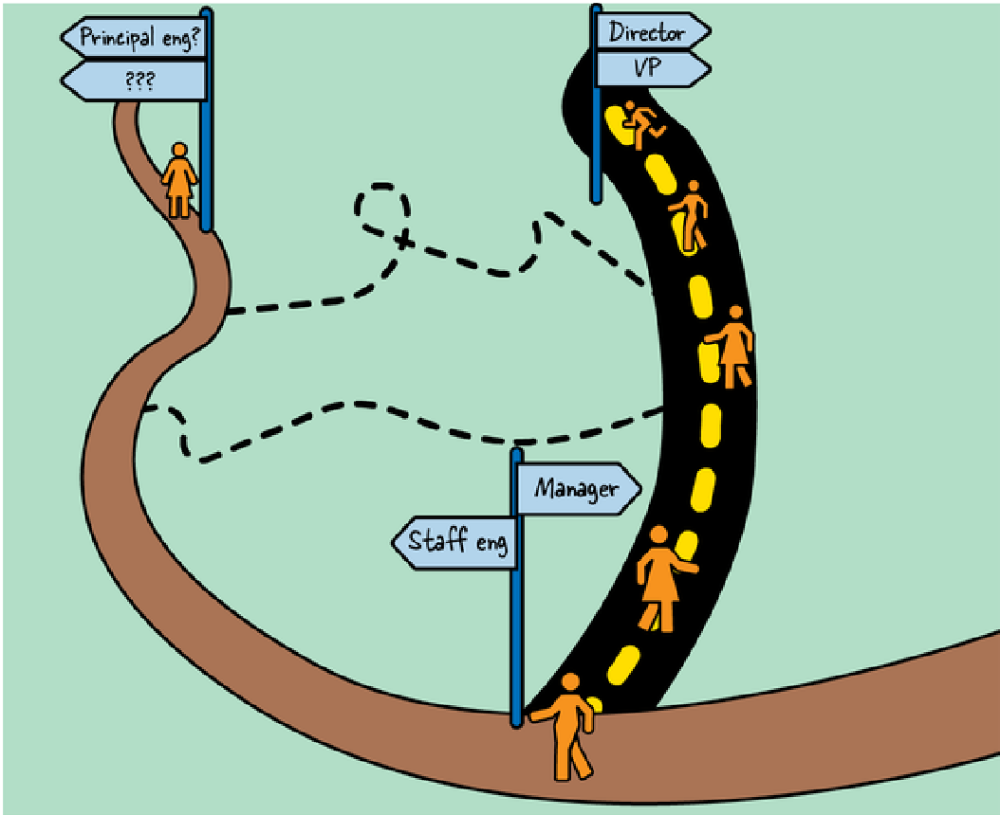

> 图 P-1：道路的岔口。

manager 的路线清晰，而且走的人很多。对任何能清晰沟通、在危机中保持冷静、
能帮同事把工作做得更好的人来说，成为 manager 是常见、甚至可能是默认的
职业一步。你多半认识一些选择了这条路的人。你以前大概也有过 manager，
或许对他们哪里做得对、哪里做得不对有自己的看法。管理也是一门被充分研究的
学科。*promotion* 和 *leadership* 这两个词常常被默认理解为“成为某个人的
上司”，机场书店里满是教你怎么把这份工作做好的建议。所以，如果你沿着管理
路线出发，这条路不会 *轻松*，但你至少对自己这段旅程会是什么样子有个概念。

staff engineer 的路线则没那么明确。虽然如今许多公司允许工程师在不带人的
情况下继续晋升资历，这条“技术路线”仍然泥泞，路标不清。考虑这条路的工程师
可能从未与 staff engineer 共事过，或者见过的担任这个角色的人性格如此单一，
以至于这份工作看起来像高不可攀的魔法。（并不是。这一切都可以学会。）
各家公司对这个职位的期望各不相同，甚至就在同一家公司里，招聘或晋升
staff engineer 的标准也可能含糊不清，并不总是可操作。

而且往往你上了岗，工作也不会变得更清楚。过去几年里，我和许多公司的
staff engineer 交谈过，他们并不太清楚别人对他们有什么期望；也和工程经理
交谈过，他们不知道怎么与向自己汇报的 staff engineer 以及 staff engineer
同级合作。³ 所有这些模糊都可能成为压力的来源。如果你的工作没有被定义，
你怎么知道自己做得好不好？甚至，怎么知道自己到底有没有在做这份工作？

即使期望清晰，实现期望的路也可能不清晰。作为新任 staff engineer，你可能
听说过别人期望你成为技术领导者、做出良好的业务决策、在没有职权的情况下
施加影响——可是 *怎么做*？从哪里开始？

## staff engineering 的三大支柱

我理解那种感觉。在行业里的 20 年间，我一直走在 staff engineer 的路线上，
如今是一名 senior principal engineer，在公司职级阶梯上与 senior director
平级。虽然我很多次考虑过 manager 的路线，但每次都得出结论：是“技术路线”
上的工作给我能量，让我早上想来上班。我想有时间钻研新技术、深入理解架构、
学习新的技术领域。你在什么事情上花时间，就会在什么事情上变得更好，
而我始终想继续在技术的事情上变得更好。⁴

不过，在职业生涯早期，我很难把这条路看明白。当 mid-level engineer 的时候，
我不明白为什么“senior”之上还有职级——那些人整天都在干什么？从我当时所在的
位置，肯定看不到通往那些角色的路。后来，作为新任 staff engineer，我发现了
没人明说的期望和缺失的技能，却不知道该怎么描述，更不用说行动了。这些年里，
我从许多项目和经历——无论成功还是失败——以及出色的同事和其他公司的同行
那里学到很多。现在这份工作对我来说已经说得通了，但我多希望当年就知道
现在知道的这些。

如果你已经走上 staff engineer 这条路，或者正在考虑它，欢迎！这本书就是
为你写的。如果你与 staff engineer 共事，或者管理 staff engineer，
想更多了解这个新兴角色，这里也有很多适合你的内容。在接下来的九章里，
我会分享我学到的关于如何成为出色 staff engineer 的东西。我现在就先警告你：
我不会对每个话题都给出规定性的做法，也不会回答每一个问题：这个角色的大量
模糊性是内在固有的，答案往往就是“要看具体情境”。但我会教你如何驾驭那种
模糊性，理解什么是重要的，并和你一起工作的其他领导者保持方向一致。

我会通过我视为其三大支柱的东西来拆解 staff engineer 这个角色：*全局思考*、
项目 *执行*，以及 *提升* 与你共事的工程师。

### 全局思考

全局思考意味着能够退后一步，采取更宽的视角。意味着越过眼前的细节，
理解你所工作的情境。也意味着思考超出当前的时间，无论是发起以年计的项目、
构建将来容易退役下线的软件，还是预测你的公司三年后会需要什么。⁵

### 执行

到了 staff 层级，你接手的项目会变得更混乱、更模糊。它们会涉及更多的人，
需要更多的政治资本、影响力或文化变革才能成功。

### 提升

资历每提升一级，都意味着更大的责任：提升你影响范围内工程师的标准和技能——
无论那是你的本地团队、组织里的同事，还是全公司或全行业的工程师。这份责任
既包括通过教学和指导施加的有意影响，也包括身为榜样带来的无意影响。

我们可以把这三根支柱看作像图 P-2 中那样支撑着你的影响力。

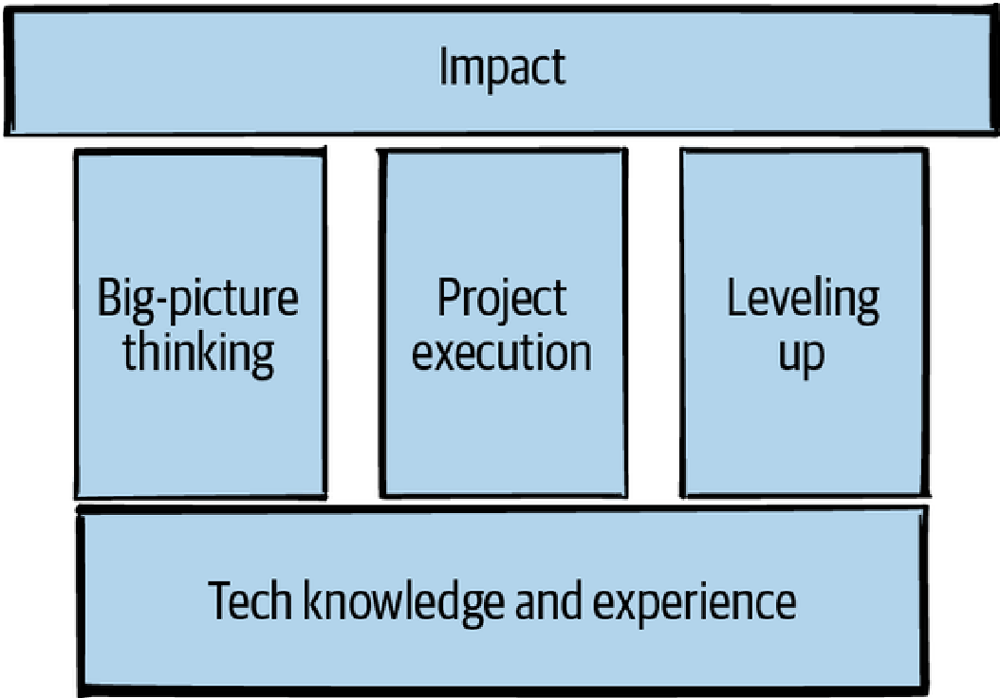

> 图 P-2：staff engineer 角色的三大支柱。

你会注意到，这些支柱坐落在一块由技术知识和经验构成的坚实地基上。这块地基
至关重要。你的全局视角包括理解什么是可能的，以及拥有良好的判断力。在执行
项目时，你的解决方案需要真正解决它们着手要解决的问题。在扮演榜样时，
你的评审意见应该让代码和设计变得更好，你的观点需要经过深思熟虑——
你得是对的！技术技能是每个 staff engineer 角色的地基，而且你会一直锻炼它们。

但只有技术知识是不够的。在这个层级上取得成功和成长，意味着做出的事要超出
单靠技术技能所能做到的。要擅长全局思考、执行更大的项目、提升你身边的
每一个人，你还需要“做人”技能，比如：

- 沟通与领导

- 在复杂性中导航

- 把你的工作放进大局中看

- 指导、提携和委托

- 把问题框定得让其他人也关心它

- 不管你觉得自己像不像领导者，都要像领导者那样行事⁶

把这些技能想象成哥特式大教堂上的飞扶壁（如图 P-3）：它们不取代墙壁——
也不取代你的技术判断——但它们让建筑师能盖出更高、更宏伟、更令人惊叹的
建筑。

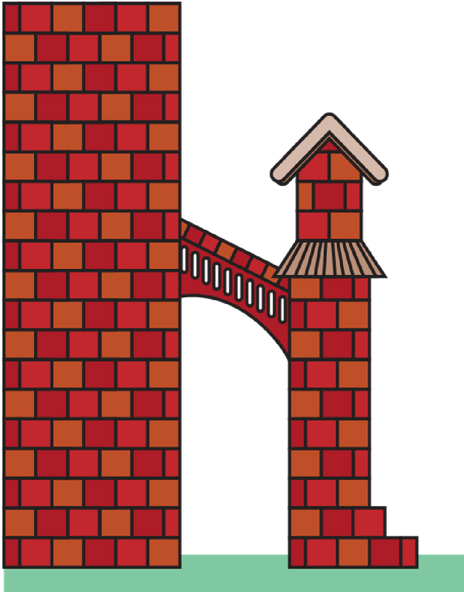

> 图 P-3：领导力技能就像飞扶壁，让我们得以让巨大的建筑保持稳定。

三根支柱中的每一根都有一组必备技能，而你对其中每一项的天资各不相同。
我们中有些人领导并完成大型项目时如鱼得水，却在两个战略方向之间做选择时
感到胆怯；有些人对公司和行业的走向有敏锐的直觉，处理事故时却很快失去
对局面的控制；还有人能让共事的每个人都技能大涨，却很难围绕一项技术决策
建立共识。好消息是，所有这些技能都是可以学会的，你可以把三根支柱都练到娴熟。

本书分为三个部分。

## 第一部分 全局图景

在第一部分里，我们会看思考自己的工作时，如何采取宽广、战略性的视角。
第 1 章会从关于你的角色的大问题开始：别人期望你做什么？staff engineer
是干什么用的？第 2 章我们会进一步拉远镜头，获得一些视角：把你的工作放进
情境中看、在组织里找路，并弄清你的目标是什么。最后，第 3 章讲的是通过创建
技术愿景或技术战略来为全局图景添砖加瓦。

## 第二部分 执行

第二部分进入战术层面，转向领导项目和解决问题的具体实践。第 4 章讲选择
做什么：我会分享一些技巧，包括怎么决定把时间花在哪里、怎么管理你的精力，
以及如何以一种不减损它的方式“花”你的可信度和社会资本。第 5 章讨论如何
领导横跨团队和组织的项目：为成功做好准备、做出正确的决策、保持信息流动。
第 6 章讲如何应对一路会遇到的障碍，庆祝一个成功完成的项目，以及在项目被
取消、干净收尾时做复盘（但仍然要庆祝！）。

## 第三部分 提升

第三部分讲提升你的组织。第 7 章讲如何通过示范优秀工程师的样子、公开学习、
构建有心理安全感的文化，来提高每个人的水平。我们会讲到在事故或技术分歧中
如何做“房间里的大人”。第 8 章讲更有意识地提升同事技能的形式，比如教学和
辅导、设计评审、代码评审，以及推动文化变革。最后，第 9 章探讨如何提升
你自己：如何继续成长，如何思考你的职业生涯。在当前角色之后你去哪里？
我会讨论一些选项。

在继续之前先警告一句：这是一本关于留在技术路线上的书。它不是一本技术书。
我说过，要成为 staff engineer，你需要坚实的技术基础。这本书帮不了你打基础。
技术技能是与领域绑定的，而你既然读到了这里，我假设你已经拥有——或者正在
着手学习——成为你所在领域最资深的工程师之一所需要的任何专业技能。无论对你
来说“技术”意味着编程、架构、UX 设计、数据建模、生产运维、漏洞分析还是
别的什么，几乎每个领域都有大量支持你学习的书籍、网站和课程。

如果你是那种认为只有技术技能才算数的人，在这本书里多半找不到你想找的东西。
但讽刺的是，你也可能是从这本书里收获最多的人。无论你的技术知识多么深、
多么冷僻，你会发现，当你能说服其他人采纳你的想法、提升身边的工程师、
轻松穿过让所有人慢下来的组织僵局时，工作就变得没那么恼人了。这些技能
不容易学，但我保证它们全都学得会，我会在这本书里尽力指出路来。

你想成为 staff engineer 吗？不追求更资深的工程角色完全没问题。转去管理路线
（或者来回切换！）也没问题，或者留在 senior 层级做你喜欢的工作，同样没问题。
但如果你喜欢这样的想法：帮助实现组织的目标，同时继续锻炼技术肌肉，并让你
周围的工程师把手艺练得更好——那就继续读下去。

## O'Reilly 在线学习

> [!NOTE]
> 40 多年来，O'Reilly Media 一直提供技术和商业培训、知识与见解，
> 帮助公司取得成功。
>
> 我们独特的专家与创新者网络通过书籍、文章和我们的在线学习平台分享他们的
> 知识和专长。O'Reilly 的在线学习平台让你可以按需访问现场培训课程、深入的
> 学习路径、交互式编码环境，以及来自 O'Reilly 和 200 多家其他出版社的大量
> 文本和视频。更多信息请访问 https://oreilly.com。

## 如何联系我们

请将有关本书的评论和问题发送至出版社：

O'Reilly Media, Inc.

1005 Gravenstein Highway North

Sebastopol, CA 95472

800-998-9938（美国或加拿大）

707-829-0515（国际或本地）

707-829-0104（传真）

我们为本书设有网页，列出勘误、示例和任何附加信息。你可以通过
https://oreil.ly/staff-eng-path 访问此页面。

发送电子邮件至 bookquestions@oreilly.com，对本书发表评论或提出技术问题。

关于我们书籍和课程的新闻和信息，请访问 https://oreilly.com。

在 LinkedIn 上找到我们：https://linkedin.com/company/oreilly-media。

在 Twitter 上关注我们：https://twitter.com/oreillymedia。

在 YouTube 上观看我们：https://youtube.com/oreillymedia。

## 致谢

感谢许许多多帮助这本书成为现实的人。

感谢 Sarah Grey，所有可能的开发编辑里最好的一位，以及 O'Reilly 其他所有
出色的人，包括策划编辑 Melissa Duffield、制作编辑 Liz Faerm、文字编辑
Josh Olejarz、创作了惊艳封面的 Susan Thompson，以及把我的铅笔涂鸦变成
精美艺术的插画师 Kate Dullea。这是我第一次写书，是你们所有人让这件事
不再可怕。

感谢 Will Larson 的鼓励和支持，以及他帮助 staff engineering 社区第一次
找到了彼此。也感谢 Lara Hogan，当我在她的私信里冒出来，满口“可是我能写
一本书吗？”时，她给了我热情和引荐。感谢你们两位示范了提携是什么样子。

我很幸运，这段旅程中有我认识的最智慧、最有洞察力的两位工程师同行。
Cian Synnott 和 Katrina Sostek，因为你们过去一年的审阅和反馈，这本书好了
不知道多少倍。尤其是你们围绕那些不奏效的部分提出的周到建议，让我受益匪浅。
建设性的批评总是更难，感谢你们付出的时间和精力。

许多人慷慨地拿出时间与我讨论想法、提供反馈或教我新东西。我要特别感谢
Franklin Angulo、Jackie Benowitz、Kristina Bennett、Silvia Botros、
Mohit Cheppudira、John Colton、Trish Craine、Juniper Cross、
Stepan Davidovic、Tiarnán de Burca、Ross Donaldson、Tess Donnelly、
Tom Drapeau、Dale Embry、Liz Fong-Jones、Camille Fournier、
Stacey Gammon、Carla Geisser、Polina Giralt、Tali Gutman、Liz Hetherston、
Mojtaba Hosseini、Cate Huston、Jody Knower、Robert Konigsberg、
Randal Koutnik、Lerh Low、Kevin Lynch、Jennifer Mace、Glen Mailer、
Keavy McMinn、Daniel Micol、Zach Millman、Sarah Milstein、
Isaac Perez Moncho、Dan Na、Katrina Owen、Eva Parish、Yvette Pasqua、
Steve Primerano、Sean Rees、John Reese、Max Schubert、Christina Schulman、
Patrick Shields、Joan Smith、Beata Strack、Carl Sutherland、
Katie Sylor-Miller、Izar Tarandach、Fabianna Tassini、Elizabeth Votaw、
Amanda Walker 和 Sarah Wells。也感谢通过私信、邮件、走廊交谈或热烈的
Slack 讨论与我交流的许多（太多了！）其他人。你们让这本书变得更好，
我感激你们。

感谢一起喝下午茶的人们：你们每天都在展示社区的力量。感谢 Rands Leadership
Slack 上 `#staff-principal-engineering` 频道里的每一个人，感谢你们始终如一的
支持，以及谦逊地分享自己的经历。向我在 Squarespace 的同事和散布各处的
Google SRE 同仁致以巨大的感谢。我从你们所有人身上学到了海量东西。我还要
感谢 Ruth Yarnit、Rob Smith、Mariana Valette 和整个 Lead Dev 团队，
感谢他们与世界分享的精彩技术领导力内容。感谢你们所做的一切。

感谢 Hillfolks 一家，包括那只非常好的狗。能有你们这样的朋友，我幸运而有福。
谢谢你们让我在你们的房车里写作（还在我感染 COVID 时在那里隔离！）。我期待
未来几十年的友谊，也期待看着你们的橡树宝宝长大。

最后，感谢我的全家——我的父母 Danny 和 Kathleen，以及整个大家族——
感谢你们在过去一年里对人间蒸发的我保持耐心。

当然，还有 Joel 和 9 号小姐！我期待周六再见到你们。感谢 Joel（“做人”技能
就是“飞扶壁”这个主意就是他提出的），感谢那些关于工程组织和做好软件的精彩
对话，也感谢所有的三明治。感谢 9 号小姐（我写这本书初稿的时候，她还是
6 号小姐！）：谢谢你的绝妙点子、画画和拥抱。我爱你们这两个小笨蛋。

> ¹ 只不过在面试里，你不应该用“一个同时是宇航员的动物园饲养员”来回答这个问题。
> 成年人的生活限制真多。

> ² 为求简洁，本书通篇使用“软件工程师”这个说法；不过，如果你是系统工程师、
> 数据科学家或任何其他技术从业者，我想你也会发现本书与你相关。这里欢迎所有人！

> ³ 这种情况正在改变。Will Larson、LeadDev 等人一直在做铺路的工作，成果卓著。
> 我会在全书各处链接相关资源。

> ⁴ 我保留以后改变主意的权利。

> ⁵ 本书在谈到雇主时通篇使用“公司”一词，但当然，你也可能在非营利组织、政府机构、
> 学术机构或其他类型的组织里工作。换成对你来说说得通的说法即可。

> ⁶ 还远不止这些。推荐阅读 Camille Fournier 的文章《An Incomplete List of Skills
> Senior Engineers Need, Beyond Coding》。

# 第一部分 全局图景

# 第 1 章 你在这里做什么？

staff engineer 这条路线，或者说“技术路线”，对很多公司来说都是新事物。
各家组织对于自己最资深的工程师应该具备哪些特质、
应该做哪类工作，看法并不一致。
尽管大多数人都同意 Silvia Botros 写下的观点——
技术路线的顶端并不只是“更资深的 senior”——
但对于它究竟是什么，我们并没有共识。
所以本章我们先从存在主义的问题入手：
一个组织为什么会希望非常资深的工程师留下来？
带着这份理解，我们再拆解这个角色：
它的技术要求、它的领导力要求，以及自主工作意味着什么。

staff engineering 角色有很多种形状。
做这份工作有很多正当的方式。
但有些形状更适合某些情境，
而且并不是所有组织都需要所有类型的 staff engineer。
所以我会讲如何刻画和描述一个 staff engineering 角色：
它的范围、深度、汇报结构、主要聚焦点以及其他属性。
你可以用这些描述精确表达你想怎样工作、
你想成长为哪种角色，或者你需要招什么样的人。
最后，由于不同公司对 staff engineer 应该做什么有不同想法，
我们会努力让你的理解与你组织里其他关键人物的理解对齐。

我们先从这个工作到底是什么说起。

## staff engineer 究竟是什么？

如果唯一的职业路径就是成为 manager
（如图 1-1 左侧那家公司所示），
很多工程师就会面临一个严峻而艰难的选择：
要么留在工程角色里、在自己的手艺上继续精进，
要么转去做管理、让职业生涯继续发展。

所以，很多公司现在提供“技术路线”或“个人贡献者路线”，
让职业发展与 manager 角色并行，这是件好事。
图 1-1 右侧的阶梯就是一个例子。

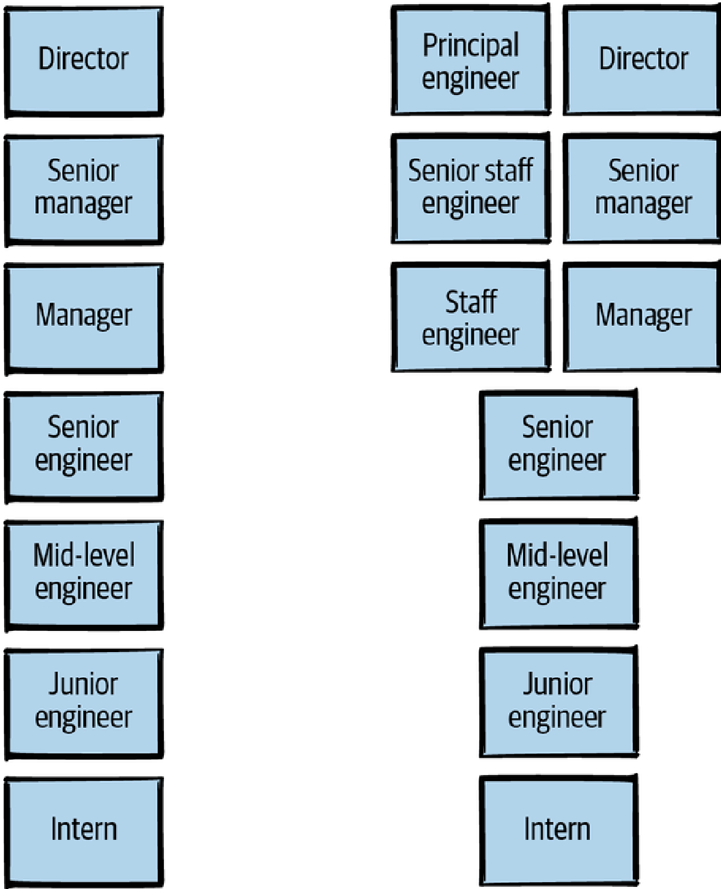
> 图 1-1：两条示例职级阶梯，其中一条有多条路径。
> 左边是单一的管理阶梯，右边是工程师与管理可以并行的双轨阶梯。

各家公司的职级阶梯都不一样，
甚至因此出现了一个网站 *levels.fyi*，
用来比较不同公司的技术路线阶梯。¹
这些阶梯的级数各不相同，每一级的名称也不一样。
你甚至可能看到同样的名称以不同的顺序出现。²
但非常常见的是 *senior* 这个词。
Marco Rogers 是一位在两家公司搭建过职级阶梯的工程 director，
他把 *senior* 这一级描述为职级阶梯的“锚点”级。
正如 Rogers 所说：“下面的级别是让人成长出自主性；
上面的级别则增加影响力和责任。”

senior 有时被看作“终身职”级别：你不需要再往上走。³
但如果你继续往上，就进入了“技术领导力”级别的区域。
senior 之上的第一级通常叫作“staff engineer”，
这也是我在本书中会一直使用的名字。

在图 1-1 的双轨职级阶梯中，
senior engineer 可以选择积累技能，晋升为 manager 或 staff engineer。
晋升之后，从 staff engineer 换成 manager（或者反过来），
会被视为横向调动，而不是进一步晋升。
senior staff engineer 的职级相当于 senior manager，
principal engineer 相当于 director，以此类推；
这些级别在公司职级阶梯里可能还会继续往上。
（为了指代 senior 之上的所有角色，我会使用 *staff+*，
这是 Will Larson 在他的书 *Staff Engineer* 中创造的表达。）

> [!NOTE]
> **关于职级名称**
>
> 我偶尔听到有人坚持认为，职级名称和职级评定不应该（或者确实不）重要。
> 持这种说法的人往往会讲一些听起来很合理的话，
> 说他们公司是平等主义的精英体制，警惕层级带来的危险。
> “我们是自下而上的文化，所有想法都会被尊重地对待。”
> 他们说，而这是一个值得敬佩的目标：
> 职业生涯早期绝不应该意味着你的想法被无视。
>
> 但职级名称确实重要。
> Medium 的工程团队写过一篇博客，列出职级名称之所以必要的三个理由：
> “帮助人们理解自己正在进步，
> 把权威赋予那些可能不会自动获得权威的人，
> 以及向外部世界传达一个预期的能力水平。”
>
> 虽然第一个理由是内在的，
> 而且对每个人来说未必是动力，
> 但另外两个理由描述的是职级名称对其他人产生的影响。
> 无论一家公司是否宣称自己扁平、平等，
> 总会有人对不同级别的人反应不同，
> 而我们大多数人至少都有点在意地位。
> 正如 Colorado State University 创业学临床教授
> Kipp Krukowski 博士在他 2017 年的论文
> “The Effects of Employee Job Titles on Respect Granted by Customers”
> 中所说：“职级名称充当符号，
> 公司用它们向公司内外的人传递员工的特质。”
>
> 我们一直在对人做隐含的判断和假设。
> 除非我们投入大量时间和精力去觉察自己的内隐偏见，
> 否则这些假设很可能会受刻板印象影响。
> 例如，2015 年的一项调查发现，
> 接受调查的 557 名 STEM 领域的黑人和拉丁裔职业女性中，
> 大约有一半曾被误认成清洁工或行政人员。
>
> 当一名软件工程师走进一个有陌生人的会议时，
> 类似的内隐偏见也会起作用。
> 白人和亚裔男性软件工程师常被默认更资深、
> 更“技术”、更会写代码，
> 无论他们是昨天刚毕业还是已经做了几十年。
> 女性，尤其是有色人种女性，
> 则被默认为更初级、更不合格。
> 她们必须在会议中付出更多努力，才能被当作有能力的人。
>
> 正如那篇 Medium 工程博客所说，
> 职级名称把权威赋予那些可能不会自动获得权威的人，
> 并传达他们预期的能力水平。
> 通过锚定期望，
> 它让这些人省下本来要一次又一次证明自己的时间和精力，
> 每周能多出几个小时。
>
> 你现在拥有的职级名称也会影响你下一份工作。
> 和我们行业里的很多人一样，我每天都会收到 LinkedIn 上招聘者的邮件。
> 我这一生中*只有三次*收到过冷不防的招聘邮件，
> 邀请我去面试一个比我当时职级更高的职位。
> 其他所有邮件推荐的职位都恰好是我当时所在的级别，或者更低。

所以，这就是这份工作在职级阶梯上*看起来*的样子。
但让我们看看技术领导力级别*为什么*存在。
我在引言里谈过技术路线的三大支柱：
全局思考、项目执行和提升。

为什么我们需要*工程师*具备这些技能？
我们为什么需要 staff engineer？

### 为什么我们需要能看见全局图景的工程师？

任何工程组织都在不断做决定：
选择技术、决定要构建什么、投资某个系统或者把它下线。
其中一些决定有明确的负责人和可预测的后果。
另一些则是基础性的架构选择，会影响其他每一个系统，
而且没人能声称自己确切知道它们会如何发展。

好的决定需要*背景信息*。
有经验的工程师都知道，大多数技术选择的答案都是“看情况”。
了解某项技术的优缺点还不够——你还需要了解本地的细节。
你想达成什么？你有多少时间、金钱和耐心？
你的风险承受度如何？业务需要什么？
这就是做决定时的背景信息。

收集背景信息需要时间和精力。
单个团队往往为自己的利益做优化；
一个只属于某个团队的工程师可能只顾着实现这个团队的目标。
但那些看起来属于某个团队的决定，
其后果常常远远超出该团队的边界。
*local maximum*——对单个群体最好的决定——
放到更宽的视角下，可能完全不是最好的决定。

图 1-2 是一个例子：
一个团队要在两款软件 A 和 B 之间做选择。
两者都具备必需的功能，但 A 明显更容易搭建：装上就能用。
B 稍难一点：需要花两三个 sprint 折腾才能跑起来，
而没人乐意等那么久。

从团队的角度看，A 明显胜出。他们为什么要选别的？
但其他团队会非常希望他们选 B。
原来，A 会给法务和安全团队带来持续的工作，
而它的认证需求意味着 IT 和平台团队将永远得把它当作特例处理。
选择 A 这个 local maximum，
团队在不知不觉中选了一个对公司整体而言时间投入大得多的方案。
B 对团队来说只差一点点，但整体上好得多。
多花的那两个 sprint 会在一个季度内回本，
但只有团队里有人能从更宽的视角看问题时，这一点才会显现。

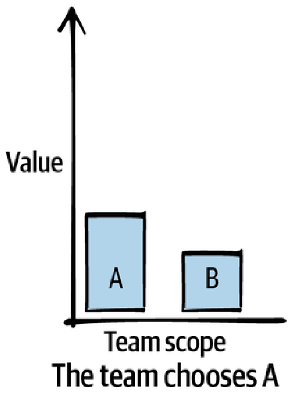
> 图 1-2（a）：局部最优 vs. 更好的决策。
> 只看团队范围（Team scope）时，A 的价值高于 B，团队选择 A。

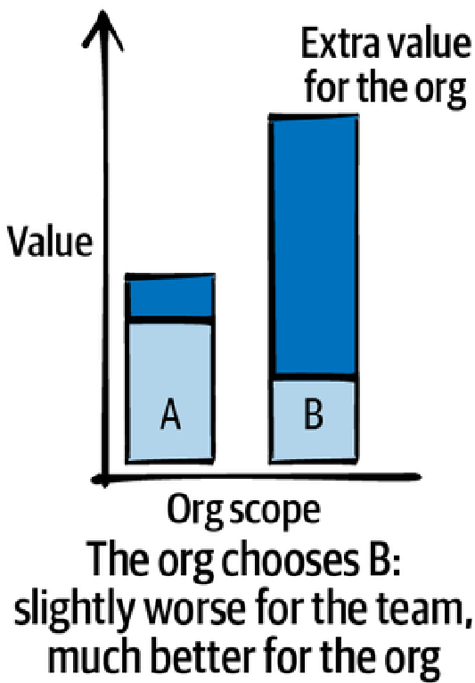
> 图 1-2（b）：把视野放大到组织范围（Org scope）。
> B 为组织带来的额外价值远超 A，于是组织选择 B。

要避免 local maxima，
团队需要能采取*外部视角*的决策者（至少是决策影响者）：
他们能同时考虑多个团队的目标，
选出一条对整家组织或整个业务最好的路径。
第 2 章会讲如何拉远视角、看见更大的全局图景。

和看清当下的全局图景同样重要的是，
能够预判你的决定在未来会如何展开。
一年之后，你会后悔什么？
三年之后，你会希望自己现在就开始做什么？
要想朝着同一个方向前进，各群体需要就技术战略达成一致：
投资哪些技术、在哪些平台上标准化，等等。
这些巨大的决定可能很微妙，而且常常充满争议，
因此做决定的关键在于能够分享背景信息、帮助他人理解它。
第 3 章讲的就是如何作为一个群体选定方向。

所以，如果你想做宽泛而面向未来的决定，
就需要能看见全局图景的人。
但为什么这不能由 manager 来做？
为什么 chief technology officer（CTO）不能直接掌握所有“业务上的事”，
把它们翻译成技术结果，然后把重要的部分传达下去？

在某些团队里，他们可以。
对一个小团队来说，manager 常常可以充当经验最丰富的技术专家，
负责重大决定和技术方向。
在一家小公司里，CTO 可以深度参与每一个决定的细节。
这些公司可能不需要 staff engineer。
但管理权威可能盖过技术判断：
下属可能不敢反驳 manager 的技术决定，即使有更好的方案存在。
而且管理人是件全职工作。
一个投入精力做优秀人员管理者的人，
能留给紧跟技术发展的时间会更少；
而任何真的把自己埋在细节里的人，又更难满足下属的需求。
短期来看这没问题：
有些团队不需要太多关注也能继续走在成功的路上。
但当团队的需求和技术战略的需求出现张力时，
manager 必须选择把注意力放在哪里。
要么团队成员被忽视，要么技术方向被忽视。

这就是很多组织为技术领导力和人员领导力设置不同路径的原因之一。
如果你手下有不止几个工程师，
那么每个决定都要落到 CTO 或某个 senior manager 的桌上，
效率会很低——更不用说还剥夺了别人的权力。
如果经验丰富的工程师有时间深入钻研、
建立背景信息和权威，去设定正确的技术方向，
你会得到更好的结果和设计。

这并不意味着工程师独自设定技术方向。
manager 作为负责给技术项目分配人力的人，
需要参与重大技术决定。
我将在本章后面谈到如何保持工程师与 manager 之间的对齐，
第 3 章讨论战略时也会再谈。

> [!NOTE]
> **架构师呢？**
>
> 在一些公司里，“架构师”是职级阶梯技术路线上的一个级别。
> 在另一些公司里，
> 架构师是抽象的系统设计者，有自己独立的职业路径，
> 与实现这些系统的工程师不同。
> 在本书中，我会把软件设计和架构视为 staff+ engineer 角色的一部分，
> 但要知道，在我们这个行业里这并非普遍如此。

### 为什么我们需要能领导跨多团队项目的工程师？

在一个理想世界里，
组织里的各个团队应该像拼图一样互相咬合，
覆盖正在推进的项目的方方面面。
可在这个理想世界里，每个人都在做一个漂亮的全新绿地项目，
没有既有的约束，也没有需要绕开的遗留系统，
而且每个团队都完全投入到这个项目里。
团队边界清晰、没有争议。
事实上，我们一开始拥有的正是 Thoughtworks 的技术顾问们所称的
“Inverse Conway Maneuver”：
一组恰好与目标架构的各个组件一一对应的团队。
这个乌托邦式项目里困难的部分之所以困难，
只是因为它涉及深入而迷人的研究和发明，
而负责这些部分的人渴望从解决它们中获得技术挑战和职业荣光。

我想去做那个项目，你不想吗？
可惜现实有些不同。
几乎可以肯定，任何跨团队项目涉及的团队在项目构想出来之前就已经存在，
而且还在做别的事情，甚至可能是他们自认为更重要的事情。
他们会在项目进行到一半时发现意料之外的依赖关系。
他们的团队边界有重叠也有缺口，并且会渗透到架构里。
而且项目里那些暧昧不明的困难部分并不是迷人的算法研究问题：
它们意味着在遗留代码里摸索、
和没空又不想做任何改动的团队谈判，
以及揣摩多年前离职的工程师的意图。⁴
就连弄清需要改什么，都可能是复杂的问题，
而且并非所有工作在一开始就能被知道。
如果你仔细看设计文档，你可能会发现它把最需要对齐的关键决定推迟了，
或者一笔带过。

这才是更真实的项目描述。
无论你多么小心地把团队叠加到一个大项目上，
总有一些职责最终没有任何人负责，另一些则被两个团队都声称拥有。
信息流动不起来，或者在传递中被扭曲，引发冲突。
团队做出漂亮的 local maximum 决定，软件项目卡住了。

让项目继续前进的一个办法，
是让某个人对整个项目有主人翁感，而不是只对其中某个部分。
甚至在项目启动之前，这个人就能摸清工作范围、做出一份提案。
项目开始之后，
他们很可能是高层系统设计的作者或共同作者，也是主要联系人之一。
他们维持高工程标准，用自己的经验预判风险、提出尖锐的问题。
他们还会花时间非正式地指导或教练——
或者只是以身作则——项目各个部分的负责人。
当项目卡住时，他们有足够的视角去找出原因并解除阻塞
（第 6 章会详细讲）。
在项目之外，他们讲述正在发生什么以及为什么，
把愿景推销给公司其他部分，
并解释这些工作会带来什么可能、新项目如何影响每个人。

为什么 technical program manager（TPM）
不能做这种建立共识和沟通的工作？
职责上确实有重叠。
但归根结底，TPM 负责的是交付，不是设计，也不是工程质量。
TPM 确保项目按时完成，
而 staff engineer 确保它以高工程标准完成。
staff engineer 负责保证最终的系统健壮，并且与公司的技术版图契合。
他们对技术债很谨慎，
对任何会成为这些系统未来维护者陷阱的东西都很警惕。
TPM 去写技术设计、或者为测试与代码评审设定项目标准，会很不寻常；
也没人指望他们深入一个遗留系统的内部，
去判断哪些团队需要与它集成。
当 staff engineer 和 TPM 在一个大项目上配合得好时，
他们可以是一对梦幻组合。

### 为什么我们需要能有正面影响的工程师？

软件很重要。
我们构建的软件系统会影响人们的福祉和收入：
Wikipedia 上的软件 bug 列表读起来很好——虽然也很让人清醒。
我们从飞机坠毁、救护车系统故障和医疗设备失灵中学到，
软件 bug 和故障可以致人死亡，
而如果假定未来不会出现更多、更大的软件相关悲剧，那就太天真了。⁵
我们需要认真对待软件。

即使利害关系没那么大，我们做软件也是有原因的。
除了少数偏研发性质的情况，
工程组织通常不会只是为了构建更多技术而存在。
它们是为了解决一个真实的业务问题，
或者创造人们会想用的东西。
而且它们希望以某种可接受的质量水平、
对资源的高效利用和最少的混乱来达成目标。

当然，质量、效率和秩序远没有保证，尤其是在有截止日期的时候。
当“做对”意味着慢下来时，
急于发布的团队可能会跳过测试、偷工减料，或者对代码评审敷衍盖章。
而且打造好的软件并不容易，也不直观。
团队需要那些磨炼过技能、见过什么成功什么失败、
并且愿意为做出能用的软件负责任的资深人士。

我们从每个项目里学习，
但我们每个人能反思的经历数量有限。
这意味着我们也需要从*彼此*的错误和成功中学习。
经验较少的团队成员可能从没见过好的软件是怎么做出来的，
或者可能把产出代码当作软件工程中唯一重要的技能。
更有经验的工程师可以通过做代码评审和设计评审、
提供架构最佳实践、创造让大家更快更安全的工具，产生巨大的影响。

staff engineer 是榜样。
manager 可能负责在团队里塑造文化、推行良好的行为、确保标准得到遵守。
但工程规范是由项目上最受尊敬的工程师的行为决定的。
不管标准怎么规定，如果最资深的工程师不写测试，
你就永远说服不了其他人去写。
这些规范不只限于技术影响：它们也是文化的。
当资深的人公开赞赏别人的工作、互相尊重、提出澄清性问题时，
其他人也更容易这么做。
当职业早期的工程师把某人视为自己希望“长大成为”的那种工程师时，
那是一种强大的动力，会促使他们照做。
（第 7 章会探讨如何通过做榜样来提升你的组织。）

也许现在你已经被说服，
工程师应该做这些全局图景、大项目、正面影响的事情，
但问题在于：他们没法在 senior engineer 的编码工作量之上再做这些。
你花在写战略、评审项目设计或设定标准上的每一个小时，
都是没有在写代码、设计新系统，
或者做很多软件工程师可能会被考核的工作。
如果一家公司最资深的工程师整天只是写代码，
代码库会受益于他们的技能，
但公司会错过只有他们才能做的事情。
这类技术领导力必须是做这份工作的人职责描述的一部分。
它不是工作的干扰项：它就是工作本身。

## 道理讲够了。我的工作到底是什么？

staff engineering 角色的细节会因人而异。
不过，我认为这份工作有一些属性是相当一致的。
我在这里把它们列出来，
本书余下部分会把它们当作公理。

### 你不是 manager，但你是领导者

先说最重要的一点：staff engineering 是一个*领导*角色。
staff engineer 常常和 line manager 职级相同。
principal engineer 常常具有 director 的职级。
作为 staff+ engineer，你是同一级别 manager 的对等角色，
而且和对方一样被期待成为“房间里那个成熟的人”。
你甚至可能发现，
自己比组织里的一些 manager 更资深、更有经验。
每当出现“这里应该有人做点什么”的感觉时，
这个“有人”很有可能就是你。

你*必须*成为领导者吗？
mid-level engineer 有时会问我，
要想再往上走，是否*真的*需要擅长“那些软乎乎的人的东西”。
技术技能还不够吗？
如果你是那种因为想做技术工作、不喜欢跟人说话才进入软件工程的人，
那发现自己的志业撞上这堵墙，可能会觉得不公平。
但如果你想继续成长，深入技术本身只能带你走这么远。
要成就更大的事情，就要和更大的人群合作——
那需要更宽的一套技能。

随着你的薪酬提高、时间越来越贵，
人们期待你做的工作更有价值、影响更大。
你的技术判断需要包含业务的现实，
以及任何特定项目是否值得做。
随着资历提升，你会承担更大的项目，
这些项目没有协作、沟通和对齐就无法成功；
如果你说服不了团队里的其他人相信你选的路是对的，
你那绝妙的方案只会让你自己沮丧。
而且不管你愿不愿意，你都会成为榜样：
其他工程师会看着那些头衔很大的人来理解该怎么行事。
所以，不能：你无法避免成为领导者。

不过，staff engineer 的领导方式和 manager 不同。
staff engineer 通常没有直接下属。
他们虽然参与并投入到身边工程师的技术技能成长上，
但不负责管理任何人的绩效、也不审批休假或报销。
他们不能解雇或晋升——
不过团队里的 manager 应该重视他们对其他团队成员技能和产出的意见。
他们的影响以其他方式发生。

领导力有很多形式，你可能不会立刻认出它们。
它可以来自设计“happy path”方案，让其他工程师免于常见错误。
它可以来自以提升他人信心和技能的方式评审其他工程师的代码和设计，
或者指出某个设计方案并不满足真实的业务需求。
教学是一种领导力。
悄悄提高所有人的水平是领导力。
设定技术方向是领导力。
最后，还有作为杰出技术专家所拥有的声誉，
它能让人仅仅因为信任你就认同你的计划。
如果这听起来像你，那你猜怎么着？你就是领导者。

> [!WARNING]
> **你可以是内向的人。但你不能是个混蛋。**
>
> 对很多人来说，“成为领导者”这个想法可能有点吓人。
> 别担心：并非所有 staff 和 principal engineer
> 都必须是“擅长和人打交道的人”。
> staff engineering 给内向者留了充足的空间——
> 即使是最安静的工程师，也能通过自己的判断力和正面影响
> 来设定强有力的技术方向。
> 你不必喜欢和人待在一起才能成为好的领导者。
> 但你必须做一个榜样，而且你必须善待他人。
>
> 我们很多人甚至都有关于“那个工程师”的故事：
> 他因为太难相处，被挪到了角落里。
> 20 世纪 80 年代和 90 年代的科技文化——
> 以 Usenet 等地方的讨论为代表——
> 沉醉于那种难搞、令人不快的软件工程师形象，
> 同事不仅容忍他们的行为，
> 还为了不和他们打交道而做出奇怪的技术决定。
> 但在今天，这样的工程师是一种负债。
> 不管他的产出是什么，
> 很难想象有谁能抵得上其他工程师因此降低的产出和成长，
> 以及因为这个工程师不愿跨团队协作而失败的项目。
> 把这样的人当作榜样，会搞乱整个组织。
>
> 如果你怀疑同事会觉得这个侧栏说的就是你，
> 去看看 Kind Engineering，
> Squarespace 的 SRE manager Evan Smith 在那里给出了具体的建议，
> 教你如何做一个主动友善的同事。
> 你会惊讶于自己多快就能扭转“难相处”的名声。

### 你身处一个“技术性”角色

staff engineering 是领导角色，但它也是一个高度专业化的角色。
它需要技术背景，以及来自工程经验的那些技能和直觉。
要想有正面影响，你需要对什么算优秀的工程有高标准，
并且在你自己构建东西时做出示范。
你对代码或设计的评审应该对同事有教益，
并且应该让你的代码库或架构变得更好。
当你做技术决定时，你需要理解其中的 trade-off，
并帮助别人也理解它们。
你需要在必要时能深入细节、提出正确的问题、并理解答案。
当你为某个行动方案、或技术文化中的某项改变辩护时，
你需要知道自己说的是什么。
所以你必须有一套扎实的技术技能基础。

这并不一定意味着你要写很多代码。
在这个级别上，你的目标是高效地解决问题，
而编程常常不是你时间的最佳用法。
更合理的做法可能是，
你承担只有你能做的设计或领导工作，把编程交给别人。
staff engineer 常常接手含糊、混乱、困难的问题，
只在上面做刚好足够的工作，让它们变得别人可以管理。
一旦问题变得可处理，
它就变成了经验较少的工程师的成长机会
（有时由这位 staff engineer 提供支持）。

对一些 staff engineer 来说，
深入代码库仍然是解决许多问题最高效的工具。
对另一些人来说，写文档可能效果更好，
或者成为数据分析大师，或者开多得吓人的一对一会议。
重要的是问题*是否*被解决，而不是*如何*被解决。⁶

### 你的目标是自主开展工作

当你刚开始做工程师时，
manager 大概会告诉你做什么、怎么做。
到了 senior 级别，也许 manager 会建议你哪些问题值得解决，
然后让你自己去想该怎么办。
到了 staff+ 级别，manager 应该给你带来信息、跟你分享背景信息，
但你告诉他们什么重要，应该和他们告诉你的一样多。
正如 Intercom 的 principal engineer Sabrina Leandro 所问：
“所以你知道自己应该去做有影响、有价值的事情。
但你在哪里能找到这个神奇的高影响工作清单呢？”
她的答案是：“你自己创造它！”

作为组织里的资深人士，你很可能会被拉向很多方向。
捍卫并组织好自己的时间是你的责任。
一周的小时数有限（见第 4 章）。你可以选择怎么花。
如果有人请你做某件事，你会把自己的专业判断带到这个决定里。
你会权衡优先级、时间投入和收益——
包括你想与那位求助者维持的关系——然后自己拿主意。
如果你的 CEO 或其他本地权威人物告诉你某件事需要完成，
你会给这件事适当的权重。
但自主也要求负责任。
如果他们请你做的事最终是有害的，你有责任说出来。
不要默默看着灾难展开。
（当然，如果你想被人听取意见，
你必须先建立起可信、判断准确的声誉。）

### 你设定技术方向

作为技术领导者，
staff engineer 的一部分职责是确保组织有良好的技术方向。
你的组织所提供的产品或服务背后，是一大堆技术决定：
你的架构、你的存储系统、你使用的工具和框架，等等。
无论这些决定是在团队层面做出的，
还是跨多个团队、整个组织做出的，
你的一部分工作是确保它们被做出来、被做好、并且被写下来。
这份工作不是要提出技术方向的所有方面
（甚至不一定需要提出任何方面！），
而是确保存在一个达成一致、被充分理解的方案，
能够解决它要解决的问题。

### 你频繁且高效地沟通

你的级别越高，就越依赖强大的沟通能力。
你做的几乎每件事都涉及把信息从你的大脑传达到别人的大脑，反之亦然。
你越容易被理解，工作就越轻松。

## 理解你的角色

这些公理应该能帮你开始定义自己的角色，
但你会注意到，它们略去了大量落地细节！
事实是，一位 staff engineer 的日常工作可能和另一位非常不同。
你角色的实际情况取决于你公司或组织的规模和需求，
也会受到你个人工作风格和偏好的影响。

这种差异意味着，
很难把你自己的工作和身边的、或其他公司的 staff engineer 做比较。
所以在这一节里，我们要拆解这个角色中一些更易变的属性。

我们先从汇报链条说起。

### 你在组织中的位置在哪里？

我们这个行业还没有就 staff+ engineer
如何汇报到工程组织的其余部分达成任何标准模型。
有些公司让最资深的工程师汇报给首席架构师或 CTO 办公室；
另一些把他们分配给各个组织的 director、各层级的 manager，
或者以上几种的混合。
这里没有唯一的正确答案，但可能有很多错误答案，
取决于你想达成什么。

汇报链条（见图 1-3 的例子）会影响你得到的支持水平、
你能接触到的信息，以及在很多情况下，
你所在群体之外的同事如何看待你。

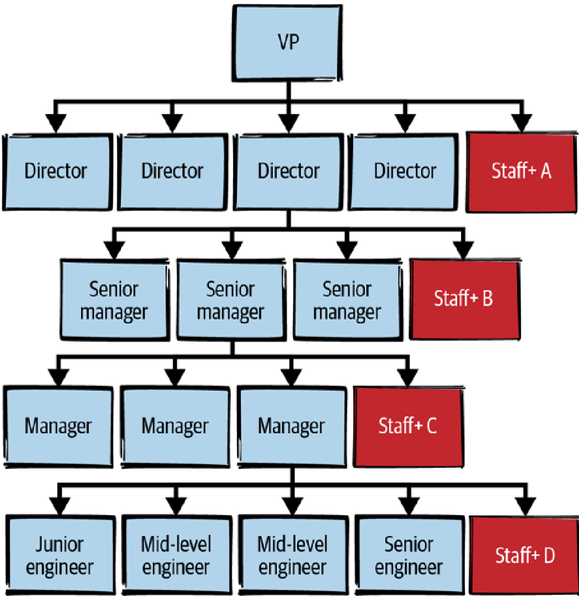
> 图 1-3：staff+ engineer 汇报到组织层级的不同位置。
> 资历相同时，A 比 D 更容易获得组织背景信息、更容易参与 director 级对话。

#### 向“高处”汇报

在组织架构图中向“高处”汇报，比如汇报给 director 或 VP，
会给你宽广的视角。
你得到的信息会是高层的、有影响的，
要求你解决的问题也是如此。
如果你汇报给一位非常能干的资深人士，
观察他们做决定、主持会议或应对危机，
可以是一种独特而有价值的学习经历。

话虽如此，你从 manager 那里得到的时间，
大概会比有一位本地 manager 时少得多。
你的 manager 对你工作的可见度可能更低，
因此可能没法为你发声或帮你成长。
一个与单个团队紧密合作、却汇报给 director 的工程师，
可能会觉得自己和团队其他人脱节，
也可能把 director 的注意力拉进本应在团队层面解决的本地分歧里。

如果你发现 manager 没空、没时间理解你做的工作，
或者被拉进一些并不值得占用他们时间的低层技术决定里，
那么考虑一下：
也许换一位关注点与你更一致的 manager 会让你更开心。

#### 向“低处”汇报

向组织架构图中较低的 manager 汇报，
有自己的优势和劣势。
你很可能从 manager 那里得到更集中的关注，也更可能有人为你发声。
如果你更愿意聚焦于某个单一技术领域，
那么与一位接近该领域的 manager 合作可能会让你受益。

但被分配给单个团队的工程师可能会发现，自己很难影响整个组织。
不管你喜不喜欢，人就是会关注地位和层级——以及汇报链条。
如果你汇报给一位 line manager，你的影响力很可能会小得多。
你得到的信息也更容易被过滤，
并且集中在那个特定团队的问题上。
如果你的 manager 接触不到某些信息，那你几乎肯定也接触不到。

汇报给 line manager 还可能意味着你的 manager 经验比你少。
这本身不是问题，但你可能从 manager 身上学到的东西更少，
而且他们可能对职业发展没什么帮助：他们很可能不知道该怎么帮你。
如果你从别处满足了部分管理需求，这一切也许没问题。⁷
特别是，如果你汇报给组织中层级较低的人，
一定要和 manager 的 manager 做 skip-level 会议。⁸
想办法与组织的目标保持连接。

如果你和 manager 对“怎样才能最有效”有不同的想法，那会产生张力。
你最终可能遇上我前面提到的 local maximum 问题：
manager 想让你去做团队最重要的事，
而组织内部有远比这更大的问题更需要你。
当一个人的绩效评级和薪酬由另一个人负责时，
技术或优先级上的争论就更难在真正平等的场地上进行。
如果你发现这类争论经常发生，
你可能想争取汇报到更高的层级。

### 你的范围有多大？

你的汇报链条很可能影响你的*范围*：
你密切关注并负有一定责任的那个领域、团队或若干团队，
即使你在该领域并不担任任何正式的领导角色。

在你的范围之内，你应该对短期和长期目标有一些影响力。
你应该知晓正在做出的重大决定。
你应该对变化有看法，
并代表那些没有筹码去阻止影响他们的糟糕技术决定的人。
你应该思考如何培养和发展下一代 senior 和 staff engineer，
并且应该注意并提出能帮助他们成长的项目和机会。

在某些情况下，你的 manager 可能期望你
把大部分技能和精力投入到解决他们领域内的问题上。
在另一些情况下，某个团队可能只是你的根据地，
而你把一部分时间花在组织中别处的火情或机会上。
如果你汇报给一位 director，
可能存在一种隐含假设：你在高层运作，
把组织里正在发生的一切工作串联起来；
也可能你被明确分配给了这位 director 的部分团队或技术领域。
要弄清楚到底是哪一种。

当危机发生时，要准备好忽略你的范围：
例如，在故障期间没有“这不是我的工作”这回事。
你还应该对走出自己的日常经验感到自在：
在需要时站出来领导，学习你需要学的东西，修复你需要修的东西。
staff engineer 的价值之一，就是你*不*只管自己那一摊。

尽管如此，我建议你非常清楚地界定自己的范围，
即使它是临时的、随时可能变化。

#### 范围过大

如果你的范围太大（或者没有定义），有几种可能的失败模式。

##### 缺乏影响

如果任何事都可以是你的问题，那么所有事都很容易变成你的问题，
尤其是在一个资深人手不足的组织里。
总会有下一个支线任务：
事实上，很容易创造出一个完全由支线任务构成、根本没有任何真实目标的角色。⁹
小心把自己摊得太薄。
你最终可能没有一个关于自己工作的叙事，
让你（以及雇你的人）觉得自己成就了什么。

##### 成为瓶颈

当有一个被看作什么都能做的资深人士时，
惯例可能变成：每个决定都*需要*他在场。
你不但没有加快组织的速度，反而让它变慢，
因为没有你他们就转不动。

##### 决策疲劳

如果你逃过了试图什么都做的陷阱，
你也会持续付出决定*哪些*事情要做的成本。
第 4 章会讲如何选择你的工作。

##### 缺少关系

如果你合作的团队非常多，
就更难有足够规律的接触去建立那种友好关系，
而那种关系能让事情更容易推进（也让工作更愉快！）。
其他工程师也会受损：
他们得不到“本地” staff engineer
参与他们工作所带来那种指导和帮助。

在一个你可以做字面意义上任何事的工作场所里，很难运转。
更好的做法是选一个领域，在那里建立影响力并取得一些成功。
把时间投入到彻底解决某几个问题上。
然后，如果你准备好了，再转向另一个领域。

#### 范围过窄

也要小心把自己限定得太窄。
一个常见的例子是 staff engineer 属于单个团队、汇报给一位 line manager。
manager 可能真的很喜欢这样——
他们得到了一位经验非常丰富的工程师，
可以承担很大一部分设计和技术规划，
也许还能充当某个项目的技术领导者或 team lead。
有些工程师也会喜欢这样：
这意味着你可以深入团队的技术和问题，理解所有的细微之处。
但要小心范围过窄的风险：

##### 缺乏影响

你可能把所有时间都花在某件并不*需要*
staff engineer 的专业能力和专注的事情上。
如果你选择在单个团队或技术上深入下去，
它应该是一个核心组件、一个关键任务团队，
或者别的对公司非常重要的东西。

##### 机会成本

staff engineer 的技能通常很抢手。
如果你被分配给单个团队，
组织里别处的问题可能不会首先想到你，
或者你的 manager 可能不愿意放你走。

##### 盖过其他工程师

范围狭窄可能意味着没有足够的工作让你保持忙碌，
也可能意味着你会盖过经验较少的人，把学习机会从他们手里拿走。
如果你总有时间回答所有问题、接手所有棘手的问题，
那别人就得不到做这些事的机会。

##### 过度设计

一个不忙的工程师可能会给自己制造工作。
当你看到一个对简单问题的过度设计时，
那常常是某位本应被分配更难问题的 staff engineer 的手笔。

有些技术领域和项目足够深，
工程师可以在那里度过整个职业生涯而机会永不枯竭。
只是要非常清楚你是否身处这样的领域。

### 你的角色是什么形状？

只要大家普遍认同你的工作是有影响的，
你在如何完成它上就应该有很多灵活性。
这包括在一定程度上由你来定义你的工作是什么。
以下是一些可以问自己的问题：

#### 你做事是深度优先还是广度优先？

你更愿意狭隘地聚焦在单个问题或技术领域上吗？
还是更倾向于跨多个团队或技术铺开，
只在某个问题没有你就无法解决时才聚焦于它？
深度优先还是广度优先，很大程度上关乎你的性格和工作风格。

这里没有错误答案，
但如果你在这方面的偏好与你的范围一致，
你会过得更轻松、更愉快。
例如，如果你想影响组织或业务的技术方向，
你会发现自己被那些能采取更宽视角的机会吸引。
你需要待在做决定的房间里，处理影响许多团队的问题。
如果你在承担一个很深的架构问题的同时还试图做这些，
那没有人会赢。
反过来，如果你的目标是在某个特定技术领域成为行业专家，
你就需要能够收窄焦点，把大部分时间花在那一个领域里。

#### 你更倾向于“四种学科”中的哪一种？

Twitter 的 distinguished engineer Yonatan Zunger
描述了世界上任何工作都需要的四种学科：

##### 核心技术技能

写代码、诉讼、产出内容、做饭——
这个角色的典型从业者所做的工作

##### 产品管理

弄清楚需要做什么以及为什么，并维护关于这项工作的叙事

##### 项目管理

达成目标的实际事务：消除混乱、跟踪任务、
注意到什么被阻塞，并确保它被解除阻塞

##### 人员管理

把一群人变成一个团队，建设他们的技能和职业，
指导他们，并处理他们的问题

Zunger 指出，你的级别越高，
这些技能的组合与你的职级名称就越不对应：
“你越资深，这一点就越成立：
人们越来越期望你能轻松流畅地在四种工作中切换，
并且在所有房间里都能发挥作用。”

每个团队、每个项目都需要这四种技能。
作为 staff engineer，你会用到全部四种。
但你不需要在四种上都出色。
我们每个人的天赋不同，喜欢或回避的工作类型也不同。
也许你很清楚自己喜欢哪些、希望永远不需要哪些。
如果你不确定，Zunger 建议和朋友逐一讨论，
让对方观察你谈论它时的情绪反应和能量变化。
如果其中有一种你*真的*讨厌，
一定要和某个乐于承担这方面工作的人一起合作。
无论你是广度优先还是深度优先，
你都会发现，只有核心技术技能，你很难继续成长。

> [!NOTE]
> **超级专才的职业路径**
>
> 在少数罕见的情况下，
> 一个身处*非常关键的业务领域*的强 senior engineer
> 可以在不提前规划、也不影响身边人的情况下获得成功。
> Zunger 把这种角色称为“hyperspecialist”，
> 但他指出：“随着时间推移，你的影响力会衰减。
> senior 级别上纯粹做 hyperspecialist 的工作其实非常少。
> 这不是人们通常会需要的东西。”
> Pat Kua 把这条路称为“the true individual contributor track”，
> 并指出它仍然需要出色的沟通和协作能力。
> 取决于公司，“hyperspecialist”这条路
> 可能被算作 staff engineer 角色，也可能完全独立。

#### 你想（或需要）写多少代码？

这里的“写代码”，你可以替换成自己职业生涯至今的核心技术工作。
这套技能大概是把你带到今天这个位置的原因，
而感觉自己生疏或过时，会让人不舒服。
有些 staff engineer 发现自己最终读了很多代码、评审了很多代码，
但基本不怎么写。
另一些人是项目的核心贡献者，每天都写代码。
还有第三种人，他们会找理由写代码，接一些非关键的项目，
这些项目有趣或者有教育意义，但不会延误项目进度。

如果一天不碰代码你就心神不宁，
那就确保自己不要承担覆盖面很宽的架构类或影响力驱动型角色——
那种角色你就是没时间写代码。
或者至少有个计划，想想怎么挠这个痒，
这样你才能忍住不去接手编码任务、把更大的问题晾在一边。

#### 你的延迟满足能力如何？

写代码的反馈循环舒服地快：
每一次成功的编译或测试运行都会告诉你进展如何。
这就像每天一次微小的绩效评审！
当转向那些没有内置反馈回路告诉你是否走对路的工作时，
可能会让人灰心。

在一个长期或跨组织的项目上，或者在战略或文化变革上，
可能要过几个月——甚至更久——
你才会有强烈的信号判断自己在做的事情是否有效。
如果你会在反馈周期更长的项目上焦虑、压力大，
那就找一位你信任的 manager，
定期、诚实地告诉你进展如何。
如果你需要这个却没有，那就考虑回报周期更短的项目。

#### 你是否还留着一只脚在 manager 这条路线上？

虽然大多数 staff engineer 没有直接下属，但有些人有。
tech lead manager（TLM），有时也叫 team lead，
是一种混合角色：
staff engineer 既是一个团队的技术领导者，也管理这个团队。
这是出了名的难干。
既要对人员负责，又要对技术结果负责，
很难不觉得自己在某一头失败了。
也很难找到时间投入任何一方的能力建设，
我听说过 TLM 们因此哀叹职业发展受损。

有些人先做几年管理角色，再做 staff engineer 角色，
时不时来回切换，让自己两边的能力都保持锋利。¹⁰
我们会在第 9 章进一步讨论这种“钟摆”以及 TLM 角色。

#### 这些原型里有适合你的吗？

在他的文章“Staff Archetypes”中，
Will Larson 描述了他见过的 staff engineering 角色的四种不同模式。
在定义自己拥有或想要的角色时，你可以使用这些原型：

##### Tech lead

与 manager 合作，指导一个或多个团队的执行。

##### 架构师

负责某个关键领域的技术方向和质量。

##### 解题者

一次深入一个困难问题。

##### 左右手

为组织增加领导力带宽。

如果你在这些原型里都没看到自己，
或者你的角色跨越了不止一种，那也没关系！
这些原型不是要规定什么；
它们给我们提供概念，用来表述我们偏好怎样工作。

### 你的主要聚焦点是什么？

我们已经讨论了你的范围和你的汇报链条：
你运作的组织部分的粗略边界，以及你在组织中的位置。
我们也看了你的天赋：你喜欢怎样工作、容易被哪类技能吸引。
但即使你理解了这一切，也清楚自己角色的形状，
还剩一个问题：你打算做什么？

随着影响力增长，你会发现越来越多的人想让你关心各种事情。
有人正在编写一份关于你们组织怎么做代码评审的最佳实践文档，
他们想要你的意见。
你的小组正在集中招聘，需要有人帮忙决定面试考什么。
有个废弃项目，如果有一位 staff engineer
去为它争取资深人士的提携，进展会更快。
而这还只是周一上午。你该怎么办？

在某些情况下，你的 manager 或他们汇报的对象
对你应该聚焦在哪里会有强烈意见，
甚至专门招你来解决某个特定问题。
但大多数时候，你在决定什么最重要时有一定的自主权。
每次你选择做什么，你同时也在选择*不*做什么，
所以要深思熟虑地对待你接手的事情。

#### 什么才是重要的？

在职业生涯早期，
如果你把某件事做得很好，而这件事后来被证明没必要，
你依然做得很好。
但到了 staff engineer 级别，
你做的每件事都有很高的机会成本，
所以你的工作必须*重要*。

我们来展开一下。
“你的工作必须重要”并不意味着你只能做最炫、
最光鲜的技术和 VP 支持的项目。
最重要的工作往往是没人看得见的工作。
你可能连说明它的必要性都很费劲，
因为你的团队还没有关于它的良好心智模型。
它可能涉及收集并不存在的数据，
或者在十年没被碰过的陈旧代码或文档里摸索。
还有各种各样脏活累活只是需要有人做完。
有意义的工作有很多形式。

弄清楚你在解决的问题为什么具有战略重要性——
如果不重要，就去做别的。

#### 什么需要你？

还有一种类似的情况：
一位资深人士把自己投入到
任何 mid-level engineer 都能接手的编码项目上。
你会把它做得很出色，
但很可能同时存在一个资深级别的问题，
是 mid-level engineer 解决不了的。
用我孩子有一天很有深意地冒出来的一个说法：
“你不会在唯一的桶里种草。”

要警惕选择那些已经有很多资深人士在做的项目。
弄清楚还有谁在做这个问题，
以及他们看起来是否可能成功解决它。
有些项目甚至可能因为多来了一位领导者而变慢。¹¹
一般来说，如果做“明智的理性之声”的人
比真正敲代码（或者你项目里的对应工作）的人还多，
那就别插进去。
尽量选一个真正需要你、并且会从你的关注中受益的问题。
第 4 章会给你一些决定该接哪些项目的工具。

## 在范围、形状和主要聚焦点上达成一致

到现在，你应该对自己角色的范围是什么、形状如何、
当下在做什么有了相当清楚的画面。
但你确定这幅画面和其他人的一致吗？
你的 manager 和同事对 staff engineer 是什么、
你有权做什么决定，以及无数其他大问题的期待，
可能和你相差很远。
如果你以 staff engineer 的身份加入一家公司，
最好一开始就把这些全部理清。

我从朋友 Cian Synnott 那里学到一个方法：
写下我对工作的理解，并与 manager 分享。
回答“你在这里做什么？”这个问题可能会让人有点发怵。
要是别人觉得你做的东西没用，或者觉得你做得不好怎么办？
但把它写下来能消除含糊，
而且你会早早发现，你对这个角色的心智模型是否和别人一致。
现在发现总比绩效评审时发现好。

下面是一个这样的角色描述可能长什么样，
对象是 Ali——一位广度优先、架构师原型的 staff engineer，
正在协助（但不是领导）一个大型跨团队项目。

> [!NOTE]
> **Ali 做什么？**
>
> *总览*
>
> 这份文档列出我未来一年的工作计划。
> 我的主要聚焦点是 retail sales engineering 团队的成功。
> 我预计会把大约一半时间花在这个团队的技术方向上，
> 大约 30% 用于参与 NewMerchandising 项目，
> 剩下的时间分配在跨组织事务（API 工作组、架构评审）
> 和社区工作（面试、指导 senior engineer）之间。
> 作为 incident commander 轮值的一部分，
> 我预计每 10 周里有一周 on-call。
>
> *目标*
>
> 1. 通过引导技术方向、参与组织目标设定和预判风险，让 retail sales 成功。
> 2. 作为顾问/力量倍增器，推动 NewMerchandising 成功。
>    识别威胁项目目标的工程实践风险和缺口。
> 3. 为 retail sales engineering 的各个团队主持架构评审。
> 4. 通过参与其他销售团队的架构评审，改善跨工程的规划。
> 5. 在需要时（例如事故或冲突期间）充当额外的领导力带宽。
>
> *示例活动*
>
> - 提出能应对 retail sales 风险与机会的 OKR。
> - 就 NewMerchandising 的目标和交付物达成一致，并确保各团队对齐。
> - 为组织内各团队提供架构咨询。
>   推荐架构方案，并为 RFC 贡献章节，
>   但不太可能成为任何一份 RFC 的主要作者。
> - 指导/教练 senior engineer。
> - 面试 senior 和 staff engineer 候选人。
>
> *成功是什么样子？*
>
> - retail sales 正在构建能支撑未来五年规模的系统。
> - NewMerchandising 项目在四个团队
>   共享目标理解的情况下持续推进。

不要执着于把它做到完美：做到足够对就行。
描述你的目标并不意味着你被禁止做别的事情。
但它是关于你原本打算做什么的一个不错的提醒，
也能帮你留意自己是否真的在做你声称是自己的工作的那件事。

你可能会比自己预想的更早发现聚焦点需要改变。
世界局势会变，或者你的优先级会变。
如果是这样，就用新信息写一份新的角色描述。
把自己的期望讲清楚，能确保大家在同一页上。

### 那是你的工作吗？

你的工作是让你的组织成功。
你可能是一位技术专家、一名编码者，或者隶属于某个特定团队，
但归根结底，你的工作是帮助你的组织达成目标。
资深的人会做很多不在他们核心职责描述里的事。
他们最终甚至可能做在任何人的职责描述里都说不通的事！
但如果那就是项目成功所需要的，考虑去做。

我在 Squarespace 的一些同事讲过 2012 年那天的故事：
他们的数据中心停电了，
他们把燃料扛上 17 层楼梯，让数据中心保持在线。
“搬运一桶桶柴油”不出现在大多数技术岗位的职责描述里，
但那就是让网站保持在线所需要做的事（而且它奏效了！）。
多年前我工作的 ISP 机房被淹时，
工作变成了用垃圾桶排成一条传递链把水位降下去。
还有 2005 年一个 Google 项目延期、
我们又没有足够的硬件人手时，
我连续几天的任务是在 San Jose 的一个数据中心里上架服务器。
为了让项目成真，你需要做什么就做什么。

当然，通常这种“不是我的工作”的工作没那么戏剧化。
它可能意味着聊上十来次话，
去解除一个你的团队所依赖的项目的阻塞；
或者注意到你的新工程师迷路了，去问问他的情况。
再强调一次：
你的工作归根结底是你的组织或公司需要它是什么，它就是什么。
下一章我会谈如何理解那些需求是什么。

## 小结

- staff engineering 角色按定义就是含糊的。
  你的角色是什么、对你意味着什么，要靠你自己去发现和决定。
- 你很可能不是 manager，但你在一个领导角色里。
- 你也身处一个需要技术判断和扎实技术经验的角色。
- 明确你的范围：你负责和影响的领域。
- 你的时间有限。刻意选择一个重要、
  并且不会浪费你技能的主要聚焦点。
- 与你的管理链条对齐。
  讨论你认为你的工作是什么，看看你的 manager 认为它是什么，
  理解什么被看重、什么真正有用，并明确设定期望。
  并非所有公司都需要所有形状的 staff engineer。
- 你的工作有时会是一种奇怪的形状，这没关系。

## 注释

> ¹ 我还推荐 *progression.fyi*，
> 它收录了各家科技公司发布的大量职级阶梯。

> ² 我听说过一家公司按资历顺序使用“senior”“staff”“principal”这三档，
> 但后来被另一家使用“senior”“principal”“staff”的公司收购了。一片混乱。
> 收购方把所有“staff”改成“principal”，把所有“principal”改成“staff”，
> 没人高兴。staff 和 principal 都把这视为降级。职级名称很重要！

> ³ 我喜欢我朋友 Tiarnán de Burca 对 senior engineer 的定义：
> 到了这个级别，一个人可以停止晋升、
> 在余下的职业生涯中保持当前的生产力、能力和产出水平，
> 而且如果他离开，仍然算“令人惋惜的流失”。

> ⁴ 他们当时*在想什么*？这真的是他们打算做的吗？
> 当然，未来的团队也会这样问我们。

> ⁵ Hillel Wayne 的文章“We Are Not Special”指出，
> 很多过去需要仔细调试物理设备的工程方案，
> 现在改用“软件补丁”来凑。
> 我一直真心惊讶于到目前为止软件造成的重大致命事故如此之少。
> 我可不想依赖我们一直走运。

> ⁶ 这就是我不喜欢给经验丰富的 staff engineer 安排编码面试的原因。
> 如果你已经到了这个级别，
> 要么你代码写得很好，
> 要么你已经学会用自己的其他肌肉解决技术问题。结果才重要。

> ⁷ 我推荐 Lara Hogan 关于打造“manager Voltron”的文章。

> ⁸ 如果 skip-level 会议在你们公司不常见，
> 你可能需要说清楚：你不是想削弱或“打小报告”你的 manager；
> 你想理解更大群体的优先级，
> 并建立能帮你产生最大影响的人脉。
> 理想情况下，你的 manager 会理解 skip-level 会议的价值并帮你安排。

> ⁹ side quest 是电子游戏里与主线任务无关的一部分，
> 你可以选择去做，换取金币、经验值，或者纯粹为了好玩。
> 想象一下很多这样的场景：
> “呃，我本来正要杀进重兵把守的堡垒
> 打败那个一直蹂躏这片土地的恶魔，
> 不过好吧，我可以先帮你找猫。”

> ¹⁰ Charity Majors 的“The Engineer/Manager Pendulum”
> 是关于这个话题的极好文章。

> ¹¹ 你会听到有人引用 Brooks 定律：
> “向一个已经延期的软件项目增加人力，会让它更延期。”
> 虽然 Brooks 本人称这“是一种离谱的过度简化”，但它有道理。
> 见 Fred Brooks 的 *The Mythical Man-Month*（Addison-Wesley）。

# 第 2 章 三张地图

作为 staff engineer，你需要广阔的视野。每当你要应对事故、主持一场会议、
或者给某位被指导者提建议时，你都需要了解共事的是什么人、
事情的利害有多大。当你提出一项战略或推动项目前进时，
你会想要理解你的组织如何运转、一路上可能撞上哪些困难。
而除非你能跳出日常事务，看清大家本该往哪里去，
否则你无法就“该做什么”做出好的选择。

在第 1 章里，我们拉远镜头，从全局图景上看 staff engineer 是什么、
组织为什么需要他们。我们定义了几条有助于理解 staff 角色的公理，
随后请你做一次实地调查，梳理你自己角色的若干方面：汇报链路、
范围、工作偏好，以及当前的主要关注点。如果你此前对自己这份工作
还没有全局图景，希望现在有了。不过，如果你徒步旅行过，
或者在一个陌生城市里认过路，你就会知道：弄清自己站在哪里只是开始。
建立方位感，还意味着了解你周边的环境。

## 呃，有人带地图吗？

本章里，我们将通过画几张地图，来描述你工作和所在组织的全局图景。
地图因用途不同而有不同形式：比如说，你不会把海拔、选区和地铁导航
都塞进同一张地图里。所以，与其把所有信息叠加成一张密不透风、
无法阅读的图，不如分别构建三张不同的地图。它们不会是完美的模型，
却是很有用的工具，能帮你思考工作，并向自己提问：你在哪里、
你的组织如何运转、大家到底想做成什么。

你可以把它当作一次思维练习——只是用来思考你的工程组织的一个比喻——
也可以真的动手把这几张地图画出来。和同事对一对笔记，
看看你们在哪些地貌和地标上意见不一致，这会既令人开悟，也挺好玩。

最终我们会得到这三张地图：

### 定位地图：你在这里

我们先从你在更大范围的组织和公司中的位置说起。上一章我们谈过你的范围，
但要真正理解那个范围，你得看到范围之外有什么。边界上有什么？
当你远远拉远镜头，与别处相比，你那一方天地有多大？
把它想象成新闻台在主播身后投出的那种地图：提醒你某个地方在哪里，
并把它放进背景里理解。

你需要定位地图，是因为当你深陷某项工作之中时，很难对它保持客观。
除非你能维持全局视角，否则你所在小圈子的关切和决策，
在你眼里会比在大尺度上看时重要得多。所以我们会尝试一些
获得这种视角的技巧。你要对自己诚实：你关心的那些项目里，
哪些真的会出现在公司的大地图上，哪些不一直放大到最细就根本看不见。

### 地形图：了解地形

第二张地图讲的全是怎么在地形中导航。如果你要穿越一片地界，
对前方有扎实的了解，你就能走得更远、更快。本节我们会看看
地图上的一些危险：组织断层线上的峡谷与山脊、
没人料得到的地方冒出的古怪行政边界，以及人人都绕道躲开的难缠人物。
如果前方有流沙、有要提防的北海巨妖，或者一片无法穿越的沙漠、
里面尽是先前旅人被晒白的骸骨，那你在出发前最好把这些都标得清清楚楚。

尽管有危险和困难，你也可能发现已经存在可通行的路径。
要发现这些路径，包括理解你组织的“性格”、你的领导偏好怎样工作，
弄清决策是如何做出的，并揭示官方的和“影子”的两套组织架构图。

### 藏宝图：X 标出宝藏所在

第三张地图有一个目的地，以及通往那里的一路上若干个路标。
它标出你要去哪里，并列出旅途中的一些停靠点。航行也许凶险，
但只要你有地图，就能看出自己是否正在靠近那个巨大的红色 X。

揭示这张地图意味着采取长期视角，并评估你工作的目的。
每个项目本身就是一个目标，还是通往真正目标的路上的一块里程碑？
有时你会发现根本没有目的地，或者有好几个互不相容的目的地。
当没人宣布宝藏是什么，或者大家在怎么到达上各执一词时，
staff engineer 可以产生巨大的影响：创造愿景或战略、做出决策，
或者干脆为组织画一张全新的藏宝图。不过我扯远了。
现在我们看的是揭示*既有*的全局图景。创造*新的*全局图景
将发生在第 3 章。

### 驱散战争迷雾

这三张地图已经存在于你的组织中，只是被遮蔽了。当你加入一家新公司时，
全局图景的大部分对你来说完全未知。开始一份新工作，
很大一部分内容是建立背景认知、了解新组织如何运转、弄清每个人的目标。
把它想象成电子游戏里的战争迷雾：在地图上你尚未探索的部分，
你看不到等待着你的东西。当你四处侦察时，迷雾被驱散，
你对地形的了解更清晰了，知道周围有什么，是否有狼群来袭扰你的村民。
你可以着手揭示三张地图中被遮蔽的部分，
并找到办法让这些信息容易被别人理解。例如：

- 你的定位地图能帮你确保与你合作的团队真正理解自己在组织中的目的、
  他们的客户是谁，以及他们的工作如何影响他人。
- 你的地形图能帮你凸显团队之间的摩擦与空白，并打开沟通的通道。
- 你的藏宝图能帮你确保每个人都清楚知道自己到底想达成什么、为什么。

有些地图区域你可以通过日常学习来清除，另一些则要有意识地去清除。
本章的一个核心主题是：了解情况有多么重要——持续拥有背景信息，
对正在发生什么心里有数。了解情况既需要技巧，也需要机会，
而且你可能要下一番功夫，才能开始看见自己此前没看见的东西。

先从技巧说起。疫情期间，我在爱尔兰乡下待了几个月，
和住在那里的朋友们一起做了很多次自然漫步。起初，
我以为自己看到了所有能看到的东西：一丛毛地黄、一棵橡树，
那些显眼又美丽的东西。但朋友们看到的东西比我多。
他们会在我根本不会多看一眼的一摊泥前停下来，指出松貂的脚印。
他们会挑出我当成杂草忽略的叶子，说它味道鲜美、带胡椒味，
是采食者的宝贝。就连孩子们都能发现小野花，
或者扑向一片我径直走过的野草莓。为什么他们能看到这些我看不到的东西？
因为他们学会了留心观察，而且知道自己在找什么。

留心观察意味着对影响你项目或组织的事实保持警觉。
这也意味着不断从周围的噪声中筛出信息。如果你能训练自己的大脑
说出“这挺有意思！”，并记住以后可能用得上的事实，
你就会开始为地图添上细节，并培养出综合新信息的能力。

什么样的事实有用？任何能帮你或他人获得工作背景、在组织中导航，
或向目标推进的事实。举几个例子：

- 公司全员大会上关于即将到来的营销推广的介绍，也许暗示着
  你的系统即将迎来你还没准备好的巨大流量高峰。
- 你的 director 让你接手一个你没时间做的项目，
  而你知道组织里哪些 senior engineer 已经准备好迎接
  能发挥、拓展他们技能的机会。
- 公司优先级的转变，可能意味着你曾考虑过但搁置了的某个平台
  已经变成一笔极佳的投资。
- 你的数据库突然不见了，而你记得收到过一封关于网络维护的邮件。

时间久了，你会习惯消息在组织里如何传播、自己该关注什么。
你会知道哪些邮件必须读、哪些会议必须参加。如果你的大脑天生不“粘”、
记不住这类信息，我建议你给自己一个挑战：把以后可能有用的信息记下来，
就为了让留心观察成为习惯。把收集背景信息当成工作中要培养的一项技能。

但“注意到”也只能做到这个程度。如果你接触不到影响你工作的决策和讨论，
留心观察也帮不上忙。你可能每天都被会议、邮件和 Slack 里
那些令人遗憾的 @here 消息包围，但还有很多别的信息，
除非你知道它存在，否则你连问都无从问起。
你怎么才能进入“事情发生的那间屋子”？本章我会分享一些策略。

## 定位地图：获得全局视角

随着资历增长，要真正产生影响，意味着能够把你的工作放进更大的背景中，
并认识到你的观点深受你所站位置的影响。
（图 2-1 提供的全局视角也许有点过头了。）

> 图 2-1：银河系的定位地图（原银河系图片由 Jean Beaufort 制作，CC0）。

当然，与你共事的其他人也各有各的观点：他们的“你在这里”标记
会落在地图上的别处。如果你想做出好的决策，
就需要能从其中一些别的角度去看。

你在任何领域里沉浸得越久、对范围内工作的细微之处了解得越多，
它对你来说就越丰富、越复杂。当你理解了其中的人、问题和目标，
你会更加聚焦于它们。这种聚焦带来深度和理解，但也伴随着一些风险，
对 staff engineer 尤其如此。

现在我们来看看其中四种风险。

### 优先级排得糟糕

当你周围的人在意的都是同一批事情时，很容易放大这些事情的重要性。
相比之下，你团队之外存在的问题可能开始显得简单或不重要。
这就是为什么你会看到团队做出我在第 1 章谈过的那些 local maximum 决策：
local maximum 开始让人觉得*真的*很重要。你盯着自己团队的问题越久，
它们就显得越特别、越独特，越值得用特别而独特的方案来解决。
有时确实如此！但真正全新的问题并不常见。如果你先查一查
已有做法和现成方案，就能少花点时间重复造轮子。

### 失去同理心

人很容易过度聚焦，忘了世界上还有别的东西，
或者开始觉得与你那个丰富而细腻的领域相比，其他技术领域不过尔尔。
这就像你开始透过一枚鱼眼镜头看世界：眼前的东西被放得巨大，
其余一切都挤到边缘。你可能因此对其他团队在做的工作失去同理心：
“他们解决的那个问题很简单。我一个周末就能搞定。”

你使用的措辞、你选择解释而把哪些留作默认、你为别人设想的动机，
都会受你视角的影响。这就是为什么工程师和非工程师沟通起来那么难。
图 2-2 讲了一个似曾相识的故事，
说明我们多么容易误解别人对你领域的了解程度。

失去同理心在事故中也会显现：团队可能沉迷于问题中好玩的技术细节，
忘了还有用户在等着系统恢复上线。

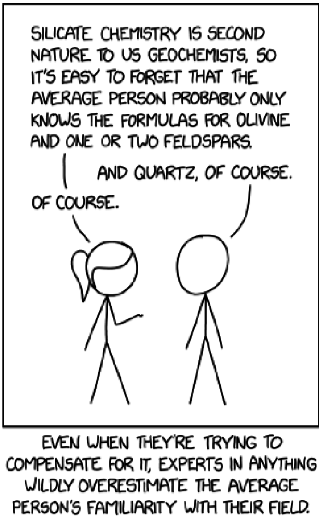
> 图 2-2：人们很容易对别人知道什么失去正确判断（来源：
> https://xkcd.com/2501，作者 Randall Munroe）。

### 对背景噪声充耳不闻

如果说一种失败模式是你团队的关切显得比别人的更重要，
另一种则恰恰相反：你根本不再注意到问题！如果你已经和同一个
脏兮兮的配置文件或坏掉的部署流程共处了几个月，你可能习以为常，
不再把它当成需要修的东西。同样，你可能没注意到，
某种起初只是略烦人的东西已经慢慢恶化。也许某个问题快要演变成危机了，
你却根本不再注意到它，因此无法客观判断自己需要多快做出反应。¹

### 忘了工作是为什么

身处孤岛，可能意味着你与公司里其他地方正在发生的事失去了联系。
如果你的团队当初接手某个项目是为了解决一个更大的目标，
那么即使这个目标已经不再重要、或者已经用别的方式解决了，
项目可能仍在继续。如果你只做项目中自己那一小块，
很容易不再去想这个项目是为了什么。你会滑入这样一个世界：
每个人都做着自己那一小块，没有人觉得自己对最终结果负责。
你也可能看不清自己所做之事的伦理，
发现自己在做一件若退后一步、想想全局就不会真正认同的事。

### 看到更大的图景

打开你公司的组织架构图，看看你所在的团队和其他你在意的团队
与组织其余部分是如何连接的。当你扩展了自己能看到的地图范围，
你自己的团队可能显得小了很多，你的“你在这里”图钉
也许感觉离热闹中心很远。但没有全局视角，你就做不出有影响力的工作。
本节我们来看看另外一些看到更大图景的技巧。

#### 以局外人的视角

多年前我刚加入一个 infrastructure 团队、还是最新来的人时，
几周后我的同事 Mark 评论说：“每次我描述我们的系统时，
你脸上都有一种表情……”的确，我认为有几个老旧系统需要替换，
但我没意识到自己的看法如此明显（而且无礼！）地写在脸上。
两年后，团队的努力让架构大有改善。我们为这份工作感到自豪。
我觉得它相当不错！直到来了一个新人，而……
他们的看法也相当明显地写在脸上。那时我已经成了团队内部人。
我需要一个更新的“新人”来帮我重新看见问题。

当团队里的新人看着一团乱麻的架构或一堆技术债时，他们没有历史背景。
正如我的同事 Dan Na 所说，新人总能看见问题。他们没有经历那些渐变，
也没见过“温水煮青蛙”：他们看到的只是现状本身。没有先入之见，
他们可以自由地四处打量并发问：“这里到底在发生什么？
这其中有什么是管用的吗？”

> [!WARNING]
> 作为新人并不是可以粗暴无礼的许可。事后说“这太糟了！他们干吗不直接……”
> 很容易。但要有谦逊，假设现状有其存在的充分理由。Amazon 的
> principal engineer 群体在其社区信条之一里承认了这一点：
> “尊重先于你存在的东西”。

作为新人是你获得完整局外人视角的最佳机会，但作为 staff engineer，
你应该一直尝试保持这种视角。你需要能够把自己的团队
当成自己不在其中那样来看，并对看到的东西诚实。
你的技术决策是不是只有那些忘了团队之外还有世界的人才觉得合理？
如果你们全都停下手上的工作，要过多久别人才会注意到、才会在意？
你是否沉迷于技术，忘了最初的目标是什么？*一切还好吗？*
接下来四节给出一些像局外人那样看问题的技巧。

#### 逃离回音室

当你发现自己身处一个回音室，遇到的每个人都持同一套观点时，
一旦你与其他团队的同行建立联系，发现他们的一些看法就……很不一样，
这会让你很受冲击。

在 infrastructure 岗位上、在技术栈底层干了十多年后，
第一次和 product engineering 团队共事，着实冲击了我的认知体系。
他们行动快、敢冒险，认为打造出客户喜爱的功能，
至少和让这些功能拥有磐石般的可靠性同样重要。我们的争论
动摇了我一些根深蒂固的信念，也让它们变得更细腻。

主动去结识其他团队的同行，是你工作中重要的一部分。
和其他 staff engineer 建立友好的关系。努力达到这样的程度：
你们能彼此说真话，而且不会引起争执，因为你们已经积累了足够多的善意。
这也包括理解其他团队对你所在团队的任何负面看法——
如果你开始看出他们的评论中哪些有道理，你的工作会做得更好。
把其他 staff engineer 看作你的团队，和你是其中一员的任何团队一样。

同样的原则适用于跨组织的情形。在图 2-3 和图 2-4 中，
我把每位 staff engineer 描绘成范围限定在单个 group，
把每位 principal engineer 限定在一个 organization。
实际结构会各有不同，但重点在于：成为比你自己的 team 或 group
更大的某个事物的一部分，这样你就能对大家在做什么有更客观的看法。

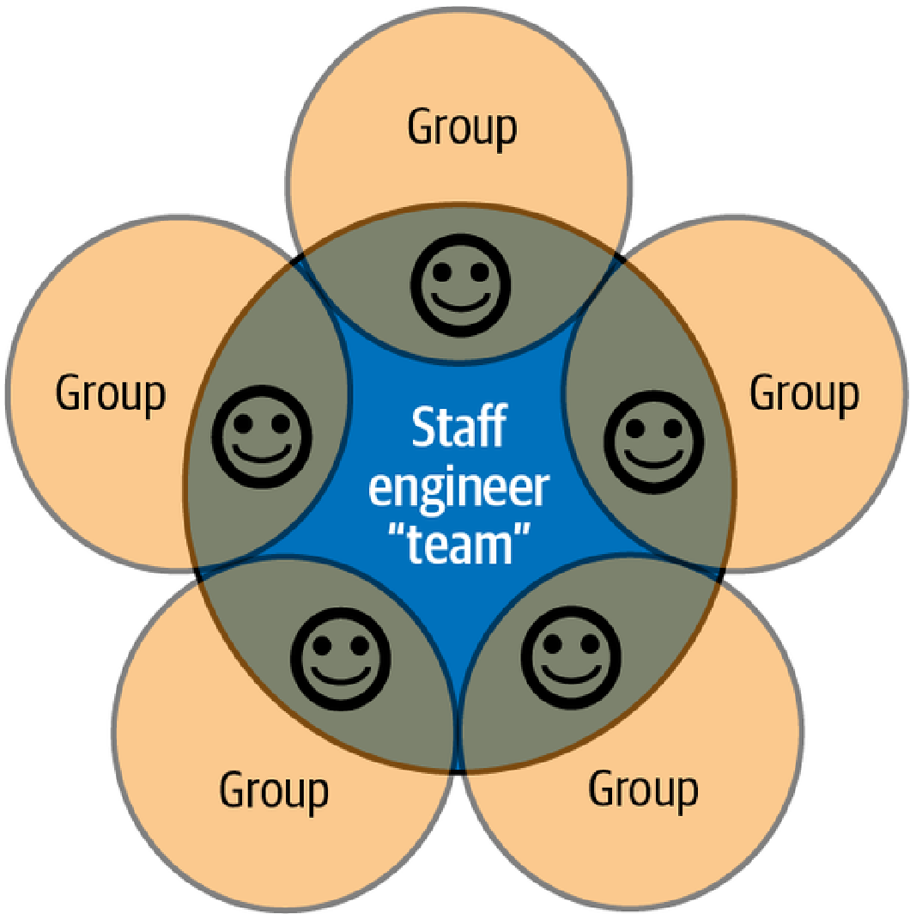
> 图 2-3：一个示例软件工程组织。这里每个 group 都包含多个 team。
> 在这家公司里，每位 staff engineer 的范围都是单个 group，
> 他们既认为自己是所属 group 的一员，
> 也属于一个更大的、虚拟的 staff engineer“团队”。

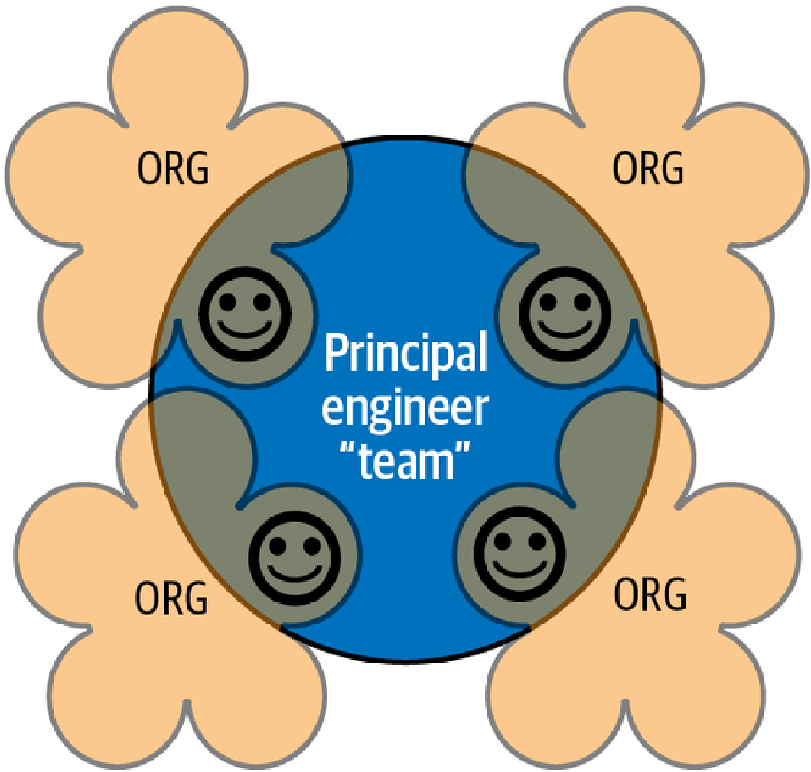
> 图 2-4：一家公司内部的多个工程组织，每个组织都有一位 staff engineer。
> 每位 principal engineer 都在自己的 org 里，
> 同时也是一个虚拟的 principal engineer 团队的一员。

走出工程领域：和产品、客户支持、行政等人员建立关系。
如果你的工作影响他们，或者他们的工作影响你，就去和他们友好相处，
理解他们的观点。这会给你一种全新的方式，
来思考什么对你的部门或你的业务重要。

#### 什么才是真正重要的？

和非工程师交朋友，在另一个方面对你的视角有好处：作为工程师，
很容易沉迷于技术。但技术只是达成某个目的的手段。归根结底，
你来这里是为了帮雇主实现其目标。你应该知道那些目标是什么。
你应该知道什么才是重要的。

一家创业公司对什么重要的定义，会和一家巨型科技巨头或一个本地
非营利组织不同。成熟产品与早期产品的需求也不同。
有些目标——因而有些项目——比其他的更重要。图 2-5 展示了一个
感觉像你整个宇宙中心的项目，放到更大的图景里看时，可能远没有那么重要。
优先次序会随时间变化，所以要理解*此刻*什么重要。如果你的客户
正大批流失，因为你的产品缺少竞争对手拥有的核心功能，
那现在大概不是推动大家关注技术债的时候。如果一切顺风顺水，
你在预期增长，那也许正是确保地基牢固的好时机。

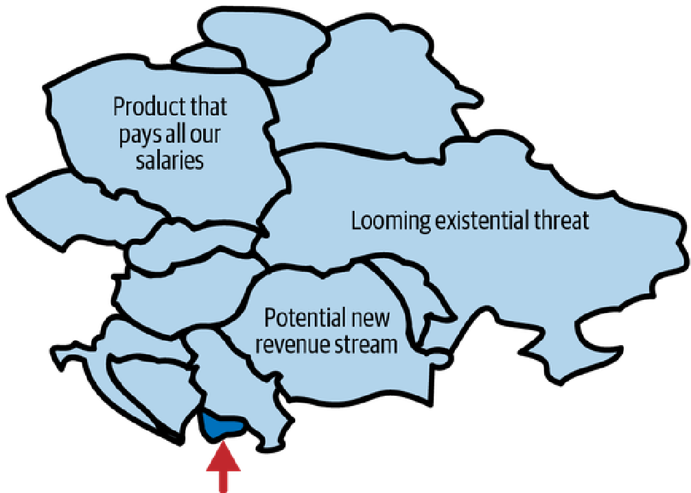
> 图 2-5：把你的项目放进全局图景。那个升级也许是你所在组织
> 最重要的工作，但看更大图景的人不会觉得它重要。
>
> 你正试图让所有人关心的那个升级

一家公司的目标不止于它公开宣称的目标和指标；还包括“继续存在下去”、
“有足够的钱给所有人发工资”和“拥有良好的声誉”。
我的同事、Squarespace 工程运营负责人 Trish Craine 把这些称为
“永远成立的目标”。这些是你公司显而易见的需求，
只有到了危险的时候才真的会被说出来。你的组织提供的产品或服务
应该能正常工作。它的客户应该想用它。部署它不应该慢得让人痛苦。
既要了解明确的目标，也要了解隐含的目标。

> [!TIP]
> 随着时间推移，你公司的优先级会变化，你地图上的一些部分会重新起雾。
> 为了跟上什么重要，要关注你所在团队和其他团队的全员大会，
> 主动约你manager的manager做 skip-level 一对一，
> 并找机会和你所依赖的客户或团队面对面。
> 如果你对自己工作为何重要（或是否重要）缺乏业务背景，就去要。

也要留意目标何时发生变化，因为那可能意味着你的范围或关注点也该变了。
你没有在做*最*重要的事，这没关系，但你做的事不应是在浪费你的时间。
如果你没法向自己解释清楚，为什么你做的事需要一个 staff engineer，
那你可能在做错误的事。

#### 你的客户在意什么？

Honeycomb 的 CTO Charity Majors 经常分发写有“用户不高兴时，
几个 9 都不重要“的贴纸。这里的”几个 9”指的是
service level objective（SLO），一种衡量系统可用性的常见机制。
“三个半 9 的可用性”意味着 99.95% 的时间里服务都处于运行状态。
SLO 很有用，但正如 Majors 指出的，它们并不能说明全部情况。
因为“可用”的含义由谁定义呢？

Mohit Suley 是 Microsoft 的一位 engineering manager、
此前的 principal engineer，他讲过自己的团队如何追查并联系
那些不稳定、导致他们的搜索引擎 Bing 无法访问的 ISP。
坏掉的并不是 Bing，但正如 Suley 所说：“用户不会去区分 DNS 服务、
ISP、你的 CDN 还是你的 endpoint，不管那是什么。归根结底，
有些网站能用，有些不能用。”你需要从用户的角度衡量成功。
（如果你的客户是你公司内部的其他团队，这依然适用！）
如果你不理解你的客户，你就没有对什么重要的真正视角。

#### 你的问题以前是否被解决过？

Amazon 那条“尊重先于你存在的东西”的信条里有一条提醒：
“许多问题本质上并不新。”如果在创造新东西之前研究别人已经做过什么，
你会想出更好的方案。记住，你的目标是解决问题，
而不一定要写代码来解决它。在动手构建新东西之前，
花点时间了解已经存在什么——组织内部和外部都要看。²

> [!TIP]
> **业界视角**
>
> 去了解业界其他人是怎么解决你正在处理的问题的。你偏好的出版物
> 和资源取决于你的兴趣，但我这里有一些在架构、技术领导和
> 软件可靠性方面觉得有价值的。我很喜欢 LeadDev 和 SREcon 大会，
> 尽量多参加。LeadDev 有一个（写作时）新设的大会 track，
> 叫 StaffPlus。我在主持他们的一些活动，所以没法完全客观，
> 但我认为它非常棒！
>
> 在线讨论方面，我喜欢 Rands Leadership Slack：
> #architecture 和 #staff-principal-engineering 两个频道是宝藏。
> LeadDev Slack 的 #staffplus 频道在活动期间也非常活跃。
>
> 我订阅每月的 InfoQ Software Architects' Newsletter，
> 以及 the VOID report 和 SRE Weekly。我读 Raw Signal 通讯，
> 每周补一点管理者视角。我也热切期待每季度的 Thoughtworks Radar。
>
> 无论你在哪个领域，都会有它自己的出版物。用它们来维持视角，
> 并发现那些需要时可以深入探索的新想法。它们也会帮你持续学习。

## 地形图：穿越地形

定位地图提供全局视角，但你不能靠它导航。你需要另一张地图：
一张显示地形的地图。

地质学家研究*板块构造*，即地球岩石圈的巨大板块（见图 2-6）
随时间相互挤压移动，形成山脉与海沟，并引发地震和火山活动的方式。
团队构造有类似的性质。当各块职责领域彼此碰撞时，
它们形成一种组织地形，有重叠、有冲突，有山脊、有深渊。

> 图 2-6：地球主要构造板块的简化地图。（改编自：Scott Nash，
> 公有领域，https://oreil.ly/UdeNz）。

重组会破坏需要紧密协作的团队之间的沟通。负荷沉重的团队会固守阵地、
竖起屏障。一位新的高级领导可能引发一场地震，一夜之间重塑地貌。
在组织中导航（见图 2-7）需要一张地形图。

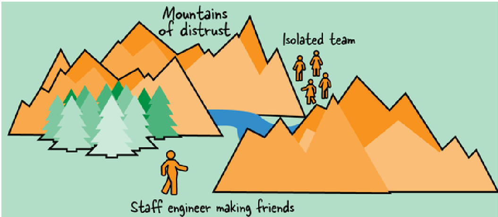
> 图 2-7：一位 staff engineer 在崎岖地形中穿行。

### 崎岖地形

我们来探讨一下，如果你没有一张详细的地形图就上路执行任务，
会遇到哪些困难。

#### 你的好点子得不到支持

在“需要变革”这件事上你是*对的*，这连一半的仗都算不上。
你还得说服别人你是对的，而更难的，是让他们*在意*你是对的。
这意味着要知道如何在组织内积累势头：搞清楚谁能提携你的想法、
或者帮它传播，以及你如何把它推过终点线，让它“成真”。

##### 直到走到那里，你才知道难在哪里

许多看起来显然可行的旅程，都有一个没人想出如何越过的关键点。
你也许正试图攀登一处曾让许多前辈折戟的悬崖。
staff engineer 往往能越过经验较少的工程师越不过的障碍，
别人失败的地方，你也许能成功。但如果你知道过去人们在哪儿卡住，
你就能换一条路，或者先解决问题中最难的部分，
这样别人才会相信这个项目值得他们投入。

##### 一切都更费时间

除非你了解自己的组织如何运作，否则本该直截了当的决策
会拖上几个月甚至几个季度。组织规划周期的运作机制也会影响你。
一年中有些时候，为一个新项目争取人力、或者把所有人团结在某个目标下
会更容易。如果你在每季度的 engineering OKR 刚定下来之后
就宣布一项倡议，你会打一场硬仗，
而且可能要等上一个季度才能看到任何朝目标推进的进展。

### 理解你的组织

工程师有时把组织能力贬为“政治”，但这些能力是好工程的一部分：
考虑系统中的人、清楚自己在解决什么问题、理解长期后果，
以及在优先级之间做 trade-off。如果你不懂得如何在组织中导航，
每一次变更都会困难得多。

本节我会讲一些驱散迷雾、理解你公司地形的方法。
这要从评估你文化的若干方面开始，包括哪些东西会被写下来、
信任程度有多高、人们是乐于改变还是犹疑不前，以及新倡议从哪儿来。
这些认识会决定你对一次普通旅程的预期：取得进展会容易吗？
之后，我们来看一些会出现在你地形图上的障碍和捷径。

#### 文化是什么样的？

每次我面试求职者，他们的第一个问题往往是：“这里的文化是什么样的？”
我过去很难回答；该从哪儿说起呢？关于组织文化，已经有整本整本的书了。
不过现在我觉得，大多数时候人们真正想问的是这几个问题：

- 我能有多少自主权？
- 我会感到被接纳吗？
- 犯错会安全吗？
- 影响到我的决策，我会参与其中吗？
- 在我的项目上取得进展会有多难？
- 这里的人……你懂的……友善吗？

你公司的文化不是决定这些问题答案的唯一因素：
个人和领导层也是其中一部分。但组织确实有各自鲜明的“性格”，
所以我们来谈谈文化。

如果你的组织发布过价值观或原则声明，那能帮你看出领导者最在意什么。
但这些价值观是愿景式的：公司真正的价值观体现在每天实际发生的事情里。

要更了解你公司的工程文化，这里有几个问题，
你可以问问自己，或者和同事讨论。其中大多数问题没有对错之分。
如果你的公司完全偏向某一端，做事会很难腾挪，
但两端之间有很大一片可以成功的空间。

##### 保密还是开放？

每个人知道的有多少？在保密的组织里，信息是硬通货，没人轻易送人。
每个人的日历都是私密的。Slack 频道仅限受邀者。通常你开口要，
就能拿到某个东西的访问权，但你得先知道它存在！当所有信息
都是“按需知密”时，就更难想出创造性的解决方案，
也更难真正理解为什么某件事不奏效。

在开放的组织里，你能接触到一切（连乱糟糟的初稿也是！）。
你可能会因为要挑选消费哪些信息而决策疲劳。你可能分不清
哪些文档是官方的、需要行动，哪些只是早期的想法。
而且开放的信息可能带来更多戏码：坏主意更难被悄悄扼杀。

了解围绕分享的文化预期至关重要。在把知识锁得很紧的文化里，
如果你把老板私下告诉你的事情转述出去，就会失去他们的信任。
在更开放的公司里，如果你藏着信息、或者不确保每个人都知道
正在发生什么，就会被认为工于心计或不可信赖。

##### 口头还是书面？

哪些内容靠口耳相传，哪些会被写下来？决策涉及多少书面工作和评审？
在有些公司，在走廊闲聊时做出重大决定很常见，或者你的同事
建了一个巨大的新功能，你直到它上线（或者因为它被 on-call 呼叫）
才知道。在另一些工作场所，每一次软件变更都附有正式规格说明、
需求、签字确认和审批清单，一行代码的改动你都可以预期要花一个季度。

好在大多数工作场所都介于两者之间。如果你那里偏好快速交谈，
那么当你花时间去把决策写下来时，可能会遭到反对——
而超过一页的设计文档根本没人会读。更大、更成熟的公司
往往对变更更为审慎。如果你在这样的公司却不建变更管理工单、
不写设计文档，就会显得马虎、不负责任。我待过的一个团队
有一顶牛仔帽，它会落到最近做了点过于“狂野西部”之事的那个成员桌上。
这是种亲昵的玩笑，但也是个很好的提醒。

##### 自上而下还是自下而上？

倡议从哪儿来？完全自下而上的文化，是员工和团队感到有权自己做决定、
并为他们认为重要的倡议奔走的文化。然而，当这些倡议需要更广泛的支持时，
它们就会慢下来。如果各团队在方向或优先级上意见不一，
缺少一个中心的“决策者”可能导致僵局。

另一方面，在完全自上而下的公司里，人们会觉得选择倡议、
采取果断行动容易得多。不过那些决策不会是最好的，
因为它们缺少本地背景信息。工程师很可能感到受控制，
也不会被赋予对随时出现的变化做出反应的能力。

staff+ engineer 应当相当自主、自我驱动，但要确认你的组织也这么认为：
如果你的manager期望批准你把时间花在哪里，而你不去同步，就可能引发冲突。
如果你习惯了请示批准、或者习惯了被分配工作，
然后换到一家自下而上的公司，你会被认为缺乏主动性，什么事都难做成。

如果你了解自己的组织通常如何运作，你也会知道该先把自己的想法
带给一线同事、先争取他们的支持，
还是该从说服你所在部门的 director 开始。

##### 快速变化还是深思熟虑的变化？

更年轻的公司往往决策迅速，会突然转向去尝试新机会。
随着公司变大、变老，它们改变方向需要的时间更长。“快”的组织
可能排斥承接像两年期迁移这样的长期项目。慢的组织则会错过
那些唾手可得的改进机会。

取决于你所在的地方，你需要用不同的方式表述你的倡议。
如果你所在之处快如闪电，你会想要一条能立刻显现价值的渐进路径。
在更审慎的环境里，你需要证明自己已经通盘考虑过整个计划。
这也和口头/书面文化紧密相连。

##### 后门渠道还是正门？

不同团队的人怎么互相交流？信息和请求可能有正式的通道，
但你的社交文化也会加上非正式渠道。如果跨团队的人彼此友善，
他们有问题时会发私信，喝咖啡时分享想法。³

如果一个团队里的工程师能直接去找另一个团队的对口同事聊，
那么做跨两个团队的决策就会容易些。在有些地方，
真正把事做成的唯一方式，是通过和团队里某人的私人渠道“走个后门”。
如果更常见的做法是提工单然后等，或者把一个协作想法
沿着你的管理层级一路往上提，直到你和另一个团队有共同的manager，
那么一切都会更慢——但也会更可预测、更公平。

要了解在你的组织里什么算是常规做法。
如果人人都严格只用正式渠道，那么不按次序提问会被视为失礼，
插队也会让人对你评价不佳。如果后门渠道是办事的常规方式，
你可能要等上一个月才有回复，而你本来只要和那个一直在公司宠物
邮件列表上欣赏你猫咪照片的人聊两句就行。

##### 已分配还是有余力？

每个人都有多少时间？如果团队人手不足、超负荷工作，
那么任何不在现有产品路线图上的新想法，你都会很难找到落脚点——
最快、最省事的回应就是不看请求直接说不。任何能在不需要大投入的
情况下腾出时间的倡议，你的影响力都会最大。你最可能成功的情况是：
你可以独自完成、或者只需一点帮助，
不需要让一屋子忙碌的人对任何新事物做出承诺。

不忙的团队可能看起来更好合作，但它们有另一个问题：
未被充分分配的工程师很少会长期保持这种状态。
如果有很多空闲产能可用，那么很可能正有一场“寒武纪大爆发”：
一堆互相竞争的新奇草根倡议正在扎根，每个都有少量拥趸。
如果你选一个刚起步的项目，帮它冲过终点线，
并说服别人也聚集到它周围，你的影响力会更大。

##### 流动还是结晶？

权力、地位和声誉从哪儿来？你怎么获得信任？有些组织，
尤其是学术界以及大型老牌公司，有着清晰的等级：同一群人、
以同样的配置一起向上攀升，并且有一套相当固定的结构
来沟通、做决策和分配“好项目”。每个人就像晶格中的一个节点：
只要周围的人往上升，你也会往上升。这类群体里的资深人士
常常会说，他们从不主动谋求晋升：他们待在原地，接到一个项目，
得到群体的支持，轮到自己时就获得了晋升。

这种等级制度对年轻、小巧、有拼劲的公司来说是可憎的，
它们自称差不多算是 meritocracy。对此我们还是现实一点：
成功依然取决于能否获得机会和提携，
所以它深受刻板印象偏见、小圈子偏袒和其他认知偏差的影响。
（更多内容见网站 Is Tech a Meritocracy?。）“流动”型公司
给你更多空间去改变自己在结构中的位置，但要想晋升，
你多半得主动去拼。你可能会在一个个团队之间流动，
寻找高影响力的工作，好按自己的节奏前进。
如果你坐等别人给你指派项目，那你会等很久。

在晶格稳固的团队里，至关重要的是理解自己在等级中的位置，
并且知道轮到你、拿到一个能把你带到下一层级的项目的时刻何时到来。
如果你提出接手某件已经被指定为别人晋升项目的事，你会惹恼别人——
一位试过这么做的朋友说，他们的老板看他们的眼神，
“就像我提议去偷银餐具一样”。

试试图 2-8 里的滑块示意图，想想这七种属性如何影响你组织的运作方式。
如果你想促成文化变革，常常可以——只要有坚定的努力——
随着时间把滑块朝某个方向推一推。至少要知道它们现在在哪，
这样就能避开一些逆着主流文化做事会踩到的坑。

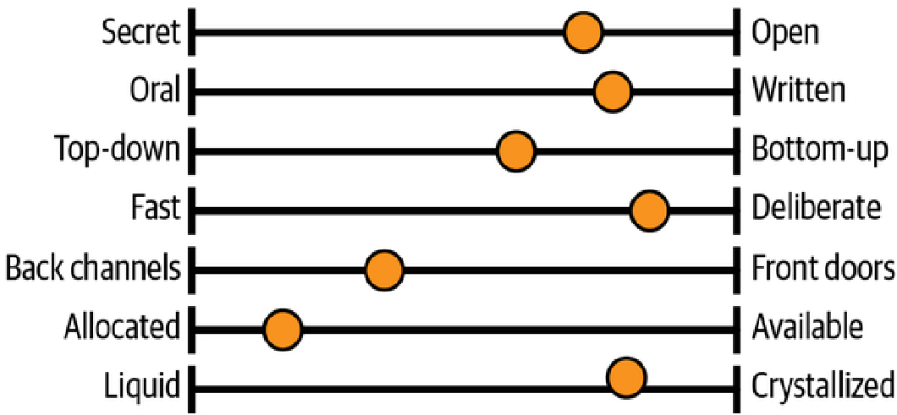
> 图 2-8：大多数公司在每项属性上都会处在中间某个位置。

#### 权力、规则还是使命？

这里还有一面观察你文化的透镜：你的领导者认为什么重要？
在他 2005 年的论文“A Typology of Organisational Cultures”中，
社会学家 Ron Westrum 写道：

> 通过象征性的行动以及奖励与惩罚，领导者传达出他们认为什么重要。
> 这些偏好随后成为组织全体员工的关注焦点，因为奖励、惩罚和资源
> 都追随着领导者的偏好。与这些偏好一致的人会得到奖励，
> 不一致的人则会被搁置一旁。大多数长期成员凭直觉就知道
> 如何解读时代的信号，而那些不会的人很快就会得到代价高昂的教训。

Westrum 用三个类别对组织及其对信息流动的影响作了分类（见表 2-1）：

##### 病态型

一种低合作的文化，其中权力和地位就是目标，人们囤积信息；
用 Westrum 的话说，“一门心思扑在个人权力、需求与荣耀上”。

##### 官僚型

一种以规则为导向的文化，信息通过标准渠道流动，变革困难；
Westrum 写道，这里关注的是“规则、职位和部门地盘”。

##### 生成型

一种以使命为导向、高信任、高合作的文化，信息自由流动；
Westrum 称之为“专注于使命本身”。

> 表 2-1：Westrum 组织类型模型：组织如何处理信息（Ron Westrum，
> “A typology of organisational cultures”）BMJ Quality & Safety 13,
> no. 2 (2004), doi:10.1136/qshc.2003.009522。

| 病态型 | 官僚型 | 生成型 |
| --- | --- | --- |
| 以权力为导向 | 以规则为导向 | 以绩效为导向 |
| 低合作 | 适度合作 | 高合作 |
| 信使被枪毙 | 信使被忽视 | 信使受过训练 |
| 责任被推卸 | 职责狭窄 | 风险共担 |
| 不鼓励搭桥 | 容忍搭桥 | 鼓励搭桥 |
| 失败 → 找人背锅 | 失败 → 公正 | 失败 → 探究 |
| 新事物被碾碎 | 新事物 → 麻烦 | 新事物被落地 |

DevOps Research and Assessment（DORA）小组（现属 Google Cloud）
已经表明，强调信息流动的高信任文化有更好的软件交付绩效。
越来越多的软件公司志在拥有生成型文化，这并不奇怪。
这意味着鼓励合作的跨职能团队、从免责的事故复盘中学习、
鼓励试验、承担经过计算的风险，以及打破孤岛。
如果你的组织是这样运作的，你分享信息和取得进展都会更容易些。

如果你清楚自己的工作场所是以权力、规则还是使命为导向，
你就会发现事情更容易办成。对人们愿意分享多少信息、配合到什么程度、
肯花多少时间帮忙、会不会支持新想法有所感知，
能让你在穿越地形时更安全、更少受挫。如果你知道自己身处官僚机构，
那么提前规划、守规矩、尊重指挥链，你会更成功。
如果你在一个病态的组织里，就少冒风险——真要冒险时也要护好自己。
推车走过鹅卵石路比走过平整路面更难。如果你知道路会颠簸，
你就会多留出时间，也更不容易对处境中你无法控制的部分生气。

#### 留意地标

这把我们带回地形图。理解你组织的文化，
能让你大致判断一次普通旅程会有多容易、多困难。但要导航，
你还需要理解障碍、旅途中困难的部分，以及捷径。
以下是我所了解的各类组织地形中的一些地标。

##### 深渊

公司的板块构造会在团队和组织之间形成深渊。例如，图 2-9 描绘了
专注于产品的软件工程团队与为它们提供服务的 infrastructure、
platform 或 security 团队之间可能形成的峡谷。团队的文化、规范、
目标和预期各自演化，造成缺口，使沟通、决策和解决争端都变得困难。

> 图 2-9：infrastructure 组织与 product engineering 组织之间的深渊。

即使在同一个组织内部，也会形成较小的深渊。
各团队被界定的职责边界很少能完美对齐，
项目工作与信息可能在团队之间的空隙中丢失。

##### 堡垒

堡垒是那些似乎铁了心不让任何人把项目做成的团队或个人。
也许你需要他们的批准，却约不到他们的时间。又或者他们是守门人，
似乎还没弄清你在请求什么，就已经判定你的想法不好。
虽然有些堡垒是小心眼的暴君，但大多数是好意的。他们守门是因为在乎。
他们想保持代码或架构的高质量，让所有人都安全。

要通过堡垒的大门，你可能需要带上一份来自守门人敬重之人的提携信物，
或者知道放下吊桥的口令。（常见口令包括：证明你已经缓解了
所提议变更的所有风险、填完冗长的检查清单或容量估算，
或者用可接受的答案回复海量的文档评论。）另一种选择是旷日持久、
血腥的战斗，其中你要为每一点争辩，把别人也拖入战局——
打赢这样一场仗可能是一场惨胜，让你几乎后悔当初去试。
或者你可以放弃，绕远路绕过堡垒，让你的旅程更复杂，
并失去本来可以从守门人那里得到的智慧。

##### 争议地带

要以让每个团队都能自主工作的方式划分团队边界，是非常难的。
无论你的 API、契约或团队章程多有主见，
总不可避免地会有一些工作被多个团队都认为是自己的，
而在这些争议中周旋会让人觉得风险很大。

我曾参与一个项目，需要把一个关键系统从一个平台迁移到另一个平台。
迁移这个特定系统只占我项目的不到 5%，所以我不想在这上面花太多时间——
但当我寻找愿意为它负责的人时，我碰了壁。
这个系统的归属散落在三个团队之间，
每个团队负责它行为的不同方面。没人能告诉我，
把它迁移到我们的新平台是否安全。每个团队都说：
“据我所知是的，但你也该问问……”然后指向下一个团队。
没有一个能为整个系统发声的负责人，我兜来兜去，
试图积累足够的背景信息来说服自己迁移会成功。（结果并没有成功。
围绕回滚让三个团队达成一致也不好看。）

当两个或更多团队需要紧密协作时，
如果他们对要去的地方没有同样清晰的图景，项目就可能陷入混乱。
缺乏一致会导致权力斗争和徒劳的努力，因为双方都想“赢”得技术方向。
团队职责的重叠会让情况更糟，使决策更复杂，浪费所有人的时间。

##### 无法穿越的沙漠

在你努力达成目标的过程中，有时会撞上一场别人认为不可能赢的仗。
这可能是一个实在太庞大的项目，或者一个政治上乱成一团、
最后总是被某位资深人士一票否决的局面。无论它是什么，
以前都有人试过，而任何再次挑战它的提议都会遭到劝阻和倦怠的对待。

这并不是说你不该试！但你该有足够的证据，
说服自己和别人这次会不一样。如果你要打的是一场可能打不赢的仗，
事先知道这一点是好事。

##### 铺好的路、捷径，以及绕远路

那些致力于让工程师高效的公司，往往会设立流程，
确保做某件事的官方方式同时也是最容易的方式。
一个例子是遵循一份自助检查清单，以确保新组件可以安全地投入生产。
如果你有幸拥有一些这样简单、定义清晰的路径，
就要知道它们在哪，并加以利用。

不幸的是，并非所有的路都铺得好。我们都曾长时间用官方方式解决问题，
直到有人告诉我们通往成功的秘密路径：没写进文档的搜索功能、
能帮你建账号的管理员，或者 IT 部门里那个会回私信的独苗。
有时官方方式恰恰是所有人都学会*不要*去用的方式。图 2-10 展示了
一条铺好的路，它不通向人们实际想去的大多数地方；
人们转而走那些老路。如果你不知道组织里这些羊肠小道，
一切都会更费时间。但当你摸清它们时，团队可能会请你不要把它们写进文档：
人们*应该*用新路，他们坚持说，而且*很快*就会更好。

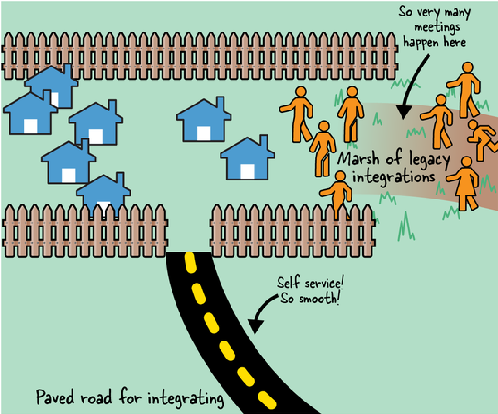
> 图 2-10：新铺的路很美，但人们实际想去的大多数地方都在沼泽深处。

### 你的地图上有哪些地标？

你的地形图上还应该有什么？有没有你一不小心就会走落下去的意外悬崖？
有没有某些行为或沟通风格，在别的公司或团队里完全没问题，
在你这里却算失礼？有没有你以为已经存在的护栏，其实并不存在？
有没有容易爆发的区域，或者会让那些以为自己站在坚实土地上的人
遭遇地震（或突然重组）的领导者？地方政治呢——哪些团队由君主统治，
哪些由议会治理？哪些是无政府状态？谁在和谁开战？

试着自己画一张地图吧。记住，制图本身就是政治性的：
你选择纳入什么，也说明了关于你的某些东西。
留意你把什么放在地图中心，以及你在哪里倾向于站队。

组织之所以会有奇怪的形状，是因为重组、收购、个人性格，
以及在有些情况下，单纯就是有人互相不喜欢。如果你想到了一些
我没想过的障碍、信息通道或其他地貌，我很想听听。⁴

#### 决策是如何做出的？

观察信息和观点如何在一家公司中流动、看它们如何出人意料地
变成一份正式计划，是件很吸引人的事。突然间大家都在用一个新缩写，
或者持有某种特定观点，而很难看出这是从哪儿来的。
一个曾满怀希望和前景的项目，如今被认定很可能失败而遭到否定。
大家都在为 microservices 兴奋，或者已经过了 microservices 的阶段、
对 serverless 感到好奇，又或者认为模块化单体就是务实的常识。
一个团队今年获批招更多人，另一个没有。这些决策都是怎么发生的？
有备忘录吗？

有些决策似乎是自然地从对话中浮现出来的，根本没人明确宣布做了决定。
另一些则更正式，但发生在你不在的房间里。如果你有很多想法，
看到别的倡议扎下根来、而你的没有，会很让人沮丧。
他们为什么不听你的提议？⁵ 真相是我们很多人难以释怀的一件事：
在方向上技术正确只是开始。你还需要说服别人——
而且要说服*对的*人。

如果你不理解自己组织或公司里的决策是如何做出的，
你会发现自己既无法预判、也无法影响它们。你还可能发现，
你以为自己对接下来该怎么做和所有人看法一致，
结果突然发现大家都在主张另一条路。如果你持续感到被蒙在鼓里，
那就是个信号：你不了解决策如何做出、谁在影响决策。

#### “那间屋子”在哪里？

影响你和你的范围的决策每天都在发生，如果你不断被它们惊到，
那会很难受。你至少该对它们从哪儿来有个感觉，
而且你多半也想对它们有些影响力。
我们先从做出重大决策的正式渠道和官方会议说起。

你对决策的接触会因你在组织层级中所处的位置而异。
其中一些决策不可避免地会发生在公司里比你更高的层级。
你可以通过你的汇报链路或其他渠道，确保相关信息到达那些房间，
从而影响它们。但决策也在你的范围这一层直接做出，
你要尽可能参与其中。如果你看过音乐剧 Hamilton，
你会记得 Aaron Burr 渴望“身处事情发生的那间屋子”。
正如 Burr 告诉我们的，不在那间屋子里的人
“对自己被交换掉的东西没有发言权”。虽然有时局外人的视角会有帮助，
但这件事不属此列。如果你想设定技术方向或改变你所在地方的文化，
你就必须成为做决策那个群体的内部人。

弄清楚决策发生在哪里。也许有一个每周的manager会议，
本意是做组织决策，却常常对流程或技术方向发表意见。
一位 director 可能倾向于在和自己下属开的 staff meeting 上做计划。
一个中央架构小组可能有个 Slack 频道，他们在那里就前进路径达成共识。
如果你看不清自己的组织如何运作，就请一位你信任的人
带你梳理某个具体决策是从哪儿来的。（要说明清楚
你不是在反对那个决策，只是想理解你组织的内部运作。）

当心：可能根本没有什么“屋子”。在最极端的情况下，
重大的技术宣示可能在与最高层领导的一对一中做出，
或者它们本意就是完全自下而上的（因此常常根本不会被做出）。⁶
但如果你关心那类决策确实存在一间“事情发生的那间屋子”，
就弄清楚那是什么、谁在里面。

#### 请求加入

一旦你发现某个做出重要决策的会议，想要参与其中是很自然的。
但你得有一个令人信服的说法，解释为什么该让你进去。
这似乎显而易见，但你的理由应该是关于对你组织的影响，
而不是对你个人的好处。无论和你同级的manager们多喜欢你，
把你的被排除说成对你职业发展不利，都不太可能改变人心。
要展示把你纳入进来会让你的组织更好地达成目标。
要展示你能带来哪些目前没有的东西。准备一套清晰的叙述，
说明你为什么需要接触权，练好你的要点，然后去请求加入。

你很可能会遇到一些阻力。给一个群体增加人手，
对已经在里面的人来说很少是没有代价的。任何会议里多一个人，
都会拖慢节奏、拉长讨论，并降低与会者展露脆弱或直言不讳的意愿。
如果这个群体习惯于一起工作，每一个新来的人都会重置这种动态；
在某种程度上，与会者不得不重新学习如何一起工作。

如果你真的收到了邀请，别让任何人为邀请你而后悔。
Will Larson 的文章“Getting in the Room”强调：除了为这个房间增添价值，
你还需要降低把包括进来的成本：到场前做好准备、发言简洁，
做一个乐于协作、摩擦很小的贡献者。
如果你让这个房间在做决策或快速分享信息方面效率更低，
你就不会再被邀请。

如果你没能进那间屋子，别往心里去，尤其是在那些人们还在琢磨
自己的 staff+ engineer 是干什么用的、还没接受这是个领导角色的组织里。
在他们想明白的过程中，如果你友善、把工作做好，
会比抱怨自己没被邀请参与什么更有影响力（也更像个领导者）。
理解处境、保持善意，而且，正如我在第 1 章说过的，永远别做个混蛋。

也有一些屋子是你根本就不该进的。如果你明确走在个人贡献者路线上，
你通常不该参与关于薪酬、绩效管理和其他manager路线事务的讨论。
你可以把影响这些决策的信息带给你的manager或 director，
但要不要行动由他们决定。如果重大技术决策和那些manager对话
发生在同一间屋子里，你可以建议把这些议题拆到不同的会议里。

最后，记住你想进的那间屋子，权力可能比你想象的少。几年前，
我惊讶地发现，一群 director 并不认为自己的意见有多大分量；
他们因为无法影响上面两级那些*真正的*话事人的决策而沮丧。
原来还有另一间我从没想过的“屋子”。上面大概还有更多！
对你请求接触的东西要现实一点。

#### 影子组织架构图

以上就是正式的决策过程。如果你理解它，你就会理解你组织
如何形成自己的观点、决定该做什么的许多方面。但不可避免地，
还有一大堆其他影响力在起作用，其中一些从表面上看毫无道理。
非正式的决策不遵循基于层级或职位头衔的规则。这些东西当然有分量，
但还有更多东西在起作用。

理解官方的技术领导者是谁很重要，但同样重要的是理解他们听谁的、
他们如何做决策。如果你的 infrastructure 组织的 director Jan
看起来完全支持你的想法，然后突然冷淡下来，这是怎么回事？
如果你留心观察，就会了解到 Jan 在任何决策中的第一步
都是去问 10 年前加入团队的 Sam。Sam 级别并不特别高，
但如果 Sam 觉得某个想法不好，你永远也别想让 Jan 支持你。
这些影响线在你加入一个组织时并不会立刻显现，
所以一个不错的早期步骤是交几个朋友，问问这个组织是怎么运作的。

在合著的 *Debugging Teams: Better Productivity Through Collaboration* 一书中，
Brian W. Fitzpatrick 和 Ben Collins-Sussman 描述了“影子组织架构图”：
权力和影响力借以流动的、不成文的结构。影子组织架构图
帮你理解群体中的影响者是谁，而它很可能与实际的组织架构图并不相同。
在变革得以发生之前，你需要说服的正是这些影响者。

作者指出了两类人：“连接者”，他们认识整个组织各处的人；
以及“老资历”，他们不管级别或头衔如何，仅凭在职时间长就拥有影响力。
这些人很可能对什么行得通、什么行不通有很好的把握，
而真正拥有级别和头衔的人在决策时很可能信任他们、
依赖他们的良好判断。如果你能获得他们的认可，那你已经取得不错的进展。

### 让地形图保持最新

我前面谈过让定位地图保持最新有多重要。让地形图保持新鲜更加重要。
地面上的事实会迅速变化，你自以为知道的事会不再成立。
在平常的一天里，你可能需要知道这些：

- 你依赖的一个团队换了新负责人。
- 你一直在等的一个项目最终不做了。
- 季度规划即将开始。
- 一个有用的新平台即将推出。
- 你的 product manager 即将休长假。

要跟上的信息很多。但你需要全都知道，所以你需要知道该留意什么。
以下是一些让你保持最新的方法：

#### 自动化的公告列表和频道

用于分享新设计文档、公告故障或链接变更管理工单的专用频道，
能让每个人都轻松地俯瞰正在发生什么。如果这类频道不存在、
而你觉得有用，可以考虑创建它们。

##### 走现场

精益制造的同行会谈到 gemba，也就是走到制造现场、
看看事情实际如何运转的理念。找一些途径，
让自己和你周围团队在做的工作保持连接。这可以采取
偶尔结对做变更、处理事故，或者为你想多了解的系统做一次部署的形式。
离技术太远不仅会减少你的背景信息，还会削弱你的技术可信度。
（第 4 章会详细讲。）

##### 潜水旁观

我在 Rands Leadership Slack 上问过大家怎么了解情况，
一个共同的做法是关注那些算不上机密、但本来也不是给你看的信息。
这包括看资深人士的日历、浏览你不在其中的会议的议程或笔记，
以及——这一点我从来没想过——按最近创建排序查看完整的
Slack 频道列表，从而看出有哪些新项目正在进行。

##### 留出阅读时间

在文档文化成熟的公司里，计划和变更往往会附带 RFC、设计文档、
产品简报等等。快速浏览一下，获取基本背景，
或者在日历上安排时间来深读。

##### 与你的领导保持同步

你需要会告诉你事情的盟友和提携者。足够频繁地和他们同步，
以便听到幕后的更新，并确认你的思路仍然与你的领导者一致。

##### 和人聊聊

出去喝杯咖啡聊聊，不只是愉快的建立关系——它也是很好的背景信息来源。
如果你真的想要全局视角，就和工程之外的人交谈：产品、销售、市场、
法务等等。如果你在做产品，就和你的客户支持同事交朋友：
他们对你做出来的东西比你更了解。也和行政人员交朋友。
行政人员聪明、有办法、人脉广。他们知道正在发生什么，
而且往往是公司里最有趣的人。去交朋友吧。

> [!NOTE]
> **“我不知道怎么和人说话”**
>
> 很多工程师对任何带着“社交”味道的东西都反感。它让我们想到
> 80 年代那种油腻的商务午餐。（还是只有我这样？）但社交不必是
> 算计或肮脏的。如果你去认识人、待人友善，
> 分享信息和互相帮助自然会随之而来。
>
> 如果你难以和某人开启一段对话，一个简单的起点是问一个问题、
> 对他们做的事表现出兴趣，或者（真诚地）称赞你欣赏他们的某一点。⁷
> 大多数人都愿意谈自己的工作或优先级，大多数人也乐意解释
> 自己感兴趣的东西是怎么运作的。闲聊是一项可以习得的技能，
> 会在你的整个职业生涯中带来回报。（而且如果你在和比你资历浅的人
> 交谈，让对话不尴尬多少算是你的责任。）

### 如果地形依然难走，就做一座桥

拖慢技术组织的问题，最常见的往往是人的问题：团队之间不知道怎么沟通、
没人觉得自己有权做出的决策，以及权力斗争。这些都是难题！
当你往自己的地形图上添加信息时，你可能会发现有些地方
让人很想潦草写上“此处有龙”，发誓绕道而行。
但 staff engineer 常常可以通过走向别人不敢踏足之处、
把危险地带变得对所有人都更容易走，来产生最大的影响。

Westrum 模型强调了“搭桥”的重要性（见图 2-11），
即在组织各部分之间建立连接——否则它们之间会有巨大的信息鸿沟。
你对地形越了解，就越容易通过以下方式弥合缺口：
发出没人发的邮件总结、介绍两个一个月前就该交谈的人认识，
或者写一份文档说明各项目之间如何相互连接。

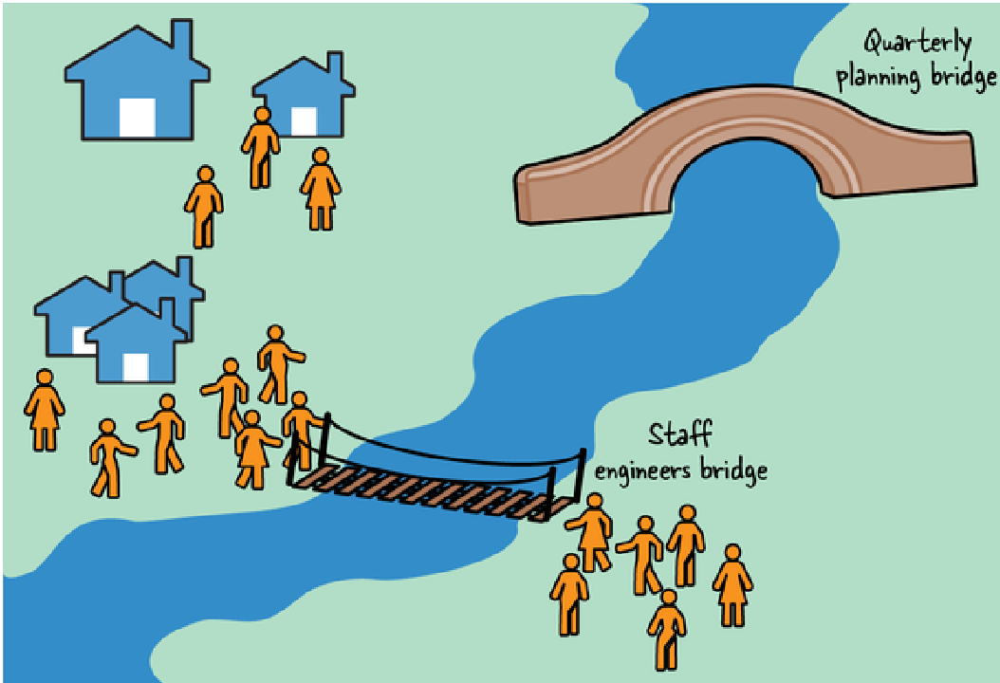
> 图 2-11：当季度规划还很遥远时，staff engineer 可以建立连接，
> 在两个组织之间搭桥。

Google 的 DevOps 网站建议先发制人地搭桥：“在组织里找出一个
你不理解其工作的人（或者其工作让你恼火的人，比如采购），
请他们喝杯咖啡或吃个午饭。”

在可以的时候，把你的工作范围界定为横跨板块、涵盖某个系统
或问题领域的全部，而不仅仅是属于单个团队的那一部分。
这样，你就能接住正在被丢掉的工作、调解冲突，
并帮助形成一个关于正在发生什么的统一叙述。
当有人提出重大变更时，你会有足够的背景信息，
可以说“是的，这次迁移是个好主意”，或者“不，我们还有活要干”。

## 藏宝图：再提醒我一下我们要去哪儿？

到目前为止我们画了两张地图。*定位地图*显示我们在哪里。
*地形图*显示我们如何穿越组织。但我们要去哪儿？
这就是第三张地图的用途（见图 2-12）。

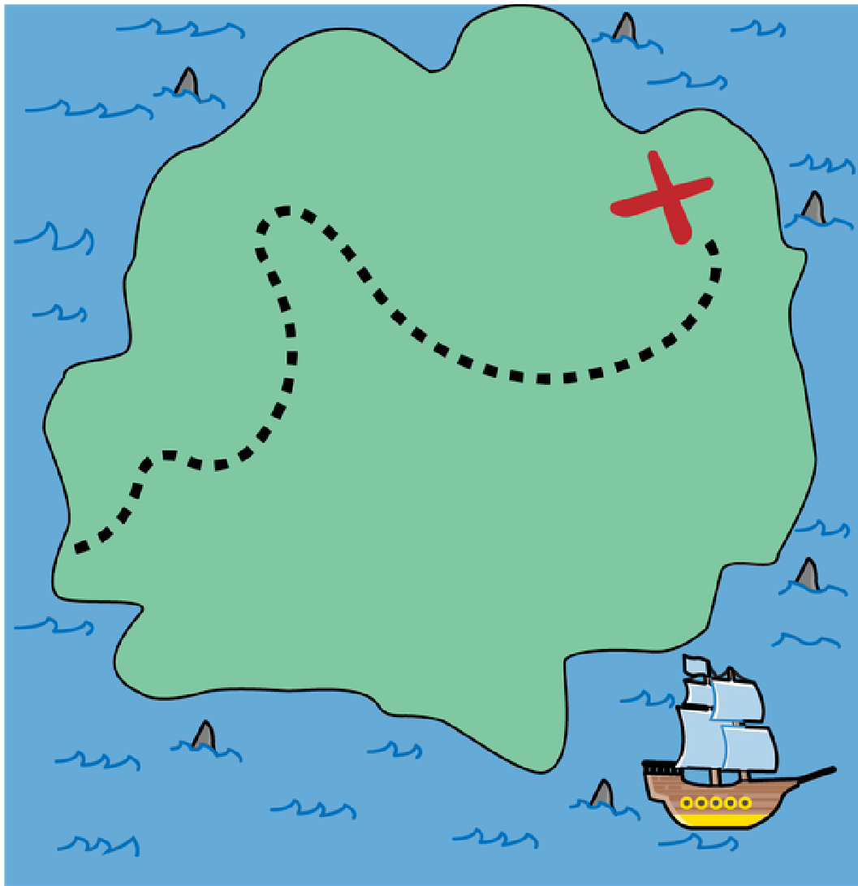
> 图 2-12：X 标出了宝藏埋藏之处！现在你只需要到达那里。

*藏宝图*给我们一个引人入胜的故事，讲我们要去哪儿、
为什么想去那儿。我们上路冒险吧！

### 追逐亮闪闪的东西

本章前面我谈过，你需要越过你团队的局域问题，
对你周围的世界保持全局视角。你需要在*时间*维度上也有同样的视角。
人很容易过度聚焦于短期目标，比如当前的功能发布，
或者最新一条不满意的 App Store 评论。但要想得更大些。
你想去哪里？你做这一切是为什么？说清楚一点，
我不是说你*不该*追求短期胜利。但*只*想着短期目标会有局限。
如果你只想着短期：

#### 让所有人朝同一个方向走会更难

如果团队不知道大计划，他们要么会走错地方，
要么每一个决策都会漫长、复杂、充满讨论。
有时绕开困难意味着要走一条间接的路。每个人都应该非常清楚：
在那个里程碑之后需要做出怎样的航向修正。

##### 你完不成大事

如果你的团队一直聚焦于解决局域问题和痛点的短期项目，
你就无法解决那些需要多步推进、更大、更长期的问题。
你现有项目的价值，团队之外的人可能也看不清楚。

##### 你会积累冗余

如果团队不知道自己要去哪儿，他们有两种选择。
他们可以试图灵活到能支持每一种未来状态，
从而创造出过度复杂、难以维护的方案。或者他们可以做局域决策，
冒的风险是：他们的方向与别人不一致，
他们的方案会变成一个别人都得绕开的古怪边缘情况。

##### 你会有互相竞争的倡议

在一个依赖草根或自下而上倡议的组织里，可能有多个人
试图围绕完全不同的方向聚拢热情。他们都在努力做正确的事、
让人们达成一致，但最终结果是混乱。

##### 工程师停止成长

只聚焦短期目标，会限制你思考和表述工作的方式，
也会限制你对那些掉进任务之间缝隙里的工作承担多少责任。
如果团队要完成一个大项目，他们就必须找出各项分配任务之间的空白，
并想办法填补，在这个过程中锻炼能力。一个习惯了在短小、
定义明确的目标上迭代的团队，不会长出做大项目的肌肉，
也无法讲出自己为什么做了那些事的故事。

### 采取更长远的视角

如果每个人都知道自己要去哪儿，日子就会好过些。
一路上无需保持紧密对齐。每个团队都可以更创造性地找出自己的路线，
并用自己的叙述来解释为了到达那里需要解决哪些问题。
他们更不容易走错路，也会有足够的信息来做决策，
从而减少需要付出的反复权衡和技术债。他们可以庆祝沿途的胜利，
同时记得还有一个长期目标，而真正的庆祝要等到抵达之后才会发生。

#### 你为什么在做你现在做的事？

我经常用的一个类比是许多策略游戏里都能看到的科技树，
比如 *Civilization*。⁸如果你没有，呃，把人生中太多小时*投资*
在这款出色的游戏上，我来解释一下它怎么运作。你扮演一个文明的统治者，
努力建立一个帝国。你通往伟大的路径包括积累科学知识，
所以你可以一路选择研究各种科技。可研究的科技构成一张有向图
（见图 2-13）。开始时你可能研究，比如说，制陶和狩猎，
但随着游戏推进，你的技能会彼此叠加。在 *Civilization* 里，
不先研究桥梁建造和蒸汽机，你造不了铁路。而不研究物理学和工程学，
你也造不出蒸汽机。所以游戏中会出现这样的时刻：你在研究物理学，
但你*真正的目标*是造铁路。直到你建好桥梁、研究出蒸汽机，
并给你的列车员订好小帽子，你才算赢得真正的胜利。
（遗憾的是，最后这一点并不会真的发生。）除非你记得自己
原本想去哪里并持续为之努力，否则你永远无法坐上那列火车。

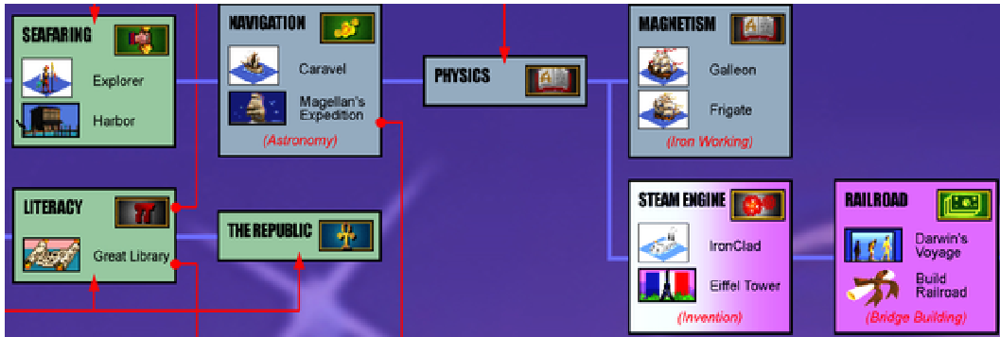
> 图 2-13：Sid Meier's Civilization II 科技图的一部分，
> 由 Microprose/Activision 制作（来源：http://www.civfanatics.com）。

当你选择投入某一项科技时，往往是因为它是通往别处的路上
无法回避的一步。你构建一个新的 service mesh，
不是为了构建 service mesh 本身的乐趣；你构建它是为了让你的
microservices 框架更易用，因为你想让新服务能轻松快速地建起来，
因为你想让团队能更快地交付功能。真正的目标是缩短上市时间。
当你知道真正的目标时，你就能退后一步，
评估任何拟议的工作是否能让你更接近它。

#### 分享地图

你可能要花些时间才能驱散战争迷雾、揭示你旅程的真正目的地。
一旦你理解了它，不要把它藏在心里。那意味着把故事讲给别人听，
让他们明白它为什么重要。你的故事应该展示你在哪里、要去哪里，
以及你为什么一路上要采取这些步骤。如果有海怪或捷径需要知道，
你大概会想把这些标出来——但别包含任何干扰。
让人容易看清正在发生什么。地图应该描述宝藏——
也就是给出对成功的清晰定义——这样每个人都知道自己在瞄准什么。

看到自己在进步是很激励人的，但人也出奇地容易忘记自己此前在哪里，
甚至觉得自己毫无进展。作为拿着地图的人（见图 2-14），
你处于有利位置，可以展示大家正在向目标靠近（如果没有，就做航向修正）。
既要讲你要去哪儿的故事，也要讲你从哪里来。

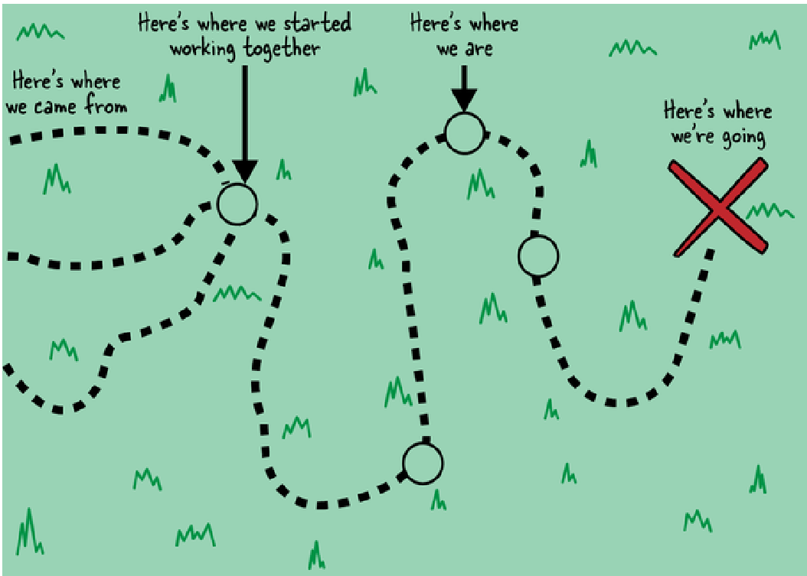
> 图 2-14：既要讲你从哪里来、取得了多少进展，也要讲你要去哪里。

### 如果藏宝图仍然不清楚，也许是时候画一张新的了

如果所有人都在用同一张藏宝图，那你这里的任务就完成了。
但如果你发现有多条互相竞争的路径，或者根本没有计划，
你可能需要帮这个群体选择一个目的地。有时你只需要写一份简短总结，
指出你在哪里看到混乱或不一致。通过把事实写清楚并分享出去，
你是在迫使那场对话（或者说是争论）摆到台面上。
但在问完所有问题、梳理完 *Civilization* 的科技树、
鼓励意见不合的人彼此交谈、并且认真思考之后，
你可能还是会得出结论：实际上还没有人选好一个长期目的地，
或者存在多个互相竞争的目的地。

那样的话，从地图上驱散战争迷雾就再没有什么可收获的了：
是时候创造一张新地图了。下一章讲的就是这件事。

## 你自己的旅程

在结束本章之前，我们来谈谈*你*的旅程。作为 staff engineer，
看到自己工作的影响可能需要更长时间。这意味着讲述那份工作的
*故事*更难——但也更重要。当你回望时，你应该有一套叙述：
你当时想达成什么、进展如何。你和你的团队一起成就了什么？
当你展望前方时，你也该有一个故事：你在努力做什么？
你当前的工作如何为那个目标做贡献？

一旦有了那套叙述，即使小任务也会成为更大故事的一部分。
任何某一周的工作可能都说明不了什么，但你这个月、这个季度、
这一年做了什么？你在靠近某个宝藏吗？要理解你的旅程，
你还需要一张地图，即步道图。我们会在第 9 章画它。

## 小结

- 练习有意寻找更大图景、看清正在发生什么的技能。
- 在背景中理解你的工作：了解你的客户、和你团队之外的同行交谈、
  理解你的成功指标，并清楚什么才是真正重要的。
- 了解你的组织如何运转，以及其中的决策如何做出。
- 建立或发现让所需信息流向你的路径。
- 清楚每个人瞄准的目标是什么。
- 思考你自己的工作，以及你的旅程是什么。

> ¹ 有一个流行的比喻叫“温水煮青蛙”：如果你把一只青蛙扔进一锅沸水，
> 它会跳出来；但如果你把青蛙放进冷水，再非常缓慢地升高温度，
> 你可以把水烧开、把青蛙煮死。它常被用作警示故事，
> 说明渐变可能变成常态，而我们可能在毫无反应的情况下滑向灾难。
> 当我得知真实的青蛙并不会这样——它们会直接跳出来！——我松了一口气。
> 我们还是放过可怜的青蛙吧，但这个比喻很有用。

> ² 这也是为什么设计文档应该有“考虑过的备选方案”一节；
> 我们会在第 5 章更详细地谈设计文档。

> ³ 共同兴趣的 Slack 频道、社交俱乐部和 employee resource groups（ERG），
> 是认识人、在整个组织内建立连接的绝佳方式。致敬我在公司 #crosswords 频道里
> 每天分享自己《纽约时报》填字游戏用时的朋友们，
> 以及 #women-in-engineering 频道里为每位成员的成功喝彩的参与者们。

> ⁴ 如果你生活里有一个五年级小学生，我推荐和他讨论地貌。
> 他们特别擅长回答这类问题：“如果峡湾是人类试图一起协作的隐喻，
> 它会是什么？”（两个团队一起做了一个大项目——一条冰川——但他们彼此生气，
> 项目融化了，只剩下底部的水。现在你知道了。）

> ⁵ 那个没有具体所指的“他们”往往是个关键词，提醒你正在信息不足的情况下行动。
> 如果你发现自己在产生这样的念头，就再确认一下你说的“他们”到底指谁。
> 如果指的是“整个组织”，那这本身就是你问题的一部分。
> 要确切理解你需要说服的是谁。
> 本章后面我会更多地谈官方的决策者和“影子”组织架构图。

> ⁶ "Coordination Headwind: How Organizations Are Like Slime Molds"
> 是一个很棒的演讲，讲的是自下而上协调的失败模式。

> ⁷ 称赞你欣赏的东西，但请不要告诉同事他们长得好看！
> 一般来说，只称赞一个人主动选择去做的事。
> 一份写得好的 RFC、一场顺利的会议，或者一个很酷的桌面小玩具，
> 都可以放心称赞。

> ⁸ *Civilization* 如今已出到第六代，是一款存在了几十年的策略游戏。
> 它用了战争迷雾，你必须妥善决定长期投资和短期投资之间的取舍。
> 我推荐玩 *Civilization* 来理解关于 staff engineering 的一切。
> 告诉你老板这是在做研究。

# 第 3 章 创造全局图景

这是我最喜欢的一个故事，讲的是一个缺失全局图景的团队。
我所在的组织即将召开一次全员大会，人们可以提前提出话题，
其中有一个问题是关于一个关键系统的——我们姑且称它为 SystemX——
它引发过几次故障。我被指派来回应。就在我准备发言要点的时候，
几乎同时收到了三条私信：

- 第一条：“请安抚大家，我们清楚 SystemX 一直是个问题，
  但我们正在给支撑它的团队补充人手，并增加副本帮它扩展。
  我们预计不会再有故障了。”

- 与此同时：“很高兴有人问了这个问题！
  我们应该强调 SystemX 已经被废弃，所有人都应该计划迁离它。”

- 还有：“嘿，你能不能告诉大家，我已经成立了一个工作组，
  研究如何演进 SystemX？我们会在下个季度公布计划。
  如果有人想加入这个工作组，请联系我。”

这个公开论坛本是一个绝佳的机会，
可以让人们了解这三条非常合理的推进路径中的任何一条。
但为什么会有三套不同的计划？

在第 2 章末尾，我们刚揭开了你所在组织现有的藏宝图。
如果你的团队已经有了这样一张图——一个单一的、有说服力且被充分理解的目标，
以及一条通往那里的计划——那么你的全局图景就是完整的。
你可以直接跳到第二部分，那里我会讲如何在大型项目上执行落地。
但很多时候，staff engineer 会发现目标并不清晰，或者计划本身有争议。
如果你正处于这种情况，请继续往下读。

在第一部分的这最后一章里，我们要谈的是*创造*全局图景。
当路径尚未定义、令人困惑时，你有时需要让团队就一套计划达成一致，
并创造出那张缺失的地图。这张地图通常表现为*技术愿景*，
描述你想要抵达的未来状态；或者*技术战略*，
概述你计划如何穿越挑战、实现特定目标。
我会先介绍这两类文档，包括你为什么需要它们、它们可能是什么形态、
以及你可能在其中放入哪些内容。然后我们会看如何以团队的方式
创作这类文档。我们会讨论创作文档的三个阶段：筹备、撰写与发布。¹
最后，我们会用一段虚构的案例研究，看看这些技巧如何实际发挥作用。
我们现在就把那个场景摆出来，这样你就可以开始思考*你*会如何应对它。

## 场景：SockMatcher 需要一套计划

SockMatcher 几年前以两人初创公司的形式成立，
目标是解决一个重要问题：单只袜子。
丢了袜子的人用公司的移动应用上传一张图片或一段视频，
后端一套复杂的机器学习算法会尝试找到另一个丢了同款单只袜子的用户。
如果两位袜主中的一位想把单只袜子卖给另一位，
算法随后会给出一个建议价格。每一次袜子所有权的变更，
都记录在一套分布式的 sockchain 账本里。

你大概能想象，风险投资人为此疯狂。²
SockMatcher 迅速成长为互联网上最大的单只袜子交易市场。
公司不断扩张，与几家定制袜厂商建立了合作，
加入了个性化袜款推荐，甚至拓展到了手套和纽扣。
它还发布了一个外部 API，第三方可以把它当作平台来做袜子分析（SaaaP）。
用户很喜欢这些新功能。

公司的架构是自然生长起来的。一切都围绕一个中心数据库和数据模型构建，
由一个单体二进制程序负责登录、账户订阅、计费、匹配、个性化、
图片与视频上传等等。产品各自的逻辑被内建到这些功能里。
例如，计费代码里包含用户如何付费的逻辑：袜子按成功匹配次数收费，
而纽扣按季度订阅收费。袜子数据和用户数据存放在同一个大型数据存储里，
其中包含关于用户的敏感 personally identifiable information（PII），
比如姓名、信用卡号和鞋码。

出于竞争考虑，SockMatcher 一直优先把新功能快速做进 App，
而不是以可扩展或可复用的方式构建。例如，团队把手套功能实现为
现有袜子匹配功能的一个特例，在袜子数据模型里加了一个字段，
允许把一件物品标记为“左”或“右”。当用户上传一张手套的图片时，
软件会生成一张镜像图，然后把手套当作另一种袜子来处理。

当公司决定加入纽扣匹配时，几位 senior engineer 主张是时候
重新设计架构，创建一个便于添加新可匹配物品类型的模块化系统了。
不过商业压力占了上风，纽扣匹配同样被实现为袜子的特例，
在数据模型里新增字段来指定一套纽扣的数量和每颗纽扣的孔数。
计费代码、个性化子系统以及其他组件里，
都含有硬编码的定制逻辑来处理袜子、手套和纽扣之间的差异，
这些逻辑大多实现为散布在代码库各处的 *if* statements。

现在有了一个新的商业目标：公司想扩展到匹配食品保鲜盒和盒盖。
这类产品会与现有的产品有不同的特性。与袜子不同，
保鲜盒和盒盖并不完全相同。团队将需要不同的匹配模型和逻辑，
还需要一整套新的供应商和合作伙伴关系，
这样在没有匹配结果时，才能给用户提供一个全新的替换盒盖或盒体。
公司最新的产品战略文档中还在推测未来要加入耳环、拼图块、轮毂盖等等。

新的食品保鲜盒团队已经准备好开始梳理这个功能了。
他们并不急于在现有的单体应用里干活：
他们很想构建自己独立的匹配微服务，配自己的数据存储。
但即便那样做，他们还是需要认证、计费、个性化、安全处理 PII
以及其他共享功能的代码——而这些目前都是针对袜子的模型优化的。
如果他们想自主工作，就得把这些功能从单体应用中暴露出来，或者重新实现一遍。
两种做法都要花时间，所以他们预计会面临一些压力：
把食品保鲜盒宣布为一种袜子，在现有代码里干活，
在需要的地方往手套和纽扣旁边再加一些边界情况。
团队对于正确的下一步该是什么意见不一。

还有其他一些挑战：

- 分享给第三方的那个 API 没有版本管理，因此很难修改它；
  随着新的集成在规划中，这个问题拖得越久就越难解决。

- 自研的登录功能一直——用三年前写它的那位工程师的话说——
  “有点糙”。它还能支撑几年增长，但这不是任何人引以为傲的代码。

- 匹配功能是市面上最好的，让用户很满意，
  但有时明明存在匹配结果，它却找不到。

- 有一位团队成员对一个新算法和系统有想法，
  它能用当前耗时的一小部分找到匹配结果。他们为此非常兴奋。

- 负责运维单体应用的团队一直跟不上它的增长，
  不断在救火式地应对扩展问题。他们每天要因为磁盘写满、
  部署失败和软件缺陷被叫醒好几次。

- 随着越来越多的工程师在同一个代码库里工作、复用现有功能，
  意外行为变多了，用户可见的缺陷也发布得越来越频繁。
  几乎每个团队和每个用户都会受到几乎每次故障的影响。

- 名人和网红出售他们的袜子，曾造成 100 倍的用户流量尖峰，
  导致彻底宕机。食品保鲜盒的发布可能会把明星厨师吸引到平台上，
  进一步推高需求。

- 每增加一项功能都会拖慢单体应用的构建时间，
  无人维护、时好时坏的测试更是雪上加霜：
  构建并部署一个新版本通常要三个小时，拉长了大多数事故的处理时间。

- 移动端 App 在 App Store 的评分已开始下滑；
  很多一星评论都提到可用性很差。

尽管这个场景里包含很多问题，其中许多都有直截了当的技术解法。
每个新加入公司的人都提出改动建议：
把数据存储分片、给 API 加版本管理、从单体应用中剥离功能，等等。
各种工作组已经启动过。它们总是从一屋子 20 个非常在乎、
但彼此意见不合的人开始，然后因为没有人有时间专注于此而陷入泥潭。
毕竟，还有让人觉得更重要、或者更有可能成功的功能开发要做。
工程组织似乎无法在任何单一倡议上形成势头。

你会怎么做？我们会在本章末尾回到这个场景。

## 什么是愿景？什么是战略？

你应该把新功能构建成可复用的平台，还是作为某个具体产品的一部分？
团队应该学习那个难用的新框架，还是继续用那个流行但已废弃的框架？
也许每个团队可以自行决定：去中心化的决策方式
能让组织行动更快、自行解决自己的问题。
但每个团队各自决策也可能带来一些缺点：

- 可能出现“公地悲剧”：各个团队追求自身最优行动、
  彼此不协调，最终导致对所有人都糟糕的结果。
  又是那个 local maximum。

- 共享的关切可能被忽视，因为没有任何一个团队有权力或动机
  独自去解决它们。

- 团队可能缺乏足够的情境信息来做出最佳决策。
  采取行动的人可能与承受结果的人不是同一批人，
  或者在时间上与他们相隔。

当有重大的决策尚未做出时，项目就会变慢或受阻。
没有人愿意为了打一场漫长而痛苦的仗——去做出一个有争议的决定
或选定一项标准——而推迟自己的项目。于是，各团队做出局部最优的决策，
解决自己眼下的问题。每个团队都基于自己的偏好，
或者基于关于组织技术方向的传闻来选择方向——并且常常把这些选择
固化在自己打造的方案里。把那些重大的底层问题往后拖，
只会让它们在日后更难解决。³

当组织意识到需要解决其中一些重大的底层问题时，
*愿景*和*战略*这两个词就会被频繁提起。
你会听到它们既被当作同义词使用，也被用来指代不同的东西。
为了避免术语上的混乱，我们先给出一些可用定义，
在本章中一直沿用。

### 什么是技术愿景？

*技术愿景*描述的是目标达成、最大的问题解决之后，
你所希望看到的未来。描述工作完成*之后*一切会是什么样，
能让每个人更容易想象那个世界，而不会纠结于如何抵达的细节。

你可以在任何范围上写技术愿景，从整个工程组织的宏大图景，
到一个团队的工作。你的愿景可能继承自更大范围的文档，
也可能影响更小范围的文档（一些例子见图 3-1）。

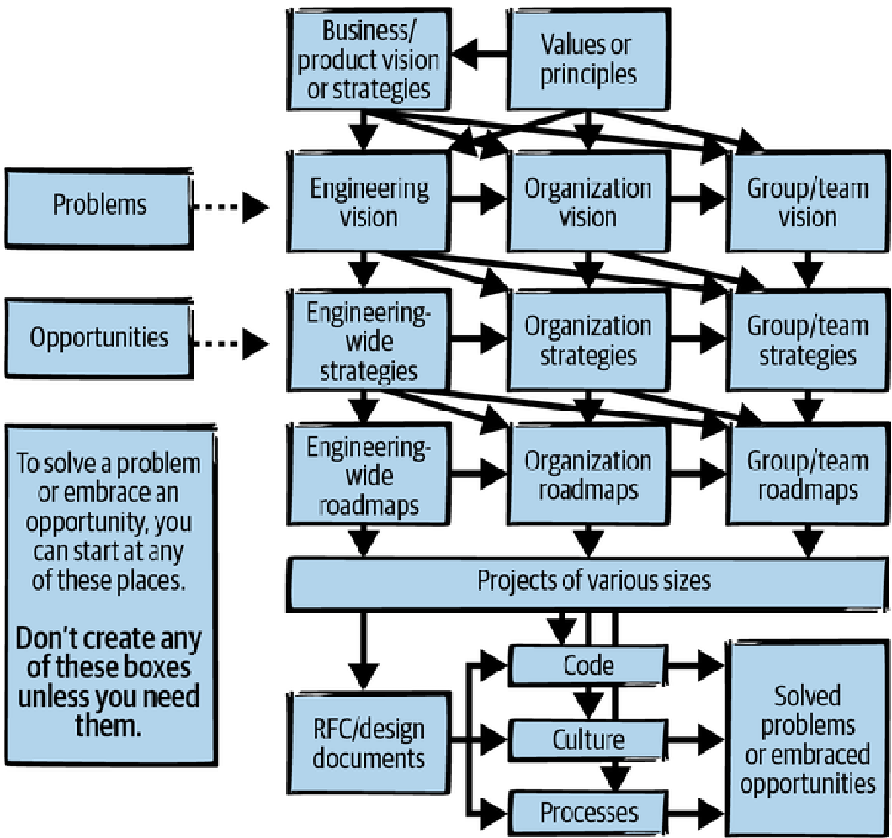

> 图 3-1：取决于问题的规模，你可能从整个工程组织的愿景、
> 某个团队范围的愿景，或介于两者之间的东西开始。
> 除非确实需要，否则不要创建愿景、战略之类的文档。

愿景创造一种共享的现实。作为能看到全局图景的 staff engineer，
你大概能想象出你的架构、代码、流程、技术和团队更好的状态。
问题在于，你周围的许多其他资深人士大概也能，
而你们的想法未必都一致。即使你认为大家意见一致，
也很容易做出假设或跳过细节，直到这些分歧引发冲突才被发现。
书面文字的巨大的力量，会让彼此误解变得难得多。

技术愿景有时被称为“北极星”或“山巅之城”。
它并不打算做出所有决定，但它应当消除冲突或歧义的来源，
让每个人都能选择自己的路径，同时确信自己最终会到达正确的地方。

> [!TIP]
> **撰写技术愿景的资源**
>
> 如果你打算写一份技术愿景文档，以下是我推荐的一些资源：
>
> - *Fundamentals of Software Architecture*，
>   Mark Richards 与 Neal Ford 著（O'Reilly）
> - *Making Things Happen* 第 4 章，Scott Berkun 著（O'Reilly）
> - “How to Set the Technical Direction for Your Team”，Amazon 的 James Hood 著
> - “Writing Our 3-Year Technical Vision”，Eventbrite 的 Daniel Micol 著

愿景长什么样并没有特定标准。它可以是一句简洁而有激励性的“愿景宣言”，
可以是一篇 20 页的文章，也可以是一份幻灯片。它可能包含：

- 对高层价值与目标的描述

- 一组用于做决策的原则

- 对已经做出的决策的总结

- 一张架构图

它可能非常详细，深入到技术选型，也可能保持在高层，
把所有细节留给实现它的人。

无论你创作什么，它都应当清晰且有主张，
应当描述一个现实可行的更好未来，并且应当满足你组织的需要。
如果你能挥一挥魔杖就大功告成，你的架构、流程、团队、文化或能力
会是什么样子？那就是你的愿景。

### 什么是技术战略？

*战略*是一套行动计划。它是你打算如何实现目标、
如何绕过沿途遇到障碍的方式。这意味着既要理解你想去哪里
（这可能就是我们刚讨论的愿景！），也要理解你路上的挑战。
我在本章中使用*战略*一词时，始终指的是一份具体的文档，
而不只是做一个有战略思维的思考者。

技术战略可能支撑商业战略或产品战略。
它可能与技术愿景配套，也可能只处理该愿景的一个子集，
比如愿景所涵盖的某个组织、产品或技术领域。
它也可能完全独立存在。

就像技术愿景一样，技术战略也应当带来清晰——
不是关于目的地的清晰，而是关于通往那里路径的清晰。
它应当以务实的方式应对具体挑战，提供强有力的方向，
并界定团队沿途应当优先采取的行动。战略不会做出所有决定，
但它应当有足够的信息去克服阻碍团队抵达目的地的种种困难。

> [!TIP]
> **撰写技术战略的资源**
>
> 关于战略的经典著作是 Richard Rumelt 的
> *Good Strategy/Bad Strategy*（Currency）。
> 如果可以，我建议你花时间读一读。其他优秀资源还包括：
>
> - “Technical Strategy Power Chords”，Patrick Shields 著
> - “Getting to Commitment: Tackling Broad Technical Problems
>   in Large Organizations”，
>   Mattie Toia 著
> - “A Survey of Engineering Strategies”，Will Larson 著
> - Technology Strategy Patterns，Eben Hewitt 著（O'Reilly）
> - Rands Leadership Slack，尤其是 #technical-strategy 和
>   #books-good-strategy-bad-strategy
>   这两个频道

就像技术愿景一样，战略可以只有一两页，也可以是长达 60 页的庞然大物。
它很可能包含对世界现状的诊断，包括需要克服的具体挑战，
以及应对这些挑战的清晰路径。它可能包含一份应当推进的项目的优先级清单，
或许还附有这些项目的成功标准。视其范围而定，
它可能包含宽泛的高层方向，也可能包含针对一组具体难题的决策，
并解释每一项的 trade-off。

在 *Good Strategy/Bad Strategy* 中，Rumelt 描述了“战略的内核”：
对问题的诊断（diagnosis）、指导性方针（guiding policy），
以及绕过挑战的行动（actions）。我们逐个来看。

#### 诊断

“这里到底发生了什么？”对你所处情境的诊断，
必须比混乱的现实更简单，也许可以通过在噪声中找出模式，
或者用隐喻或心智模型，让问题变得容易理解。
你要做的是把你所处的情境提炼到最本质的特征，
好让人能够真正理解它。这很*困难*，需要花时间。

#### 指导性方针

指导性方针是你绕过诊断中所描述障碍的方法。
它应当给你一个清晰的方向，并让后续的决策变得更容易。
Rumelt 说它应当简短清晰，是“一个路标，标示出前进的方向”。

#### 一致的行动

一旦有了诊断和指导性方针，你就可以具体说明你将要采取的行动——
以及你不会采取的行动。你的行动几乎肯定会涉及技术之外的东西：
可能会有组织变革、新的流程或团队，或者对项目的调整。
这一点我怎么强调都不为过：你会把时间和人力投入到*这些*行动上，
而不是一开始摆在桌面上的那一长串其他想法。
这种聚焦很可能意味着，你和其他人没法去做一些曾让你们兴奋的事。
就是这样。

战略应当借助你的优势。例如，伦敦的 engineering manager
Isaac Perez Moncho 在为一家公司撰写工程战略时，
就着眼于创造正向反馈循环。他告诉我，那家公司的产品工程团队
面临许多问题：缺少工具、事故太多、部署很差。
但他有一个优势：一支很棒的 DevOps 团队，
只要他们有更多时间，这些问题他们都能解决。
他的指导性方针就是腾出 DevOps 团队的一部分时间。
给他们腾出空间后，他们就能自动化流程，进而腾出更多时间，
形成一个正向反馈循环，让他们有余力去解决其他问题。
想一想如何以自我强化的方式放大你的优势。

最后，战略不是对别人在完美世界中会怎么做的理想化描述。
它必须是现实的，必须承认你所处情境的约束。
一份在你的组织里根本找不到人手的战略，是在浪费你的时间。

### 你真的需要愿景和战略文档吗？

技术愿景和技术战略能带来清晰，但对很多情况来说可能过于重了。
不要给自己制造不必要的工作。如果描述你想达到的状态
或你想解决的问题很容易，那你真正想要的
可能更像是设计文档里的目标一节，甚至像一段 pull request 的描述。⁴
如果不需要这份文档大家也能对齐，那你大概并不需要它。⁵

如果你确定自己需要点什么，那就想一想它该是什么形态。
适应你的组织的需要以及它能支持的东西。例如，
如果方向缺失正在让所有人变慢，你可能想召集一个小组
创造一份抽象的高层愿景，然后再就如何实现它变得更具体。
如果你正在为公司增长做准备，你的 CTO 可能会让你
从工程组织各处召集一个小组，描述三年后你们的架构和流程会是什么样。
但如果你的团队反复卡在某个缺失的架构决策上，
不要花太多时间在哲学上：直接对卡住你的那个具体事项做个了断。

撰写技术愿景或战略要花时间。
如果你能以更轻量的方式达到同样的结果，那就那样做。
只创造你组织需要的东西，不要多。

## 筹备

创造一份愿景、战略或任何其他形式的跨团队文档，都是一个大项目。
会有大量的准备工作，然后是大量的迭代与对齐。
记住，让人们达成一致并不是横在你和真正的解题工作之间的一件杂务：
达成一致*本身就是*那项工作。你为项目带来的任何洞见或大胆愿景，
只有在你能把人们一起带上这段旅程时才有价值。
就像你不会赞赏一个无视物理定律的工程方案所花的时间一样，
为一个你知道无法说服组织去做的项目摇旗呐喊，
也不是对时间的好用法。

虽然到目前为止我一直把战略和愿景分开讲，
但在本章余下的部分，我不会对它们做太多区分。
它们是非常不同的东西，但都涉及把人们聚在一起、做决策、
带着组织一起前进，以及讲故事。你也可以用同样的方法
去创作其他全局性的文档，比如技术雷达或一套工程价值观。

创作任何这类文档都是那种典型的“百分之一的灵感加百分之九十九的汗水”的事业，
但如果你准备得当，就会提高发布出真正有人用的东西的概率。
我会谈谈一些能让你为成功做好铺垫的准备工作，
然后我会请你把准备工作的产出想清楚，
评估你是否能成功，并决定是否把这件事正式立项。

### 拥抱无聊的想法

我不知道你怎样，但我刚入行时以为，
非常资深的工程师都是巫师，他们整天在琢磨
针对深不见底的技术难题的、改变游戏规则的洞见性解法。
我想象那就像某一集 *Star Trek: The Next Generation*：
曲速核心反物质约束即将失效之类的，
所有人都没辙了、快疯了，突然 Geordi La Forge 或 Wesley Crusher
喊出：“等等！如果我们 <极端技术黑话>”，
然后在触摸屏上点了八个字符，进取号就在最后几秒得救了。呼！

现实生活有点不一样。好吧，有时候“如果我们 <极端技术黑话>”
确实就是答案：尤其是在非常小的公司里，
有时你确实会卡住，直到一位有经验的人出现，描述一个解决方案、扭转局面。
但如果身边有资深的人，那很可能好想法已经足够多了。
缺口在于让所有人对做什么达成一致。

当你进入这个创造愿景或战略的项目时，
要做好准备：你的工作会涉及已有的想法，而不是全新的想法。
正如 *The Manager's Path* 的作者 Camille Fournier 所写：

> 我有点觉得写工程战略很难，因为好的战略相当无聊，
> 写起来也挺无聊的。而且我觉得，人们听到“战略”就会想到“创新”。
> 如果你写出了什么有意思的东西，那它多半是错的。
> 这看起来方向上是对的，大多数战略确实是综合归纳，
> 而这一点并不常被提及！

Will Larson 补充说：“如果你按捺不住想把最精彩的想法塞进这个过程，
那你可以把它们放进准备工作里。把你所有最好的想法写进一份巨大的文档，
删掉它，然后再也不要提起它们中的任何一个。
现在……你的头脑就为接下来的工作腾出来了。”

创作某种让人感觉“显而易见”的东西，写的时候会让人觉得不过瘾：
我们都想带着一个天才的愿景式想法登场，拯救进取号！
但通常真正需要的，是一个愿意权衡所有可能方案、
为做什么和不做什么给出理由、让所有人对齐，
并且有足够勇气做出那个（可能是错的！）决定的人。

### 加入一场已经在进行的远征

如果已经有人在做你想创作的那种文档，不要去竞争——加入他们的旅程。
有三种加入方式：

#### 分担领导

你可以在不接管项目的前提下，为它带来领导力。
建议做一次正式的分工，让你们各自都有机会以有说服力的方式牵头。
例如，一个人负责整个项目，另一个人负责其中某些单项倡议。
你也可以提议共同牵头：轮流担任主要作者，随着工作推进来分摊任务。
如果各位牵头人彼此欣赏对方的想法，而且都在朝同一个方向用力，
这会造就一支非常高效的团队。

##### 跟随他们的领导

把自尊放到一边，跟随他们的计划。如果他们比你经验少，
你可以通过把他们往正确方向上轻推、帮助把工作做到最好，产生巨大的影响。
做那个满身沧桑、经验丰富的最佳配角，是一个了不起的角色。⁶
你可以用自己的深厚技术知识去填补他们技能上的空缺，
比如深入一个遗留代码库摸清某个东西到底是怎么运作的。
你也可以在他们不在的场合为这个计划说话。支持他们，帮助把事做成。

##### 走开

当然，第三种做法是判断这项工作没有你也会成功，对它保持热情，
然后去找点别的事情做。如果这个项目不需要你，那就找一个需要你的。

当别人的方向不是你原本计划的方向时，让别人来领导会很难。
科技公司的晋升体系会激励工程师觉得自己必须“赢下”某个技术方向，
或者成为某个项目的门面。这种竞争会催生“猿猴游戏”：
支配性的把戏与权术，每个人都想确立自己是这个领域里的领导者，
把他人的想法视为威胁。这对协作有毒，也让成功变得更难实现。

我的朋友 Robert Konigsberg，Google 的 staff engineer 兼 tech lead，
总说：“别忘了，某个东西出自你的大脑，并不代表它就是最好的想法。”
如果你倾向于把“正确”等同于“赢”，那就退后一步，聚焦真正的目标。
练习换位思考：他们的方向是错了，还是只是*不同*？
如果那条你想走的路是同事提出来的，你还会同样用力地为它辩护吗？
即便它更好，也要警惕为了争一条只稍微好一点的路，
而付出根本做不出决定的代价。正如 Will Larson 所写：
“要迅速把支持给到那些正在推动改进的其他领导者。
即便你不认同他们最初的做法，
一位值得信赖的人来领导项目，几乎总能走向好结果。”

如果你认为这个人的想法或领导力即使有你支持也做不成呢？
你有时确实需要灵活，但这种灵活不应扩展到为
你认为危险或有害的想法背书。即便如此，
也要试着加入已有的旅程并改变它的方向，
而不是从零开始另立一个竞争性的倡议：
这样你会有现成的盟友和已经积累起来的势头，
也能从他们已经做过的事情中学到东西。

如果在一个项目上，多个人真的没法在不玩猿猴游戏的情况下都取得成功，
那就考虑去一个可施展范围更大（而且文化更健康）的地方。

### 找一位提携者

除了最草根的团队文化，任何没有高层支持的大动作都不太可能成功。
愿景或战略可以在没有提携的情况下起步，
但日后把它变成现实会是一个挑战。即便在早期，
提携者也能帮助厘清和论证这项工作。如果你的 director 或 VP
从一开始就认可你的计划，那么你创作的东西在某种意义上
就是组织的藏宝图，而不只是你自己的——这降低了你在浪费时间的风险。
提携还能给那些原本会卡在追求共识上的小组增加层级。
提携者可以设定成功标准，并在决策在委员会里僵住时充当裁决者。
他们可以指定一位牵头人或“决策者”——有时称为
directly responsible individual（DRI）——在小组卡住时拥有最终决定权。
你未必需要这个，但把它作为你可用的一个选项记在心里。

找到一位提携者可能并不容易。高管们很忙，
而你实际上是在请他们把资源、人力和时间投入到你的提案上，
而不是投入他们原本打算做的事。提升成功率的方法，
是给潜在的提携者带来他们想要的东西。
虽然一个对公司有利的提案是个很好的起点，
但如果它契合那位 director 自己的目标，
或者能解决他们关心的问题，你会走得更远。
弄清楚是什么在阻碍他们的目标，然后看看你想解决的问题
是否与那些目标吻合。提携者也会有一些“永远为真的目标”：
如果你能让他们的团队更高效、或者（真正地）更快乐，
那就足以成为一个支持你工作的有力理由。

在试图说服提携者支持你的项目之前，
先想清楚并练习你的“电梯演讲”：如果你没法用 50 个词说服他们，
你也许根本无法说服他们。有一次，我试图说服当时在 Google
担任 engineering director 的 Melissa Binde 提携一个我非常在意的项目。
我讲了各种各样的细节，试图让她也觉得这件事重要。
我那一通说辞完全没有说服力——但 Melissa 好心借此机会指点我：
“你讲故事的方式没法让我在乎，也没法让其他任何人在乎。
再来一次——换一个角度讲这个故事。”她让我试了几种不同的项目理由，
并告诉我哪些引起了共鸣。你几乎永远不会遇到这样的机会，
所以在进门前就要把说辞打磨好。

staff+ engineer 能当项目提携者吗？根据我的经验，不能，至少不能直接当。
提携者需要有权决定一个组织把时间和人力投在哪里，
而这类决定通常由本地的 director 或 VP 来做。

一旦你有了提携，就要经常确认你*仍然*拥有它。
Reddit 的 principal engineer Sean Rees 说，
staff+ engineer 最容易犯的最大错误之一，
就是不去维护自己的高管提携：“我觉得这一条特别阴险，
因为你可以是在有提携的情况下起步的，
而随着现实变化，那份提携会逐渐消退……
然后你就得在棘手的水域里摸索着重新对齐。”

### 选择你的核心小组

有些人在踏上旅程、不被支线任务分心方面非常有纪律，
但我们大多数人从一点点外在约束中受益。
和其他人一起工作就能给你这种约束。
当一个人分心或泄气时，其他人会让势头继续；
知道你需要就这项工作做汇报，会是一种强大的动力。
在小组里工作还能让你们汇集各自的人脉、社会资本和可信度，
从而触达组织中更广泛的群体。你必须花功夫让大家对齐，
但既然最终你需要与整个组织对齐，
先让核心小组达成一致，能帮你更早发现潜在的分歧。

目标是招募一个*小的*核心小组来帮你创作文档，
再加上一个更广泛的一般盟友与支持者群体。
当然，如果你是加入了别人的旅程，那你就会是*他们*核心小组的一员。
（为简单起见，本章余下部分假设是你在牵头这件事。）

你希望谁加入你的小组？拿出你的地形图。
你需要谁站在你这边？谁会反对？
如果有那种只要决定不是他们参与做出的就会痛恨的异议者，
你有两个选择：要么非常确定你拥有足够的支持来抵消他们的反对，
要么从一开始就把他们带上。如果你能理解他们为什么反对这项工作、
以及他们希望看到什么别的结果，把他们带上会更容易。

虽然可能有很多同事关心你在写的东西并想帮忙，
但要让核心小组保持在可管理的规模：两到四个人（包括你）最理想。
时间投入在这里能帮上忙：如果核心团队的每个人都要为这项工作
每周投入 8 或 12 小时，你就能在不排斥任何人的情况下让小组保持很小。
（这也是把“游客”挡在外面的好办法。）
在核心团队之外，你可以提供更轻量的参与方式：
你会访谈他们，尽量在工作中代表他们的观点，
并让他们评审早期草稿。

一旦有了核心小组，就要准备好放手让他们工作！
从一开始就明确：你把自己看作这个项目的牵头人和最终决策者，
还是更像同侪中的第一人。如果你之后想要动用裁决权或凭地位压人，
那就从一开始就强调你作为牵头人的角色，
比如在你们创作的各种启动文档里加一个“角色”一节。
但无论你是不是牵头人，都要让你的小组有想法、
推动项目前进，并且在谈论项目时不必把所有问题都转给你。
提供牵头做事的机会，并在他们主动出手时给予支持。
他们的势头会帮你走得更快，所以不要拦住他们。

至于你更广泛的盟友群体，要让他们保持参与：
访谈他们，用上他们给你的信息。把文档进展的更新发给他们。
邀请他们对早期草稿发表评论。如果你有一群有影响力的人
支持你正在做的事，你的路会好走得多，
而且他们从组织各处带来的知识也会带来更好的结果。

### 设定范围

当你思考你试图解决的那个或那些具体问题时要考虑，
它们横跨组织有多广。你想影响整个工程组织、一个团队，还是一组系统？
你计划的范围可能与你作为 staff engineer 的职责范围一致，
但也可能远远超出它。⁷

目标是覆盖足够多的地面以真正解决你的问题，
但也要清楚自己的技能水平和影响力范围。
如果你想对比如网络做一次重大改动，
明智的做法是把网络团队的人纳入核心小组，
并在那个团队里建立可信度。否则，你就是在给自己制造冲突和失败。
如果你想为公司里远在你影响力范围之外的领域写一份计划，
要确保你有一位在那里有影响力的提携者——
最好还有一些对组织那些部分有清晰地图的核心小组成员。

对你可能做到的事要务实。如果你对未来的想象涉及
完全不在你掌控之内的东西，比如 CEO 换人，
或者客户购买模式的调整，那你就已经跨进了玄学思维。
要绕开你的固定约束，而不是忽视它们，或者盼着它们不是那样。

话虽如此，如果你只是为你所在的那部分公司写愿景或战略，
要明白更高层的计划可能会打乱你的。
即便你写的是覆盖整个工程组织的东西，
商业方向的改变也可能让你所有的决定失效。
要做好准备定期重新审视你的愿景，
确认它仍然适合你的组织。随着你在愿景或战略上取得进展，
你可能会发现你的范围变了。这没问题！只要把这一点讲清楚就行。

同样要讲清楚的是，你打算创作的是哪一类文档。
我建议一开始就让核心小组的每位成员都非常明确地说出，
他们希望这项工作结束时存在哪些文档、演示或车贴标语。
然后选择一种对你——最重要的是，对你的提携者——
说得通的文档类型和格式。如果他们对某种特定做法很有热情，
先扪心自问一下再去做别的。
不要让你的日子变得比实际需要的更难。

### 确认它可实现

当你把前方的项目想一遍时，你看到多少个大的问题？
有没有你真的不知道该怎么做的决策，或者巨大的技术困难？
有一两个你不知道怎么解决的问题，并不意味着你不该介入，
但要想一想这个问题究竟能不能解决。

一个务实的做法是去找以前做过类似事情的人聊聊。可以这样问：
“我正在写一份愿景/战略，目前我看到前方有三个我还不知道怎么处理的问题。
我愿意试一试，但如果这事根本无解，我不想浪费时间。
你能凭直觉告诉我，我是不是会撞上死胡同吗？”
或者也许：“前方的一切看起来都可做，我只有一个问题，
但这个问题是我的老板觉得这是在浪费时间，
想让我完全聚焦到别的事情上。这事还值得继续吗？”⁸

也许你认为这个问题很重要、也能解决，但目前的你解决不了。
有没有一位教练或导师能帮你伸展一下、把它做成？
或者，这件事对于你当前的职业阶段来说就是太大了？
如果你是 staff engineer，面对一个划分给 principal engineer 的问题
而望而却步，这并不会让你显得糟糕：你其实是在做相当好的风险分析。

如果在这番分析之后，你判断这个问题无法解决，
或者至少不是你能够解决的，你有五个选项：

- 骗自己，祈祷运气，硬着头皮上。

- 招募一位拥有你所缺技能的人，要么与其合作，
  要么请他们来领导这个项目（并分给你一个子部分来磨练你的技能）。

- 缩小你的范围，把固定约束纳入进来，
  然后带着一个形状不同的问题，把本章的流程重新走一遍。

- 接受没有人会去写一份愿景/战略来解决你能看到的问题，
  断定你的公司没有它大概也没事，然后去做别的事。

- 接受没有人会去写一份愿景/战略来解决你能看到的问题，
  断定你的公司没有它不行，然后更新你的简历。

### 让它正式立项

在继续之前，我们把一路上问过的那些问题回顾一下。
这里是一份在开始创造技术愿景或战略之前值得过一遍的清单。

- 我们需要这个。

- 我知道解决方案会是无聊且显而易见的。

- 目前没有已经在做的相关工作（或者我已经加入了它）。

- 有组织层面的支持。

- 我们对要创作什么意见一致。

- 这个问题可以解决（由我来解决）。

- 对以上各条我都没有骗自己。

对最后那个问题稍微自省一下。如果你没法把所有这些框都打上勾，
我的看法是你不该继续下去。如果你把时间花在愿景或战略上，
而不是花在需要 staff+ engineer 的其他工作上，
机会成本是很高的。

不过，如果你确实觉得准备好了，还有最后一个问题：
你准备好承诺投入这项工作，并开始“公开地”做它了吗？
这也许是个好时机，把愿景或战略的创作正式立成一个项目，
配上启动文档、里程碑、时间线，以及汇报进展的预期。
如果你有任何拖延或容易分心的倾向，这些结构尤其重要。
你在这一点上的透明度取决于你对组织的了解：
想想你在上一章画的那张地形图。
如果你能在这样的事情上公开透明，
人们就更容易把信息带给你，也更容易被你吸引过来帮忙。
如果你觉得自己需要秘密地创作一份愿景或战略，弄清楚为什么。
这是否意味着你没有足够的支持？
你是否不确定自己的信心和投入程度？
如果你需要先做一部分工作来说服自己会坚持下去，
好吧，我不评判，但要尽快把它正式立项。
如果你把所有人的预期都设定好，
你就不太可能撞上竞争性的努力——或者至少你会早点知道它们的存在。

## 撰写

准备工作做完了，项目正式立项了，你有了提携者，有了核心小组，
也选好了文档格式。你正在做的事已经有了框架和范围。
是时候真正开始写那份文档了。

### 撰写循环

在这一节里，我会讲一些实际创作你的愿景、战略或其他宽泛文档的技巧。
我们会看写作、访谈他人、思考、做决策，以及在做这些事的同时保持对齐。
这些技巧未必会按我列出的顺序发生。事实上，
你多半会把其中大部分做上很多遍（见图 3-2），
随着你的视角变化，甚至偶尔还会退回到“筹备”一节的某些步骤。
信息永远还会有更多，所以当你发现这个循环开始收益递减时，
就要留意了。愿景或战略非常容易一直拖下去，
尤其是当它不是你的主要项目时，所以给这项工作设个时间盒，
给自己一些截止日期。如果你设了里程碑，
就用它们提醒自己停止迭代、收尾。不要害怕停下来，
即便它还不“完美”：你可以——也应该——定期重看这份文档，
看看有哪些情境已经变了。如果你漏掉了什么，
后面还有机会补上。

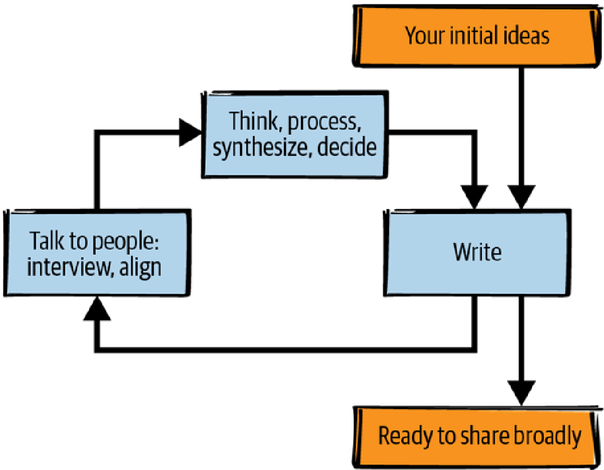

> 图 3-2：撰写愿景或战略时的迭代过程。

#### 初步想法

在你刚开始思考创作愿景或战略时，可以问自己一些问题。
这些问题只是一个起点：干系人和视角会很多，
这只是一次练习，帮你在与他人交谈前把自己的想法理清楚。

##### 已经有哪些文档？

如果有比你的文档范围更大的愿景或战略，比如公司目标、
价值观，或者已发布的产品方向，你应当“继承”它们设定的任何约束。
这正是你的定位地图带来的视角派上用场的地方。
如果你在写一份大范围的技术愿景，
你应当知道你的组织希望在未来几年实现什么。
你所设想的未来，应当既包含那些既有计划的成功，
也包含为支撑它们而必须发生的技术变化。

如果有比你的范围更小的团队级或小组级文档，也要留意它们。
有时，一份范围更广的愿景或战略不可避免地会让范围更窄的那份必须改变，
但要理解那会造成的扰动，并在考虑 trade-off 时把它权衡进去。

##### 什么需要改变？

现在什么是困难的？如果你的团队在抱怨被对其他团队的依赖卡住，
你可能想要强调自主性。如果新功能上线很慢，
也许你想要的是快速迭代速度。如果你的产品宕机的时间和正常的时间一样多，
也许你需要把重点放在可靠性上。

以你对公司的了解，你的团队应该把投入放在哪里？
Mark Richards 和 Neal Ford 谈到软件中的“架构特征”：
可扩展性、可扩展能力、可用性等等。⁹
随着业务扩张或变化，你需要投入哪些特征？

要往大了想。如果你所在的代码库构建并部署一次需要一天，
你可能会很自然地希望渐进式改进。“这个必须缩短到半天！”
但要再往前想一步。如果你设定 20 分钟部署的目标，
奔向这个目标的团队就有动力去想更大胆的想法。
也许他们会考虑替换 CI/CD 系统，
或者弃用一个永远无法与这个目标兼容的测试框架。
激励人们变得有创造力。（但是，正如我在本章后面会讨论的，
不要设定你的组织不可能实现的目标。）

##### 什么已经很好？

如果你有敏捷的性能、坚如磐石的可靠性，
以及简单干净的 UI，那就确保你的未来状态包含
把这些运转良好的东西保留下来。也许你最终会刻意
用其中一部分优秀之处去换取你更想要的东西，
但不要不自觉地这么做。

##### 什么重要？

你也许已经注意到一个规律——这个问题到目前为止每一章都出现过
（而且它还会再出现）。你的愿景或战略会影响许多资深人士的工作。
不要把他们的时间或你的时间浪费在不重要的事情上。
例如，如果你要让团队做一个从一个系统到另一个系统的昂贵迁移，
那最好在终点有一份宝藏。要花的功夫越多，宝藏就得越好。

##### 未来的你会希望现在的你做过什么？

最后一个！我很喜欢这个技巧：想象与年长两三岁
（但愿也更明智）的未来的我对话。我会问世界变成了什么样、
我们做了什么，以及我们希望自己做过什么。
哪些问题每个季度都在变得稍微更糟，如果被忽视就会变成真正的烂摊子？
如果可以，帮未来的自己一个忙，不要忽视那些问题。
我把这类帮忙称为“给未来寄一块曲奇”：
那是现在的你送给未来的你的一份小小而真诚的礼物。

#### 撰写

把这些问题的思考做完之后，你可能已经开始识别出一些主题，
并对什么最紧迫有了自己的看法。这也许是个开始写粗略初稿的好时机。
不过要做好准备，让别人改变你的想法，而且可能改很多。
随着你和别人交谈、决定下一步做什么，你会不断编辑和迭代。

以小组为单位写作可能很棘手。有两种做法：

##### 由牵头人先写一份供讨论的初稿

一种做法是让小组的牵头人（再次假设是你）
写出一份供讨论的初稿。这种做法很适合让文档有一致的语气和关注点。
但要注意，这份草稿不可避免地会受到作者自身兴趣和立场的影响。
评审者和编辑者会被草稿里已有的内容带偏，
尤其是当写它的人在影响力或资历上比他们更高时。

你可以通过在开始写作之前花大量时间以小组形式讨论，
来帮助缓解这种效应。如果你对某些决定并没有强烈感觉，
甚至是随便选的，就明确标出来：“我掷骰子选了这个方向。
如果大家达不成一致，我觉得它是个合理的默认值。
不过我打赌我们能做得更好。”务必确保在这个系统上
比你懂更多的人，会觉得安全地反对你是没问题的。
“强观点，弱坚持”只有在你能极其清楚地表明情况确实如此时才成立。

##### 汇总多份初稿

另一种做法是核心小组的每个人各写一份初稿，
然后再由某人把它汇总起来。¹⁰
Zapier 的 director of engineering Mojtaba Hosseini
跟我讲过一个小组在之前一家公司采用这种做法的故事。
他说，有多份文档是收集每个人不带偏见意见的好方法，
但有些参与者最后对自己的文档投入了感情，
开始批评别人的文档，而不是为别人的文档做贡献。
那个小组没有指定任何人来合并草稿，
或者在两份草稿冲突时充当裁决者。
Hosseini 建议一开始就说清楚，这些文档都是
一份最终文档的输入，而那份最终文档所有人最后都能评审——
没有任何一份文档会是“赢家”。
要对谁写最终版本、谁来调解分歧设定预期。

#### 访谈

你核心小组的想法和意见，只会反映那个小组里成员的经历。
关于你自己团队之外的其他团队难在哪里，
你可能并不知道自己不知道什么——所以先把成见放一边，去和人交谈。
和很多人交谈。不要只挑你本来就认识和喜欢的同事：
他们很可能在组织上和你的位置相当接近。
去找其他领域的领导者、有影响力的人，以及贴近一线工作的人。

在早期，你可以在访谈中问一些宽泛、开放式的问题。

- “我们正在为 X 制定一套计划。你觉得有哪些重要的东西必须包含进来？”

- “和……一起工作是什么感觉？”

- “如果你能挥一挥魔杖，你希望……有什么不同？”

当你已经界定了工作的范围、搭好了框架，
你可以通过描述你正在如何思考这个话题、
分享一份进行中的文档，或者请他们对一个稻草人方案做出反应，
来为对话划定范围。要优化的是获取尽可能多的有用信息，
并让你的访谈对象觉得自己是你正在做的事的一部分。
我总是在这类访谈的最后问：“我还应该问你什么？有什么重要的事我漏掉了吗？”

访谈还有另一个好处：它向访谈对象表明你重视他们的想法，
并打算把他们纳入你写的东西里。你会听到你没想到过的问题，
以及关于你已知问题的新观点。
别人可能对什么才是最大的问题和你看法不同。
保持开放的心态，认真对待他们的想法。

#### 思考时间

无论你和你的小组喜欢怎样处理信息（白板讨论、写作、画图、
结构化辩论，还是坐着对着墙发呆），都要确保给自己大量时间去做它。
我最好的思考方式是写作，所以在做愿景或战略时，
我需要把自己的想法写出来，然后长时间地精炼和编辑，
直到它们对我来说更讲得通。我也从与同事把想法聊一遍、
向自己提问、试着拆解细微差别中收获很多。
相比之下，我的同事 Carl 喜欢把信息装入大脑然后睡上一觉：
第二天早上他通常会有新的洞见。
在某些情况下，你能够搭建原型来检验自己的想法。
在另一些情况下，战略会更偏高层，
你得把各种后果推演当成思想实验来做。

对思考的转变保持开放。随着你在识别关注领域
或需要解决的挑战上取得进展，你会注意到自己在用新的方式谈论它们。
顺着这一点走，帮助它发生。你建立的心智模型和抽象，
会帮你想到更大的想法。

思考时间也是检查自己动机的好时机。
留意你是否在用某个你已经选好的方案来描述问题——
这对很多工程师来说会是一种思维阻塞。
我们一开始是在比较要解决的问题，
结果却发现自己在谈论我们“应该”使用的某种技术或架构，
说它会让人一切都变好。正如 Cindy Sridharan 所说：
“一个有魅力或有说服力的工程师，可以成功地把自己的热情项目
推销成对组织有益的东西，哪怕那些好处往好了说也只是表面的。”
尤其要留意你自己在向自己推销什么！在审视你提议要做的工作时，
反复问“是的，但是为什么？”，直到你确定这条解释
能追溯到你想实现的目标。如果这个联系很牵强，就诚实地承认。
你的宠物项目会有它的时机的。但不是现在。

### 做决策

在创造愿景或战略的每个阶段，你都需要做决策。
本章已经讨论了很多早期决策：创造哪类文档、让谁参与、
向谁寻求提携、如何界定你的雄心范围、
聚焦哪些目标或问题、访谈谁，以及如何为这项工作搭框架。
随着你在愿景或战略上推进，你还需要权衡 trade-off、
决定如何解决一个问题，并决定哪一群人不会如愿。

#### Trade-off

决策之所以难，是因为所有选项都有利有弊。
无论你选什么，都会有缺点。提前权衡你的优先级，
能帮你决定你愿意接受哪些缺点。对优点也是一样：
每个方案大概都在某些方面有好处！

我见过澄清 trade-off 最好的方法之一，
是把你想要的结果的两个正面属性拿来对比。
我听到这类说法被称为 *even over* 陈述。
当你说“我们会优先优化易用性 *even over* 性能”，
或者说“我们会选择长期支持 *even over* 上市时间”时，
你其实是在说（引用“The Agile Manifesto”的话）：
“右边的项固然有价值，但我们更看重左边的项。”
这种表述方式把 trade-off 讲清楚了。

#### 建立共识

有时桌面上没有一个选项能让所有人满意。
确实要努力对齐，但不要卡在全体共识上：
你可能要永远等下去，于是又回到了默认选择现状。
从 Internet Engineering Task Force（IETF）那里借一招：
他们的决策原则以拒绝“国王、总统和投票”而闻名，
转而采用他们所称的“粗略共识”，
主张“没有异议比一致同意更重要”。
换句话说，采纳小组的总体意见，
但不要坚持所有人都必须完全一致。
与其问“大家都接受选项 A 吗？”，不如问“有人没法接受选项 A 吗？”

当 IETF 工作组做决策时，他们要的是小组中绝大多数人同意，
并且主要的反对意见已经被提出并讨论过，
即便讨论结果不能让所有人满意。可能并不存在让所有人都满意的结果，
而他们对此没意见。Mark Nottingham 为 Stephen Ludin 和 Javier Garza 的
*Learning HTTP/2*（O'Reilly）所写的前言中，
提到他自己在这样一个小组里的经历：
“有几次大家一致认为，向前推进比让某一个人的论点胜出更重要，
所以我们靠掷硬币来做决定。”

如果粗略共识无法让你得出结论，而你又不准备掷硬币，
那就需要有人来拍板。这就是为什么最好事先就确定：
你或者别人拥有明确的领导权威，可以充当裁决者。
如果没有人担任这个角色，你可以请你的提携者来裁决，
但要把这当作最后手段。你的提携者很可能离这个决策太远、
并不掌握全部情境，你会占用他们大量时间，
而且他们最终可能选出一条谁都不满意的路。

#### 不做决定也是一种决定（只是通常不是好决定）

当你在选项 A 和选项 B 之间做选择时，其实还有隐含的第三个选项 C：不做决定。
人们常常默认选择选项 C，因为这样他们就能继续骑墙，也不得罪任何人。
这是你能做的最糟的事。决定会约束可能性，让进步成为可能。
不做决定本身就是一种决定：维持现状，以及围绕现状的不确定性。
无限期地保留所有选项，感觉上像是给了你灵活性，
但长期来看，你的解空间会一直很大。
其他依赖这个决定的决策，必须做对冲，
以便为你日后可能选择的任何一个方向做准备。

如果你意识到自己需要更多信息才能做出有依据的决定，
你预期能得到哪些额外信息，又打算怎么得到？
如果你选择等待，你在等什么？
记住，你通常不需要做出最好的决定，只需要一个足够好的决定。
如果你卡住了，就给它设个时间盒。
与其说“我们要选出这个星球上最好的存储系统”，
不如说“我们接下来两周研究存储系统，两周结束时做选择”。

有时推迟决定确实有很好的理由。
出色的决策网站 The Decider 列出了几条：
当你为做决定所需投入的时间和精力
根本比不上这个决定带来的任何好处时；
当做错了要付出沉重代价、做对了却回报微薄时；
或者当你怀疑这个情况可能自己消失时。
但关键在于，你是*决定*不做决定的。
你把“不做决定（维持现状）”加进你的选项清单，并有意选择它。
而不是两手一摊、转身走开。

当你无法确信自己的决定是个好决定时，想一想可能出什么错。
你能否加入一些纠偏或缓解负面结果的办法？
让它即使你错了，也不是什么可怕的事。

#### 把你的工作展示出来

无论你如何做决定，都要把它记录下来，
包括你考虑过的 trade-off，以及你最终是如何得出这个决定的。
不要省略缺点：要把它们讲得非常清楚，
并解释为什么你仍然认为这是正确的路径。
有些情况下，让所有人都满意确实不可能，
但你至少可以展示出你理解并考虑过所有论点。
把这些信息告诉同事不仅是一种尊重，
也降低了每次有新人加入项目、
并以为你没有注意到他们看得见的缺点时，
不得不把这个决定重新辩一遍的风险。

遗憾的是，当你创造战略或愿景时，让某人不满是不可避免的。
如果每个人都如愿了，那就不太可能真的做出了什么决定。
要有同理心，在能做到的时候尽量解决所有人的问题，
但要果断拍板，并说明你为什么选了你所选的东西。

### 保持对齐

弄清楚你最终的受众会是谁。你需要说服一小群同行开发者？
整个公司？公司以外的人？想一想你如何把每一群人
都带上这段旅程。

让你的提携者及时了解你的计划以及进展。
这并不意味着在你还没想清楚自己要表达什么观点时，
就把一份未编辑的 20 页文档发给他们。
要花时间把自己的想法整理好，
这样你就能给他们一份摘要，说明你如何应对各种问题、
你有哪些选项。除非他们想看到进行中的工作，
否则分享你正在写的内容的要点，而不是血淋淋的细节。
尤其是，如果你在写战略，
至少要确保在几个主要检查点上是对齐的：
在你把诊断搭好之后、在你选定指导性方针之后，
以及在你提出一些行动之后。如果你的提携者认为你走错了路，
你会希望在投入更多时间之前就发现这一点。

#### 要合乎情理

你的路径应当有雄心，但不能不可能。
有些变革的成本高得完全无法证明投入是值得的。
另一些努力在你的组织里根本赢不到支持。
有一个政治学概念叫奥弗顿窗口（图 3-3）：
在公共讨论中被容忍、不会显得过于极端、愚蠢或冒险的想法范围。
如果你的想法对需要相信它的人来说太超前，
你的同事会直接无视你的文档，而你会失去可信度
（第 4 章会讲更多）。要清楚你的组织能接受什么，
不要去接一场赢不了的仗。

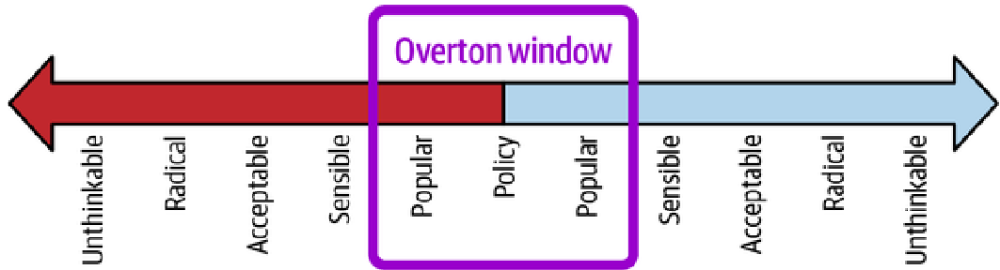

> 图 3-3：奥弗顿窗口显示了在特定时期哪些想法在政治上是可接受的
> （来源：基于 Toronto Guardian 的一张图片）。

#### Nemawashi

如果你一路上让干系人保持对齐，
你的文档就不会出现那样一个时刻：
你向一群人分享一份完成的文档，而他们是第一次听说它。
当我和 Asana 的 pillar tech lead Zach Millman
谈到在那里创作战略时，他告诉我他使用了 *nemawashi* 这一流程，
它是丰田生产体系的支柱之一。它的意思是分享信息、打好基础，
这样等到做决定的时候，已经存在共识。¹¹
如果有某个人需要对你的计划点头，
你会希望这些人在任何决策会议出现时，
就已经确信这个改变是正确的事。
我一直把这套做法表述为“在你确定自己有票之前，不要要求表决”，
但我很高兴得知原来这件事有个专门的词。

Keavy McMinn 讲过一个类似的故事，讲的是她在 Github 时创作的战略。
等到她准备好把文档分享给整个公司时，
她已经得到了老板和他老板的完全认可，
而且做了大量的幕后准备工作。
决策者们已经知道这件事应该有人员配置。
发布文档仍然围绕这项工作积累起了势头与热情，
并帮助更广泛的受众厘清细节、认可这些决定。

别忘了，对齐不只是说服别人接受某些东西。它是双向的。
随着你讨论愿景或战略的计划，那些计划可能会改变。
你可能会意识到，很多人卡在你文档的某个方面，
而那个方面对你其实并不重要，于是你最终把它删掉。
你可能会在某个引发冲突的点上妥协，
或者把某个对你并不特别重要、
却真正引起受众共鸣的东西放到更突出的位置。
你甚至可能合理地找到一个更好的目标。
所有这些都是可以的，也正是写这样一份文档需要花时间的原因。

#### 打磨你的故事

一份不是所有人都知道的愿景或战略，对你来说价值不大。
如果在你不在这间屋子里施加影响时，
人们仍然沿着既定方向前进，你就知道这个方向被理解得足够好。
但要实现这一点，你需要把信息装进每个人的脑子里。
如果你给组织一份长长的文档让他们去背，你做不到这一点；
你需要帮他们一把。这正是我之前提到的简洁一句话
或“车贴标语”式口号能真正发光的地方。
在他的文章“Making the Case for Cloud Only”中，
Mark Barnes 写到他们想出的口号“Cloud only 2020”，
它是一种强有力的方式，让 Financial Times 的每个人
都容易记住他们的云战略。Sarah Wells 在谈到同一次迁移时补充说：
“它无疑是我们技术战略中开发者能背出来的唯一一句话。”
如果你的团队知道、理解并不断重复他们要去哪里的故事，
你就更有可能抵达那里。

如果你能让人相信他们*想要*去你描述的那个地方，
你的项目也更有可能成功——并消耗更少的社会资本。
写作时，想一想你的话会被如何接收，
并清楚你想讲的是什么故事。回到画藏宝图这个比喻，
想象你已经画好了它，现在你正在海盗酒吧里，
把藏宝图摊在桌上，试图让同桌的其他人愿意跟你一起走。
你在对他们说什么？

你想要一个*可理解*、*能共鸣*、*让人舒服*的故事。

首先，你要确保这个故事是可理解的。
一个简短、连贯的故事，比一列互不相关的任务有说服力得多。
很难让人对他们不理解的东西感到兴奋，
而且你还错失了一个机会：在你不在场时让别人来讲这个故事。
即便他们是被你的热情带动的，
如果他们并不真正理解这个计划，就没法为它做宣传。

确保这个故事能引起共鸣。宝藏让你兴奋的原因，
对其他人来说可能一点也不令人兴奋，
所以你怎么讲这个故事真的很重要。
如果你的愿景是你们自己的团队将解决最烦人的问题、
过上更快乐的生活，还能吃冰淇淋，
那……对你团队里的人来说相当有吸引力。
如果实现这个愿景需要其他团队的工作，你就需要更多东西。
要展示你的工作也会让他们的生活变得更好。

同样，记住奥弗顿窗口，确保这个故事让人舒服。
一个从 A 到 B 的旅程故事，只有在他们确实处在 A 时才有说服力。
如果他们离 A 还很远，你可能先说服他们接受 A 会更成功，
然后等到这个想法被认为合理且被广泛接受之后，
再带他们走下一步。

你的故事在人们执行计划时也会帮到他们。
正如 Mojtaba Hosseini 对我说的：“当事情变难时，
每个人都需要知道这些困难是预料之中的，而且是可以克服的。
不要只讲旅途尽头有黄金的故事。
当出现问题时，你需要能够强调：
这是故事里英雄掉进坑里的那一段……但后来他们又爬出来了！”

### 创作最终稿

当你花了几周或几个月创作一份文档后，会很难相信这一点，
但并不是每个人都会兴奋地去评审它。不要觉得自己被冒犯了！
虽然人们可能心怀最好的意愿，
但一份冗长的文档可能会在标签页里开很久很久。
想想你怎么能让它容易读，或者用别的方式分享要点。
避免密不透风的文字墙。使用图片、要点列表和大量留白。
如果你能找到办法让你的观点清晰且好记，就会有更多人抓住它们。

一种办法是使用 persona：描述一些受你的愿景或战略影响的人——
开发者、最终用户，或者任何你的干系人——
并描述他们在工作完成前后的体验。
另一种做法是描述一个现在对业务来说困难、
昂贵甚至不可能的真实场景，并展示它会如何改变。
尽可能具体。除非你只面向同一领域的工程师做演示，否则避免行话。
有些读者在遇到几个他们不认识的缩写或技术术语之后，就会开始走神。

你可能会发现，除了你写的那份文档，再配一种别的文档会很有用。
如果你要在全员大会或类似场合做演示，你会需要一份幻灯片。
你可能既想要一份详细的文章式或要点式文档，
也想要一份一页纸、包含高层想法的电梯演讲。
如果你乐意与公司外的人分享，你也许可以写一篇对外博客：
这也能成为触达内部受众的又一个机会。

## 发布

一份只是某个人想法的愿景文档，与一份公司或组织正式认可、
各个团队都在努力实现的北极星式愿景，是有区别的。
我见过太多文档在这一点上死掉，
因为作者不知道如何让它们变成现实。

### 让它正式生效

你的文档是你的，还是组织的，区别在哪里？主要是信念。
它始于你的文档所需范围上的最终权威的认可。
通常这个人是人事管理链条顶端的那个人：
你的 director、各位 VP、CTO 或其他高管。
如果你一直在使用 nemawashi，并与那些意见重要的人保持对齐，
那个人可能已经认可了。如果是这样，
就看看他们是否愿意发一封邮件、作为背书在文档上署名、
在描述下个季度目标时提到它、
邀请你在规模适当的全员大会上演示你的计划，
或者做出其他某种公开姿态，表示他们把这份计划当作真事来接受。
如果你没有得到他们的支持，就请你的提携者帮你推销这个想法。

确保你的文档看起来像真的。把它托管在一个看起来正式的内部网站上。
关闭所有遗留的评论，删掉所有待办标记。
考虑取消添加评论的功能，改为留一个联系地址用于反馈。
如果你能把部门负责人或类似角色列为联系人，
那会比只在文档顶部放几个工程师的名字有分量得多。

一份获得正式认可的文档，给了人们一个可以用来做决策的工具。
然而，让文档变成现实还有另一个重要部分：
真正为其中的工作配上人手。如果你提出了新项目
或跨组织的工作，你可能需要编制——以及填满这些编制的真人。
如果你需要预算、计算资源或其他资源才能让工作发生，
这种需求本应在就方向达成一致的过程中浮现出来，
但现在你要面对真正拿到它的现实。
和你的提携者谈谈，如何在你常规的优先级、编制、OKR
或预算流程中运作这件事。

取决于你的组织，你可能要亲自负责开始执行这个战略，
也可能要把它交给其他人去让工作发生。
根据我的经验，如果你一直跟着它，
确保工作保持势头、随着愿景或战略变成实际项目时计划依然清晰，
你们所有人都会更成功。

### 让它保持新鲜

发布一份愿景或战略，并不意味着你可以不再想它。
商业方向或更广泛的技术情境可能会变化，你需要适应。
你也可能只是发现你选的方向是错的。这种事会发生。
要做好准备，在一年后重看你的文档，
或者在你意识到它不奏效时更早一点重看。
如果这份愿景或战略不再能解决你的业务问题，
不要害怕对它迭代。解释你有了什么新信息、
或者什么变了，更新它，然后讲一个新的故事。

## 案例研究：SockMatcher

是时候回到 SockMatcher 的朋友们那里了。
当你读本章开头的那个场景时，也许你对它们该怎么做有过想法。
在某些方面，那些技术问题很容易解决。
但要做出一个影响许多人的改变，绝非易事。

我们来想象你是一位在 SockMatcher 工作的 staff engineer。
下面是你筹备、撰写和发布的故事。

### 筹备

你之前的项目刚刚收尾，你正在找下一件有影响力的事来做，
最好还是有点挑战性的。为全公司最有争议的核心架构制定一套计划，
当然符合这个条件。它感觉也像个重要的问题，
一个能对业务产生巨大影响的问题。

你的 manager 有顾虑。之前有很多人尝试过处理这个架构——
这可能是一片无法穿越的沙漠！你提议花上几周时间，
弄清楚之前的尝试为什么失败。
如果你找不到一个有说服力的理由相信你的旅程可以不一样，
你就不会去做。

#### 为什么之前的尝试都没成？

你先去和两位过去尝试过重新设计单体应用架构的 staff engineer 聊天。

第一位是 Pierre，他花了三个月，
为单体应用及其周边架构做出一份详细的技术设计。其他团队并不买账：
他们不认同 Pierre 做出的一些 trade-off，
那个方向与他们为自己的组件制定的计划不一致，
而且他们不喜欢别人把一套现成的解决方案塞给他们去实现。
由于无法鼓动起热情，Pierre 断定这个项目没法解决
（至少，靠目前这批工程师不行）。他至今对此还挺恼火。

另一位工程师 Geneva，选择在尝试重构之前先建立一个联盟。
她成立了一个工作组，大家热情极高。
各方参与者起初都急着想合作，
但工作组陷进了无休止的争论，无法就一条路径达成一致。
那些小时的会议变成了时间黑洞，人们不再参加，包括 Geneva。

当你与这两位以及其他对“解决”单体应用有看法的工程师交谈时，
你注意到两种模式。第一种是大多数人心里都有一个具体方案：
“问题在于我们没有微服务”，或者“我们只需要把数据存储分片”。
每个人都希望自己的方案“胜出”，所以共识不可能达成。
第二种模式是所有人都只关注技术问题。
有很多技术上站得住脚的想法，
但没有任何计划说明如何让组织认可并走上某条路径。

你认为，如果把组织对齐作为问题的关键来处理，你能做得更成功。
你下决心要找到一位高管提携者，
并确保你提出的任何方向不仅是好的技术方案，
而且在这*家*组织里是可行的。
你会务实、低姿态，帮助已有的想法成功，
而不是让自己的方向强压过别人。

#### 提携

在之前的项目之后，你在银行里存了一些社会资本和可信度（见第 4 章），
但你知道这还不足以说服所有关心单体应用的众多团队。
你也知道自己将不得不做一些决定，而且没法让*每个人*都满意。
如果你需要完全共识，你就不会成功。
另外，你制定的任何计划都可能催生出工程项目。
如果你没法给这些工作配上人手，
你宁愿早点发现这一点，而不是浪费时间。你需要一位高管提携者。

你先找 Jody，她的团队负责运维单体应用：
让架构更容易维护符合她的切身利益。
但她看着自己的人被前两次改变架构的尝试抽走，
她想保护他们的时间。他们有自己的项目，
她不想让他们被又一个新倡议分心。
虽然她支持重新设计架构，
但那是一种“明年吧，但愿，也许”的态度。
她没兴趣把任何人投入到这项工作中。

你的下一站是 Jesse，负责食品保鲜盒发布的那位 director。
有了这个高关注度的项目上线，
Jesse 可能更容易拿到人手；而且如果你能把他的成功指标
与你自己的对齐，他很可能会支持这项工作。
当你和 Jesse 交谈时，你描述了一个未来：
产品团队可以自主工作，产品工程师更快乐，新功能交付得很快。
Jesse 不太确定。那是个不错的未来，
但食品保鲜盒今年就得发布；他们等不起一次大规模架构重构。
你同意这一点：任何方案都必须让食品保鲜盒的人以最小的摩擦发布。
Jesse 被说服了。他同意提携并支持你的工作。

#### 其他工程师

你寻找共同作者——几位能为这项工作带来不同视角和知识的同事。
你也想在组织各处建立盟友，
并把任何会对你的计划持怀疑态度或与你相抗的人拉进来。

你先从 Pierre 开始，就是那位提出过详细方案的 staff engineer。
他仍然有些情绪未平：他把心血投入一份周全的方案，却遭遇彻底的冷漠。
他说了一些关于公司领导层的失败主义（而且有点刻薄）的话，
并明确表示他认为你的工作是在浪费时间。
你问他能否把他之前的方案作为你部分工作的输入，
并承诺对你最终用到的任何部分都给他署名——
尽管你设定了预期：你的项目范围会不一样。
自己的工作被用上这个念头，让他稍微愿意帮忙了一些。
他仍然不肯加入你的小组，
但同意接受访谈，并在之后评审你的计划。

你邀请 Geneva 加入时抱有更高的期望。她加入了。
让你意外的是，她告诉你她之前的那个工作组还在，某种意义上：
三位 senior engineer 每周见面聊架构。
他们对单体应用的问题思考得非常深入，
你知道他们能看到那些不会立刻对你显现出来的细微之处。
你邀请他们一起干，请他们至少两个月内每周投入两天。
一位工程师 Fran 同意了；另外两位想提供建议，
但没法承诺一大块时间。
你同意每隔几周回到工作组会议上同步进展。

你又和几位潜在的盟友确认了一下：

- 食品保鲜盒项目的 team lead 倾向于把问题看得比实际更容易解决，
  尤其是当工作被指派给单体应用维护团队时。
  “他们为什么不在单体应用里建一些隔离的模块呢？”她问。
  但只要有计划，她就支持。

- 数据库方面的负责人担心你的项目会把意料之外的工作丢到他的团队身上。
  （这很合理：有前车之鉴。）你承诺让他了解进展，
  并让他尽早评审计划。

- 写最初那套袜子匹配代码的 staff engineer 资历非常深，
  而且*非常*有影响力。如果她被说服了，
  很多其他人也会被说服。她有一些想法，
  也想做早期评审者。

#### 范围

你的核心小组——你、Geneva 和 Fran——讨论你们想做什么、
什么可能会成功。Fran 很想为你们全部架构如何演进创作一份技术愿景，
但它不适合你的处境：你没有那么大范围的影响力，
你的提携者也没有。而且，那种范围的项目也来不及
在食品保鲜盒发布前准备好。

那为单体应用的核心架构写一份愿景呢？
那能厘清大家要往哪里去，但各团队在如何到达那里上仍会有分歧。
你确定你需要一份针对单体应用的宽泛架构计划，
以及一条明确包含食品保鲜盒发布的、通往那里的战略。
你会以描述一年的工作为目标，并保持在高层次上。
你承诺偶尔做一些更低层的技术决策，
但只在某个决策没有归属者时：
你会把大多数实现细节留给做这些工作的团队。
而且你的战略必须是正式的：它不能只是一份计划，
它必须是组织选定的计划，否则你不会认为这个项目成功。

当你们都在同一页上之后，你把要做的事写下来：
“制定一份高层的一年期技术战略，在演进我们核心单体应用架构的同时，
让食品保鲜盒的发布成为可能。”它有点含糊，但至少是个开始！

你们更多地讨论范围和问题，
收集之前那些工作的链接和工作组的笔记，
并让自己（以及你们的共同词汇）对齐。
你的文档很粗糙，不是你会分享到核心小组之外的东西，
但它把你的想法放在一处，让你们都能随时补充新想到的东西。

一旦你有了关于目标的一版电梯演讲，就去和你的提携者 Jesse 确认。
他认可这个范围和你正在创作的文档类型。
他让计划正式立项的建议是为它加一个组织层面的 OKR，
并把你列为 directly responsible individual（DRI）。
这有点吓人，但它的确会给你所期望的正式背书。
他提出去确保 Jody 和其他 director 都能接受，
并把那个 OKR 加进去。

你为这项工作创建了一个讨论频道，
在可能有关注者的其他频道里发布消息，
并分享关于你的范围以及你借鉴了哪些先前工作的笔记。
你强调你想和那些有看法的人谈，
也仍然欢迎每周至少能投入两天的协作者。
前者有*很多*——后者一个也没有。
你开始列出要交谈的人，并着手撰写你的战略。

### 撰写

在跳进解决方案之前，你想*非常*清楚自己要解决的是什么问题。
你最初的范围“制定一份高层的一年期技术战略，
在演进我们核心单体应用架构的同时，让食品保鲜盒的发布成为可能”
还需要更清晰，但你也不想直接跳到给方案。
你需要诊断现状，准确描述正在发生什么。

#### 诊断

可以考虑的事实太多了：

- 有一个当下的产品需求要支持食品保鲜盒，
  而且有迹象表明产品线未来还会进一步扩张。

- 运维单体应用的团队被叫醒得太频繁了：这不可持续，必须改变。

- 你的匹配算法有点慢，命中率还可以更高。

- 你的系统目前扛不住流量尖峰。

- 用户对你的可用性不满意。

- 登录系统很老，背负着大量技术债。

- 部署新代码又慢又烦人。

- 外部用户依赖着那些你希望能改的 API。

- 要加入新的可匹配产品，需要在几个核心组件里做重大的逻辑改动。

- 很多开发者就是不喜欢在单体应用里工作。

而这甚至还不是完整的清单！你着手挑选最重要的事实，
讲一个简单得多的故事。你的小组花了一些时间头脑风暴，
讨论什么重要、什么不奏效、什么已经很好。
你想象未来的你们看着同一个代码库，
工程师数量翻倍，又多了五个产品。
如果那些产品也被实现成边界情况，
为每个功能理清业务逻辑会变得极其可怕，
在这种情形下改动任何东西都会既复杂又令人提心吊胆。
构建会更慢，部署会更频繁地失败。
更多的名人用户会意味着更多故障。
如果你不采取行动，这就是未来。你最好采取一些行动！

虽然头脑风暴之后你有很多想法，
但你不想现在就太过投入其中。
于是你去和一些产品团队的成员，
以及工程领导者和一线实践者聊天，
目标是理解什么对他们重要。你了解到一些新信息：

- 你曾猜测名人代言带来的流量尖峰可能导致了可用性下降，
  但过载造成的故障其实不常见、也很短暂：
  每个月只有几分钟的停机。你当然应该改进这里，
  但这些故障并不是你们可用性差的最主要贡献者。¹²
  事实证明，真正的伤害来自平平无奇的代码缺陷，
  以及部署一个修复要花三个小时。
  之前提升可靠性的尝试集中在给发布路径增加更多测试——
  但这实际上拖慢了部署时间，拉长了故障时长。

- 很多工程团队抱怨在单体应用里工作，
  但他们真正讨厌的是发布代码。
  很大比例的变更会有意外行为。
  很难确定你的改动没有弄坏别人的东西，
  而且把一个修复发出去要花半天。团队因为应对故障而神经紧绷。

- 计费和个性化子系统是代码库里争议最大的部分，远超其他。
  大多数重大功能变更都伴随这两个功能中一个或两个的相应改动，
  而它们的逻辑如此复杂，以至于即便做最简单的改动，
  也很容易产生意外的副作用。

你还了解到很多别的：你交谈的每个人都有不同的话题想告诉你。
但访谈中逐渐浮现出一种模式，让你看清正在发生什么。
你挑选出最重要的一部分事实，讲一个简单得多的故事。

这是你的诊断：

*每一项新功能变更都需要在一组共享组件中做复杂的逻辑改动。
修改这些组件既慢又难。意外的相互作用意味着
团队不断干扰彼此的工作，造成长时间的故障。
每一种新的可匹配物品都会增加这些共享组件内部的耦合点，
让问题更糟。我们的系统需要能够承载更多的匹配组件、
以及更多添加这些组件的团队，而不会让开发陷入停滞。*

选择聚焦点是写战略时最痛苦的部分之一。
在这个案例中，那些没有版本管理的 API 仍然是个问题，
那套让人难受的登录代码迟早会成为问题，
而改进匹配功能是一个真实的机会——但你眼下不打算去做。
那些问题和机会都是真实的，
但你正在做一个艰难的决定，暂时忽略它们。

有了诊断之后，你去和你的提携者 Jesse 确认，
确保他同意你的聚焦方向是对的。
你把你*没有*聚焦的那份挑战清单也给他看，
以表明你看到了它们，但不认为它们应该排在前面。Jesse 同意。

#### 指导性方针

现在你已经清楚地知道发生了什么，你可以决定对此怎么做。

桌面上已经有一个别人提出的指导性方针：
你的一些同事在推动把单体应用彻底拆掉。
他们说，重构会让添加新产品更容易，
也会减少意外破坏的数量，并缩短在出问题时构建和部署代码修复的时间。
但团队仍然需要冒着风险修改共享组件。
那还意味着所有团队都要开始运行自己的服务，
其中一些团队将平生第一次进入 on-call 轮值。
最后，这样的改变至少需要三年，
而在此期间没有交付产品的方案。
所以，虽然“我们改用微服务吧”对一个约束条件不同的公司来说
可能是完美的解决方案，但它没有正视当下的处境。

转而去寻找那些少量工作就能产生巨大影响的地方。
一个明显的着力点是两个关键的共享组件——
集成会拖慢团队的地方：计费和个性化。
如果这两个组件容易接入，而不是每个产品都要写硬编码逻辑，
其他团队就能安全地添加新的可匹配物品类型。
故障会更少，团队得以把时间花在功能开发上，
并进一步改进系统。这是一个良性循环。

这是你的指导性方针：

*计费和个性化系统应当易于、且可以安全地集成。*

你也写了一些关于你*没有*选择那些指导性方针的笔记。
你描述了考虑微服务的理由，以及那条路会带来的好处，
但解释了它们为什么解决不了你的问题。

#### 行动

你着手勾勒你的小组为穿越挑战、执行指导性方针
而需要采取的行动。

你的行动必须是现实的，这一点很重要，
所以你和计费团队、个性化团队以及领导层确认，
确认他们认同你的方向。
计费团队已经有一些积压的工作，
是关于提供一份计费功能的菜单，
让其他团队通过设置配置项来选择。
个性化的人则设想过一种插件式架构：
核心功能稳定，每种可匹配物品的逻辑相互隔离。
添加新物品的团队只需要修改自己的插件组件。
这两项改动都会让共享组件更模块化，
并让它们可以被自助接入，
而这些团队也很高兴有个理由把时间花在上面。

不过这里有一个先有鸡还是先有蛋的问题：
这些都是重大且有风险的改动。
重构这些核心组件很可能造成大量故障，
所以这些团队没有把这项工作排上优先级。
你建议加入通过功能开关发布变更的能力，
这样出现回归时只需快速切回，而不必再部署一次。
更安全的部署会降低这项工作的成本和风险。

隔离工作不会一夜之间完成，
食品保鲜盒团队在此期间需要与这两个组件集成。
个性化和计费团队愿意把食品保鲜盒当作试点客户，
并为让它成功而优化，包括在现有系统里写出第一版集成，
等自助模式可用后再把它们迁移过去。
但这些团队以目前的人力没法同时承担隔离和集成两项工作。
Jesse 同意从分配给食品保鲜盒项目的编制里捐出一些，
让这两个团队都能扩编。

以下是你的行动：

- 增加一套功能开关系统，支持分阶段发布和快速回滚。

- 给支付团队增加两名工程师，给个性化团队增加一名。

- 改造计费和个性化子系统，让新的可匹配物品可以被轻松、
  安全地自助添加。

- 让计费和个性化团队把食品保鲜盒产品接入他们的系统，
  然后把它们迁移成新自助模式的试点客户。

这些行动是高层级的，相关团队有自主权去设计方案、做出大量决定。
但这种方式给了他们一个方向和若干具体的下一步。
还有很多很多其他的行动建议：
你交谈的每个人都有长长一串他们认为应该做、好让单体应用更健康的工作。
但你的指导性方针让你能聚焦精力，让清单保持简短。

你提名 Fran 作为主要作者来撰写这份计划，
你和 Geneva 提出大量修改建议。
这份文档诚实地说明了你的计划的 trade-off，
以及你考虑过、但没有选择的替代方案，以及为什么没选它们。

在你与提携者对齐之后（他建议了一些措辞改动，但总体很热情），
你把第一稿分享给几位盟友，以此试跑你的计划。
有些人留下了评论。你和另一些人当面访谈，排除了一些顾虑。
你每讲一次这个故事，它就变得更紧凑一点。
你把文档分享给范围越来越广的群体，
并开始在一些会议上做相关演示。

### 发布

说实话：你的计划并非人人都喜欢。
你的一些同事觉得不够劲（也许还有点生气）：
你的文档并不比他们已有的任何想法更“有远见”；它有点无聊！
有些人坚持认为这个问题不需要战略；
你只需要“直接决定”该做什么，而这条路就是显而易见的决定。

另一些声音响亮的派系不同意你的路径是显而易见的：
他们认为它就是错的。有一群人仍在主张把所有东西都搬到微服务上。
另一些人希望更多地关注应对流量尖峰。
而食品保鲜盒团队虽然能把他们的一部分功能建成微服务，
仍然要在单体应用里大量开发——其中一些人对这一点很不满。
不过，因为你花时间记录下了已知的缺点和你考虑过的替代方案，
这些都不算新闻。这些怨言改变不了计划。

幸运的是，正面的声音更大。
大多数人因为有了一条单一的、正式的、大家认可的方向而充满干劲。
你在那些从一开始就同行的盟友那里获得了特别强的支持。
你的工程组织级 OKR 提升了你的可见度，
你的提携者及其同侪都认同这项工作，并愿意为它配备人手。
你的计划会在不需要他们做出巨大承诺的情况下，
为单体应用维护团队卸掉一些负担，
所以 Jody 出人意料地提出提供一些帮助：他们会提供功能开关系统。

在接下来的一年里，你留在这个项目上，
直接参与计费模块化项目，并在个性化工作里担任顾问。
食品保鲜盒团队庆祝成功发布之后不久，
产品团队就宣布了一项新工作：匹配缺失的桌游棋子。
你的工作意味着桌游团队能够使用新的隔离功能，
直接开始构建。有了稳定的系统，
单体应用维护团队不再持续救火：
他们已经开始着手改进开发者体验，
并让系统对流量尖峰更有韧性。

通过聚焦你的精力，你移除了一个增长的阻碍，
以及一道拖慢所有人的屏障。而你已经准备好迎接下一个项目了。

继续翻到本书的第二部分：执行。

## 小结

- 技术愿景描述的是一种未来状态。技术战略描述的是一套行动计划。

- 像这样的文档通常是集体努力的成果。
  虽然创作它的核心小组通常很小，
  但你也会希望从更广泛的群体那里获得信息、意见和总体善意。

- 要事先有一套计划，说明如何让文档变成现实。
  这通常意味着有一位高管作为提携者。

- 要有意识地就文档类型和工作的范围达成一致。

- 撰写文档会包含许多轮迭代：与他人交谈、精炼想法、做决定、
  写作，以及重新对齐。这会花时间。

- 你的愿景或战略的好坏，取决于你能讲出多好的故事。

> ¹ 我们聚焦于愿景与战略，但这些技巧对任何大型集体决策都适用：
> 工程价值观、编码规范、跨组织项目计划等等。

> ² 如果有人想聊种子轮融资，给我留个言。

> ³ 你也许注意到，这类话题在代码评审和设计评审中仍然会消耗大量讨论时间，
> 即便它们并不是任何某个具体变更的核心。如果出现这种情况，
> 或者你看到的设计里有*相互矛盾*的既定假设，
> 那就说明你需要做一些重大的中心化决策，
> 与任何具体项目或发布无关。

> ⁴ 我们会在第 5 章讨论项目执行时谈到这类文档。

> ⁵ 话虽如此，Stripe 的 staff engineer Patrick Shields 曾告诉我，
> 他鼓励人们为各种各样的事情写小战略，
> 因为“你得先学会打业余篮球，才能进 NBA”。这是个很好的观点。

> ⁶ 一个提醒：如果你*总是*坐在后排为别人加油，
> 要确保你的组织认可这种领导力。如果没有，
> 就要确保自己也有一些发光的机会。
> 我会在第 4 章谈可信度和社会资本。

> ⁷ 如果你跳到这一章，跳过了本书前面那些“你的工作到底是什么？”的自省，
> 那么你的范围就是你觉得由你负责的领域、团队或团队集合。
> 它常常与你的 manager 覆盖同一片区域，但并不总是如此。

> ⁸ 这个问题的答案通常是否定的。

> ⁹ 他们在自己的书 *Fundamentals of Software Architecture*（O'Reilly）
> 第 4 章里有一份详尽的清单。

> ¹⁰ 本书的 development editor Sarah Grey 说，
> 如果不小心处理，这会是一场编辑噩梦，
> 一想到要把所有这些草稿汇总起来她就头疼。
> 如果你走这条路，要知道自己在做什么。

> ¹¹ 正如他所写，你想在一对一会议里听到那些“辛辣意见”，
> 并在决策者们作为小组开会之前，根据需要调整你的计划。

> ¹² 如果放弃一部分这种名人流量会被认为是不利的公关，
> 或者是一次错失的机会，你也许仍然会把它排在优先位置。
> 情境决定一切。

# 第二部分 执行

# 第 4 章 有限的时间

我刚入行时，常常纳闷为什么我那些资深同事看起来那么不愿意对事情做出
承诺。我会证明某件事确实是个问题，而令人费解的是，我的老板和身边的
资深工程师并不会放下手头的一切去解决那个问题。他们为什么不在意？

如今我成了那个资深同事，我懂了。作为资深的人，你能看到一大堆问题：
无法扩展的架构、浪费所有人时间的流程、错失的机会。当有人再指出一个
问题，你就把它加到清单上。

好消息是，你不太可能没活干。坏消息呢？你不可能把所有事情都做完。你
可能想扑向每一个问题，但你很快会明白，那样做根本不可持续。¹ 你必须
接受：走过那些坏掉的、不够理想的（或者只是特别烦人的）东西时，不做
任何处理。

## 把所有事情都做了

本章我们要讨论的是如何选择做什么。作为 staff engineer，你每天都
要做选择：是否加入事故响应的电话会议、如何回应一个指导请求、要不要
接下某个额外的项目。不是所有事都能成为你的问题。那么，哪些应该成为
你的问题？

我们已经讨论过机会成本，以及只承接对公司重要的工作；但本章我想再
叠加一层：什么对你重要。选择那些能支持你的成长、声望和幸福感的项目，
短期内可能显得有点自私，但你的需求很重要，而且你才是最有动力去关照
它们的人。

你的时间是最显而易见的有限资源：每周正好 168 小时，余生都是这个数。
我们将从这里开始，然后看另外五种你需要管理的资源：精力、生活质量、
可信度、社会资本和技能。这五种资源的权重会因你身处职业生涯的哪个
阶段、最近的成绩以及生活中其他正在发生的事情而不同。我们会看看新
项目会如何影响它们，以及你如何有意识地选择一种对自己合理的项目参与
“形状”。

作为本章的收尾，我会分析几个你可能考虑启动的工作示例，权衡它们对
公司和你的价值。我们会看一些方法，用来放大正面因素、减少负面因素，
或者干脆说不，决定不做这些事。

工作无穷无尽。而你只有一个人。先来看看你的一周。

## 时间

你承诺的每一件事都有机会成本。选择做一件事，就意味着你隐式地选择不
做另一件事。如果你用会议之间的五分钟修好文档里的一个失效链接，你就
选择了不在那一刻回一封邮件或者去倒杯水。如果你同意在接下来两年投入
*这个*有重大影响的项目，你就没有空去做*那个*项目了。² 无论规模大小，
这个决定都有代价。

### 有限的时间

我倾向于对自己的时间过于乐观。太乐观了。总有重要的、有意思的工作
可做——而我的默认反应是说：“我来做，我总能挤出时间。”我必须努力
去觉察这个倾向，并提醒自己：我的时间是有限的。

工作日程表通常只显示会议，这个默认设置很奇怪。如果你想做需要专注的
工作，你的日程表只显示了这些工作的*干扰项*，而不是工作本身。咨询
Confidantist 的高管教练 Fabianna Tassini 给了我关于管理工作量的
最佳建议：*把非会议也放进日程表*。我指的不是那种大块的“预留时间”，
好让别人一脸抱歉地往里塞会议；我指的是具体的、有明确意图的条目。³
这是一种很有力的方式，让你看清什么会在什么时候完成。示例见图 4-1。

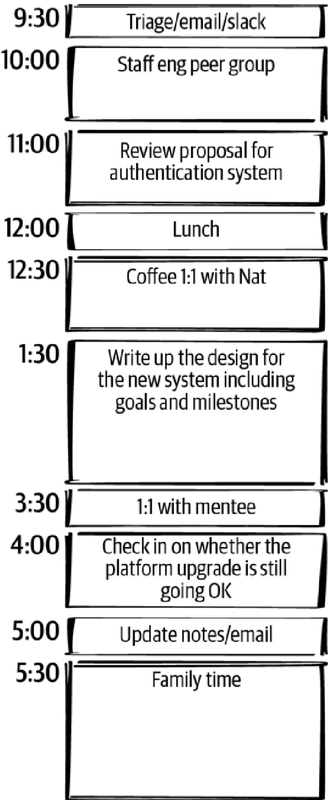
> 图 4-1：一天的工作安排。日程表里既有会议，也有专注工作的时间。

把工作放进日程表，意味着我能看清自己是否有时间接一个支线任务。我很
喜欢支线任务，所以直面自己真实的时间安排、并且问一句“如果我开始做
这件事，我就做不了什么了？”，对我很有帮助。当有人请我评审他们那份
20 页的文档时，我可以诚实地告诉他们我什么时候（或者是否）会有时间。
如果这件事比我已排入日程的某件事更重要，我可以把那件事挪开、腾出
空间。如果我发现自己把同一件工作反复改期，那就是一个信号，表明它
到底有多重要。我是不是在回避这件事？它是不是其实并不……重要？也许
我可以不再试图去做它。

日程表适合看天或看周，但如果我们要看更长的时间跨度，就需要更大的
图景。图 4-2 展示了在放入任何项目之前，一个月或一个季度的草图（我把
它叫作*时间图*）。我把一部分时间划出去，留给那些只是企业环境里工作
背景噪音的活动：全员大会、绩效评估，等等。根据企业不同，这块会大
一些或小一些，但很可能你的一部分时间已经是安排好的了。

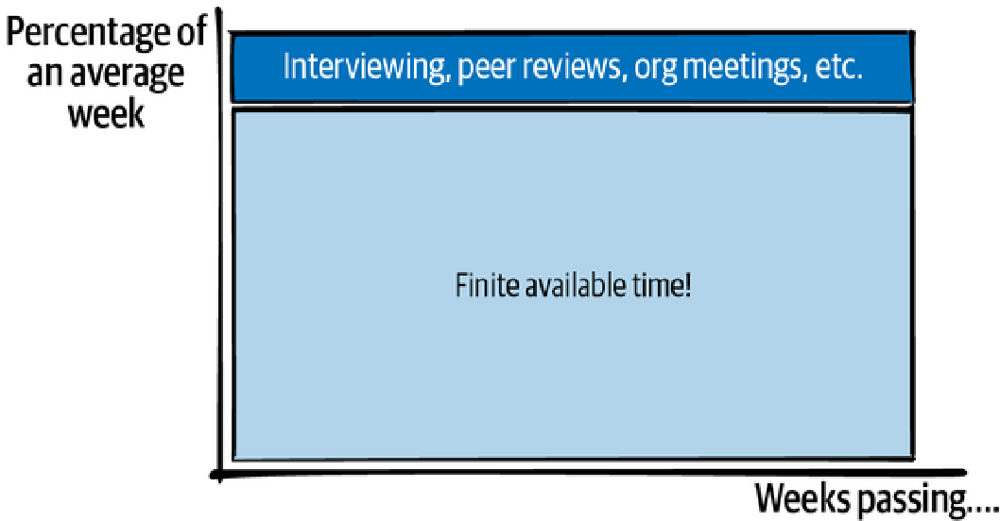
> 图 4-2：把你的有限时间可视化。

时间图上剩下的部分，是你能用来做这些事的小时数：项目工作、长期规划、
评审代码和文档、建立关系、跟上公司和行业里正在发生的事、指导和教练、
把项目往正确方向推，以及学习那些你将来会被期望对其有观点的技术。
还有吃午饭。每次你接手新的事情，就是往图上加一块。也许是一大块，也
许是一个小点。无论哪种，它都占着空间。

### 你希望自己有多忙？

领导工作可能难以预测。一场危机、一次故障或一次发布都可能造成负载
尖峰。如果一个项目需要的帮助超出你的预期，你可能会发现自己被超额
认购。所以，在填满日程时，想一想你即将到来的工作量可能有多不稳定。

如果你把 100% 的时间都分配出去，又发生了意料之外的事，你的选择就是
丢掉点什么，或者超负荷运转。如果你的许多任务并不紧急，丢掉一些可能
很容易。但如果你把自己只安排给重要的事，那么当你触及上限时，按照
定义，你丢掉的就是重要的事。如果你决定*什么*都不丢，工作就不可避免
地会溢到生活的其他部分，带来压力和疲惫。

要知道你平均每周想工作多少小时、能接受自己短时冲到多少小时，以及在
哪个点上你会无力承担这种负载、直接垮掉。我认识一些人像图 4-3 中的
“A”那样运行，遇到危机或机会需要多投入几个小时时，他们完全镇定。
我也认识另一些像 C 那样工作的人，始终处在最大产能上，时时刻刻都在
紧张。如果可以，尽量留一点缓冲空间。

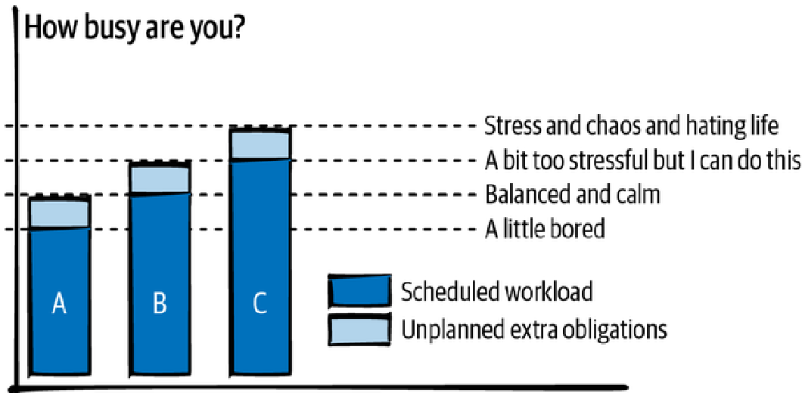
> 图 4-3：你的工作日程有多满？如果多出点事情，你能应付而不崩溃吗？

### projectqueue.pop()?

你有*定位地图*来给你关于什么重要的全局视角，有*藏宝图*来记住你想要
达成什么。利用它们，你应该能评估任何项目的重要性。那么理论上，你是
不是可以把可做的项目排个序，像图 4-4 那样，让每位工程师不断从优先
队列顶部取下一项？

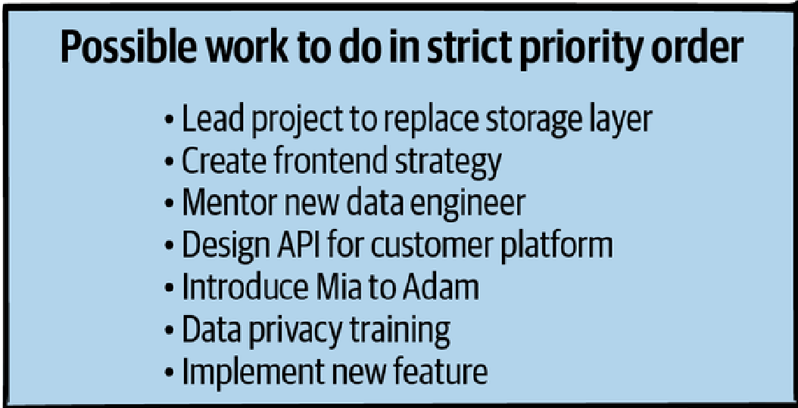
> 图 4-4：按优先顺序排序的工作清单。如果一个五分钟的引荐排在所有
> 这些项目后面，那些人一时半会儿是见不上面的。

我想我们都看得出来，那样有点傻。这份清单把大工作和小工作混在一起，
而且有些工程师更适合某些项目。严格选择最重要的下一件事，和选择适合
你的工作，这两者之间始终需要平衡。

所以接下来的这一节讲的是如何评估一个项目与你的需求有多契合。注意，
这一节会有点自私！你不应该孤立地使用这些准则：如果你在看某件自己
可能想做的事，我假定你已经考虑过这个项目是否重要、有用、及时、可
达成，是否契合组织的需求与文化。

但你不是这台组织机器上一个可互换的齿轮，而照顾自己的需求和做一个
团队玩家并不冲突。事实上，如果你去寻找办法让自己的项目既能维持你的
健康和快乐，又能让你积累技能，你会做出更好的工作——公司也更容易
留住你。人人都是赢家。所以，我们来谈谈你的需求。

## 资源约束

如果你玩过人物模拟游戏 *The Sims*，你会记得每个被模拟的小人（一个
Sim！）都有一个仪表板（见图 4-5），显示他们的舒适度、精力、社交生活
等水平。这些需求条会在不同情境下上升或下降，游戏很大一部分内容就是
让你的 Sim 保持良好状态：给他们安排活动来提升“乐趣”，给他们足够的
睡眠来维持“精力”，等等。如果其中某项需求真的见了红，你的 Sim 就会
心情极差，某些活动对他们根本不可用，即使是那些对他们有好处的活动。

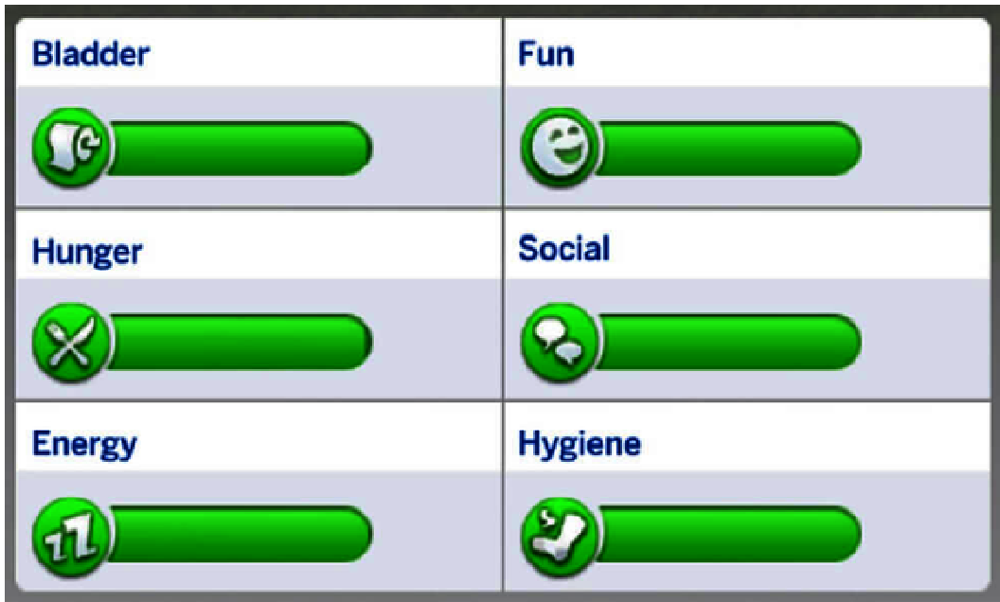
> 图 4-5：The Sims 4 中的需求面板，版权归 EA Games 所有（图片来源：
> https://www.ign.com）。

### 你的仪表板

好吧，你大概不是被模拟出来的。你大概是真实的人类。⁴ 但话说回来，
你能想象一个属于自己的小仪表板吗（图 4-6），显示你当前各项需求的
水平？想象它包含五种资源：精力、可信度、生活质量、技能和社会资本。⁵

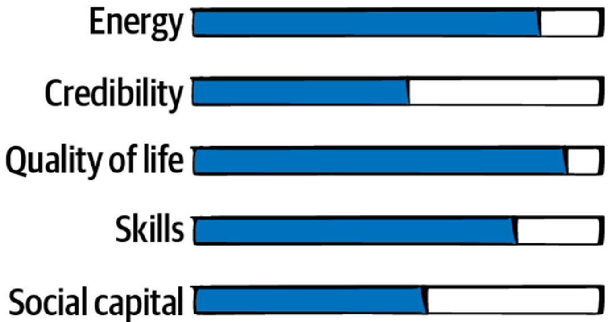
> 图 4-6：用于承接项目的需求面板。

我们来逐一看看这些需求，以及什么会让它们上升和下降。

#### 精力

理论上，如果你有一个小时的空闲，你可以选择以任何方式度过它。实际上，
这取决于你有多少精力。很容易耗尽我们家里称之为 smartbrain 的东西：
那种让你保持专注、把一件工作做出成效的精力。smartbrain 一旦用完，
做任何有用的事都会变成挣扎。开了一整天会之后，我有时会有一小时空闲，
本可以用来看文档，但我的脑子已经成了糊状：我能解析那些词，但绝不可能
记住信息、也察觉不到任何弦外之音。我得花五倍的意志力才能待在那个
标签页上、不滑去刷 Twitter。如果我试图写作，我根本组不起思路：连回
一封邮件都成了无法逾越的挑战。这里存在一道准入门槛：你必须拥有这么
多精力，才能开始这项任务。

不同的人会被不同的事充电或耗尽。一对一会议把我彻底榨干，但我有些
朋友却靠它们获得能量。一旦开始，我写代码或写作时看不出有明显的内部
上限；但读了大约一小时文档或者调试之后，我的大脑就开始关机，眼神也
呆滞了。要弄清哪些工作对你来说代价高昂，哪些工作会让你在一天结束时
还剩下一些 smartbrain。

你的精力还会受到工作之外因素的影响。如果你的宝宝不睡觉，你今天起步
时的油箱就是不满的。如果你在搬家、应对疾病，或者持续处在充满压力的
境况里，这些也会消耗你的精力。⁶ 我们中很少有人能把精力隔离开来：
去上班的时候，你还是同一个你。

#### 生活质量

在科技行业，我们大多数人处在一个非常幸运的位置：能做自己喜欢、并且
由自己选择的工作。这份工作可能很难，但它能刺激智力，通常报酬不错，
而且一般不危险。我们非常幸运。但也有可能，这一切都成立，而你正在做
的工作仍然让你深感不快。当然，你的生活质量不会、也不应该全部来自
工作；你甚至可能留在一份自己不喜欢的工作上，因为它是通往你想要的东西
的一步，你在为未来的幸福做优化。（关于这一点，第 9 章有更多讨论。）
但我们生命中很大一部分时间都在工作，希望对自己的工作感觉良好是合理
的。

如果你喜欢自己正在做的工作和一起工作的人，那会每天都提升你的生活
质量。如果你感到无聊，或者共事的人对你很糟，工作反而可能一点点磨掉
你的幸福感。你的生活质量还会受其他资源影响：如果一个项目吃掉了你的
精力，你可能就没法去做其他自己喜欢的事。如果它提升了你的知名度、
让人们敬佩你，这种认可会让人感觉良好。你是否认同你们共同踏上的这段
旅程，也会影响你：最有趣的技术和最好相处的同事，可能也抵不过“我在
世界上做了坏事”的感觉。当然，金钱对你的生活质量有巨大影响，对你的
家人或受抚养人的生活质量也一样。正如一位与我交谈过的人所说：“为一家
巨型企业工作、拿最高的薪水，也许并不会让我个人幸福，但它能让我付得
起母亲的养老照护费用，这可能是我会放在个人幸福之上的东西。”

#### 可信度

作为 staff engineer，你很容易飘向更高海拔的问题，感觉与技术的“战壕”
越来越远。这本身不是坏事：各个高度上都有工作可做。但如果你完全离开
底层技术问题，其他工程师可能会怀疑你的技术判断力，因为他们觉得你太
脱节了。在某些情况下他们可能是对的！你对什么是可行的、什么是良好
实践的理解可能会过时。

你可以通过解决难题、让自己显得有能力（见第 7 章）、持续展现良好的
技术判断力来建立可信度。我在 Twitter 上问过什么会导致可信度流失，
其中一个主要主题是绝对主义：如果你喜欢某项技术，并且在任何情况下都
为它站台，人们就不会再相信你懂自己在说什么。

可信度也延伸到你的领导技能。如果你礼貌（即使对讨厌的人也礼貌）、
沟通清晰、在压力情境下保持冷静，别人就会信任你是那个房间里的大人。
如果你粗鲁或非常戏剧化，发出的邮件是满屏术语、让人读不下去，或者
让全员大会等着你问一个只跟你有关系、又冗长离题的问题，效果就会相反。⁷
每当你接手一个混乱局面、并让它对其他人来说更容易理解，你作为专业
人士的可信度就会增加。当你被视为混乱的一部分，或者一个项目做得不好、
而你没处理好这次失败时，你的可信度就会流失。

可信度是另一种常常有准入门槛的资源。除非有人相信你能成功，否则你
不会被交予一个困难的项目或机会。而任何你提议的改动，如果别人相信你
知道自己在说什么，就会更受欢迎。⁸ 正如 Carla Geisser 在她的文章
“Impact for the Impatient”中所说：“在你展示出自己能把事情做成之后，
那个巨大的、也许无解的问题会变得更容易。”

在职级达到 staff+ 之后，你常常要在看到全局图景和接受务实的局部方案
之间找平衡。如果其他工程师认为 staff engineer 们住在象牙塔里、鼓吹
那些感觉没有价值的工作，你就更需要留意自己的“可信度分数”，并确立
自己确实知道自己在做什么。但这是一条细线：如果你忽视全局图景和业务
需求，就会在领导层那里失去可信度。

#### 社会资本

*可信度*关乎别人是否认为你有能力做到你想做的事，而*社会资本*反映的
是他们是否愿意帮你做到。⁹ 这个词来自社会学，指的是人与人之间的联系。¹⁰
不过用商业语言来说，我们通常这样看它：如果某人请你帮一个不那么方便
的忙，你会答应吗？这大概取决于他在你心里的信誉如何。他经常帮你，还是
不停地求你帮忙却什么都不回报？你上一次帮他之后是不是后悔了？不管
我们说不说出口，每个人与自己所认识的每一个人之间都有一个资本账户。
如果某人在你这里积累了信用，你就更可能帮他一个忙，或者给他一个善意
的解释。社会资本是信任、交情，以及那种“欠某人一个人情”或“相信
对方会记得欠你一个人情”的感觉的混合体。

社会资本随时间积累，而你对某些人需要的社会资本比另一些人多。总的
来说，你会希望与汇报链上的人保持良好关系，并积累起帮他们达成目标的
记录。如果有一个对业务至关重要的问题而你拒绝帮忙，或者你接下了一个
重要项目却没有完成，你就会消耗善意。而如果你总是求人帮忙却从不回报，
你会逐渐发现很难再让别人帮你。

随着你与人相处、进行好的对话、一起工作、帮他们解决问题、建立社交
联系、互相支持，善意和社会资本会在双方身上积累。完成项目也会积累
资本。如果你是去年让公司取得成功的那个项目的交付者，或者解开了那个
拖慢所有人的不可能解开的架构死结，那你下一次求人办事时就会有更多的
余量。正如 Alexandre Dumas 所说，没有什么比成功更成功。¹¹

一旦你存下了社会资本，花它的时候要有意识。当你声望正高时，你常常能
凭别人对你的信任（或者他们想让你高兴的愿望），推动一项他们其实并不
真的相信的倡议。明智地投资你的社会资本。如果你浪费掉那张“一次不
合理请求”的筹码，它不会再回来。

#### 技能

技能这种资源的表现与其他几种略有不同，因为它一直在缓慢下降。这并
不意味着你会忘记自己知道的东西（不过长时间不用的技术或方法，你确实
会失去熟练度）；它的意思是，任何技术技能组合都会慢慢变得不那么相关，
最终过时。我们这个行业变化很快。如果你接的项目什么都教不了你（或者
至少教不了与你想要的项目或职位相关的东西），你就跟不上这个下降速度。

在职业生涯中，你会通过三种主要方式提升自己的技能条。

第一种是刻意去学点什么：上一门课、买一本书，或者在一个玩具项目上
折腾。这类结构化学习常常可以在工作中进行，但你可能很难找到时间，
结果它溢到了你的业余时间里。

第二种是与一位真正高技能的人近距离共事。在一群超级明星里当那个技能
最弱的人，比在一个平庸团队里当最强的那个能学到更多。当你与优秀的人
一起工作，几乎不可能不让自己变得更优秀。

第三种——我认为也是最常见的——是边做边学。你在什么上花时间，就会
在什么上变得更擅长。如果你想打磨某项技能，练它最容易的方式就是接
那些需要这项技能的项目。

项目和职位常常都有准入门槛：如果你不具备相应的技能，就没有机会接下
这个项目。所以，取决于你在做什么，你可能每天都在提升自己的相关技能，
也可能眼看着它们慢慢侵蚀。

### E + 2S + ...？

当你考虑接下一个项目时，等式里不只有“这项工作对公司是否重要”。你
还得关注自己的需求仪表板。当你看自己如何填充时间图时，要注意任何新
项目、新任务或新倡议会对你每一项资源做什么：你的精力、生活质量、
可信度、社会资本和技能。（示例见图 4-7。）

遗憾的是，我没法给你一个能代入数字的公式：在不同时期，你会为不同的
资源做优化，这取决于你当下各项资源的水平，以及你希望做成什么。某些
项目、某些人生目标，只有在你拥有这些资源的最低水平时才够得着。

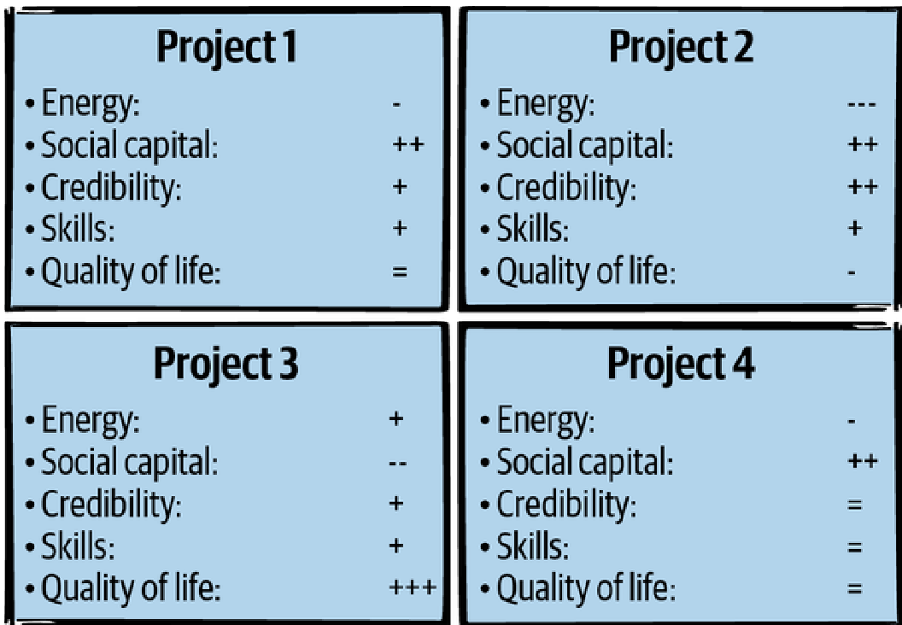
> 图 4-7：比较项目对各项资源的影响。

你接下的项目和任务不必都是理想的，甚至不必都对你有好处。有时你会
因为别的原因而选一个在某一个维度上很糟的项目。也许你接受一段比自己
更愿意承受的更长工时，因为帮团队渡过危机对你很重要。也许你去做对
老板最重要的那个项目，心里清楚之后会抽时间深入钻研自己一直有的一个
想法。有时一个项目对你客观上就是很糟，而你出于某种原因还是要做它。
但从长期看，你必须确保自己的需求得到了满足。

### bin packing

由于项目可以有各种形状和大小，高效地填满时间并不容易。图 4-8 展示了
这个决定可以有多复杂。加入其中任何一块，都可能意味着另一块更重要的
放不进去。当然，你还有让所有资源都保持良好状态这个额外的复杂度。

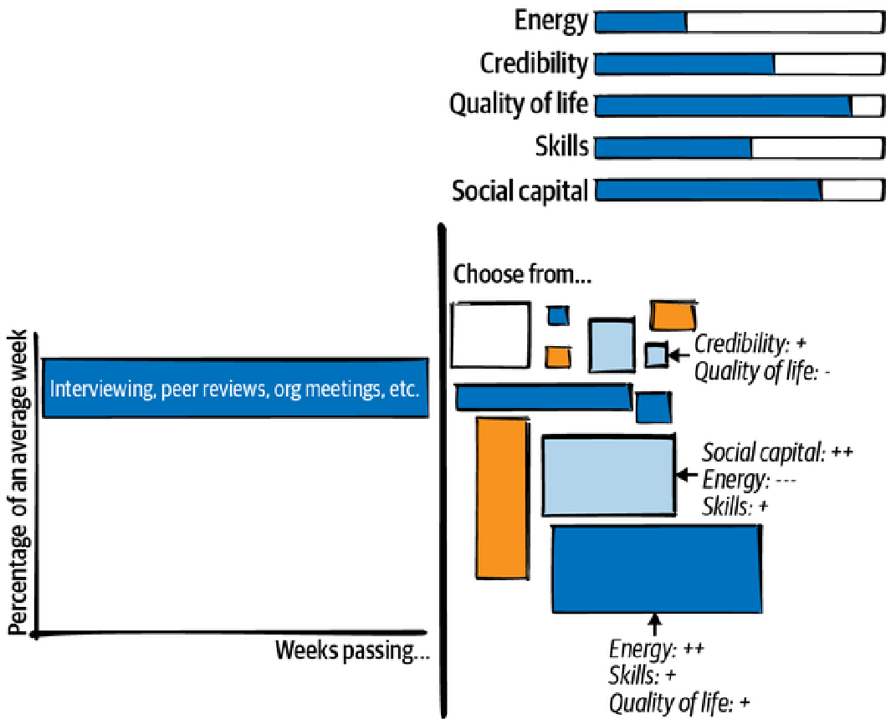
> 图 4-8：把需求纳入考虑来选择项目，是一个困难的 bin packing 问题。

这是一个多维的 bin packing 问题。这是出了名的难以优化的东西，所以
不要*完全*在这上面想太多，尤其当相关任务只会花一两个小时的时候。¹²
任何单个项目都永远不会是你仪表板分数的全部和终极答案。但项目越大，
你就应该花越多时间思考它是否合适。

## 选择项目

每天都会有新的项目和任务出现。如果你总是说是，你不太可能把任何事
彻底做完。如果你从不说好，就会错过那些本来对你有益的机会，而且看
起来像个摸鱼的人。一天里可以塞下很多小任务，而你通常同时手上不止
一个项目。但多少个才算太多？你怎么决定？

### 评估一个项目

参与一个项目可以有多种形状。但如果你清楚自己要签下的是什么，规划和
评估你的工作会更容易。

我们来看看项目来自哪些地方，以及它们的一些特征。

#### 你被邀请加入

一个项目需要负责人或另一位贡献者，于是有人来找你。项目已经在进行中，
所以它可能已经有了动能，你大概也不需要说服组织去在意它。而且被人找
上门来的感觉很好！但这个项目可能不是你认为最重要的，也不是你现在
乐意做的那种工作；而且，有人认为你很适合它，这*可能*意味着它和你
以前做过的工作非常相似，并不是一个成长机会。

#### 你主动要求加入

如果有一个项目，你认为它是很好的成长机会、能教你想要的技能、让你和
你喜欢的人一起工作，或者单纯特别有意思，你可以主动去要求加入。对
很多人来说，这太显然了，以至于这条建议不值一提。但我们中的一些人更
喜欢暗示自己有空，然后等着被邀请。如果你曾经这样做过，这则公益广告
是给你的：即使很明显你是最合适的人选，也不要等着别人来发现。去要你
想要的那个项目吧。¹³ 所有人都会更开心，而你真正得到的概率也会更高。

#### 你有了一个想法

有时新项目的机会会自己跳到你眼前。凭自己的主动去推动一件事，很可能
意味着你得找到合适的说法和叙事来让别人也在意它，尤其是当你想让他们
和你一起做的时候。当你只想进入设计或编码阶段，却发现自己陷在组织
架构里周旋——要创建新项目、要人头、要论证商业理由、要展示成果——
这会很令人沮丧。但一旦它启动起来，你就能按自己想要的方式去领导这个
项目，也许还能带来巨大的影响。

#### 火警响了

有一个严重延期的项目、一次巨大的性能回退，或者一起可怕的事故——而
你可以扭转局面。再一次，被需要的感觉很好！加入一场危机甚至会有种
奇怪的放松感：目标通常非常清晰，而且人们倾向于行动，而不是共识和
规划。但这是一次突然的切换。

如果突发危机需要全员上阵（或者需要你上阵），你可能突然要去做别的
事情一阵子，然后再回到常规的项目日程上（如图 4-9）。这是一次重大的
上下文切换。它可能有点突兀，之后你可能需要一些时间才能回到之前的
状态。但帮忙往往是对的事。

不过要记住，如果你做*太多*危机响应，就很难找到成长机会，也很难为
自己的工作讲出一个好故事——除了“哪里着火我就扑向哪里”。

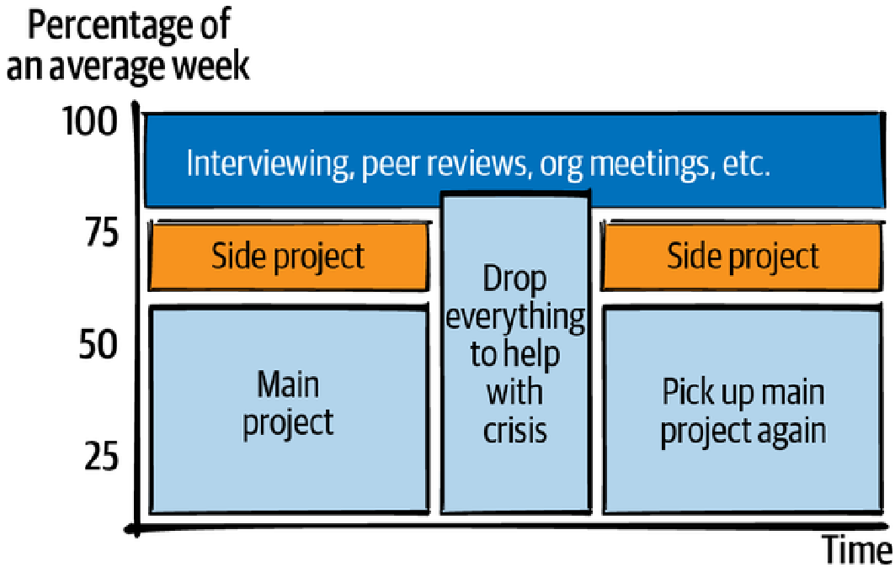
> 图 4-9：被拉走去帮忙处理危机。

#### 你认领了一个问题

当你第五次被一个笨拙的 API 或者一坨技术债拖慢速度之后，你可能会
觉得很难不去顺手把它处理掉。如果你把所有可做的工作排个序，你可能
很难说这个修复是清单上最重要的，但它*一直在烦你*，你不想再忽视它了。
是时候做一次支线任务了（见图 4-10），去修它！

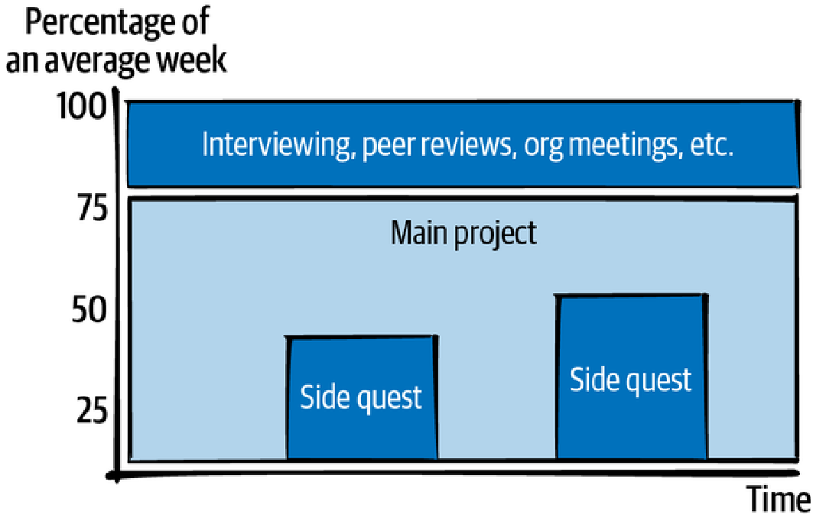
> 图 4-10：支线任务会占用你原本要做的工作时间。

当你被更大的工作卡住时，解决一些小而容易的问题可以是重新积累动能的
好办法。你能修好眼前的问题，还很可能从同伴那里得到许多称赞（以及
可信度和社会资本！）。感觉棒极了。但这类工作做得太多，会让你远离
长期项目。

#### 你被邀请加入一个草根行动

一种更模糊的邀请，是参与某个草根倡议，比如说一个在公司范围内改进测试
的工作组。这类倡议不在任何人的 OKR 上，公司很可能也没有对它投入。
加入这样一个小组，可能是与有意思的人共事并产生巨大影响的方式，也
可能*极其*浪费时间。很难判断你正在走进哪一种，所以要小心。如果有
组织层面的支持、明确的时间投入、退出标准，以及一套决策流程，工作组
可以是有效的。但如果它是一大群已经被过度占用、喜欢讨论却没有权力
改变那些烦人之事的人，那它就是个社交团体，什么工作都不会发生。

#### 总得有人……

它可能是会议结束时的行动项、另一个团队意料之外的请求，或者一个谁都
没预料到的问题：有些工作不属于任何人，而你应当尽自己公平的一份。
如果它会涉及可怕程度的政治斗争、乱七八糟的遗留物或者枯燥的杂事，
考虑承担*超出*你公平份额的部分：有时候，作为周围最资深的人，就意味
着你应该保护经验较少的同事，自己接下最脏的活。主动承担能在团队里
建立可信度和善意，虽然它往往令人沮丧，但当你把工作做到最后、知道
自己就是它不再一团糟的原因时，会有一种奇怪的满足感。不过，就像扑向
问题一样，要小心别做得太多，以至于牺牲了别人期待你交出的其他结果。

#### 你只是在插手

作为 staff engineer，你很可能对一堆你没有被邀请参与的事情（如图
4-11）持有观点。如果你看到某个项目正朝着危险方向走，或者你有让它
变得更好的想法，你可能会想办法插进去聊几句。插手可能非常受欢迎，
也可能完全相反。确保你不是在“扔水气球”：参与的时间刚好够制造混乱，
然后在没有留下来承受你那些改变的后果的情况下抽身离开。

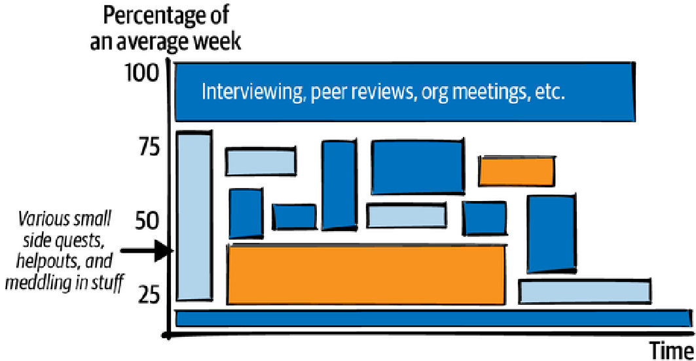
> 图 4-11：做很多小的、频繁变化的事情。这类工作很难讲出一个连贯的
> 故事。

> [!NOTE]
> **别人不一定是对的**
>
> 我们中的一些人会允许低优先级的“别人的事”抢占我们原本计划要做的
> 最优先事项。如果你总是丢下自己的活去帮忙处理哪怕很小的故障，或者
> 无论当时在做什么都在几秒内回复 Slack，你可能就是这种人。
>
> 有时打断确实比你想做的事情更重要。但要有分辨力。记住，别人对你
> 资源仪表板的可见度有限。除非你非常幸运，否则只有你自己会照顾你
> 自己的资源。

### 你要签下的是什么？

当你考虑接下一个新项目、新任务、指导安排、会议等时，要弄清它的形状，
并问自己它对你的时间会有什么影响，现在和以后都算。要对自己清楚：你
在往日程表里加什么、要把什么寄给“未来的你”。有些项目开始很小，却
会遇到一个拐点（比如项目获批），然后开始需要多得多的时间。另一些在
开始时很耗时间，之后就逐渐减少。如果你知道它以后会变忙（如图 4-12），
你到时还应付得来吗？

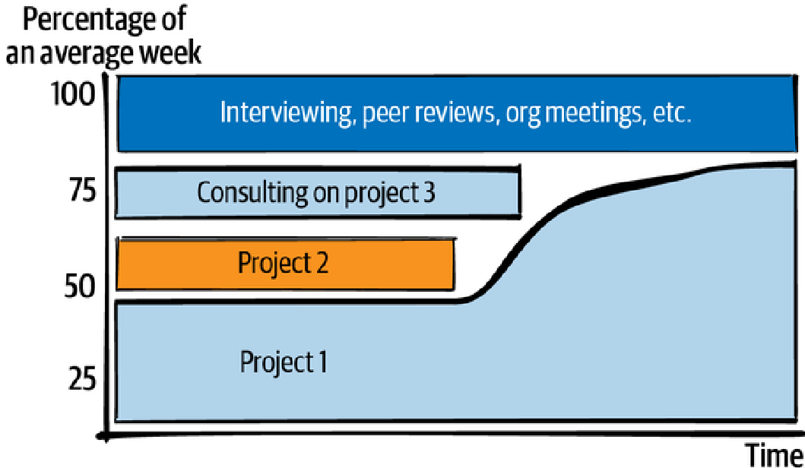
> 图 4-12：在多项目之间分配精力。项目 1 随时间逐渐加码。

在估计时间时要谨慎。比如，如果你答应每周参加一个一小时的会议，那
真的只是一小时吗，还是你需要额外做准备、还会带着行动项离开？¹⁴ 如果
这个会议落在一个空着的四小时区块中间，你还能高效利用另外三个小时吗？

一个看起来很小的项目，如果你打算长期做下去，实际上可能是巨大的时间
投入。要考虑你参与的边界和范围。如果你接手某个流程的所有权，以后你
能把它交给一个团队吗？如果你只是临时加入一个项目或帮忙处理一场危机，
并不打算长期待下去，那就明确说明你只在开头参与，以便消除歧义或帮
负责人起步。对于有风险的工作，或者你不确定自己是否该做的工作，退出
标准尤其重要。你可以通过加入正式的 go/no-go 或回顾节点，或者明确地
把它框定为一段限时实验，来降低这种风险。

即使是很小的项目或任务也能影响你的资源，而且影响可能不成比例。一次
会议可能大幅提升你的社会资本和可信度，也可能耗尽你的精力和士气，
让你一天剩下的时间都无法专注。与某位技能非常高超的人结对一个下午，有时
比你自己学一周学到的还多。

### 关于项目，要问自己的问题

这里还有几个关于资源、值得思考的问题。

#### 精力：你已经在操心多少件事了？

我开玩笑说，我的精力只够同时在意五件事。¹⁵ 如果我选择在意第六件，
前面五件里就有一件必须掉出清单。否则，随着空中抛接的球变多，我很
可能会不小心掉一个——而且掉下来的不会是那个最不重要的。我通常能在
一次会议的时长里在意一些额外的事情，之后也许还能再跟进一两个简短的
行动项。但那之后，这个槽位很快就会被下一次会议的议题填满。所以，当
有人邀请我去在意他们遇到的某个新问题时，我必须决定是否要*停止*在意
别的什么。

如果这个新项目是请你开始在意一件新的事情，你有一个空槽位给它吗？
记住，你的容量也会受到“现实生活”中发生的事情的影响，不只是工作。
如果你预计生活中会有重大的事情发生，这可能不是开始一个需要投入大量
精力和注意力的项目的时候。每一个选择都意味着有别的什么事你做不了，
而如果你选择太多，最终会稀释你在其中任何一件事上的影响。所以你确实
需要选择值得打的仗。¹⁶

> [!WARNING]
> 如果你容易让各种干扰同时把自己的注意力拉向四面八方，试着养成一个
> 习惯：在条件反射般地主动请缨或答应做某件事之前，先停顿几秒。

#### 精力：这类工作是给你充电还是消耗你？

这个项目会涉及哪类工作？如果它需要无数次白板讨论来建立上下文，而你
觉得那种事很累人，这个项目对你就更昂贵。如果你很难长时间专注，而
你需要读几百页的背景材料或者一摞行业白皮书，这类项目对你会更难。

你要共事的人里，有没有谁每次交谈都让你精疲力竭？如果你在考虑一个
项目，而一想到其中涉及的那类工作就觉得累，那么在决定是否开始时，
要把这一点算进去。

#### 精力：你是不是在拖延？

如果你精力不足，要硬推着自己在某个庞大、模糊、复杂的项目上迈出下
一步几乎是不可能的。你可能会发现自己捡起一些低优先级的工作来填空。
这没什么不行：在开了一些耗人的会议之后，一天中最后一个小时很适合
收拾桌面或者归档旧邮件。但有些低优先级任务一开始很简单，后来会长成
另一个需要精力去对付的复杂项目。

在他的博文“The first rule of prioritization: No snacking”中，Intercom
联合创始人 Des Traynor 讨论了低投入、低影响的工作对工程团队的那种
磁铁般的吸引力。他讲到 Hunter Walk——现在是 Homebrew 的合伙人——
画了一张 2 x 2 的图，把影响和投入对应起来（见图 4-13），并警告不要
落在“低投入、低影响”那个象限，把这类工作称为“吃零食”。由于这类
工作往往又快又有用（而且感觉良好），你很容易为做很多这样的事找到
理由。但正如 Traynor 所指出的：“它让人有获得感，也能解决短期问题，
但如果你从来不吃点有实质的东西，你会难受。”

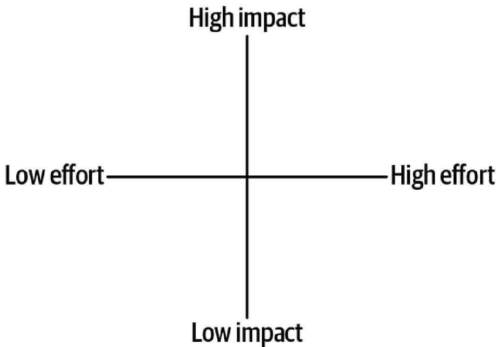
> 图 4-13：项目可以有高影响或低影响、高投入或低投入。小心不要在
> “低影响、低投入”象限花太多时间。

当你累了的时候，吃零食会比休息起来更容易。留意你什么时候是因为累
而在做杂事，然后找办法去休息。

#### 精力：这场仗值得打吗？

在她的文章“OPP (Other People's Problems)”中，Camille Fournier 提醒
人们注意：试图解决你看到的所有无主问题，会带来持续磨人的挫败感。
即使最终成功了，一个组织层面的项目也可能比你预想的更耗时、更耗精力。
正如 Fournier 所写：“花点时间反思一下，这件事对你来说是否值得，再
想想在你所在的公司里，你还看到多少和这一件一样让你想改变的事情。
想想你可以用那份额外的精力去做别的什么。”

#### 生活质量：你喜欢这类工作吗？

想想你的项目会需要哪类工作。在第 1 章，我引用过 Yonatan Zunger 的
观察：每个项目都需要核心技术技能、项目管理、产品管理和人员管理。
取决于你项目上还有谁，其中某些类别可能并没有分配给任何人；如果你是
项目负责人，你就要去补这些缺口。你会享受这类工作吗，还是会因为它
不是你真正*想*做的事而心生怨怼？

还有一些值得考虑的点：

- 如果你喜欢自己的工作紧张激烈、事关重大，这个项目有足够的刺激让你
  满意吗？反过来说，如果你更喜欢一切可预测一些，它会让你压力太大吗？
- 如果你讨厌独自工作，你会有可以协作的人吗？如果你觉得和人相处很累，
  你需要整天待在一个大团队里吗？
- 如果你喜欢结对编程，这个项目会让你结对吗？如果你讨厌结对编程，
  它会强迫你做吗？
- 你需要 on-call 吗？你喜欢 on-call 吗？
- 这个项目需要出差吗？你想要出差吗？
- 它会提供在会议上演讲、写文章，或者以其他方式公开分享你所学所得的
  机会吗？你想要这些吗？
- 你能和让你感到舒适、安全的人一起工作吗？在同事身边你能放松、做
  自己吗？

#### 生活质量：你对这个项目的目标感觉如何？

这项工作与你的价值观相符、让你感到充实吗，还是你对它有点“不对劲”
的感觉？对一些人来说，与价值观相符的工作意味着确保自己不做伤害他人
的事。对另一些人来说，工作必须主动帮助创造一个更好的世界。你的项目
想做成什么？大多数情况下，在公司内部换项目并不会改变你的工作与价值
观的契合程度，但有时你会做一些让自己感觉更好或更糟的事。想想你的
工作对世界的正面或负面影响，并权衡它如何影响你对自己生活的满意程度。

#### 可信度：这个项目会用到你的技术技能吗？

如果你已经在一个很高的高度上运作了一段时间，你可能会想偶尔回到战壕
里，证明自己仍然知道自己在说什么。不同的项目会用到和展示不同的技能，
而做困难的事会给你带来更多可信度。如果你能实现别人已经失败过三次的
东西，或者把它变得对别人来说可行，那对你的声望是实打实的提升——而
且如果你以后想做更抽象的事，你被视为“住在象牙塔里”的风险也会更小。

#### 可信度：这个项目能展示你的领导力吗？

一个新项目可以是展示你是领导者的机会：对结果负责、频繁且良好地沟通、
就什么做得好、什么不好以及为什么，给出恰当程度的细节。当然，你也会
通过真正把项目做成来与组织建立信任。评估新项目时要看它们会让你展示
哪些技能，以及成功会如何反映到你身上。同时也要意识到失败的风险：
如果你接下一场赢不了的仗，你会因为尝试而受到尊重，还是会被指责？

#### 社会资本：这是你的公司和manager期望你在这个职级做的工作吗？

在第 1 章，我们探讨了你和你的组织认为你的工作是什么。你可能想为
“manager认为适合你这个职级（或者你想晋升到的职级）的工作”做优化。
如果你所在的地方认为 staff engineer 不写代码（或不设计系统、不领导
大项目）就不算成功，那要确保你在做那些事。

总的来说，对你的汇报链上的人重要的工作，就是能积累社会资本的工作。
为了避免这开始显得*特别*马基雅维利式，我想重申这只是项目的一个
方面！我想我们都认识那种*只*为在领导层面前显得好看而优化的人，而
那种人我们通常并不尊重。但要留意你目前在那些影响你的职级评定、薪酬、
好项目分配和未来晋升的人心目中的位置。*向上管理*包括理解老板的优先
级、给他们需要的信息、解决挡在他们路上的问题——换句话说，帮他们
取得成功。¹⁷ 他们的成功会给他们带来社会资本，他们可以用这些资本来
帮你。

#### 社会资本：这项工作会得到尊重吗？

取决于你的项目与同侪的价值观是否一致，它会积累——或失去——你与
同侪之间的社会资本。如果你在做的事被别人视为一场重要的战斗，或者只是
一个非常酷的项目，那会积累善意，他们也会更愿意帮你。如果他们觉得
你在做一件毫无意义、方向错误、甚至邪恶的事，他们就会看低你，你也
很难得到他们的帮助或信任。我见过很多不以为然的私下对话，大意是
“看到 [某人] 为 [令人反感的项目或公司] 工作，我真的很惊讶。”如果
那个人口碑很好，他们可能是在用自己的背书给一个看起来不太光彩的项目
增光。有时他们是对的，但把自己的声望绑到那个项目上是一步险棋。

#### 社会资本：你是在挥霍已积累的资本吗？

这里有一个警示故事。我曾在一个团队工作，团队招了一位新的资深工程师，
他带着很亮眼的资历和许多尊重而来。大家普遍认为他是他上一个项目成功
的唯一原因，我们对他能做什么抱有很大期望。而他的开局很棒！作为团队
里最资深的工程师，他立刻就产出了成果，解决了大问题，也提高了其他
人的标准。我们那么高兴他加入了——直到我们不再这么想。

加入团队才几周，他注意到一个系统没有遵循某项最佳实践。他没错——
那确实一团糟——但那不是一个我们经常碰的系统，看起来也不值得修。
我们的新同事还是力主改动。他的声望和热情带动了其他人，当他从项目上
抽走两名应届生工程师、一头扎进这件事时，没有人反对。这是个糟糕的
决定。几周之后，事情变得很清楚：这个项目要花上几个季度——而且成本
是他预计的 10 倍。但这位资深工程师继续往前推，坚称这值得。过了几个
月他才接受现实，项目被放弃了。那两名应届生回到了原来的优先级上，
一切恢复正常——只是我们的新同事不再那么受敬重了。他把自己的社会
资本浪费在一场他其实并不特别在意的仗上。真是浪费。

留意你什么时候有浪费社会资本的风险。当你花它去帮别人时，要有意识，
比如请公司面试一位简历通常会被略过的朋友。这种形式的支持有时被称为
*提携*，它会让你付出代价：如果这个人最终失败了、表现得很糟糕，或者
成了一个让人后悔的选择，这会反映到你的判断力上。确保你提携的人值得。¹⁸
当你想要*借用*别人的资本时，也要意识到这种动态——比如你想为某个
技术愿景或技术战略争取高管的提携时。如果你在借用别人的权威和声望来
推动一个项目，别把它浪费掉。他们可能不会第二次为你的想法背书。

#### 技能：这个项目会教你一些你想学的东西吗？

技术变化很快，如果不刻意跟进，你的技能会随时间过时。一个新项目可以
是练习某项你想提高的技能的好机会。这可能是为了你想争取的某个职位、
你当前职位的某些方面，或者只是些你乐意多了解的主题。

可以这样想：你希望将来能在简历上讲出哪些故事？你想展示自己能够接下
一个庞大、模糊、混乱的项目并把它做成吗？你想要一个调试某个难题、
推动一次重大文化变革，或者把 junior engineer 培养成 senior engineer
的例子吗？如果是，就去找那些给你机会练习这些技能的项目。

#### 技能：你身边的人会提升你的水平吗？

有些人不用刻意教你就让你工作做得更好：他们太过能干，你光是沐浴在
他们的气场里就能长本事。好吧，现实是你通过观察一项技能被出色地执行
来学习，但我确实见过有些同事似乎对团队有魔法般的影响。本书第三部分
有大量内容是关于成为那样的人。但我也建议你为自己找到这样的人。

即使你是你所在群体里最资深的人，你仍然可以从身边的人身上学到东西。
做得好的人往往会提升身边人的技能，甚至是那些比自己更资深的人的技能。
如果你的团队里，应届生们敬佩资深工程师的技能，而资深工程师们同样
敬佩应届生的技能，那就是一个人人让彼此变得更好的团队。

与一位在你想要的技能上很出色的人共事，能以一种别处很难找到的方式把
你提升一个层次。这就是实习可以如此有价值的原因。但同样的现象贯穿
我们的整个职业生涯。正如一位朋友在得到与自己公司 CTO 共事的机会时
所说：“我将学到 CTO 们是怎么跟人说话的。”所以，在选择项目时，看看
你能否与那些你会从他们身上学到东西的人共事，与那些会激励你做出最佳
工作的人共事。

### 如果这是个错误的项目呢？

用这些问题逐一审视一个潜在项目之后，你大概已经对它是否该接有了不错
的感觉。也许你不该接！一个项目可能很重要，但对你来说并不真正合适。

如果你已经判定一个项目与你当前的日程和需求不合，你有几个选项。你
可以无论如何都试着去做，并接受后果：这是一个常见的选择，但不是长期
可持续的选择。你可以通过取消其他工作、在时间图上腾出空间，或者在
别处满足自己的需求，来弥补它的负面影响。你可以把这个项目变成给
别人的机会。你可以重塑它，让它变得合适。或者你干脆说不。我们逐个
来看。

#### 还是照做？

对于不合适的项目，一个常见做法是仍然设法把它做成。这看起来像阻力
最小的路径：你不必说不，而且（你告诉自己）未来的你肯定会想出办法。

短期内，这个决定甚至可能是对的：你可能为了团队扛一下、把一个关键
项目做完，即使它对你的时间、精力、技能成长等等都很糟。但如果你发现
自己接下的工作正在损害你的需求，就要确保你明白为什么。这是暂时的
状况吗？退出标准是什么，你预期什么时候达到？如果这个计划依赖自我
牺牲，那不是你能或应该长期维持的。

如果你一直在做对自己不好的项目，而且看不到尽头，那么和你的manager谈
一次是很好的选择。如果你告诉他们“这项工作在消耗我的精力，还溢到
了我陪家人的时间”，或者“我想做曝光度更高的事，因为我想晋升”，甚至
“这个项目就是让我非常不开心”，他们应该听进去。招聘 staff engineer
又难又贵，如果一位资深工程师对工作流露出不满，大多数好manager脑子里
都会响起一个小小的警报。这不意味着情况会立刻改变，但你的manager应该
随着时间帮你找到一条通往更合适的工作的路。如果你已经非常清楚地表达
了自己的需求，却仍然无法做出改变，这可能是一个信号：你在错误的团队
或错误的公司。

这个认识未必说明谁不好：你可能已经变成了一条需要换个更大池塘的
大鱼。我见过很多这样的情况，发生在做需求相对简单、范围较小的系统或
产品的团队里：个人需要什么和团队需要什么不再一致。说“如果你想成长，
是时候做点别的事了”听起来很残酷，但这往往就是现实。

#### 为项目做补偿

如果一个项目在某些方面合适、在另一些方面不合适，有没有办法补偿它？
比如，你能不能加一个副项目，给你带来从主项目里得不到的乐趣、技能
成长或可信度？如果缺口只是你没有时间和精力去做某个特定项目，你能
腾出空间吗？如果你在用“把工作放进日程表”这个技巧，你会得到一个很
直观的呈现。如果你知道某件事要花十个小时，而你一直很难为它排出时间，
你可能需要把别的东西挪开。

如果你有一些项目占据着你的脑子、需要你给不了的时间和注意力，那么
决定不再在意其中一个也是可以的。也许你在心里同时温着好几个项目，
把它们放在后灶上，希望有一天有时间去做。我的同事 Grace Vigeant 曾
给过我一个很棒的建议：有时候你必须把后灶一把烧了。¹⁹ 接受某项任务
并不重要到值得再回头做——或者把它交给另一位厨师！

#### 让其他人来牵头

一个现在不适合你的项目，可能是别人极好的机会。想想你同事的精力、
技能、生活质量、可信度和社会资本，看看有没有别人会从这个项目中受益。
作家兼工程领导者 Michael Lopp 说，领导者的工作是“积极地授权”。他
说，肯定会有一些落到你手上的工作，你每次都能“拿 A”，如果你把它
交给别人，他们大概只能拿 B。但他认为，对于他们第一次做这类工作来说，
B 已经是很棒的结果：“你在通过把让他们害怕、而且你知道——他们也
知道——超出他们能力范围的工作交给他们，来展示信任。‘我知道你能
做到。我会帮你。’这太了不起了。”另一个人得到了学习的机会。而也许
你能把他们从 B 带到 A。

如果你是团队里最资深的工程师，确保你没有把所有公开证明自己能力的
机会都拿走。凭直觉检查一下，是否有别人比你更需要这个项目。

#### 调整项目的规模

如果项目以当前形态对你不合适，有时你可以把它重塑成合适的。也许你
不能全职加入，但可以加入第一个月，评估这个方向的可行性，或者担任
另一位负责人的顾问。如果你没有多余的周期去建立一段持续的指导关系，
也许你可以见一次面。如果你没空评审一份提出的设计，也许你可以推荐
别人。如果你不愿意让某个问题成为你持续在意的事情之一，你能不能
在意它一场会议的时间，并就你会怎么推进给出建议？

如果一个项目做一些修改后你会觉得有意思，那通常值得谈一谈。他们最坏
的回答也就是不行。

#### 干脆别做

当然，最后一个选项就是干脆不做这件事。唉，说起来容易做起来难！
放下某个坏掉的东西、注意到一个你知道自己能解决的问题却每天无视它，
可能很难。但有时候你必须这样。不是所有问题都是你的问题。要么你以后
去做，要么别人会做，要么它会一直坏着——而那也就可以接受了。

如果别人已经向你求助，说不就会更难，尤其是你其实踮踮脚就能做成的
时候。但说是“不”是高质量工作的代价：如果你做太多事，就没法把它们
做好。

对“不”感到不舒服很常见，常见到外面有大量文章给出该怎么说的脚本。
比如我喜欢 indiatoday.in 上的这一篇，它建议说“我希望有两个我”
“可惜现在不是好时机”，以及“非常感谢你想到我，但我做不到！”再
或者 Ask a Manager 博客上这条很好的建议：

> 注意你欣赏的人是怎么说不的。你可能对回绝一个请求心存顾虑，因为你
> 想象不出怎么做才不疏远别人。看看那些似乎做得很成功的同事，看你能
> 不能找到可以自己借用的措辞、语气和其他线索。

或者干脆回想一下那些你答应了、却希望自己没答应的时刻！你的“不”是
送给未来自己的礼物。我开始在 Gmail 里给邮件打上 `#isaidno` 标签，这个
想法来自 Amy Nguyen 在推上说自己做了类似的事。当截止日期到来而我没有
被套住时，感觉真好。

### 示例

我们来看几个例子来结束本章：权衡每个例子的成本与收益，并想办法降低
成本、增加收益。我会给出一些建议的结果，但你当然可能做出不同的
trade-off。

#### 示例：在全员大会上演讲

你刚刚交付了一个已经跑了 18 个月的项目。这是个艰难的项目，最近两个
月你一直在拼命赶工。它上线了，在客户那里反响不错，你感到得意。同时
也很累。你正要点击 PTO 申请单上的“提交”，这时你注意到一封来自你 VP
的邮件。他们希望你两周后在工程全员大会上介绍这个项目。那时你已经
休假回来了，但这意味着在你本打算躺在沙滩上的时候做一套演示幻灯片。
你怎么办？

我们来权衡一下这个机会，如图 4-14 所示。它有很好的曝光度，而且是
你的 VP 邀请你去做。这对可信度和社会资本是加分。但它要花时间：你
不会想拿一份半吊子的演示去现场，所以它会侵占你的假期，损害你的生活
质量。它还会花很多精力，而你在那个大项目之后非常疲惫。你该怎么做？

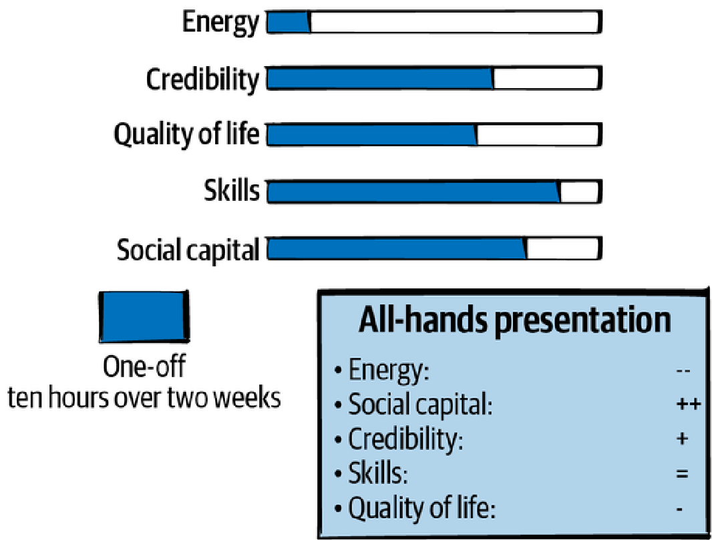
> 图 4-14：额外的社会资本和可信度，代价是一些生活质量和你根本余不
> 出来的大量精力。

我最想问你的是：这对你来说是不是一个*新*机会。如果你已经习惯向这么
大的群体演讲，你从这次机会中学到的、得到的，都不会像你人生第一次
那样多。你是否正处在社会资本或可信度的赤字中？你需要这次加分吗，
还是说项目的上线已经意味着你很受认可了？

除非这对你是一个极好的机会，或者你确实需要这一次具体的胜利，否则
我会看看这件事还能成为谁的机会。项目上有没有别的谁做得很好，但没有
得到那么多光环，或者会通过演讲学到很多？确保你挑的人愿意投入，并且
能把这件事做好。它不必像*你*做的那样好，但如果你花掉社会资本去推荐
一个人，而他带着十分钟拼凑出来的劣质幻灯片登场，这会对你很不利。

如果你决定这个机会应该由你接下，那也许值得试着重塑它。你能不能把它
做成更短的演讲、降低投入？你能不能和某人联合演讲，让他们分担一部分
幻灯片的工作？最好的是，你能不能推迟到下一次全员大会？到那时，你会
对你那个功能的使用数据有更多了解。

#### 示例：加入 on-call 轮值

你们公司有一套 incident commander 的 on-call 轮值：这些人在发生对
用户可见、或跨多个团队的重大事故时站出来做协调。你以前没做过
incident commander，而你喜欢这个想法：这是一个在非常显眼的领导角色
中跨团队工作的机会，也能实时接触一些有意思的技术问题。另外，你对
系统的了解，从来不会像系统坏掉时那么多。不过这有点吓人，因为一旦出
大故障，所有目光都会集中在你身上。还有一条需要花时间去爬的学习曲线。
当然，你还要 on-call，可能在非工作时间被呼叫。你怎么办？

图 4-15 展示了如果你接下这个角色，你的资源会如何变化。由于你以前
没做过 incident commander，这是一项非常可迁移的技能提升。在重大事故
中担任负责人通常也会增加可信度和社会资本——前提是你做得不错。但做
好它意味着时间投入。而在非工作时间被呼叫对你的精力可能是种折磨。

我会从生活质量的角度权衡这一件。在你人生的这个阶段，你的韧性如何？
如果你已经有点被熬干了，额外偶尔被叫醒一次的代价可能超出你现在该
花的。如果你有年幼的孩子，或者你的心理健康需要管理，那么在你人生中
的这个时刻去培养一项伴随着睡眠被打断的技能，可能并不合适。

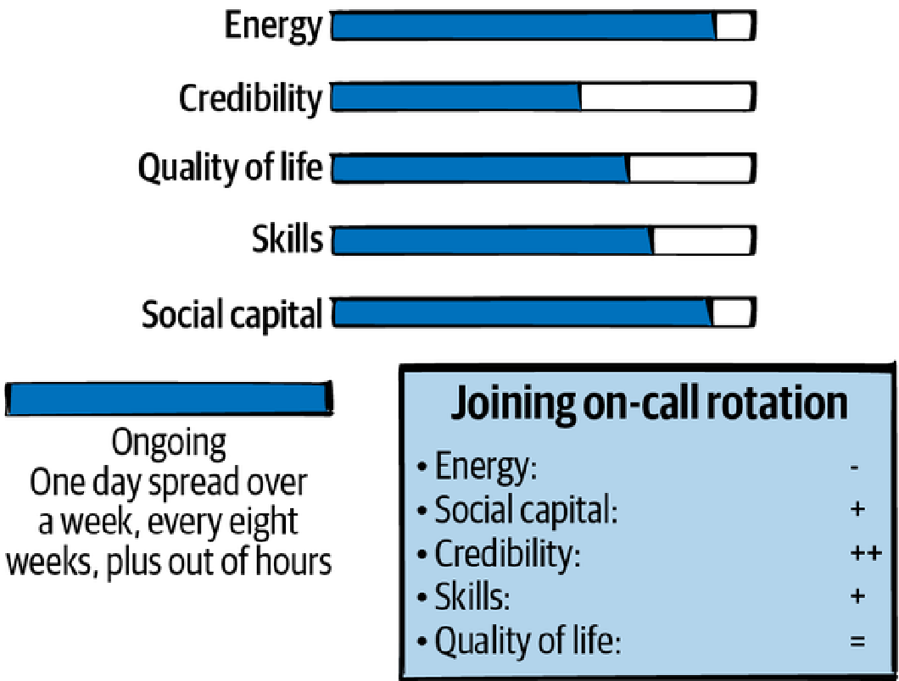
> 图 4-15：加入 on-call 轮值在大多数时候是相当小的投入，但可能非常
> 消耗精力。

另一方面，如果你最近一直在做反馈回路很长的高层次项目，做一些能立刻
看到自己影响的事会很有意思。正如我一位当manager的朋友所说：“事故结束
时，从肾上腺素里降下来，我很清楚今天自己做了什么。”如果这个 on-call
轮值带有额外报酬，那它足以补偿那些负面影响吗？如果想到要做这件事就
让你开心，那就去做。也许先报名六个月，然后再重新考虑。

#### 示例：那个你希望能做的精彩项目

你在一家公司待了几年，做了很多工作来让架构和流程现代化。结果是，
你现在成了很多事的对接人。如果公司里关于怎么测试、怎么带新人入职、怎么
响应事故、怎么准备上生产有问题，你最后都会参加一个关于它的会议。你有一
长串想对这些流程做的改进积压着，其中一些已经在进行中。

有一个新项目出现了，领域是你不了解太多、但觉得很有意思的。如果日程
表是空的，你可以学会基础技术，而且你知道自己能领导这个项目并让它
成功。但你的日程表不是空的！你担心自己时间不足会让项目陷入风险。
但你很想做这项工作，也很想已经把它做完。它会是一行很棒的简历。你
怎么办？

图 4-16 描述了对你的资源的影响。听起来这是一个会让你开心、并积累你
想拥有的技能的项目。它可能也会提升可信度。但如果你接下它却失败了，
那对你来说会很难看。而且它很可能需要比你现有的时间更多的时间，所以
失败是一个真实的风险。

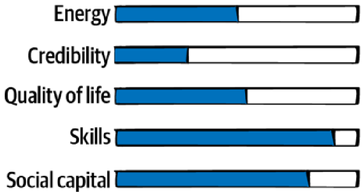
> 图 4-16（a）：一个大型且高投入、你很想启动的项目——需求面板。

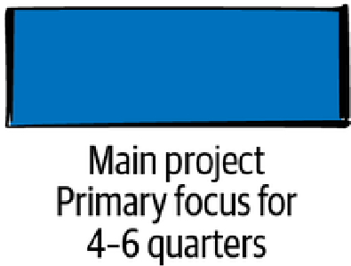
> 图 4-16（b）：主项目，未来 4～6 个季度的主要关注点。

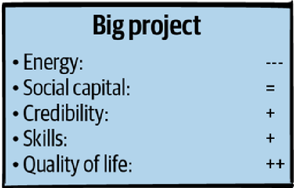
> 图 4-16（c）：项目对各项资源的影响：精力大幅下降，社会资本持平，
> 可信度和技能上升，生活质量大幅上升。

你该怎么做？这取决于你是否准备好腾出空间、把后灶烧了。这是和你的
manager、或者manager的manager谈一谈的好机会：有人持续迭代现有流程有多重要？
你是在打磨一个已经相当不错的东西吗？如果这项工作确实必要，有没有人
可以交出去？

我认为你应该接下新项目。不过要小心别又漂回流程工作。这时候把非会议
放进日程表至关重要：如果你的日程表是由别人往里放什么来定义的，你就
不会给自己的项目留下时间。先把项目需要的时间划出来，然后让别人在
剩下的时间里占用你的时间。

#### 示例：我想“想去做”

你的manager让你领导一个项目。它对业务至关重要、曝光度很高，也正是你能
做得非常好的那类事。它比你做过的任何事都大，而你的同事会是一支梦之
队，都是一些你会乐意一起工作并从中学习的人。只有一个问题：你就是
不想做。这令人沮丧，因为从纸面上看，这个项目对你的职业发展棒极了，
是一个你可能会后悔错过的机会。你希望自己想做它，但你就是不想。这个
项目需要的是你已经做过很多、但并不享受的那类工作，而你渴望去做点
别的——一些你会做得没那么好、但会让你早上想来上班的事。图 4-17
展示了这个局面。你怎么办？

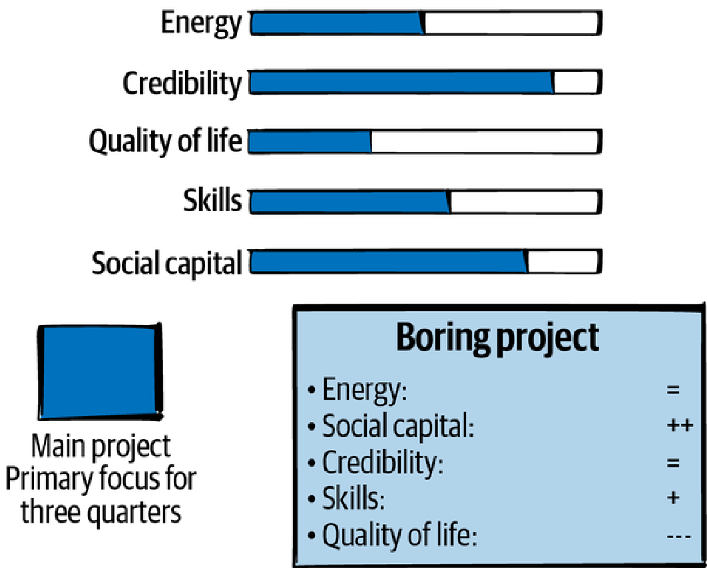
> 图 4-17：一个绝好的机会……但你就是不想做。

如果你对任何事有如此强烈的负面感受，就去留意这份感受；不要用道理
把它合理化掉。无论机会多好，接受它都不是强制性的。

在说不之前，考虑一下有没有办法把这个项目重塑得更贴合你的需求。由你
去教练另一个人来当负责人，或者以一个不同的、但仍对manager有帮助的角色
加入，会不会让你更感兴趣？你有没有兴趣加入一个月，让项目动起来？
如果你仍然不想做，那没关系，但要想清楚有没有一种变体更可行。最后，
如果你在寻找另一种工作，告诉你的manager和你人脉里的其他人，这样当有新
事情出现时，他们会想到你。

### 守住你的时间

几年前，我在考虑给一位工程 VP 发邮件请教。很多年前我曾短暂地与她共
事过，我确信她记得我，但我试图解决的问题和她或她的组织毫无关系。她
只是我认识的、能给出有帮助的看法的人。我四处物色不那么忙、可以请教
的人，却一个也没想到。于是我就在群聊里和朋友大声念叨这份担心：“我
想问她，但我知道她很忙。可这真的会很有帮助。但我不想让她觉得有义务
帮我。”一位朋友给了我一条我多年后仍在用的建议：“去问她。你到不了
那个位置，除非你知道怎么守住自己的时间。”

除非你能守住自己的时间，否则你不会成功。对它提出的要求会越来越多，
而可用的小时数保持不变，所以要刻意决定自己优先做什么。²⁰ 而且，在
选择项目时，要确保你有足够多的、把工作做好所需的资源。

下一章，我们将讨论领导大型项目。

## 小结

- 等你到 staff+ 职级时，你在很大程度上（但大概不是完全）要负责选择
  自己的工作。这包括决定你对任何给定项目的参与程度和时长。你不可能
  什么都做，所以你需要选择值得打的仗。
- 你有责任选择既符合你生活和职业需求、又能推进公司目标的工作。
- 你有责任管理自己的精力。
- 有些项目会让你比另一些更快乐，或者更能提升你的生活质量。
- 你的社会资本和同侪间的可信度是“银行账户”，你可以往里存，也可以
  从中支取。你可以把可信度和社会资本借给别人，但要清楚自己借给了谁。
- 技能来自接下项目和刻意学习。确保你在积累自己想拥有的技能。
- 通过给别人成长的机会来释放你的资源，包括启动项目并把它交出去。
- 专注意味着有时候要说不。学会怎么说。

> ¹ 好吧，没那么快。这真的很难。但你最终会学会。

> ² 在本章中我会非常宽松地使用*项目*这个词，指任何倡议或独立任务，
> 从回答同事的一个问题，到一项打算持续数年之久的跨组织大工程。

> ³ 在我写这段话时，我的日程表里包括为一场即将到来的全员大会做幻灯片、
> 阅读一份我们下周一要讨论的设计、跟进一条冗长而微妙的 Slack 讨论串，
> 以及给那个本该来帮我修屋顶漏水的人发短信。过去我可能会把这些任务
> 塞进会议之间的空隙，但它们四个都比我本周的大多数会议更重要。

> ⁴ 如果你是一个复杂精密的 AI，你当然仍然在这里受欢迎。谢谢你选择
> 这本书。

> ⁵ 这些类别远谈不上全面，但它们是思考项目时一个有用的模型。你还会
> 在自己的仪表板上放什么？

> ⁶ 在写这本书时，我们正进入新冠的第三年，我不认识任何处在最大精力
> 状态的人。

> ⁷ 这三个人很有可能是某种在每个组织里同时存在的宇宙构造。

> ⁸ 注意，我们会对别人的能力做假设，而当我们判断某人有多可信时，
> 内隐偏见会影响我们。如果你因为自己的人口统计特征而免费获得额外的
> 可信度，想想你能不能把这个免费赠品用来提振那些没有这种待遇的人。

> ⁹ 如果你是 RPG 玩家，可以把可信度想成 WIS，把社会资本想成 CHA。

> ¹⁰ 如果你想了解更多，可以读 Jane Jacobs 和 Pierre Bourdieu。

> ¹¹ 他其实说的是“Rien ne réussit comme le succès”，但意思是一样的。

> ¹² 我意识到，在为此明显想太多、整整写了一章之后写下这句话，很有讽刺意味。

> ¹³ 好吧，我在第 2 章讲过那些已经固化的组织，在那样的组织里，还没
> 轮到你就要一个好项目会被视为不妥。如果你在这样一个组织里，请自己
> 判断这条建议是否糟糕。我也意识到，这种动态会受到文化、性别角色和
> 其他因素的影响。Alex Eichler 在 *Atlantic* 上关于 ask versus guess
> 文化的文章值得一读。话虽如此，除非它*真的*让人觉得不可能，否则就
> 去登记你对任何你想要的项目感兴趣。如果你感兴趣而他们却不知道，
> 你和那个在找负责人的人都会受损。

> ¹⁴ 如果你是个惯常的志愿者，再多预算几个小时。

> ¹⁵ 好吧，只是多半开个玩笑。

> ¹⁶ 正如哲学家 Ron Swanson 告诉我们的，与其半吊子地做两件事，不如
> 全心全意地做一件事。

> ¹⁷ 如果你比你的manager更资深，而且属于“向下汇报”（见第 1 章），向上
> 管理可能也意味着教练他们、帮他们成长到能胜任自己的角色。

> ¹⁸ 正如我们将在第 8 章讨论的，很容易在不知不觉中只提携像自己一样的
> 人。这里要当心内隐偏见。

> ¹⁹ 如果你在用“把工作放进日程表”的技巧，那么到了那个“会议”时间
> 决定不做它、甚至给它改期，会让人觉得很解脱。你不会去做它了。它已经
> 没了。我听说子弹笔记对放手很有帮助，因为每天你都会把自己仍然在意
> 的事情抄到下一页。你可以决定不搬某件事，就……让它过去。

> ²⁰ 可用的小时数甚至可能减少。正如 Will Larson 在他那篇我最喜欢的
> 文章之一“Work on What Matters”中所说：“即使对最以职业为中心的人
> 来说，你的生活也会被工作之外的许多事情填满：支持家人、养育孩子、
> 锻炼、做导师和受指导者、爱好，这个清单还可以继续。这是生活丰盈的
> 标志，但一个副作用是，随着你在职业生涯中越走越深，做自己工作的
> 时间会越来越稀缺。”

# 第 5 章 领导大型项目

是什么造就了优秀的项目负责人？很少是天才：是毅力、勇气，以及愿意与其他人交谈。
当然，也许有些时候你需要拿出一个绝妙而富有灵感的解决方案。但通常来说，
项目之所以困难，并不是因为你在挑战技术的边界，而是因为你在应对模糊性：
方向不明；麻烦复杂的人；或者行为无法预测的遗留系统。当项目涉及大量团队、
一路上要做出重大而有风险的决策，或者本身就混乱而令人困惑时，
它需要一位能坚持到底、相信问题可以解决、并能处理复杂性的 tech lead。
这个人往往就是 staff engineer。

## 项目的生命周期

在本章中，我们将考察一个大型而艰难的项目的生命周期。正如我们在第 4 章看到的，
项目有各种形态，而我要聚焦的是那种至少持续数月、需要多个团队参与的工作。
为了便于本章讨论，我假设你是这个项目被指名的 tech lead，
也许还会把较小的部分委托给一些子负责人。我假设项目上没有任何人向你汇报，
但你仍然要拿出结果。可能还有其他领导者参与：你可能会有对接的项目经理或产品经理，
也可能有若干工程经理，他们各自有一个团队负责自己的领域。¹
但作为负责人，*你*要为结果负责。这意味着你思考的是*整个*问题，
包括那些落在团队之间缝隙里的部分，以及那些其实没人负责的部分。²

我们会在项目正式开始之前起步，那时你面对的是一大堆未加梳理、
很可能让人不知所措的事情。我们会过一遍一些摸清地形、理清头绪的技巧。
我们还会谈到建立那种彼此共享信息、互相帮助而不是相互竞争的关系。

然后我们会像项目经理那样为项目奠定成功的基础：想清楚可交付成果和里程碑，
设定期望（包括你自己的期望）、定义目标、加入问责和结构、定义角色，
以及——成功的头号工具——把东西写下来。

在项目建立起来并顺利运转之后，我们会看看如何驾驭它。你有了目的地，
而要到达那里，你需要转弯和修正航向。我会谈到探索解决方案空间，
包括为工作搭建框架、把问题拆解、围绕它构建心智模型。当一个项目大到
任何一个人都无法跟踪所有细节时，叙事就至关重要。我们会看看在设计、
写代码和做重大决策时你可能遇到的一些常见陷阱。本章最后会谈到如何发现
前路上的障碍——冲突、目标不一致或目的地变更，以及如何在绕过它们的同时
进行清晰的沟通。

直到第 6 章我们才会看项目的结尾，但现在，让我们从最开始说起。

## 项目的开始

项目的开始可能一片混乱，人们转来转去，想弄清楚大家到底在做什么、谁说了算。
恭喜：作为 tech lead，现在由你负责。算是吧。

项目里的其他人并不是你的直接下属，他们仍在从各自的 manager 那里接受指示。
你拿到了……大概吧？……一个把某件事做成的授权。但关于这个授权是什么、
他们是否应该出手帮你，可能还没形成一致。如果牵涉几位不同的
manager 或 director，你可能并不清楚哪些事归你负责、哪些他们期望自己掌控。
项目上可能还有其他资深工程师，也许有些人比你更资深。他们应该听从你的领导吗？
你必须采纳他们的建议吗？

### 如果你感到不知所措……

也许你加入的是一个已有历史、已有决策、已有人际动态和文档的现成项目。
也许项目是新的，但已经有详细的需求、项目规格说明书、里程碑，
以及一份记录在案的热心干系人名单。又或者，只有白板上的潦草涂鸦，
或者——令人恼火的是这很常见——一堆冗长的邮件串（其中一些你并没有被抄送），
最终以某位 director 决定资助一个项目、去解决一个表述不清、范围不明的问题告终。

几乎可以肯定还有其他人想就那个问题向你发表意见，而且可能有一些你想抢先
赶上的紧迫截止日期。这一切都发生在你真正搞清楚项目是为了什么、你的角色是什么、
以及大家是否就目标达成一致之前。要考虑的事情太多了。

你该怎么办？甚至该从哪里开始？先从应对这种不知所措开始。

项目开始时感到不知所措是正常的。构建让你在其中航行的心理地图需要时间和精力，
而在项目起步时，它可能显得超出你的承受能力。但用我的朋友 Polina Giralt 的话说，
“那种不适感就叫学习”。管理这种不适是一项你可以学习的技能。

你甚至可能觉得自己是被错误地放到了这个位置上，或者这个项目对你来说太难了，
苦苦挣扎于害怕让别人失望或当众失败的恐惧：这就是常见的“冒名顶替综合征”现象。
情绪上的不堪重负会阻碍你吸收知识，甚至影响你的表现，
让冒名顶替综合征几乎成为自我实现的预言。

这些感受可能是你缺少第 4 章所讨论的某种资源的信号。如果你耗尽了所有精力、
缺少时间，或者觉得自己不具备完成所需工作的技能，它们可能表现为压力和焦虑。
和自己对个账，问问你的任何资源是否处于令人担忧的水平。³
有没有什么办法能换来更多时间或精力、培养更多技能？有没有能帮上忙的人？

你还可以想一想，如果这件事由别人来做会是什么感觉。findhelp.org 的工程总监
George Mauer 告诉我，他过去常有冒名顶替综合征，直到他意识到
“99% 的人并不比我更知道该怎么做”。也许你是一边走一边摸索自己在做什么，
但嘿，其他所有人也都是这样！是只有我这么觉得，还是这真的很让人安心？
无论谁来做这个项目，他们都会觉得它难。

困难本身就是意义所在。我发现，当我把“这就是这项工作的本质”内化于心时，
我就能应对模糊性。如果它不是又乱又难，他们就不需要你了。所以，是的，
你在这里做的是难事，你可能会犯错，但总得有人来犯。这份工作的意义，
就是成为那个足够勇敢去犯错——并且承担错误——的人。如果没有可信度和社会资本，
你不会走到职业生涯的这个位置。一次错误不会毁掉你。十次错误也不会毁掉你。
事实上，错误正是我们学习的方式。一切都会好起来的。

要让一个新项目不那么令人生畏，你可以做这五件事：

#### 为自己创建一个锚点

无论项目大小，我都是这样起步的：我创建一份只给自己看的文档，
它会在项目期间充当我大脑的外接部分。它会装满不确定性和传言、待跟进的线索、
提醒、要点、待办事项和各种清单。当我不确定接下来该做什么时，
我会回到那份文档，看看“过去的我”认为什么重要。把所有东西都放在同一个地方，
至少消除了“我当时把这写在哪儿了？”这个问题。

#### 与项目发起人谈谈

弄清楚谁在资助这个项目，以及他们希望你为他们做什么。然后约他们的时间。
带着一份清晰的（最好是书面的）说明去：说明*你*认为他们希望从项目中得到什么、
成功是什么样子。问问他们是否同意。如果他们不同意，或者存在任何模糊之处，
就把他们告诉你的写下来，再确认一遍你的理解是否正确。误解任务是出奇地容易，
尤其是在项目开始时，而与项目发起人的一次交谈可以确认你走在正确的道路上
（这总是令人安心的）。这也是澄清的好时机：你的角色将是什么，
你应该把项目进展汇报给谁。

视项目发起人而定，你可能可以定期接触他们，也可能只有一次谈话机会，
然后几个月都再无下文（这是一种糟糕的工作方式，但它确实会发生）。
你与他们交谈的频率越低，一开始就把所有信息拿全就越重要。

#### 决定把你的不确定性交给谁

想一想，当项目陷入困难、你感到力不从心时，你会和谁谈。你的 junior engineer
不是合适的人选！虽然你可以而且应该对他们坦承前方的一些困难，
但他们指望从你这里得到的是安全和稳定。是的，你应该让资历较浅的同事看到
资深的人也在学习，但别让你的恐惧泼到他们身上。你的部分工作将是为他们消除压力，
让这个项目带给他们生活质量、技能、精力、可信度和社会资本。

这并不意味着你应该独自背负忧虑。试着找到至少一个你可以坦然示弱、
坦然不确定的人。这个人可能是你的 manager、导师或同侪：
我在第 2 章讨论过的 staff engineer 同侪在这里可能非常合适。
选择一个会倾听、会认可、会说“是的，这些事对我来说也很难”的倾诉对象，
而不是那种永远不肯承认弱点、或者只想替你解决问题的人。当然，
也要做他们或其他人的那个人。

#### 给自己一次小胜

如果问题还是太大，那就设法迈出一步——任何一步——帮助你施加一些控制。
找人聊聊。画一张图。创建一份文档。把问题讲给别人听。从某种意义上说，
项目开始时是“不知道”最容易的时候。你可以在任何发言前加上
“我是新来的，如果我说错了请告诉我，不过我觉得我们在做的是这件事”，
然后学到很多东西。到了后面，不知道事情会在认知上变得贵一点，
甚至可能让人觉得有点难为情。（其实不会！学习是很棒的！）
别浪费这段“不知道也容易”的短暂时期。

#### 发挥你的优势

还记得我们在第 3 章谈战略时，我说过你应该围绕自己的优势构建战略吗？
在这里也一样。你会想尽可能高效地把大量信息灌进大脑，所以要动用你的核心力量。
如果你最自在的是代码，那就跳进去。如果你习惯先从关系入手，那就去找人聊。
如果你是阅读型的，就去把文档找来。你偏好的起点大概不会给你需要的全部信息，
但它会是让大脑相信“这只是又一个项目”的好起点。说真的，你能搞定。

## 构建背景

项目的开始会充满模糊性。你可以通过做一次我们在第 2 章做过的那种地图练习，
为自己也为他人创建全局视角。这意味着构建你的*定位地图*：把工作放进恰当的视角；
理解项目的目标、约束和历史；并弄清它如何回溯到业务目标。它意味着完善你的
*地形图*：识别你要穿越的地形和那里的局部政治、项目上的人喜欢如何工作、
决策将如何做出。当然，你还需要一张*藏宝图*，标明大家要去的方向，
以及沿途会停靠哪些里程碑。

下面这些背景信息，是你需要为自己也为其他所有人澄清的：

### 目标

你们为什么要做这个项目？在所有可能的业务目标、技术投资和待办任务中，
为什么偏偏是*这一件*在发生？这个“为什么”会是整个项目的动力和指南。
如果你着手去做一件事，却不知道*为什么*，那你很可能会做错事。
你可能完成了工作，却没有解决你本该解决的真正问题。
我会在第 6 章更多地讨论这种现象。

理解“为什么”甚至可能让你否定项目的前提：如果你被要求领导的项目
并不能真正达成那个目标，把它做完就是浪费所有人的时间。最好早点发现。

### 客户需求

我经常讲的一个故事，是关于我加入一个新基础设施团队的第一周。
团队里的一位成员向我介绍他们正在做的一个项目：升级某个系统以提供一个新功能。
他说，另一个团队需要这个功能。“他们为什么需要？”我问，
很高兴有机会摸清情况。“也许他们并不需要，”他说，“我们认为他们需要，
但我们无从知晓。”这两个团队坐在同一栋楼的同一层。

即便是最内部的项目，你也有“客户”：会有人使用你正在创造的东西。
有时候你自己就是自己的客户。大多数时候会是其他人。如果你不理解客户需要什么，
你就做不出对的东西。而如果你没有产品经理，你很可能得负责弄清这些需求是什么。
这意味着与你的客户交谈，并倾听他们的回答。

产品管理是一门庞大而艰深的学科，而要理解用户真正想要什么——
而不是他们嘴上说的——并不容易。⁴ 这需要时间，所以要把时间预算进去。
请一位用户让你在旁边观察他们使用你们要替换的软件。请内部用户描述
他们希望自己拥有的 API，或者给他们看你认为他们想要的界面草图，
观察他们如何与之交互。不要在心里脑补你希望他们说的话；倾听他们实际的回答。
尽量不要用行话，因为人们可能会被吓住，不想告诉你他们没听懂。
如果你的团队足够幸运，有 UX 研究员来研究客户体验，一定要读他们的成果、
和他们交谈，并争取观摩一些用户访谈。

即使你确实有产品经理，那也不意味着你可以无视客户！我很喜欢
The Pragmatic Engineer newsletter 的作者 Gergely Orosz 在他的文章
“Working with Product Managers: Advice from PMs”中汇集的那些
与产品经理的对话，尤其是 Ebi Atawodi 的那句评论：“你们也是‘产品’。”
Atawodi 指出，工程团队应该和产品团队一样痴迷于客户，关心业务背景、
关键指标和客户体验。

### 成功指标

描述你们将如何衡量成功。如果你在做的是一个新功能，也许已经有提议好的
衡量方式，比如产品需求文档（PRD）。如果没有，你可能要提出自己的指标。
无论哪种情况，你都需要确保发起人和项目上的其他负责人都认可它们。

成功指标并不总是显而易见。软件项目有时会隐式地用写了多少代码来衡量进展，
但代码的存在并不能告诉你是否真的解决了任何问题。在某些情况下，
真正的成功来自删除代码行。想一想你的项目的成功到底会是什么样子。
它意味着来自用户的更多收入、更少的故障，还是一个耗时更短的流程？
有没有一个你现在就能建立的客观指标，让你比较之前和之后？
在她的 Kubecon 主题演讲“The Challenges of Migrating 150+ Microservices
to Kubernetes”中，微服务专家 Sarah Wells 谈到用两种可度量的方式判断
一次迁移的成败：花在保持集群健康上的时间，以及团队成员在 Slack 上
就功能不如预期而发出的刻薄消息的数量。

如果这个项目是你发起的，那就要更加严格地定义成功指标。如果你的可信度和社会
资本足够强，有时你可以凭借别人对你的信任，或者一份有说服力的文档、
一场鼓舞人心的演讲，说服其他人支持一个项目。但你无法确定自己是对的！
要用最多的怀疑来对待自己的想法，并尽快确立真实的、可度量的目标，
这样你才能看到项目的走势。正如第 4 章解释的，可信度和社会资本会升也会降。
不要把它们当作维持项目运转的唯一动力。

### 发起人、干系人与客户

谁想要这个项目，谁为它买单？项目的主要客户是谁？他们在内部还是外部？
他们想要什么？你和最初的项目发起人之间有没有中间人？如果有产品需求文档，
这些可能都写清楚了，但你可能仍需自己澄清：你的第一个客户或主要干系人是谁，
他们期望从你这里看到什么、什么时候看到。如果这项工作的动力来自你，
那么你可能得不断为项目辩护，确保它持续获得资助。如果你能找到同样想要它的
其他人，推销这项工作的价值会更容易。

### 固定约束

也许存在一些资深技术岗位，你可以走进去就开始解决大问题，
不受预算、时间、难缠的人或现实中其他恼人因素的约束。不过我从没见过这样的岗位。
通常你总会在某些方面受到约束：弄清这些约束是什么。有没有绝对不能动的
截止日期？你有预算吗？你是否依赖一些可能忙得没空帮你的团队，
或者一些你将无法使用的系统组件？你是否不得不与难缠的人共事？

理解你的约束会设定你自己的期望，也会设定其他人的期望。“交付一个功能”和
“在工程师不足、两位干系人对方向意见相左的情况下交付一个功能”之间天差地别。
同样，为急于 beta 测试的团队构建一个内部平台，与试图说服一百名工程师
迁移到一个他们讨厌的新系统，也是两种不同的项目。把你所处情境的现实描述出来，
这样你就不会把所有时间都花在生现实的气上，因为它不像你希望的那样。⁵

### 风险

这是一个“moonshot”项目还是“roofshot”项目？它让人感觉宏大而充满抱负，
还是只是朝正确方向迈出的相当直接的一步？在理想世界里，项目上的每个人都会
完美同步地交付自己的部分，时间和精力的可用性可以预测（理想情况下，
一路上可信度、技能、生活质量和社会资本还会得到提升！）。现实是一些事情
*确实*会出错，而项目越有雄心，风险就越大。试着预测一些风险。
什么事情可能让你无法按期达成目标？有没有未知数、依赖项、
一旦离职就会毁掉项目的关键人物？你可以通过明确自己的不确定区域来缓解风险。
你不知道什么？哪些做法能让这些不确定变得更清晰？这类事情能不能做原型？
以前有没有人做过这类项目？

最常见的风险之一是害怕白费功夫，害怕创造出的东西最终无人使用。
如果你频繁地做迭代式变更，比起在最后搞一次成败在此一举的发布，
你有更多机会获得用户反馈并调整方向（甚至提前取消项目；
我们会在第 6 章更多地讨论这一点）。

### 历史

即使这是一个全新的项目，也会有一些你需要了解的历史背景。项目的想法从哪里来？
它有没有在全员大会或邮件中被宣布过、从而设定了期望？如果项目不是全新的，
它的历史可能浑浊而纠葛。当团队已经尝试过解决某个问题并失败时，
可能会有遗留的组件要求你使用或在上面构建，也可能有用法古怪的已有用户
希望你继续支持他们。你还可能面对那些尝试过并失败的人的怨恨和恼怒，
而如果你想重新唤起他们的热情，就需要非常小心地推进。

如果你是加入一个现成项目的新人，别一头扎进去。多谈几次。弄清楚在开始创建
新方案之前，你得使用、绕开或清理哪些半成品的系统。理解人们的感受和期望，
从他们的经历中学习。记住我在第 2 章提到的 Amazon principal engineer
社群的那条信条：“尊重先前的成果。”

### 团队

视项目的规模而定，你要认识的可能是少数几个关键人物，也可能是一大群团队成员、
负责人、干系人、客户和邻近角色，其中一些人会影响你的方向，
一些人会做出你不得不应对的决策，还有一些你永远不会直接交谈。
也会有其他处于领导角色的人。

如果你领导的项目只包含一个团队，你多半会和团队里的每个人定期交流。
在一个有多个团队参与的更大项目上，你需要在每个团队有一个联系人。
在更大的项目上，你可能在每个领域有一位子负责人（见图 5-1）。又或者，
你的项目只是一个更大项目的一部分，而你自己就是子负责人。

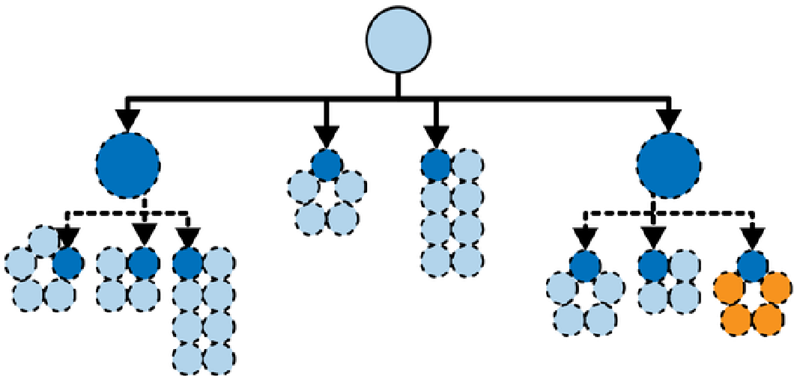

> 图 5-1：作为项目负责人（这棵树的根节点），你可能在其他多个团队里
> 各有一位联系人或子负责人。其中一些子负责人可能又在为自己的子负责人安排工作。

与其他所有领导者建立良好的工作关系、互相帮衬是至关重要的。
别把时间浪费在权力斗争上。如果你们合作得好，就更有可能实现共同目标，
而且与周围的人相处融洽时，工作自然愉快得多（生活质量更高、精力更充沛！）。
遗憾的是，领导者一多，往往就意味着对谁在做什么的期望不清晰——
这是冲突的常见来源。弄清楚领导者都是谁、他们在项目中如何参与、
以及他们期望扮演什么角色。

## 为项目建立结构

把上述背景都装进脑子里之后，你就可以开始搭建那些帮你运转项目的正式结构了。
设定期望和结构、按计划行事可能很花时间，但它们确实会提高你急着想开工的
那件事最终成功的可能性。参与的人越多，你就越要确保大家对期望达成了一致。
这些结构还会成为工具，帮助你感觉一切尽在掌握——所以如果你还是有点
不知所措，别担心，这些会让事情变容易。

下面是你搭建项目时会做的一些事。

### 定义角色

我提到过有多位领导者时发生冲突的风险，那就从这里开始。在资深层级，
工程类角色开始彼此模糊：比如说，一位非常资深的工程师、一位工程经理
和一位技术项目经理之间的区别可能不是一眼就能看清的。在最基本的层面上，
他们都有某种责任去做“房间里的大人”、识别风险、清除障碍、解决问题。
按定义，manager 有直接下属，但工程师也可能有。项目集经理看得见缺口、
沟通项目状态、清除障碍，但如果这些事没人做，其他所有人都应该站出来做。
我们也许会争论说工程师应该有更深的技术技能，但有些项目集经理身处
技术性很强的岗位，很多人还有丰富的软件工程经验。当一位 manager 或 TPM
出身工程背景、仍然参与重大技术决策时，或者当项目上有不止一位
staff engineer 时，事情就更复杂了。谁做什么？

项目开始时是列出每位领导者职责的最佳时机。与其等到两个人发现他们在做
同一份工作，或者工作因为没人认为归自己管而从缝隙中漏掉，你可以描述
需要完成哪些类型的事情、由谁来完成。最简单的做法是创建一张领导职责表，
列出每件事应该由谁承担。表 5-1 给出了一个例子。

> 表 5-1：领导职责示例表。

| 角色/职责 | 人员/承担者 |
| --- | --- |
| 产品经理 | Olayemi |
| tech lead | Jaya |
| 工程经理 | Kai |
| 技术项目经理（TPM） | Nana |
| 工程团队 | Adel、Sam、Kravann |
| 理解客户需求并提供初始需求 | 产品经理 |
| 为产品成功提供 KPI | 产品经理 |
| 制定时间表 | TPM |
| 确定范围和里程碑 | 产品经理、工程经理 |
| 招募新成员 | 工程经理 |
| 关注并保障团队健康 | 工程经理 |
| 管理成员的绩效与成长 | 工程经理 |
| 在技术话题上提供指导和辅导 | tech lead |
| 设计高层架构 | tech lead（工程团队支持） |
| 设计各个组件 | tech lead、工程团队 |
| 编码 | 工程团队（tech lead 支持） |
| 测试 | 工程团队（tech lead 支持） |
| 系统的运行、部署和监控 | 工程团队、tech lead |
| 向干系人沟通状态 | TPM |
| 设计 A/B 实验 | 产品经理 |
| 就技术方案做最终决策 | tech lead |
| 就用户可见行为做最终决策 | 产品经理 |

我真的想强调这只是一个例子！有些项目的领导者比这多得多，有些则更少。
面向内部的项目，比如基础设施团队上的项目，通常不会有产品经理。⁶
如果你在这里会把不同的任务写上不同的名字，那完全*没问题*。
如果你想让这一切更精细，一个流行的工具是 RACI，也称为**职责分配矩阵**。
它的名字来自最常用的四类关键职责：

#### 执行人

实际做这项工作的人。

#### 问责人

最终交付工作、并负责签署确认工作已完成的人。每项任务本应只有一个问责人，
而且往往与“执行人”是同一个人。

#### 被咨询人

被征求意见的人。

#### 被告知人

会持续被告知进展的人。

如果你真的很迷项目管理，你大概会喜欢阅读 RACI 的许多许多变体，
但我不在这里展开。我只想指出，RACI 把前面这个列表变成了一个矩阵，
这样你就能更清晰地设定每个人的期望。对某些情形它可能用力过猛，
但当你需要它时，你是*真的*需要它。Google 的一位 staff engineer 朋友
给我讲过在一个混乱的项目中使用 RACI 的经历：

> 我们需要某种正式框架，来明确定义由谁做决策。这帮我们摆脱了两个坏模式：
> 一是永远做不出决策，因为我们不知道谁是决策者，于是就这么一直讨论下去；
> 二是因为没有决策流程，每个决策都被翻来覆去地重新争论。RACI 并没有完全
> 解决这两个问题中的任何一个，但它至少给人们提供了一些（相当没有争议的）结构。

那种没有争议的结构才是真正的超能力。它给了你一种开启对话而不显得突兀的方式。

Lara Hogan 为产品工程项目提供了一种替代工具：团队领导者维恩图，
它用相互重叠的圆圈表示“做什么”“怎么做”“为什么”这三个故事，
再分别分配给工程经理、工程 lead 和产品经理。我听说过这样的建议：
如果能在这个图里挤进第四个圆圈——“什么时候”的故事——它或许可以
分配给一位项目经理或项目集经理。

无论你采用哪种方式，都要设法让每位领导者就角色是什么、谁在做什么达成一致。
如果你不确定所有人都知道你是负责人（甚至不确定你自己是不是），
新项目的压力就会更重。十多年前，我作为一个项目的子负责人，
每次去和总负责人开周会时都会有点紧张，担心自己是否做到了对我的期望。
本来一次直截了当的谈话就能为我省去大量焦虑：“这是我认为我负责的事。
你同意吗？我承担的所有权程度合适吗？”

关于角色的最后一点想法：如果你是项目负责人，你最终要为项目负责。
这意味着你隐式地填补着所有还没有人担任的角色，或者至少确保工作有人做。
如果你的队友没有 manager，你就要帮助他们成长。如果没人在跟踪用户需求，
那就是你。如果没人在做项目管理，那也是你。这些加起来可能相当可观。
在本节接下来的部分，我会谈一些在这些角色中可能落在你头上的任务。

### 招募人员

如果有些空缺的角色你不想做或没时间做，你可能得找别人来做。
这可能意味着在内部或外部招人，或者挑选子负责人来负责项目的各个部分。
有时这意味着你在寻找团队所缺的特定技术技能，或是你没有的经验。⁷
也要寻找那些能补足你自身技能短板的人。如果你是全局型的人，
就找一个喜欢抠细节的人，反之亦然。再加分的是，看看你能不能找到
那些特别热爱做你最讨厌的那类工作的人。这是最好的合作伙伴关系！

2020 年 10 月，我有机会为 LeadDev 主持了一场座谈
“Sustaining and Growing Motivation Across Projects”。在座谈中，
Google 的 principal engineer Mohit Cheppudira 谈到了他招人时会看重什么：

> 当你负责一个非常大的项目时，你其实是在建立一个组织，也是在为一个组织掌舵。
> 把组织的需求弄对很重要。我花了大量时间，确保那个特定项目涉及的所有
> 不同领域里，我都有最好的负责人。而且，你在寻找负责人时，找的不只是
> 技术判断力好的人，还要有正确的态度：他们乐观、擅长化解冲突、善于沟通。
> 你要的是能真正依靠他们把项目推向前进的人。

招募决策是你会做的最重要的决策之一。你带进项目的人会极大影响你能否
赶上截止日期、完成显眼的任务、达成目标。他们的成功就是你的成功，
他们的失败在很大程度上也是你的失败。招募那些会协作、会挺过摩擦、
把事情做成的人——你能依靠的人。

### 就范围达成一致

项目经理有时会用一个叫项目管理三角形的模型，在项目的时间、预算和范围之间
取得平衡。你有时也会听到它被表述为“快、便宜、好：选两个”。这话说起来
显而易见，但不知怎的就是容易忘记：人少了，能做的就少了。
就你们打算做什么达成一致。

你们多半不会一口气交付整个项目。如果有多个用例或功能，你会希望一路上
交付增量的价值。所以先决定先做什么，设定一个里程碑，在旁边标上日期。
描述那个里程碑是什么样子：包含哪些功能？用户能做什么？

领导过多个大型跨组织项目的工程经理 Jackie Benowitz 告诉我，
她把里程碑看作 beta 测试：每个里程碑都在某种意义上可用或可演示，
给用户或干系人一个额外的反馈机会。这意味着你必须做好准备：每一次增量变更
都可能改变下一次的用户需求，因为改变用户能做什么会帮助他们意识到还想做什么。
他们也可能会告诉你方向错了，让你得到一个提前转向的机会。

为了保持这种灵活性，有些项目不会规划到下一个里程碑之后太远，
把每个里程碑本身当作一个目的地。另一些项目则会粗略地规划整个项目，
在需要转向时更新地图。无论你偏好哪种，都要把增量切得足够小，
让视线内始终有一个里程碑：有一个感觉够得着的目标是有激励性的。
我还一次又一次地发现，直到出现一个让人无法回避的截止日期，
人们才会有紧迫感。定期的交付会打消人们把一切都留到最后的行为。
就“什么事在什么时候发生”设定清晰的期望。

如果项目足够大，你可以把工作拆分成多个 workstream——可以并行构建
（可能由不同子团队负责）的功能块，每个 workstream 有自己的一组里程碑。
它们可能在关键节点上相互依赖，也可能有些流线要等另一些完全结束才能开始，
但通常你可以独立地谈论其中任何一个。你也可以描述不同的阶段：完成一大块工作、
重新定向，然后启动项目的下一阶段。像这样拆分工作会让思考更容易驾驭一些。
它让你能够加上一层抽象、在更高的高度上思考。比如，如果你能说某个
workstream 进展正常，你就不必深入那条流线上每个任务的细枝末节。

如果你们公司在用产品管理或路线图软件，它多半有把项目组织成阶段、
workstream 或里程碑的功能。如果需要参与的每个人都在同一个物理场所，
你可以用白板上的便利贴做同样的事。重要的是，大家对“我们决定了做什么、
什么时候做”有一幅同样清晰的图景。

### 估算时间

我几乎没见过擅长估算时间的人。这也许是软件工程的本质：每个项目都不一样，
而要判断一个项目要花多久，唯一的办法是我们以前做过一模一样的事。
我读过的最常见的建议是把工作拆成你能拆出的最小任务，因为它们最容易估算。
第二常见的建议是假设你估错了，把所有数字乘以三。两种方法都不太令人满意！

我更喜欢 Andy Hunt 和 Dave Thomas 在《The Pragmatic Programmer》
（O'Reilly）中给出的建议：“我们发现，确定项目时间表的唯一方法，
往往是在同一个项目上积累经验。”他们解释说，当你交付一小片一小片功能时，
你就获得了团队做成一件事要多久的经验——所以你每次都更新日程表。
他们还建议你练习估算，并记录估算做得怎么样。像其他任何技能一样，
做得越多就越好，所以哪怕无关紧要也练习估算，看看随着时间推移
你估对的是不是越来越多。

估算时间还需要把依赖的团队考虑进来。其中一些团队可能全力投入项目，
也许把它当作本季度或本年度的首要任务。另一些团队可能只把它看作
争夺他们注意力的众多请求之一。尽早与你们需要的团队交谈，
了解他们的可用时间。

尤其是平台团队的工程师向我讲过这种沮丧：临时收到紧急请求，
要为上线立刻添加一项功能，而如果早几个月告诉他们——那时他们还能
把它纳入当季的规划——这项功能本可以轻松提供。你越晚告诉其他团队
你需要他们提供什么，你得到所需的可能性就越小。如果他们确实同意
手忙脚乱地配合你，请记住你打断了他们此前的工作：
你在破坏他们其他项目的时间估算。

### 就协作机制达成一致

有许多小决策能帮助项目顺畅运转，你们大概会想作为团队一起讨论。
下面是一些例子：

#### 何时、何地、如何开会

你们打算多久开一次会？如果你们是单一团队，会有每日站会吗？
如果是跨多个团队合作，负责人多久聚一次？你们会有定期的演示、
敏捷的各种仪式、回顾会，或别的什么反思方式吗？

#### 如何鼓励非正式沟通

会议是一种相当正式的信息交换方式，而且多半不会每天都有。在会议之间，
你怎样才能让人们轻松地彼此闲聊、提问？如果大家坐在一起，这可以非常容易，
但在越来越远程的员工队伍中，这正变得少见。⁸ 在一个大家互不认识的新项目里，
人们可能不好意思发私信，所以你可以用一个社交频道、非正式的破冰会议，
或者（如果大家的生活允许）把所有人聚到同一个地方待上几天来鼓励交流。
哪怕是 meme 接龙这种傻乎乎的东西，也能给人带来连接感，
让他们更快地互相提问、互相帮助。

#### 大家如何同步项目状态

你的发起人希望怎样了解项目的进展？公司其他人呢：你希望他们去哪里了解更多？
如果你们计划定期发更新邮件，由谁来发、以什么节奏发？

#### 文档主页放在哪里

项目在公司 wiki 或文档平台上有没有官方主页？如果没有，就创建一个，
用一个好记的 URL 或显眼的链接让它容易找到。这个文档空间将成为
项目宇宙的中心，应该链接到其他一切。当你在找某次会议的纪要、
下一个里程碑的描述，或某条相关 OKR 的措辞时，它给了你一个统一的起点。
你要让每个人看到的都是同样的最新信息。它是混乱宇宙中的一个固定点！

#### 开发实践会是什么样

你们将用什么语言工作？你们打算如何部署创建的东西？代码评审的标准是什么？
一切应该测试到什么程度？你们会藏在 feature flag 后面发布吗？
如果你是在一家有些历史的公司里新增项目，这些问题也许都有标准答案。
另一些可能取决于你在项目推进过程中要做的技术决策。不过，要把讨论开起来，
让所有人达成一致。

### 召开启动会

作为搭建项目的一部分，你可能做的最后一件事是召开启动会。如果所有重要信息
都已经写下，这也许显得没有必要，但看到彼此的脸这件事本身能让项目带着动能
启动。它让每个人都有机会同步信息、感觉到自己是团队的一员。

启动会上你可以涉及这些话题：

- 每个人是谁
- 项目的目标是什么
- 到目前为止发生了什么
- 大家已经建立了哪些结构
- 接下来会发生什么
- 你希望大家做什么⁹
- 大家如何提问、了解更多

## 驾驭项目

我最喜欢的关于管理项目的演讲是 Google Cloud Platform 的 VP
Kripa Krishnan 的“Avoid the Lake!”。我经常听到“驾驭一个项目”这个说法，
却没认真想过它是什么意思，但 Krishnan 的一句话让这个类比清晰起来：
“驾驶并不意味着你一脚踩下油门然后一路直行。”换句话说，驾驭不可能是被动的：
它是一个主动的、深思熟虑的、保持留意的角色。它意味着选择路线、做决策、
并对前方路上的危险做出反应。如果你是项目负责人，你就坐在驾驶座上。
你要负责让每个人安全到达目的地。

在第 3 章我们看过项目负责人的一项职责：确保决策有人做。现在我们来看看，
在你把项目开向目的地的路上，还可能遇到哪些其他挑战。

### 探索

每当一个全新项目一上来就带着设计文档或计划时，我总会起疑，
如果它们还包括实现细节——“用 Node.js 构建一个 GraphQL 服务器来……”等等——
就更可疑了。除非问题真的非常直接（那样的话，你确定它需要一位
staff engineer 吗？），否则你在第一天不会有足够的信息来做出这类
细粒度的决策。你需要一些研究和探索，才能理解项目的真实需求、
评估你可能采取的方案。如果你在创建一个设计，却很难说清目标是什么
（或者目标只是对你实现方式的描述！），那就是你在这个探索阶段
花的时间还不够的信号。

#### 项目的重要方面是什么？

你们要一起去达成什么？项目越大，不同团队对你们试图达成什么、
达成之后会有什么不同、大家采取什么方式的思维模型就越可能不一样。
有些团队可能有你不知道的约束，或者对项目走向有未言明的假设：
他们答应帮你，可能只是因为他们以为你的项目还会顺带实现他们在意的
另一个目标——而他们可能想错了！团队成员可能死盯项目中较小、
较不重要的方面或小众用例，或者对范围的预期和你不一样。
他们可能在用不同的词汇描述同一件事，或者用同样的词表达不同的意思。
要达到这样的程度：你能简明扼要地解释项目中不同团队想要什么，
而且他们也认可你的表述准确无误。

对齐和框定问题可能需要时间和精力。它需要与你的用户和干系人交谈——
而且真正倾听他们说的话和他们用词。它可能需要研究其他团队的工作，
弄清他们是否在做和你一样的事、只是描述不同。如果你带着成型的思维模型
进入项目，要放下这些先入之见、去探索其他人如何思考这项工作会很困难。
但试图驾驭一个每个人用词不同、或目的地不同的项目，会更加痛苦。

随着你的探索和期望的浮现，你会开始对“我们在做什么”形成一个清晰的定义。
探索帮你形成关于项目的电梯演讲，一种概括它、把它归结为最重要方面的说法。
你也会开始清晰地描述你们*不*做什么。对于与你相关的项目，
你会开始说明一个是另一个的子集，或者它们如何重叠。把看似相似实则无关的工作、
或看似完全无关却有意外联系的工作描述出来，能让事情更清晰。本章稍后我会谈
构建思维模型，帮助你和其他人以同样的方式思考问题。你对问题理解得越好，
为其他人框定它就越容易。

#### 可以采取哪些方案？

一旦你对自己要做的事有了清晰的说法，再去想怎么做。如果你带着心中的架构或
方案进入项目，意识到它可能并不能解决你在探索中框定的那个真实问题时，
会让人很受冲击。这种心理调整太难了，以至于我见过项目负责人紧紧抓住
他们最初对“自己在解决什么问题”的想法，抵制一切与那种世界观矛盾的信息。
那不会带来好的方案。所以，在你们就“需要解决什么”达成一致之前，
真的要对“怎么解决”保持开放心态。

也要对已有的方案保持开放，哪怕它们不如创造新东西有趣或方便。在第 2 章，
我谈到过在埋头创造新东西之前，通过研究和学习其他团队（公司内外的都算）
来构建全局视角。已有的工作可能不完全是你设想的样子，但要乐于接受它
可能是更好的样子，或者至少是可行的样子。向历史学习：弄清类似项目
成功过还是失败过，在哪里挣扎过。记住，写代码只是软件工程的一个阶段：
运行中的代码需要维护、运维、部署、监控，终有一天还要删除。
如果某个方案意味着你的组织在项目之后要维护的东西更少，
请在选择方案时把它掂量进去。

### 澄清

启动项目的一大部分工作，是让每个人对你们在做什么形成思维模型。
当活动部件、各种意见和半相关的项目很多时，要全部跟上会很吃力。
作为项目负责人，如果花时间理解棘手的概念有助于你达成项目，
你是有动力这么做的。但你求助的人有着不同的关注点，可能不会那么用力。
除非你花时间为他们降低复杂性，否则他们最终可能以一种导致其为错误结果
做优化的方式来思考项目，或者把你试图讲给组织的清晰故事搅浑。

在《The Art of Travel》（Vintage）中，Alain de Botton 谈到了学习
无法与你已知事物建立联系的新信息时的挫败感——就像你在异国参观一座
历史建筑时可能拾得的那些事实。他写到自己参观马德里的
Iglesia de San Francisco el Grande，得知“圣器室和议事厅里的十六世纪座椅
来自 Cartuja de El Paular，即 Segovia 附近的加尔都西会修道院”。
由于无法连回他熟悉的东西，这段描述无法激起他的兴奋或好奇。他写道，
这些新事实“如同没有串链的项链珠子，无用而易逝”。

我喜欢这句话，在努力帮别人理解某件事时常常想起它。我怎样才能把这个概念
挂到他们已有的知识上？我怎样才能让它变得相关、激起他们的好奇？
也许我可以通过连接概念搭出一条项链链，或者用一个类比给他们一个足够接近
而有用的想法，哪怕它不完全准确。

我们来看几种通过建立共同理解来降低大型混乱项目复杂性的方法。

#### 心智模型

当你开始学习 Kubernetes 时，新的术语会扑面而来：Pods、Services、Namespaces、
Deployments、Kubelets、ReplicaSets、Controllers、Jobs 等等。
大多数文档通过这些概念与其他新术语的关系来解释它们，或者用抽象的方式描述——
如果你已manager解整个领域，它们完全说得通。如果你是冷启动，会被淹没——
直到一位朋友把它和你熟悉的东西联系起来。他们可能用类比让你想象
某个已知事物的行为：“把这部分想成 UNIX 进程。”他们也可能用例子
给你一点所描述概念的形状的提示：“这多半是个 Docker 容器。”
这两个模型都不完美，但它们不需要完美：它们只需要足够接近，
能连回你已manager解的某个东西，给你一个可以挂住知识的钩子。

在本书中我大量使用了这类修辞手法，用电子游戏类比和地理隐喻来描述概念。
把一个抽象概念连回我非常理解的东西，能降低保留和描述这个概念的认知成本。
这就像我把这个想法放进一个命名良好的函数，之后可以再次调用它，
而不必考虑它的内部实现。（看，我又这么干了一次。）

就像我们构建 API 和接口来使用组件而不必处理它们的脏乱细节一样，
我们也可以构建抽象来处理想法。“leader election”就比“分布式共识算法”
更容易理解和解释。当你描述想要完成的项目时，很可能有一堆抽象概念，
缺少所在领域的大量知识就不容易理解。给人们一个先发优势：
为概念提供一个方便好记的名字、用一个类比、或把它连回他们已manager解的东西。
这样他们就能快速建立起自己对你所谈内容的思维模型。

#### 命名

两个人可以用同样的词表达相当不同的意思。我开玩笑说，和我最喜欢的
一位同事的交谈总会退化成我们为词义争执。但一旦彼此理解了，
我们就能用非常细腻、高带宽的方式交谈，对我们到底在哪里一致、
哪里不一致进行有力得多的对话。

2003 年，Eric Evans 写了《Domain-Driven Design》（Addison Wesley），
给了我们一个概念：有意识地构建他所说的“通用语言”——一种由系统开发者和
作为其干系人的现实领域专家共享的语言。在公司内部，哪怕是 user、customer、
account 这样非常常见的词也可能有特定含义，而且取决于你交谈的对象
在财务、市场还是工程，这些含义甚至还会变。花时间弄清哪些词对你打算
沟通的人有意义，尽可能用他们的词。如果你要同时和多个群体交谈，
提供一份词汇表，或者至少有意识地说明你所用术语的含义。

#### 图画与图表

如果你真想降低复杂性，就用图画。没有比它更容易让人对你所谈内容
产生画面的方法了。如果某个东西在变化，一组“之前”“之后”的图
可能比一整篇文章更清楚。如果一个想法包含在另一个之中，
你可以把它们画成嵌套的；如果它们是并列的概念，就可以是并列的形状。
如果有层级，你可以把它画成梯子、树或金字塔。如果要表示一个人，
用火柴人或笑脸表情比只画一个方框更清楚。

注意既有的联想：除非你乐意许多读者把它当成数据存储，
否则不要在图里用圆柱体。如果你用了颜色，一部分受众会试图解读
它们的含义，比如假设绿色组件是要提倡的、红色组件是该叫停的。

图画也可以采取图或图表的形式。如果你能展示一个目标和一条向该目标
趋近的线（如图 5-2），就很容易看出成功会是什么样子。类似地，
如果你的线正趋向你强调的某个灾难点，项目的必要性会变得直觉般清晰。

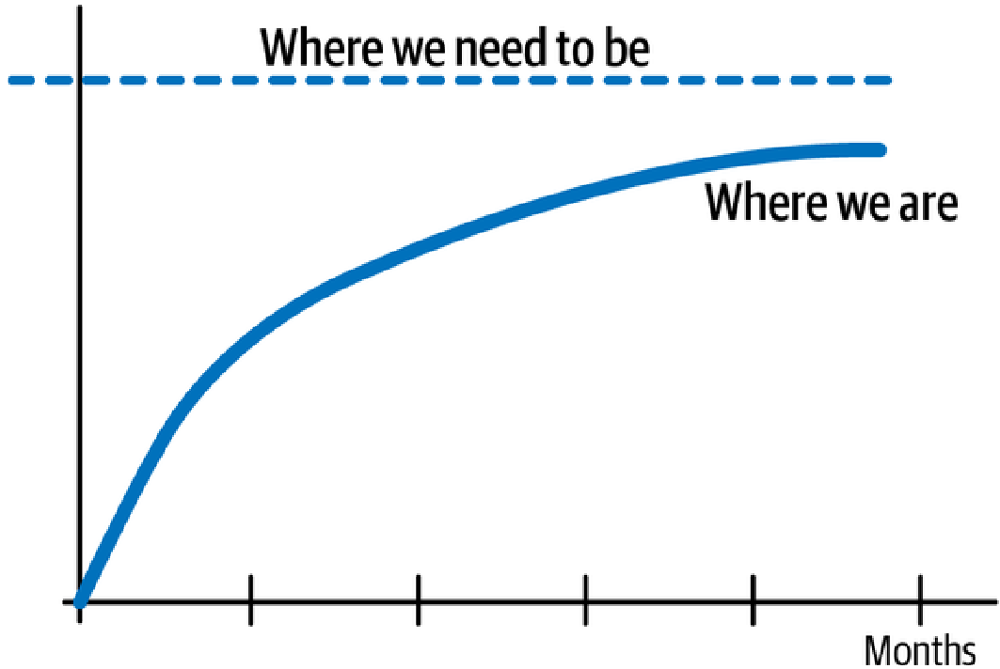

> 图 5-2：一张图可以展示朝目标推进的进展。

### 设计

探索完成、工作得到澄清之后，你大概会对接下来发生什么有很多想法：
要构建或改变什么、采取什么方式。别假设与你共事的每个人都理解或同意
这些想法。即使你谈论它们时没听到反对意见，同事可能并没有消化这个计划，
他们默许也未必说明什么。你需要努力确保所有人达成一致。
最高效的方式就是把东西写下来。

#### 为什么要分享设计？

在第 2 章我讨论过口头文化与书面文化的公司。公司越大，你们的文化就越可能
已经转向后者，越可能存在某种期望：你会撰写并评审设计文档。这是因为，
没有共同理解，很多人很难一起达成什么；而没有书面计划，
你又很难确认拥有这种共同理解。无论你创建的是功能、产品计划、API、架构、
流程、配置，还是任何其他需要多人保持同样理解的东西，在把它写下来之前，
你都不会真正知道人们是否理解并同意。

写下来并不意味着每个微小的变更都需要一份 20 页的技术深潜。一份简短、
利落、易读的东西，就足以让一组人（字面意义上）看到同一页。
但你至少应该包含计划的重要方面，并让其他人在看到你前路上的隐患时
能联系到你。为设计征求评审不只是问架构或一系列步骤是否可行；
它还包括就“你们到底在解决对的问题吗”“你对其他团队和现有系统的假设
正确吗”达成一致。对一个团队来说显而易见的路径，可能给另一个组织
带来额外工作或破坏其工作流。正如我的朋友 Cian Synnott 所说，
一份书面设计是一次非常廉价的迭代。

#### RFC 模板

以这种方式共享信息的一种常见做法是设计文档，通常称为
Request for Comments（RFC）文档。虽然你会在许多公司看到 RFC 的使用，
但对于它应该长什么样、如何被使用，其实并没有统一的标准。不同的公司会有
不同的细节和正式程度，分享的范围可宽可窄，可能鼓励也可能不鼓励评论，
你可能有一个正式的批准步骤或一场讨论设计的会议。

我不打算评判哪种流程最好——这真的取决于你们的文化——但我非常喜欢
为这类文档准备模板。¹⁰ 无论我们作为架构师多么了不起，
设计一个复杂系统、流程或变更时要记住的东西都很多。
而人类并不擅长关注所有事情。正如《The Checklist Manifesto: How to Get
Things Right》（Picador）的作者 Atul Gawande 所说：

> 我们天生不是为纪律而造的。我们为新鲜和刺激而生，
> 而不是为对细节的小心关注。纪律是需要努力才能获得的东西。
> 使用清单不知怎的会让我们觉得有失身份，是一种难堪。
> 它与我们内心深处的信念相悖——我们当中真正伟大的人、
> 我们渴望成为的那些人，就是这样应对高风险、高复杂度局面的。
> 真正伟大的人是大胆的。他们会即兴发挥。他们没有协议和清单。
> 也许我们对英雄主义的观念需要更新了。¹¹

Gawande 认为，使用清单能帮助我们互相交流、避免常见错误，并*有意识地*
而不是含含糊糊地做出正确的决策。一个好的 RFC 模板能帮你把决策想透，
提醒你那些可能遗忘的话题。经历创建这类文档、回答关于计划的某些
（也许令人不适的）问题的过程，能帮你确保没有漏掉某个至关重要的问题类别。

#### RFC 里应该有什么？

你们公司可能已经有自己的 RFC 模板，如果有，你应该沿用。不过，
下面是我会放进每一份 RFC 的标题，也是我认为至少绝对应该包含的标题。

##### 上下文

我喜欢文档在空间和时间上有锚点。当有人在两年后偶然发现这份文档时，
页眉应该给他们足够的上下文来判断它与他们在找的东西是否相关。
它应该有标题、作者名和至少一个日期；我喜欢“创建于”和“最后更新于”，
但只有其中一个也比没有强。写上文档的状态：是一个早期想法、开放详细评审、
已被另一份文档取代、正在实现、已完成，还是暂停。我喜欢页眉用标准格式，
这样快速浏览一份 RFC 非常容易，但信息可得比信息标准化更重要。

##### 目标

目标部分应该解释你到底为什么要做这件事：它应该表明你要解决什么问题、
或想抓住什么机会。如果有产品简报或产品需求文档，这部分可以是它的摘要，
并附上回链。如果这个目标只会引出“好吧，可你为什么要做那个？”这个问题，
你就应该再进一步，把这个问题也回答了。提供足够的信息，
让读者判断他们是否认为你在解决对的问题。如果他们不同意，那很好——
你现在发现了，而不是在做出错误的东西之后。

目标不应包含实现细节。如果你发给我一份 RFC，目标是“创建一个把鸡叫声
翻译出来的 serverless API”，我完全可以相信这就是你想做的事，
我可以评审这份 RFC、试着评估你的设计。但不知道你到底要解决什么问题、
为谁解决，我就无法评估这是否真是正确的路径。你在目标里指明要做
serverless，于是你已经做了一个重大设计决策，却没有任何论证。
具体实现应该服务于目标；它不应该是目标。把设计决策留给设计部分。

##### 设计

设计部分说明你打算如何达成目标。确保包含足够的信息，让读者能评估
你的方案是否行得通。给受众他们需要知道的东西。如果你是写给潜在用户
或产品经理看的，确保把你打算给他们的功能和接口说清楚。
如果你将依赖某些系统或组件，写上你想如何使用它们，
这样读者就能指出对其能力的误解。

你的设计部分可以是一两段话，也可以是 10 页密密麻麻的内容。
它可以是叙事，可以是一组要点，可以是一堆带标题的小节，
或任何其他能清楚传达信息的格式。

取决于你要做什么，设计部分可以包括：

- API
- 伪代码或代码片段
- 架构图
- 数据模型
- 线框图或截图
- 流程中的步骤
- 组件如何组合在一起的心智模型
- 组织结构图
- 供应商成本
- 对其他系统的依赖

重要的是，读到末尾时，你的读者应该理解你打算做什么，
并能告诉你他们认为它行不行。

> [!TIP]
> **错了也比含糊好**
>
> 我经常看到有人写这个设计部分时有点含糊其辞——或者干脆避免承诺任何方案——
> 因为他们不想让别人就细节和自己争。但与其含糊，不如错得明确或有争议，
> 这是对时间的更好利用。如果你错了，人们会告诉你，你会学到东西，
> 需要的话还可以改变方向。如果你在尝试一个有争议的想法，
> 你可以早点发现同事会不会拖你的方案后腿。别人对你的设计有分歧，
> 并不意味着你需要改道，但它给了你原本不会有的信息。
>
> 这里有两条让设计更精确的建议：
>
> - 为每一个动词明确是谁或什么在执行这个动作。如果你发现自己在写被动语态，
>   比如“数据在传输中会被加密”或“JSON 负载会被解包”，那你就是在遮蔽信息、
>   让读者去猜。相反，用有主语的主动动词来写：“客户端会在传输数据之前
>   先把数据加密”或“Parse 组件会解包 JSON 负载”。¹²
> - 这里有一条对我帮助巨大的建议：如果多用几个词、甚至重复一下自己就能避免
>   歧义，那完全没问题。正如软件工程师兼作家 Eva Parish 在她的文章
>   “What I Think About When I Edit”中建议的：
>
>   > 与其说“这个”或“那个”，你应该加一个名词，把你具体指的东西写明白，
>   > 哪怕你刚刚才提到过它。
>   >
>   > 例：我们只剩两个箱子了。要解决这个，我们应该再多订一些。
>   >
>   > 修改：我们只剩两个箱子了。要解决这个短缺，我们应该再多订一些。
>
> 自从读了 Eva 的文章，我注意到太多设计文档里一个光秃秃的“this”遮蔽信息的
> 例子。比如：“A proposal exists to replace OldSolution, which was built
> to provide OriginalFunctionality, with NewSolution. TeamB needs this,
> so we should discuss requirements.”TeamB 需要的到底是什么：
> 这个提案、原有功能，还是新的解决方案？
>
> 如果你在写作上很吃力，请记住这是一项可学习的技能。你们公司能用的
> 任何学习平台，多半都提供技术写作课。或者考虑 Google 的课程
> Technical Writing One 和 Technical Writing Two。Write the Docs 网站
> 也提供了大量关于如何写好东西的资源。

##### 安全/隐私/合规

你有什么值得保护的东西，要防的是谁？你的计划是否以某种方式触碰或收集
用户数据？它是否向外部世界打开了新的访问入口？你打算用的密钥或密码
将如何存储？你防的是内部威胁、外部威胁，还是两者都防？即使你认为
没有安全问题、认为这一部分不相关，也写下你为什么这么认为。

##### 考虑过的替代方案/现有方案

如果用电子表格就能解决同样的问题，你还想做它吗？¹³ “考虑过的替代方案”部分
是你（向自己也向别人！）证明自己是来解决问题的、而不只是对解决方案
感到兴奋的地方。如果你发现自己因为没考虑过任何替代方案而想省略这一节，
那就是你可能还没把问题想透的信号。为什么更简单的方案或现成产品行不通？
公司里有没有别人尝试过类似的东西，为什么他们的方案不合适？
我有一条原则：如果公司内部已经存在一个看似可行的选项而我们不打算使用它，
RFC 作者就必须把新设计发给拥有那个系统的人，给他们一个回应的机会。

这些是我认为哪怕在一份极小的 RFC 里也绝对要包含的标题。
它们是那些“让你诚实”的部分！不过还有一些别的标题，如果你想从
所写的文档中获得最大价值，它们往往很有帮助。

##### 背景

这里的情况是怎样的？读者需要什么信息来评估这份设计？如果你用了
评审者可能不认识的内部项目名、缩写或冷门技术术语，可以附上一个词汇表。

##### Trade-off

你的设计有哪些缺点？你有哪些因为认为收益值得付出代价而有意做出的
trade-off？

##### 风险

什么可能出错？最坏的情况是什么？如果你对系统复杂性、新增延迟，
或团队对某项技术缺乏经验有点紧张，别藏起这种担忧：警告你的评审者，
给他们足够的信息来自行得出结论。

##### 依赖

你对其他团队有什么期望？如果你需要另一个团队开通基础设施或写代码，
或者你需要安全、法务或公关部门批准你的项目，你需要给他们留多少时间？
他们知道你要来吗？

##### 运维

如果你在写一个新系统，谁来运行它？你将如何监控它？如果它需要备份
或灾难恢复演练，谁负责这些？

#### 技术陷阱

虽然本书并不打算写成一本技术或架构书，但我确实想指出几个我常在
设计文档中看到的陷阱。自己先抓住它们，免得别人来抓。

##### 这是一个全新问题（但并不是）

偶尔会有例外，但你的问题几乎可以肯定不是全新的。我已经谈过寻找先前的
和相关项目，但这重要到值得在这里再提一次。别错过向别人学习、
考虑复用现有方案的机会。

##### 这看起来很容易！

有些项目比看上去难得诱人，你可能要到深陷实现的泥潭时才意识到。
软件工程师并不总能真正内化“其他领域和自己的领域一样丰富、细腻、复杂”。
他们可能看到，比如，一个会计系统，就假设自己能构建一个更好、更干净、
更简单的。之前的团队怎么会往*这东西*里投入几千个工程小时！？
但构建会计系统（或薪资系统、招聘系统，甚至一个正确共享 on-call 排班的
东西）实际上是个难题。如果它看起来微不足道，那是因为你还不理解它。

##### 为当下构建

如果你是按当下世界的状态构建的，你的方案在三年后还能用吗？
即使你按当前用户数和请求量的五倍来设计，还有其他维度要考虑。
如果系统需要知道公司里的所有团队或所有产品，那么随着公司增长、
发生并购或被并购，会发生什么？如果产品变成五倍，这个组件会不会
因为所有人都在等同一个团队为他们添加定制逻辑而成为瓶颈？
如果团队规模翻倍，成员还能在这个代码库上工作吗？

##### 为远得不能再远的未来构建

如果你按比当前用量高几个数量级来设计，你有真实的理由要这么大吗？
如果处理更多用户是轻而易举的，那很好，去做，但要当心那些远比需要
复杂得多的过度工程方案。如果你在添加定制负载均衡、额外缓存或
自动区域故障转移，要解释为什么值得投入这些额外的时间和精力。
“我们以后可能会用到”不是一个足够好的理由。¹⁴

##### 每个用户只需要……

如果你有五个用户，你大概可以逐个教会他们你系统的所有晦涩规则。
如果你有几百个或更多，他们会做错；如果你不为此做计划，
你的设计就是行不通的。你的方案中任何涉及人改变工作流或行为的部分
都会困难重重，需要成为设计的一部分。

##### 难的部分以后再想办法

这种情况在迁移中很常见：你花一个季度构建和部署系统，打磨它，
让它对几个简单的用例完美——然后你得想办法让它对更困难的用例也能用。
如果到头来发现做不到呢？无视项目中困难的部分，也可能意味着把复杂性
推给别人，比如要求某个 API 的所有现有调用方改代码而不是保持向后兼容，
或者迫使你的客户自己写逻辑去解读晦涩而分散的信息。

##### 用让大问题更难的办法解决小问题

如果你有大量小型项目，人手勉强够用，你会看到人们用粗糙的方式绕开难题，
而不是正面应对。这些补丁式方案往往对现有系统行为有隐藏依赖，
意味着以后实现更全面的方案会更难。如果你的组织拒绝投资解决底层问题，
你可能别无选择，但至少要在设计中把它指出来。想一想怎样在不让更大问题
更难解的前提下解决较小的问题。

##### 这其实不是重写（但它就是！）

如果你看着一个庞大的软件系统，设想它换一个形状，请对自己和他人诚实面对
那需要多少工作。你也许想象“只是”把业务逻辑抽出来重构，
或者为云重新做架构。但除非你的代码已经非常模块化、组织良好
（那样的话，你确定需要重新做架构吗？），你很可能最后重写的
比你打算的多得多。如果你的项目是一个遮遮掩掩的“从头重写”，
请对自己诚实并承认它。

##### 可它运维得起来吗？

如果你在下午 3 点都想不起某样东西是怎么工作的，那么凌晨 3 点你更不会明白。
而在你离开后加入团队的人会觉得难得多。确保你创造的是别人也能推理的东西。
力求让系统可观测、可调试。让你的流程尽可能无聊、尽可能自文档化。

说到可运维性，如果它要在生产环境运行，就决定谁为它 on-call，
并写进 RFC。如果那是你自己的团队，确保你们不止三个人（理想至少六个），
否则你们是在把自己推向倦怠和漏接告警。

##### 把最小的决策讨论得最多

谁不喜欢一场精彩的 bikeshed 讨论！“bikeshedding”这个说法来自
C. Northcote Parkinson 1957 年的“琐碎定律”，该定律认为，
讨论一个琐碎问题远比讨论困难问题容易，团队就会把时间花在那里。¹⁵
Parkinson 的例子是一个虚构的委员会，在评审核电站规划时，
却把大部分时间花在最容易理解的话题上，比如员工自行车棚用什么材料。¹⁶
技术人通常知道 bikeshedding 这个概念，但即使是资深的人，
也会不自觉地就最琐碎、最可逆的决策写下长篇大论，却完全不去碰那些
更难理解或更难达成共识的决策。

这只是常见陷阱中的一部分。你大概已经注意到其他一些。把它们加到
你的清单里，并且非常确定你自己没有成为它们的猎物。

### 写代码

大多数软件项目都会涉及写大量新代码或修改现有代码。在本节中，
我会谈项目负责人如何参与这类上手的技术工作。（如果你不是软件工程师，
请换成对你来说合理的任何核心技术工作。）

#### 你该不该在项目上写代码？

作为项目负责人，你贡献多少代码取决于项目的规模、团队的规模和你自己的偏好。
如果你在一个很小的团队，你可能深陷每次变更的细节。在一个多团队的项目上，
你可能偶尔贡献一些功能，或只做小修复，也可能在更高的层面工作、完全不写代码。
许多项目负责人发现自己评审了大量代码，但自己写得并不多。

正如 Joy Ebertz 指出的：“写代码很少是你花时间的杠杆最高的事情。
我今天写的大部分代码，都可以由资历浅得多的人写出来。”不过 Ebertz 也指出，
写代码给你一种难以通过其他方式获得的深度理解，帮你发现问题。更重要的是，
“如果每周花一天写代码能让你保持投入、兴奋地来上班，你在工作的其余方面
很可能会做得更好。”最后，参与实现能确保你和团队一样切身感受到
自己架构决策的代价。

不过要留意，你是否在以牺牲更困难、更重要的事情为代价来贡献代码。
这是我在第 4 章提到的 *snacking* 的一种形式：接下你知道怎么做的工作
（反馈回路更短），逃避重大而困难的设计决策或关键的组织运筹。

#### 做榜样，但别做瓶颈

作为负责推进项目的人，你的时间比别人更难预测。你的会议大概也比
其他所有人都多。所以如果你接下最大、最重要的问题，你很可能比别人
更晚才能开始写代码，这会阻塞别人，让你成为瓶颈。如果你要写代码，
尽量挑不赶时间、不在关键路径上的工作。

把你的代码当作帮助其他所有人的杠杆。《99 Bottles of OOP》的合著者、
GitHub 的 staff engineer Katrina Owen 给我讲过一个项目，她在其中创建了
为 API 分页写测试的标准方式，然后用她的方式替换了所有现有测试。
通过改变当前所有的分页测试，她也隐式地改进了未来的测试：
任何创建新测试的人都会照抄已经存在的模式。

力求让你的方案赋能团队，而不是取而代之。从事数据库系统工作的
staff engineer Ross Donaldson 曾把他的部分工作描述为“侦察与绘图”：

> 我回到团队说：“我发现了这个问题、那条河、这些资源”，然后我们可以
> 一起讨论想如何处理这些新信息。接着也许我会出去在新河上搭一座
> 粗糙的桥，由团队拥有并改进它。我会提供一两个意见，提醒人们
> 他们手头可用的工具，但除此之外，我会把他们的所有权感
> 置于我自己的代码审美之上。

Squarespace 的 senior staff engineer Polina Giralt 补充道：

> 如果某件事只有我懂，我会去做，但坚持要有人和我结对。如果是紧急情况
> 而我知道怎么修，我会自己动手，之后再解释。或者我会写下代码来确立
> 一个新模式，然后交给别人继续实现。这样就强制了知识共享。

与其亲自承担每一项重要变更，不如为其他人创造成长的机会：聊聊细节，
或在变更上结对编程。结对分享知识、培养他人的技能。结对也意味着
你可以只参与变更的关键部分，然后留给同事去完成。

如果你在评审代码和变更，注意你的评论是如何被接收的。即使你觉得自己
亲和友好，当一位 staff engineer 评论职业早期工程师的工作时，
还是可能让人胆怯。你要让团队其他人把你当作学习的资源，而不是一个
批评每个决定、让他们觉得自己不行的人。有时更好的做法是让别人建立
一个*足够好*的模式而不去推翻，即使你自己会做得更好。另外，
小心不要做*所有的*代码评审——否则你会成为单点故障，
团队其他人也学不到那么多。

staff+ 工程师还是另一种更隐性的榜样：你做的任何事都会为团队设定期望。
因此，产出高质量的工作很重要。达到或超越你们的测试标准，添加有用的
注释和文档，对走捷径要非常小心。如果你是团队里最资深的人而你马马虎虎，
你就会带出一支马马虎虎的团队。（我会在第 7 章更多地谈论做榜样。）

### 沟通

良好的沟通是按时交付项目的关键。如果团队之间不交谈，你们不会有进展。
而如果你不与项目之外的人交谈，你的干系人就不会知道进展如何。
我们来看看这两类沟通。

#### 互相交流

为你的团队成员寻找定期互相交谈、建立关系的机会，即便是在
（或者也许恰恰是在）完全远程的团队上。伸手提问应该感觉容易，
他们彼此应该足够自在，可以表达分歧而不至于气氛紧张。你可以用共同的
会议、友好的 Slack 频道、演示和社交活动让建立关系变得更容易。
如果团队数量不多，相邻团队的关键人物可以互相参加对方的会议或站会。
目标是自在的熟悉感。

熟悉感也会让人更安全地提出澄清性问题。互不相识的工程师可能不好意思说
“我不知道那个术语是什么意思”或“你刚描述的问题意味着什么”。其结果是，
一起工作、分享知识、揭露误解都会更难。力求达到这样一种状态：
你的团队提问、承认自己不知道什么是正常的。

#### 同步状态

你的项目还有其他关心它的人：干系人、发起人、等你完成的客户团队。
让他们容易了解进展，并设好你们何时到达各个里程碑的期望。
这可能意味着一对一的交谈、定期的群发邮件更新，或一个带状态的项目仪表盘。

随着你对项目进展的理解，你大概会掌握很多细节和微妙之处：谁在做什么、
什么时候打算发生什么、项目的每个部分进展如何。在做状态汇报时，
你可能倾向于分享你知道的一切：信息越多越好，对吧？未必！
太多细节会遮蔽整体信息，让你的受众更难带走你想要的结论。

相反，用影响力来解释你的状态，想一想受众真正*想*知道什么。
他们大概不关心你搭建起了三个微服务；他们关心用户现在能做什么、
什么时候能做下一件事。如果越来越清楚你们赶不上某个关键里程碑日期，
这是一个你想传递的事实。但如果某个团队的延误并不改变你们的交付日期，
那个延误对他们可能就无关紧要。特意指出它，甚至可能显得你想把一件
不需要升级的事升级。

如果你认为受众真的想要全部细节，至少把要点放在最前面。别假设他们会
从你的更新里筛出关键事实，或在字里行间读出微妙之处。如果有什么不清楚，
就把要点明说。练习在事实后面跟上“这意味着……”，或解释你做某事是
“为了让我们可以……”。

对汇报的状态要现实、诚实。如果你的项目正遇到困难，你可能很想强撑笑脸，
指望把一切摆平，然后汇报状态是绿的。但这样做的话，你就是在为项目结束时的
不愉快意外埋雷——那时你不得不承认它不是绿的，而且早就不是了。
你听说过有人谈论“西瓜”项目吗？外面全是绿的，里面却是红的。
如果你的项目卡住了，别藏：求助。

### 绕行

总会有事情出错。也许你意识到一项一直是你计划核心的技术终究不合适：
它扩展不了，它缺少某些基本必备功能，或者它带着一个你的法务团队
绝对否决了的许可条件。也许你的组织宣布业务方向调整，现在需要你解决
另一个问题。也许项目中某个关键人物离职了。你必然会遇到一些路障、
不得不改道，而如果你带着“总会有什么事出错——只是还不知道是什么”的
假设进入项目，你会好过得多。这种态度能帮你更灵活，以至于当路障到来时，
你甚至会觉得有点意思，而不是被它挫败。把这些绕路重新框定为学习的机会、
获得否则不会有的经历的机会。

作为握着方向盘的人，你要对项目遇到障碍时发生的事情负责。你不能说
“唉，项目被阻塞了，我们无能为力”：你要负责重新规划路线、向能帮上忙的
人升级，或者，实在不得已时，向干系人宣布目标现在无法达成。
避开那些“西瓜项目”：如果项目状态除了一个不可能解决的关键问题外
都是绿的，那项目状态其实并不是绿的！

无论干扰是什么，和你的团队一起想办法绕过它。变化越大，你就越可能需要
回到本章开头，把不知所措重新应对一遍、重建背景，并把项目当作重新启动
来对待。无论发生什么，确保你就此保持良好的沟通。别制造恐慌或让谣言滋生。
相反，给人们事实，并明确你希望他们拿这些信息做什么。

遇到困难时，记住想要你的项目成功的不止你一个人。¹⁷ 你的 manager 的工作
是让你成功，你的 director 的工作是让你的组织成功。如果你不告诉他们你需要
帮助，他们就很难做好自己的工作。有些人真的很抗拒求助。也许那感觉像失败。
但如果你卡住了、需要帮助，最大的失败是不去求助。别独自挣扎。

下一章我会更多地谈论如何绕过障碍，看看项目可能卡住的一些原因
以及怎样让它们回到正轨。

## 回顾

- staff engineer 可以接手那些看似无解的问题，并把它们变得可解。
- 被一个巨型项目压得喘不过气是正常的。项目本来就难。
  这正是它需要你这样的人的原因。
- 搭建能减少歧义、让背景容易共享的结构。
- 明确项目的成功会是什么样子、你将如何衡量它。
- 领导一个项目意味着有意识地*驾驭*它，而不是任其发展。
- 通过建立关系、有意识地着手积累信任，让你的路更平坦。
- 把东西写下来。要清晰、要有立场。错了会被纠正，含糊会一直留着。
- 总会有 trade-off。做决策时，要清楚你在优化什么。
- 心中装着受众，频繁沟通。
- 预料问题会出现。做计划时就假设会有方向变更、人员离职和依赖不可用。

> ¹ 我在本章里会一直说“项目经理”，但你共事的可能是项目集经理
> （通常负责多个有着共同目标的项目）。有时你会看到技术项目经理（TPM）
> 这个头衔。就本章而言，只需假设我说的是这些角色中的任何一种人，
> 而且他们组织能力超群、擅长交付产品。

> ² 如果你跳过了第 2 章，那就把团队和组织想象成相互挤压的构造板块，
> 板块交界处充满摩擦和不稳定。

> ³ 也留意一下你的生理需求。不是要打听你的私事，但我们这个行业
> 有很多人睡眠不足。你呢？睡眠能培养韧性、意志力和精力！它太神奇了。
> 你上一次喝一杯水是什么时候？

> ⁴ 虽然几乎可以肯定是杜撰的，但有一句 Henry Ford 关于 Model T 的话，
> 说明了不同领域的人如何无法沟通：“如果我问人们想要什么，
> 他们会说要更快的马。”

> ⁵ 这也许不言自明，但在描述这种现实时要讲点外交手腕。如果你写下
> 对那个难缠的人、对立的团队或优柔寡断的 director 最善意的描述，
> 当有人不可避免地把邮件或文档转发给他们时，你就不会那么尴尬。
> 你也会对他们生出共情，或许还能获得一些如何与他们合作的洞见。

> ⁶ 不过想想看，如果他们真的配了产品经理，我们行业的内部解决方案会好多少。

> ⁷ 不过要尽量避免依赖某个人非常特定的技能组合。人们经常在各个公司之间流动，
> 你不会想要单点故障。

> ⁸ 很可能至少有一些人不在办公室，而且整支团队的人分布在不同城市或时区
> 也并不少见！如果大家分布在全球各地，最好让他们的工作时间有相当大的重叠，
> 尤其是在需要密切协作的情况下。完全依赖异步沟通很难建立信任关系。

> ⁹ 在整个项目中都要把这一点说清楚！新领导者常常只是隐隐暗示，
> 如果大家做了某件你需要他们做的事就好了。这样想吧：如果你含糊其辞，
> 其他人就得去琢磨你要求的事情到底有多重要，这反而是给所有人*增加*工作。
> 明确说出你想让大家做什么。

> ¹⁰ 我为 Squarespace 工程博客写过一篇文章，里面包含一个示例模板：
> “The Power of ‘Yes, if’: Iterating on Our RFC Process”。

> ¹¹ 他随后证明了清单能救命。读这本书的人很少会负责性命攸关的系统，
> 但如果你恰好负责，请务必要有协议和清单！

> ¹² Rebecca Johnson 博士提供了我读过的最好的被动语态误用检验法：
> “如果你可以在动词后面插入‘by zombies’，那它就是被动语态。”
> 它几乎总是有效。“The data will be encrypted in transit [by zombies]。”
> 谢谢僵尸！

> ¹³ 如果你热爱电子表格，而这反而让项目对你更有吸引力，
> 那就把你觉得最平淡无奇的技术换成别的。

> ¹⁴ 软件工程史上代价最高的句子之一。

> ¹⁵ Parkinson 还创造了那条定律：“工作会膨胀，直到填满所有可供完成
> 它的时间。”这家伙真有洞见！

> ¹⁶ 我有一次写演讲稿，整套 83 页的幻灯片，有人唯一的评论是建议换掉我
> 在其中一页放的那张自行车棚图片。真事！我不觉得他们是在反讽。

> ¹⁷ 除非你真的是像第 4 章讨论的那样，把社会资本花在一个没别人关心的
> 激情项目上！那样的话，抱歉，你可能只能靠自己了。但我希望你积累了
> 足够多的善意，让你的同事和 manager 仍然多少替你感到兴奋，
> 并愿意帮你摆脱困境。

# 第 6 章 我们为什么停下来了？

作为项目的驾驶员，你有责任把所有人安全地送到目的地。
但你的旅程有很多理由会提前停下。你可能会撞上路障：事故、收费站，
或者一条满是羊的乡间小路。你可能发现自己的地图丢了，
或者车里的人对要去哪里各执一词。又或者你只是意识到，
你本该去的是别的地方。

## 项目没有前进——它应该前进吗？

在第 5 章里，我们谈了怎么启动项目。现在该看看项目会怎么停下来了。
我们先从两种你可能遇到的临时停摆说起：被什么东西阻塞，以及迷路。

然后我们会看看你可以怎样有意地停下这段旅程。
有时这意味着太早宣布胜利，但有时也确实只是旅程该结束了，
不管它有没有到达目的地。

趁这个机会正好说明一点：作为组织里的领导者，
你也能帮助那些 *不是* 你负责的项目。有时你时间的最佳用法，
就是把手上正在做的事放到一边，用推动、轻推和小步子
（好吧，有时是重大升级）让一个停滞的项目重新动起来。
正如 Will Larson 所说，这小小的投入可能带来巨大的影响：

> 数量多得惊人的项目，离成功只差一个小小的改动，
> 离解锁一个新机会只差一次快速调整，离达成共识只差一次对话。
> 凭借你在组织里的特权、你在公司各处建立起来的关系，
> 以及经验带给你的绕过弯看到后面的能力，
> 你常常只要投入一丁点儿努力，就能改变一个项目的结局，
> 而这是你能做的最有价值的工作之一。

为了统一，本章剩下的部分都假设停滞的那个项目正是你负责的项目。
不过，如果你只是介入来帮忙，很多技巧也同样管用。

但别忘了：看到一个问题，并不等于你就该跳上去。
就像我在第 4 章说的，你需要 *守住自己的时间*。
别陷入图 6-1 那张时间图里的处境——你被太多支线任务和帮忙缠住，
以至于没有时间做你真正要负责的工作。要有分辨力！
挑那些你的帮助最有价值的机会，然后有意识地行动，
并想好之后怎么抽身。

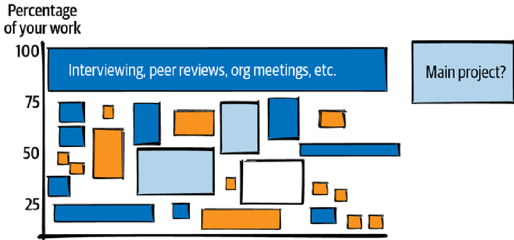
> 图 6-1：你完全可能把时间都花在帮助和推动一个个项目上，
> 以至于没有给承诺要做的那个主项目留下任何空间。

我们先从项目停滞的第一类原因说起：它们被阻塞了。

### 你堵在路上了

在理想世界里，团队都是自治的，从不需要考虑别人在做什么。
现实中，任何大项目都会横跨多个团队、多个部门和多种职能。
哪怕只是一个人的拖延，有时也足以错过一个重要截止时间。
而当项目是一次迁移或一次废弃时，成功可能取决于每一个其他工程团队的工作，
一路上有大把机会被卡住。

不管你面对的是哪种阻塞，你都会用到一些相同的技巧：

#### 理解并解释

你会排查正在发生什么，并理解这个阻塞。然后你要确保其他人
对正在发生的事有同样的理解。

#### 让工作更容易做

你会绕过阻塞——办法是不再向你等待的人要那么多东西。

#### 争取组织支持

当你能证明一件事是组织的目标时，让它排上优先级会更容易。
你要展示这项工作的价值，从而拿到那种支持。
有时你还会升级，以获取帮助来跨过阻塞。

#### 制定备选方案

有时阻塞就是不会消失，这时你会用创造性的方案取得成功。
或者你会接受：这个项目以目前的形式就是做不成。

我们来看看，当你以各种方式被阻塞时，怎么用这些技巧：
等另一个团队、等一个决策、等一个批准、等一个人、
等一项没人负责的工作，或者等一次迁移涉及的所有团队。

### 被另一个团队阻塞

我们先从一个经典的依赖问题开始：你的项目进展正常，
但你需要另一个团队做的工作，而它 *就是没发生*。
如果运气好，那个团队的一位领导者会主动告诉你发生了什么、
他们什么时候能开始。如果运气差一点，那个团队已经不回你的邮件了，
你只能自己拼凑正在发生什么。等他们很让人沮丧。
你掌握的信息他们全都掌握，而且他们知道有上线日期！
他们为什么不在乎？去弄清楚。

#### 发生了什么？

如果一个你依赖的团队没有交付你需要的东西，几乎肯定有一个很正当的理由。
三种可能的原因是：误解、意外，或者优先级错位。

##### 误解

即使在沟通路径清晰的组织里，信息也可能丢失。
一个团队觉得某件事必须在某个具体日期之前完成，这是显而易见的。
另一个团队根本不知道有截止时间，
或者对他们被要求做的事有了不一样的理解。

##### 意外

生活总会发生。有人辞职，有人生病，或者需要突然请假。
你依赖的那个团队人手不足、负荷过重，
或者被他们自己的下游依赖卡住了。
不管这件事有多重要，他们可能都无法赶上截止时间。

##### 优先级错位

也许那个团队速度惊人——只是不在你的项目上。
即使你在做的事情至关重要，另一个团队也可能有更高的优先级。
看看图 6-2。Project C 是 Team 2 的最高优先级，
他们把它放在其他所有必须做的工作之上。
但它只是 Team 1 的第三优先级！他们有时间才会做。

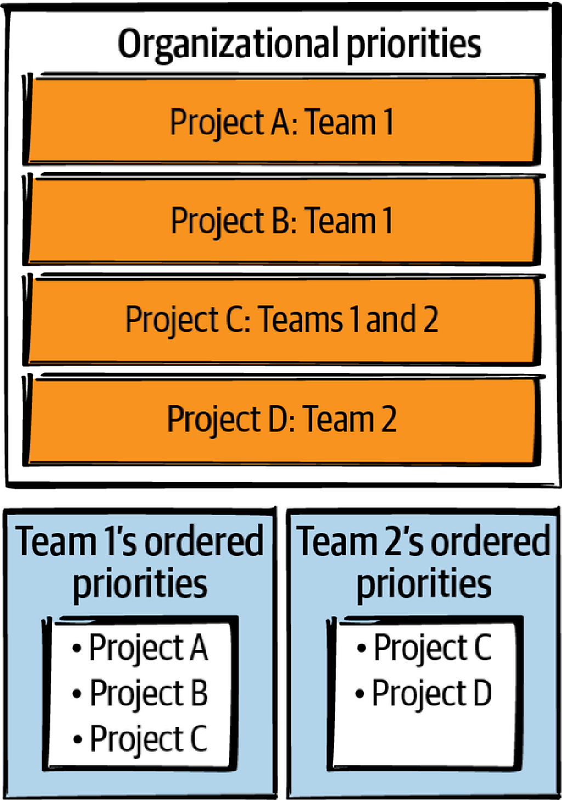
> 图 6-2：优先级错位的团队。如果每个团队都做自己最重要的项目，Team 2
> 很可能要一直等 Team 1。

#### 在依赖关系中周旋

下面就是那四个技巧的实际运用：

##### 理解并解释

先弄清楚另一个团队为什么不动。是他们没理解需要什么？
是有什么挡着他们？理解意味着彼此交谈。
如果私信或邮件不管用，就改成同步的语音对话——对，这意味着开个会。
如果这个团队很难联系上，走些私下渠道可能有帮助：
希望你已经在那个团队里或者团队附近的人那里搭起了一座桥。（见第 2 章。）

解释这项工作为什么重要，并讲清楚你希望他们交付什么、什么时候交付。
再给他们一次机会告诉你这现不现实，
或者他们能不能做点别的什么来解决你的问题。

##### 让工作更容易做

如果你需要的东西来自一个没时间提供的团队，
试着向他们要小一点的东西。这可能意味着只要一个你绝对需要的功能，
而不是你很想有的那好几个。如果他们自己被依赖卡住了，
想想你能不能帮他们解开：如果你能解决他们的问题、
让他们能解决你的问题，那就是所有人都赢！
有时你会沿着一条依赖链一路做支线任务，
直到找到一个小推动，让所有人都重新动起来。

另一种做法是，你可以主动提出替他们做一部分工作，
比如让另一个团队写好代码再发给他们评审。
要知道这个提议可能并不如你以为的那么有帮助：
比如，陪着一个没有经验的人在一个难搞的代码库里完成一次改动，
往往比你自己动手还费力。如果那个团队没有接受你的提议，别觉得被冒犯。

##### 争取组织支持

如果你等待的那个团队在做他们认为优先级更高的事，
去弄清楚他们是不是对的。如果优先级不清楚，
请组织的领导层裁定哪个项目该“赢”。要尊重而友好，
但要问足够多的问题来理解。我希望这不用多说：
如果你的组织认为你的工作 *没那么* 重要，
你就该别去打扰那个团队，让他们专心做手上的事。

但如果你被阻塞的项目确实更重要，这可能就是一个向双方共同的领导者升级的场景。
不管你多沮丧，都要摆出不带情绪的事实：
说明你需要什么、为什么重要、什么没有发生。
升级之前，考虑先和你的项目发起人或 manager 讨论一下情况。
他们可能有别的建议，或者愿意替你去谈其中一些话。

> [!WARNING]
> 升级并不意味着大吵大闹，或者抱怨另一个团队。
> 它意味着和一个有能力帮忙的人礼貌地谈一谈，一起设法解决一个问题。
> 保持建设性。

##### 制定备选方案

如果那个团队真的不会有空，你就得另找办法绕过这个阻塞。
这可能意味着重新界定你的项目范围、选一个不同的方向，
或者比你原计划更晚上线。事情就是这样。
一定要和你的干系人、项目发起人谈任何日期变化，
并确保他们明白你被什么卡住了。
他们可能有你没想到的解锁办法。

### 被一个决策阻塞

团队该走路径 A 还是路径 B？
他们该为一个单一的、特定的用例做设计，
还是试着解决一个更宽泛的问题？他们的架构、API
或数据结构该怎么布局？太多事情取决于这些细节，
而没有它们就很难推进。你可以按最大灵活性来设计，
但那很贵，而且你想避免过度工程。
不过，如果一年后你因为走了错路不得不把方案扔掉，那感觉会很糟。
于是你向干系人要具体的需求、用例或其他决策。而你得到的是……什么都没有。
怎么会有人让你去建一个东西，却不知道自己想要什么？！

#### 发生了什么？

当你在等别人做决策时，很容易觉得他们的工作比你的简单。
他们只需要决定自己想要什么，对吧？
然后由你来做真正困难的搭建工作。这需要来自工程之外
的决策时，我见过很多这种偏见。“产品团队为什么不干脆……？”
和“干脆”或“简单”这类词的许多用法一样，答案会很复杂。
产品、市场（或任何别的人）都和你一样没法拍脑袋决定。
又或者他们得先等信息——来自他们依赖的人的信息——才能决定。

他们还可能没理解你在问什么。当你让工程师向非工程师解释一个工程问题时，
这种情况特别常见。我见过一位工程师问一位干系人：
“你是想要 X 还是想要 Y？”结果听到的回答是“对，那太好了！”
那位干系人并不是故意装糊涂！不同的背景和不同领域的语言
意味着他们看不出你问的这两样东西有多大区别，
所以他们根本不可能做出一个知情的选择。

#### 在尚未做出的决策中周旋

当你的决策被别人的决策卡住时，要有同理心：
这个决策站在他们的位置上大概也不会更容易。
但当然，你不想永远等下去，所以这里有一些技巧，
可以在别人难以做决定时帮你推进。

##### 理解并解释

记住你们是同一阵营的。
与其把你等待的人看成障碍，不如看看你们能不能一起穿过这片模糊地带。
理解他们需要什么信息或批准才能做决策，并试着帮他们拿到。
确保他们知道这件事为什么重要，
以及在他们决定之前、除非他们决定，什么都不能发生。
解释这件事对 *他们*（不是你！）在意的东西有什么影响。
如果他们被卡住了，弄清楚他们在等谁、等什么。

##### 让工作更容易做

想想你是怎么问这个问题的，并建立对方如何接收它的心智模型。
真正设身处地钻进他们脑子里：如果你是他们，
你会怎么理解这些话？有没有容易产生误解的地方？
想想你能不能用手绘、用户故事或例子来重新表述这个问题。
等一切都对他们“咔哒”对上了，这个决策可能就容易了。

有时问题在于这个决策没有明确的负责人，
而各位干系人就是谈不拢。如果你需要的那个决策被冲突卡住了，
可以考虑扮演调解人，帮每一方理解对方的观点，
并找到一个两边都合适的方案。如果你的决策者被 *他们的* 决策者卡住了，
就用他们带得回去的形式给他们需要的信息。
花点时间给他们准备好谈话要点，
让他们需要打交道的人能听懂。如果这个决策的某些部分比其他部分更重要，
就解释清楚哪些部分以后很难或很贵才能反悔，哪些其实无所谓。

##### 争取组织支持

如果你还是没法让一个关键决策做出来，
就和你的项目发起人谈谈他们想怎么做。
他们可能对前路有一些想法，
或者能进入一些你进不了的房间，在那里推动决策发生。

##### 制定备选方案

在一个重大决策还悬而未决的情况下推进项目，
往往既让人不满意也很复杂：当你必须对所有未来方向保持开放时，
方案就不可能那么简洁优雅。它们通常也更贵。
但有时，把选项都留着是你手上最好的选择。

另一种做法是，有时你可以就正确的路径做出你能做的最好猜测，
并承担猜错的风险。如果你猜了，就把 trade-off 和这个决策写下来。¹
确保决策者知道你在猜，并理解你所选方向的含义。
花点时间想想最坏会发生什么、你以后可能会希望自己当初做了什么，
并尽你所能缓解那些风险。

最后，要现实一点。如果你的组织做不了这个关键决策，
绕开它去做够不够？你会不会在下一个决策上撞到同一个问题？
也许是时候接受：眼下这项工作你就是推进不下去了。
如果是这样，和你的项目发起人谈谈，告诉他们你试过什么，
并确保他们同意目前无法继续。

### 被一次 $%@$% 的按钮点击阻塞

我们都经历过，而且它让人无比沮丧。
你在等一个团队或一个审批人，他们只需要勾一个框、部署一份配置，
或者评审一个只有五行的 pull request。这会花他们 10 分钟！
他们为什么不干脆点一下那个该死的按钮？！

#### 发生了什么？

我曾经在一个为全公司其他人配置负载均衡的团队里。
我们的文档写着：要把一个新的后端加到负载均衡器上，需要提前一周告知。
但说实话，每个请求大约只花半小时。
我们需要多开一些容量、改配置、重启服务。
这是一项频繁的任务，对懂行的人来说也很直接。
其他团队知道我们做的事不是什么火箭科学，
所以我们经常收到这样的请求：“我们明天就上线，
所以请今天就把我们的负载均衡配好。”而通常，我们不会做。

为什么我们坚持要提前一周？因为这些配置不是我们唯一的工作。
有几百个团队在用我们那几组负载均衡器，而负载均衡
只是我团队支持的四个关键服务之一。我们不想一直被动响应：
我们想把自己的每一周规划好，把这些配置改动批量做，
而不是每次都要一遍遍重启服务。结果是，
对那些火急火燎跑来质问我们、
为什么几个钟头前才说的事我们还没做的人，我们没什么同情心。
我们团队的口号变成了“你缺乏规划，不是我的紧急事故。”²

再一次，当你站在另一个团队的位置上，世界看起来会非常不一样！
你的请求只是某个人工作中很小的一部分，是他时间图上的一小块。
对他来说也许只是点一下按钮，但还有很多人给他发没被点过的按钮。
他们可能人手不足、苦苦挣扎。
他们可能正在改进自己的运营，过程中不断发现边界情况。
我见过一些团队意识到自己处理请求的流程没法扩展，
于是抽出一部分成员去搭一套更好的做法，
结果短期内团队人手更紧、速度更慢。

记住，其他团队给出批准时，往往也承担了责任。
当你让安全团队“点一下按钮”来批准你上线，
或者让沟通团队批准你的对外信息时，
你是在请他们分担（甚至是完全承担！）出问题时的责任。
他们不该轻易这么做。

#### 在没被点击的按钮上周旋

如果那个团队就是没做这件事，你可以用我在本章前面讲过的
大部分处理被阻塞依赖的机制。但如果事情其实是：
和他们打交道有一套标准做法，而你没用，那你就需要换个路子。
如果你不是真的着急，也许你就等着，
等那个团队做到你这件事的时候。但如果你有真实的截止时间，
你没法回到过去用那套流程。下面又是那些技巧：

##### 理解并解释

如果你真的需要插队，试着开口问。尽可能礼貌友好：
道歉比冲一个很忙的团队吼叫更能得到好结果。
如果有人特意费心帮你，要说谢谢。
在有同事奖金或即时奖金的公司里，已经有一套道谢的机制：用它。
如果那个团队坐在一起办公，你能不能送他们一份答谢礼物，
比如好茶或巧克力？至少在你上线邮件里感谢的名单中加上他们。
这样之后，人们记住的不会是“那个最后一刻才提要求的团队”，
而是“那个搭了桥、交了朋友的团队”。

##### 让工作更容易做

就像面对团队依赖时一样，把你需要的东西做到尽可能小。
把你的请求组织得容易让人说“好”，需要读的东西尽可能少。
（示例见图 6-3。）如果你能看到这个团队收到的其他类型的请求，
就看看通常会出现什么问题：哪些信息缺失，哪些很复杂，
哪些有争议。试着让你的工单成为那种简单的工单，
也就是做这件事的人会最先拿起来的那种，
因为这不需要他们想太多。

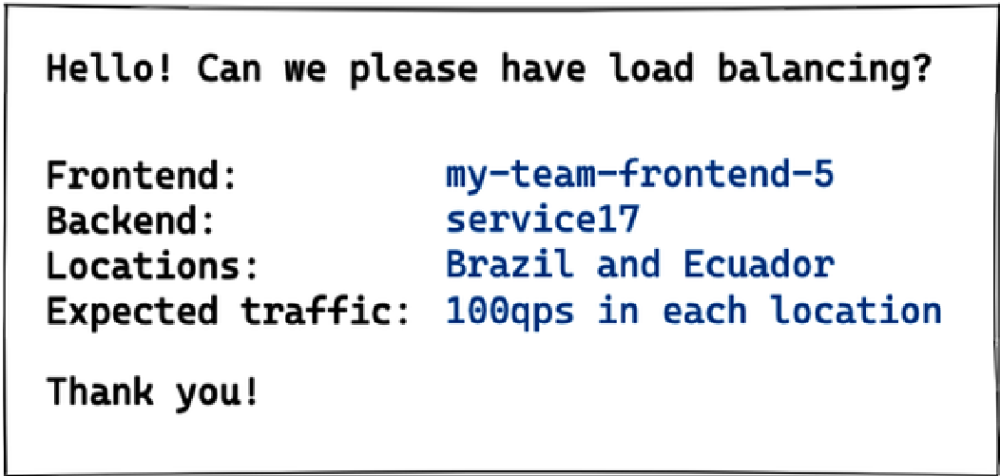
> 图 6-3：一份把所有信息都摊开、几乎不需要阅读的请求。

##### 争取组织支持

如果你真的没法通过其他任何方式获得帮助，而截止时间又很重要，
你可能就需要请人帮忙插队。提醒一句：
升级可能会让你和那个你求助的团队结下梁子：
没人喜欢自己的 director 或 VP 要求自己把一个请求挪到队首。
要尽可能减少可能的敌意：清楚说明你理解这个团队为什么有这个流程，
并且你是在道歉的前提下请求，就这一次破例。

##### 制定备选方案

有可能，和那个团队里的某个人有（或建立）一层关系，
就足以把优先级提上去。（世界不该这样运转，但往往就是这样运转的。）
不过，如果这些选项都不管用，你可能就只能等。
让你的干系人知道你会延期。

### 被一个人阻塞

如果等一个团队已经让人沮丧，那么当一个重要的项目整个在等 *一个人* 时，
情况可能更糟。工作已经分配了，就在某个人的桌上，
而他就是不做。

#### 发生了什么？

我曾经有一个项目，被一位同事卡住了：
他需要写几个很短的 Python 脚本来解决一个问题。
几周过去了，脚本没有出现，而我想自己动手写的冲动一天比一天强。
我这位同事总有很好的借口：出了事故，他需要请一天假，
或者他的电脑有硬件问题需要修。
在为他毫无进展而沮丧了几周之后，我意识到他并不是在偷懒：
他是被吓住了。他出身运营岗位，习惯的是那种被中断驱动的工作——
从一个火场跳到另一个火场，很少能拿到一段完整的专注时间。
这个项目本是他开始写代码的机会，
但他并不真的相信自己能做到，所以他就没法开始。

你的同事给出的被卡住的理由，不一定是真实的理由。
这个人可能是被吓住了、卡住了，或者手上事太多。
他可能因为个人生活里的什么事压力很大，根本无法专注，
或者他正从自己的领导层那里收到关于什么最重要的信息——
并且不敢告诉你，你的项目不在那份清单上。又或者前两次你解释的时候，
他都没理解你要的是什么，而他又太尴尬，不愿第三次开口问。
所有这些原因从外面看起来都一样：这个人就是没做这件事。

#### 与一位没在做事的同事周旋

当有人完不成自己的工作的时候，有一些办法可以帮上忙。
先说清楚：你既不是这个人的老板，也不是他的心理医生，
帮人治好拖延不是你的角色。但你也许能拿到你想要的结果，
而且如果对方经验较少，你还能借机教他一些技能。你可以这样做：

##### 理解并解释

看看你能不能多了解一点你这位同事的情况。
下次和他谈的时候，不要只接受他“下周就好”的承诺：再往深里挖一点。
你也许查不出到底发生了什么，
但你会对这件事是不是你能帮上忙的有个感觉。

非常清楚地说明这项工作为什么必要。
当你等一位更资深的同事时，这一点尤其有用——
他（想必！）是在对相对重要性做有意识的判断，而不只是在拖延。
描述业务上的需要，并展示在他们的工作完成之前什么都不能发生。
如果他们工作量很重，请他们告诉你他们能不能做完，
这样你就有时间找替代方案。可以考虑设一个更早的 go/no-go 截止点，
过了这个点你们双方就都明白：他们赶不上了，你该找别的路子。

##### 让工作更容易做

让这个人做你想让他做的事尽可能容易。
这可能意味着增加结构、把问题拆开，或者设置里程碑：
当项目太难的时候，有时连想怎么把它拆开都太难。³
不要靠让这个人去文档里翻找分配给他的行动项、
或者去猜你让他做什么，来把请求弄得含含糊糊：直接把你要的东西列出来。
看看 Brian Fitzpatrick 和 Ben Collins-Sussman 的
“Three Bullets and a Call to Action”技巧：
那是用来向忙碌的高管提请求的，在这里同样管用！

> [!TIP]
> **你到底想要什么？**
>
> 我很喜欢 Brian Fitzpatrick 和 Ben Collins-Sussman 在他们的书
> *Debugging Teams*（O'Reilly）里提出的
> “Three Bullets and a Call to Action”方法。他们写道：
> “一封好的 Three Bullets and a Call to Action 邮件包含
> （至多）三个要点，说明手上的问题，以及一个——而且只有一个——
> 行动号召。就这样，不多不少——你需要写的是一封能被轻松转发的邮件。
> 如果你东拉西扯，或者在邮件里放四件完全不同的事，
> 可以肯定他们只会挑一件事来回应，而且会是你最不在乎的那一件。
> 或者更糟：心智负担高到你的邮件会被整个丢掉。”

如果你的同事不堪重负，这可能是个教练的机会。
向他保证：他手上的事确实很难，但是可学的。
帮他，但尽量不要接手。⁴ 提问、回答问题，帮他找到自己的路。

如果你的同事看起来愿意做这项工作、只是迟迟无法开始，
看看你能不能和他们一起做。对前文提到的那位同事，这正是有效的解法：
结对把脚本写出来，让他迈过最吓人的第一步，之后就能自己继续了。
结对也可以是一起画白板，或坐下来同时编辑一份文档。
最后这种做法在你等 manager 的时候有时很好用：约一个一对一会议，
建议对方用这段时间做你需要的事，你就坐在旁边，
随时解答过程中的问题。

##### 争取组织支持

尽管在升级之前你该试过别的办法，但归根结底，
有人没有在做自己的工作，而这是人员管理问题。
和他的 manager 谈一次困难的对话很不舒服，
但如果另一个人是项目将要失败的原因，你无视它也同样是失职。
就像我在其他情形下说过的，升级不意味着抱怨：
它意味着寻求帮助。比如，如果你的同事被卡住，是因为他在做
他的 manager 认为更重要的事，那么和那位 manager 谈谈
可能是调整优先级的唯一办法。

### 被无人负责的工作阻塞

如果这项工作没有分配给任何人呢？
当一组团队一起解决一个问题时，有时会有这样一件大家一致认为
必须做、但它不在任何人路线图上的事。
它对任何一个工程师来说都太大，需要大量专门的时间，
或者它会涉及创建一个新组件，而这个组件需要有人长期负责和支持：
它需要一个团队来拥有它。也许有好几个团队都认为自己 *参与* 了这项工作——
他们会来参加相关的会议，对任何 RFC 都有很多意见——
但没一个打算提交代码去实现它。

#### 发生了什么？

这是板块构造问题的一个例子（见第 2 章）。
每个团队对自己负责什么都有清晰的边界。强边界可能是好事——
它让每个人都保持专注——但现在有一些关键的基础性工作不属于任何人。
我们在第 3 章的 SockMatcher 场景里见过这种情况。
很多工程师都关心那个架构：Geneva 为讨论这些问题组建的工作组
吸引了很多参与者。但那些挑战对任何人来说都太大，
没法当作支线项目来解决。除非它得到专门的关注，否则这项工作就是不会发生。

如果没有人被指派做这项工作，把它拆解、优化或者做计划的价值都很有限：
在有人拥有它之前，你就是卡住的。工程师们非常常见的做法是，
试图靠在与它相邻的技术工作上投入更多努力，
来解决这样一个组织层面的阻塞。（示例见图 6-4 那张藏宝图：
那道不可通行的山脊就是你们的人手缺口！）

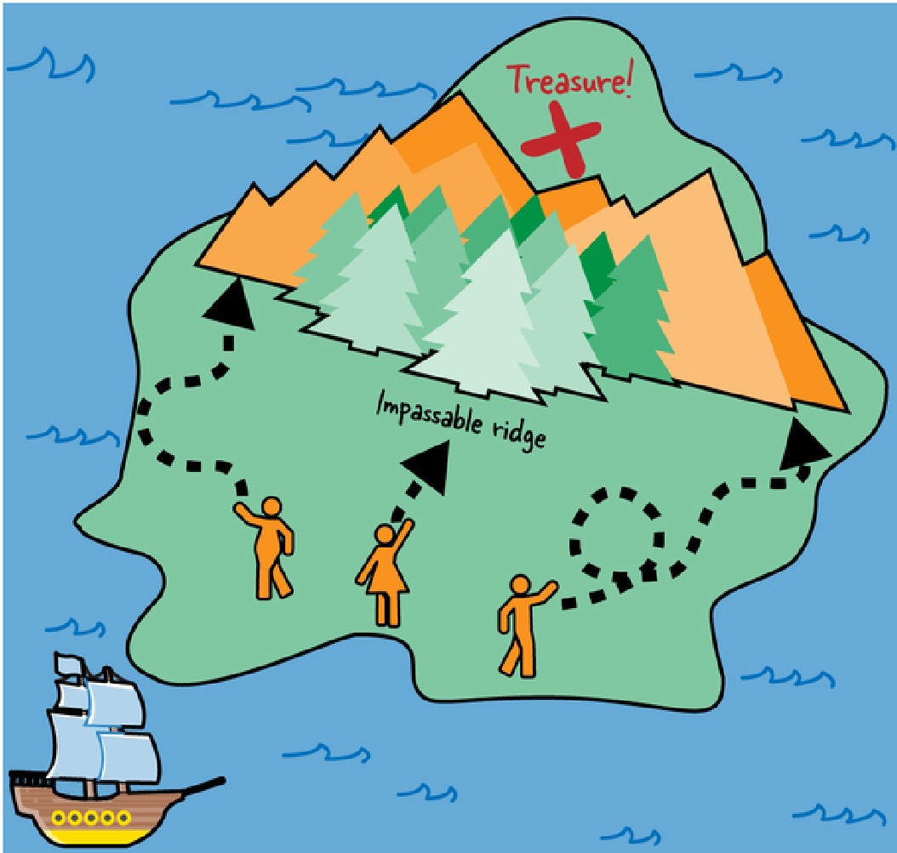
> 图 6-4：除非你能找到越过那道不可通行山脊的办法，
> 否则走前三条路中的哪一条其实都无所谓。
> 但团队会花大量时间争论该走哪条注定失败的路。

但除非组织层面的问题被解决，
再多的设计、再聪明的方案也没用。组织上的缺口是问题的关键所在。
如果你解决不了它，你就是在浪费时间。

#### 在无人负责的工作中周旋

当你被一项看起来不属于任何人职责的工作卡住时，
有几件事你可以做。

##### 理解并解释

工作无人拥有这件事并不总是显而易见的，
尤其当有很多团队和它紧挨着的时候。
既然你是最关心它成功的人，别人认为你现在就是负责人，这并不奇怪。
去进行大量的对话，顺着线索一路追下去，
弄清楚到底在发生什么。解读这些信息并得出明确的结论。
然后把它们写下来！（见下面的侧栏。）
保持简短，给出清楚的陈述：就像我在第 5 章讲设计文档时说的，
错误比含糊好，而除非你消除模糊，否则你不会发现任何误解。

> [!NOTE]
> **汇总**
>
> GitHub 的一名 manager Denise Yu 描述了“rollup 的艺术”：
> 把所有信息汇总到一处，“创造清晰、减少混乱”。
> 这是一个多用途的技巧，在任何有大量背景故事、
> 好几条不同的叙事线索、而且有些人可能没跟上正在发生什么的情况下都很有用。
>
> 把进入这份汇总的事实聚合起来，是建立你的认知、
> 确保你理解正在发生什么的好办法。但把它全部写下来，
> 也可能意味着你综合出了此前没有人表述过的新信息。
> 也许 Alex 说：“这个新库会为这个端点提供认证。”
> 而不久之后 Meena 告诉你：“我们要到 Q3 才能升级到这个库的新版本。”
> 你可以把这两个事实都写下来，同时也写下这个解读：
> “我们至少要到 Q3 才会有认证。”
>
> 带着所有上下文，这个结论可能看起来显而易见，
> 但如果此前没有人得出过它，对某些人来说它可能会很震撼。
> 把它明确写出来，你就给了每个人一个机会，
> 对这条信息做出反应并纠正方向。

##### 让工作更容易做

如果你有时间去指导、建议或加入做这项工作的团队，
就在你的汇总里提到这一点。director 们可能更愿意围绕一个现成的志愿者
搭一个团队，而向一位 staff+ engineer 学习的机会，
可以成为他们用来吸引其他成员加入的激励。

##### 争取组织支持

你在这个项目上价值最高的工作，是倡导组织支持和一个负责团队。
在你出发寻找这项工作的提携者之前，
确保你已经打磨好自己的电梯演讲，
能解释清楚这个问题为什么值得你的组织投入时间。
你要的不只是让你的提携者相信你，
还要让他们在需要时能向同级和领导层论证这项投入的合理性。

##### 制定备选方案

如果已经有过可信的人手承诺，要耐心，给它时间去兑现：
项目配人涉及重新调整团队，而 manager 和 director 们
（可以理解地）更愿意在这件事上慎重。但如果你拿不到
任何人愿意拥有这项工作的承诺，或者永远都是“下个季度”，
却没有任何关于人手从哪来的具体信息，
这就是一个信号：你的项目对组织来说优先级不高，应该推迟。

### 被一大群人阻塞

我要谈的最后一种路障，是项目需要每个人的帮助：
就是那种所有使用某个服务或组件的团队都得改变工作方式的废弃或迁移。
很可能，并不是所有团队都愿意改。

我做过很多很多次软件迁移，我知道它们能有多让人沮丧。
你有充分的理由要离开一个旧系统，你非常清楚需要发生什么，
你也沟通过很多次，但其他团队就是无视你的邮件。
你追着问，他们说很忙——但你也很忙啊！
他们怎么就看不到这项工作很重要？

#### 发生了什么？

每个团队、每个人都有自己的故事。
有的团队大体上支持这次迁移，只是没时间。
有的团队反对这个变化：他们可能更喜欢旧系统，
或者觉得新系统缺了他们关心的某个功能。
还有第三类团队可能无所谓，
他们只是厌倦了源源不断、令人泄气的升级、替换和流程变更，
而这些似乎没给他们带来任何好处。

推动迁移的人和抵制迁移的人都是有道理的。
但卡在迁移做到一半的状态对谁都不好：
团队得同时花时间支持旧系统和新系统，
新用户可能还得花时间去搞清楚该用哪个——
尤其是当迁移停滞、看起来有可能被取消的时候。

#### 在做到一半的迁移中周旋

半途而废的迁移会拖慢所有不得不和它打交道的人。
这正是 staff engineer 可以介入并产生很大影响的地方。
这里有一些办法，可以让所有人一起冲过终点线。

##### 理解并解释

迁移的叙事可能会丢失，我有时听到一次迁移被说成
“那个基础设施团队就是想玩玩新技术”，
而现实是一个无法回避的业务或合规需求，
连那个基础设施团队自己也不喜欢。

同样地，我也听过“那个产品团队不在乎还技术债，
他们只想做新功能”，而那个团队这个季度已经有一半时间
在应付别的迁移，正急着开始做自己的目标。
理解双方，并帮助讲述双方的故事。展示这项工作为什么重要，
也展示它为什么很难。做一座桥。

##### 让工作更容易做

再一次，说服别人做一件事的关键，是让这件事容易做。
总的来说，要倾向于让推动迁移的那个团队尽可能多做额外工作，
而不是依赖其他每个团队去做更多。如果有哪一步你能自动化，就自动化它。
如果你能更具体地说明你想让每个团队做什么——
比如你想让他们编辑哪些文件——就多花些时间提供这些信息。
另外，这大概不用多说：新的做法必须真的能用，
不能让团队去跳一堆火圈。

试着让新做法成为默认选项。更新所有把人们引向旧路径的文档、代码或流程。
找出那些可能会鼓励旧做法的人，请他们帮忙。
如果你有相应的组织支持，可以考虑给现有用户设一个允许列表，
或者制造一些摩擦，让旧做法更难被采用。
我见过的一种做法是：只要新用户在配置里写上
`i_know_this_is_unsupported` 之类的内容，旧做法就一直正常可用。

展示这项工作的进展。我做过一个项目，需要让几百个团队改配置，
换用另一个端点。当我把那张显示出做了多少个、
还剩多少个的图分享出去之后，人们更急着做自己那份，好让数字降下来。
我们大脑里的某种东西真的很喜欢看一张图走完它归零的旅程！⁵

有些团队是真的太忙，动不了，或者有一个你的自动化方案
不太支持的用例。也可能有些组件已经没有人拥有了，
所以没有团队去更新它们。你能不能和那个团队结对，
或者替他们做这个改动？

##### 争取组织支持

如果你能展示这项工作是你们组织的优先事项，迁移会更容易。
这件事的推论当然是：这项工作应该确实重要。
如果各个团队被各种变更压得喘不过气，
你的组织就该把最重要的那些排在前面，
并且在开始下一批改动之前完成第一批。
如果你没法说服你的领导层，让你的迁移出现在组织的季度目标
或重要项目清单上，那也许这说明：眼下不该是你投入时间的地方。

##### 制定备选方案

到迁移后期，你可能需要一些创造性的方案。
如果你有组织层面的授权，而团队还是不行动，
你能不能撤掉对旧做法的支持，甚至开始在沿路上加摩擦，
比如人为地放慢，或者每隔一段时间直接关掉它？
没有强有力的组织支持，不要这么做
（而且如果它会弄坏客户的东西，就完全不要做；要明智）。
如果最后剩下的团队真的拒绝离开旧系统，
你能不能让他们成为它唯一的支持者和所有者，
让它作为他们自己服务的一个组件运行？最后一个走的人关灯，朋友们。

## 你迷路了

我们接着看第二类让你难以推进的原因：你只是迷路了。
并不是你被什么看得见的东西卡住了：你只是不知道路。
这可能是因为你现在不知道要去哪里，
因为这个问题太难，或者因为你不确定自己做的事是否还有组织支持。
每一种情况你都会用到不同的技巧。

### 你不知道大家要去哪里

想象 40 个团队在做同一套遗留架构。
只有一个巨大的代码库，十年的糟糕决定的堆叠，
一团被所有人同时拥有的乱糟糟的数据。
团队不敢重构现有代码，所以就把新功能硬接到外面。
你被指定为负责修复它的领导者，而且你有一个专门的团队来做这件事。
组织有一个“让架构现代化”的目标。感觉上你有明确的授权去做这件事！
然而……要做的决策太多了。干系人太多，
每份文档上都有一大堆评论，每个会上声音太多。
几个月过去了，你没有取得真正的进展。

#### 发生了什么？

我们在第 3 章的 SockMatcher 场景里见过这种情况：
要解决一个半个公司都极为关心的问题是很难的！
每个人都有自己的看法。每个人都确信自己知道正确的事该怎么做。
在这个例子里，几乎肯定有一批人主张做微服务。
另一派可能想要 feature flag 和快速回滚，让改动更安全。
第三派想转向事件驱动架构。
第四派不在乎发生什么，只要底层的数据完整性问题被解决。
这些只是众多好建议里的四条。

一大群人面对一团没有被定义的乱麻，几乎不可避免地会陷入分析瘫痪。
每个人都同意该做点什么，但他们没法就做什么达成一致。
你没法驾驶这个项目，因为它只是一堆想法：没有一个项目可供驾驶。

#### 选择目的地

在你能开始寻找通往目的地的路之前，你得先非常清楚那个目的地是什么。
这里有一些选择它的方法：

##### 明确角色

面对这么大的一个群体，领导者不能只是房间里众多声音中的一个。
从一开始就明确角色。明确说出你想听到每个人的意见，
但你不以完全一致为目标：最终由你来决定走哪个方向。
如果你觉得自己没有权力把自己定为决策者，
就请你的项目发起人或组织负责人明确表示他们会支持你。
如果你没有那种组织支持，你可能就不具备成功的条件。

##### 选择战略

除非你知道自己要去哪里，否则你到达那里的机会很小。
定一条规则：在你们就到底在解决什么问题达成一致之前，
不允许任何人讨论实现细节。⁶ 如果可以，
挑一个小群体去深挖这些问题并制定一份技术战略。
强调任何战略从定义上就会做出 trade-off，它不可能让所有人都满意。
你会挑出少数几个挑战，暂时把其他真实存在的问题留作未解。
第 3 章里有很多关于怎么写战略的内容：
先设定好预期，这不会是一段短暂或轻松的旅程。

##### 选择一个问题

如果你被分配来的工程师正急着为这个目标写代码，
那么说“你们得先花时间做战略”，会让人沮丧（而且政治上不受欢迎）。
如果你真的没有时间去评估所有可选的挑战、
按重要性给这些工作排出顺序，那就选一件事，任何一个真实的问题。
设定预期：你不允许这个群体被其他（非常真实的）问题带偏，
但你完全打算在解决第一个问题之后回过头处理它们。
再一次，错误比含糊好：任何一个有意识的方向，
很可能都比冻在犹豫不决里更好。

##### 选择一位干系人

你挑选要解决的问题的一种方式，是挑选一位要让他满意的干系人。
与其去解决“这个共享数据存储太烂了，我们得重新思考整个
架构！”，你能不能解决“有一个团队想把它的数据挪到别处”？
把项目重新定位到“把某样东西交付给某个人”上。
以“垂直切片”为目标去解决：先帮一位干系人完成一件事，
然后再帮另一位。朝着某个方向前进有助于打破僵局、
弄清下一步该做什么。一旦你开始拿出一些成果，
就可以考虑回头看看制定战略、设定全局目标的思路。

### 你不知道怎么到达那里

如果你确切知道自己要去哪里呢？
目的地很清楚，路上也没有阻塞，但你还是到不了。
你不太确定眼前的下一个问题该怎么解决，
或者项目太大，你甚至不确定下一个该解决的是哪个问题。
我在上一章提到过冒名顶替综合征可以自我实现：
如果你觉得这项工作很难，这可能变成一个恶性循环，
让你更没有能力应付它。也许你正在回避思考它，
但你越是无视这个项目，它给人的感觉就越糟。

#### 发生了什么？

这个项目就是很难！可能是要跟踪的主题数量巨大，
让你完全觉得自己力不能及，特别是在出问题的时候。
又或者有一个不可能的任务，一个技术挑战或一个组织障碍，
而你就是不知道怎么越过去。如果你以前没见过这类问题，
可能需要一些时间才能认出正在发生什么，找到解决方案需要的时间更长。

#### 找到路

前路是未知的，但并非不可知！这里有一些开始找路的技巧：

##### 把问题讲清楚

确保你对想做的事有一个清晰的表述。
如果你很难把它讲清楚，试着写出来，或者对自己大声解释一遍。
留意那些你可以更精确的地方：你指的是谁或什么，
以及正在发生什么、与之相对应该发生什么。
和任何愿意和你讨论的人把问题讲一遍，借此打磨你的理解。

##### 重新审视你的假设

有没有可能你已经预设了一个具体的方案，
只在那个框架里苦苦求解？⁷ 你是不是在寻找一个在所有维度上都更好的方案，
而其实 trade-off 是可以接受的？你有没有因为某些方案
“太容易”而把它们排除掉？大声解释你为什么觉得这个问题无法解决，
可能帮你发现一些你此前没注意到的、其实可以动的约束。

##### 给它时间

你有没有遇到过那种怎么都攻不下来的代码或配置问题，
结果第二天早上一下子就能解决了？睡眠太神奇了。
假期也能有同样的效果。我发现，
如果我离开一个问题几天，回来时几乎总会有更好的想法，
哪怕这段时间我压根没想过它。

##### 给自己扩容

试图在会议之间的碎片时间里解决问题，会限制你能产生的想法。
给自己排一些专门的时间，真正在脑子里把情况拆解开来：
哪怕只是清空你脑子里关于其他事的噪音，都可能要好几个小时。
争取带着你最好的大脑去参加那场和自己的会议：
对我来说这意味着良好的睡眠、不油腻的食物、充足的水，
以及一个光线和空气都好的房间。你了解你自己的大脑：做任何让你变聪明的事。

##### 寻找先行方案

你真的是第一个解决这类问题的人吗？
看看别人在内部和外部做过什么。
别忘了你可以从软件之外的领域学习：航空、土木工程或医学等行业，
往往对技术人员以为自己在首次发现的问题，
已经有了深思熟虑的解决方案！

##### 向别人学习

和项目发起人或干系人把问题讲一遍，
有时能给你足够的额外上下文或想法，帮你找到下一步。
你也可以向公司之外的人学习。大多数技术领域都有活跃的互联网社区。
看看有没有一个主题专家们常待的地方，在那里花些时间，
吸收他们是怎么思考的，以及他们提到了哪些你不知道的关键词和方案。

##### 换个角度试试

从另一个角度看，激发创造性的方案。
如果你在试着解决一个技术问题，想想组织层面的解决方案。
如果这是一个组织问题，想象你会怎么用代码去解决它。
如果你必须把它外包：你会付钱请谁来解决这个问题，他们会做什么？
（那会不会是个选项？）如果你不在，这项工作会被重新分配给谁，
他们会怎么着手？

##### 从更小的地方开始

如果你被任务压垮了，又不清楚什么该先做，
试着先解决单独的一小部分，看看你能不能感受到一点进展，
让剩下的工作显得更可完成。另一个角度是问自己：
你真的需要把这个问题解决得那么好吗？
一个凑合的方案眼下够不够好？或者你能否先从一个糟糕的方案开始迭代，
这样就不用从一张白纸开始？

##### 寻求帮助

虽然感觉上你的能力是成功与失败之间唯一的障碍，但你并不孤单。
向同事、导师或当地的专家求助。如果你是一个讨厌求助的人，
记住：通过向别人的经验学习，你是在摊销他们当年学同一件事所花的时间：
你们俩都从第一性原理重新推导，是低效的。

### 你不知道自己站在什么位置

这是迷路的最后一种形式，从某些方面来说它是最吓人的：
你不知道自己的工作是否还有必要。
你在最近一次全员大会上听到的一句话，
可能让你担心一个新举措会把你的项目带偏。
也许你注意到你的 manager 或项目发起人来得少了，
对你的成果也显得没那么感兴趣。
或者公司发布了一份列出所有重要项目的公告——而你的不在里面。哎呀。
和你一起工作的有些人似乎心不在焉：
他们说起你的项目时更多用“如果”而不是“什么时候”，
而且他们正在把别的工作排前面。他们是不是听到了什么
你没听到的事？这个项目还在进行吗？没有人告诉你任何事。
你还在负责吗？

#### 发生了什么？

组织变更、领导层变更和公司优先级变更，
都会影响人们对你项目的热情。如果你有了一位新的 VP 或 director，
他们可能不认为你解决的问题重要，或者（有时更糟）
他们认为这太重要了，以至于要用比你当初承担的
大得多的范围、由另一个人来领导解决它。
你的项目确实可能正面临被砍掉的风险，而没有人想到要告诉你。
如果你的领导位置不太常规，这种沟通缺失尤其常见——
比如，如果你所在的部门与做大部分工作的那个部门是相邻的，
或者你在领导比你更资深的人。当优先级变化时，人很容易被忘掉，
或者被漏在正在做决策的会议之外。

又或者完全不是这样！你的项目可能进展得太好，
以至于从领导层那里得到的关注就是变少了。
当别处有火要救时，没有人会去查看一个运转顺畅的项目。
沉默可能意味着“继续做你正在做的”。

#### 回到坚实的地面上

不知道自己站在什么位置还继续走同一条路，只会带来压力，
而且你可能在浪费时间。这里有一些你可以做的事：

##### 弄清楚组织支持

做好心理准备：你可能会不喜欢答案，然后去弄清楚正在发生什么。
和你的 manager 或项目发起人谈谈，解释你听到了什么，
并问你的项目是否还打算继续。

##### 明确角色

如果你是负责人，却发现自己不敢认领这个头衔，
或者你不确定自己被允许做什么，那你就需要把角色正式化。
我在第 5 章讲过的 RACI 矩阵在这里可能有用，
第 1 章里的角色描述文档也可能有用。顺便说一句，
如果你想用一个“非正式负责人”之类的头衔来带项目，
那无异于邀请失败——如果你是负责人，而除了你没人知道这件事，
那你就不是负责人。

##### 索要你需要的东西

如果你缺少做这项工作所需的权威、正式认可或影响力，
谁能帮你找到这些东西？想得到一点“你的项目仍然重要”的保证是很自然的。
请求在全员大会上提一下这个项目，或者把它列进组织的目标里，都没问题。
你可能得不到你想要的，但如果你不问，你肯定得不到。

##### 补充能量

做一件似乎没别人在乎的事会让人士气低落。
如果你和你的团队都觉得能量不足，
你可能需要刻意把能量重新建立起来。补充能量可能意味着设定新的截止时间、
写一份新的项目章程，或者组织一次新的启动会或团建：
用“欢迎来到项目的第二阶段”来重启，
总比“让我们继续做一直在做的事，但我发誓这次会不一样”更鼓舞人心。
如果你能加入一两位迫不及待要开工的新成员，
他们的热情可能就足以让团队重新动起来。

## 你到达……某个地方了？

项目停下的第三个原因：团队认为项目已经到达目的地了……但问题不知怎么还是没解决。

我见过很多项目像图 6-5 那样结束：离目标就差一点。
项目计划上的所有任务都完成了，团队成员收下了赞美，
转去做别的事，而客户仍然不高兴。

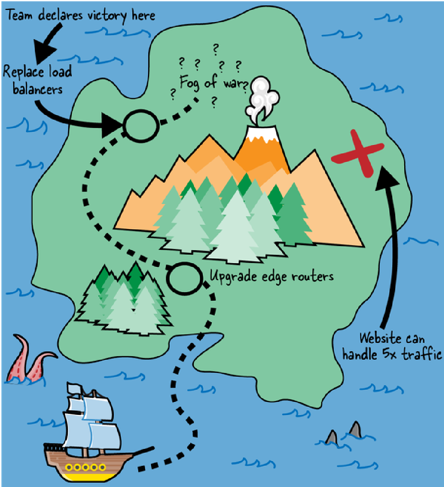
> 图 6-5：团队宣布胜利后回家了——但还有一份更好的宝藏，他们从未到达。

在这一节里，我们会看三种你可能在没有真正到达目的地的情况下宣布胜利的方式：
只做定义清楚的那部分工作、做了方案却不告诉用户，以及匆匆上线一个劣质的东西。
当心这些终局状态！

### 可是代码已经写完了！

我觉得我在职业生涯里有过上百次这样的对话：

“我很期待新的 foo 功能。什么时候能用？”

“哦，它做完了！”

“太好了！我怎么开始用它？”

“嗯……”

这个“嗯……”后面总是我为什么今天还用不了它的原因。
foo 还有硬编码的凭据；它只在预发环境跑，没在生产环境跑；
有一个 PR 还在评审中。但它做完了，对方会坚持这么说。
它只是还不能用而已。

#### 发生了什么？

软件工程师常常把自己工作理解为写软件。
我们做项目计划时，往往只列出与写代码有关的那部分工作。
但要让用户真正用上代码，还需要发生太多别的事：
部署和监控它、拿到上线批准、更新文档、让它真正跑起来。
软件本身准备好了并不够。

LaunchDarkly 的开发者关系布道师 Heidi Waterhouse
曾经让我大开眼界：“没有人想用软件。他们想抓到一只 Pokémon。”
一个想玩电子游戏的用户不在乎代码是用什么语言写的，
也不在乎你解决了哪些有趣的算法挑战。他们要么能抓到一只 Pokémon，要么不能。
如果他们不能，那这个软件就等于不存在。

#### 确保用户能抓到 Pokémon

作为项目负责人，你可以从项目的全局图景来看，
而不只是看哪些任务完成了，从而避免工作从缝隙里掉下去。
这里有一些你可以用的技巧：

##### 定义“完成”

在开始工作之前，就先商定最终状态是什么样子。
Agile Alliance 提出要设定一个完成的定义（definition of done），
也就是在任何用户故事或功能可以被宣布完成之前必须成立的标准。⁸
这可能包括适用于所有改动的一份通用检查清单——
比如我常见到 PR 模板里有一节说明这个改动是怎么测试的——
以及针对单个项目的一组具体标准。同样地，
用户验收测试让新功能的预期用户可以试用他们想用它完成的任务，
并确认这些功能运行良好。即使是内部软件也可以有用户验收测试。
在这些都做完、用户表示满意之前，没人有权声称这个项目完成了。

##### 做你自己的用户

有没有可能让你定期使用自己在构建的东西？
当然，这不总是适用，但如果有办法让你体会到客户的体验，就花时间去做。
这有时被称为“吃自己的狗粮”，也就是 dogfooding。

##### 庆祝落地，而不是上线

庆祝把东西交付给用户，而不是只庆祝内部团队看得见的里程碑。
在用户开心地用上你的系统之前，你还没到可以庆祝的时候。
如果你在做一次迁移，要庆祝旧的东西被关掉了，
而不是新的东西上线了。

### 做完了，但没人在用

你有没有见过一个平台或基础设施团队花好几个月
为一个常见问题做了一个漂亮的方案，上线、庆祝，
然后因为似乎没人想用而沮丧？他们确信它更好：
它确实改善了用户的生活。但各个团队还是在用旧的、困难的方式做事。

#### 发生了什么？

这个团队没有想技术工作之外的事。
不幸的是，内部方案常常是这样“营销”的：
我们做出某个有用的东西。我们给它取一个可爱的名字。
我们（也许）写一份文档解释怎么用它。然后我们就停下了。
我们做出来的东西可能有很多会喜欢它的潜在用户，
但他们没有任何途径知道它存在；就算他们碰巧撞上它，
这个名字也提供不了任何关于它做什么的线索。
这个问题的常见搜索词也不会指向这个方案。
我把这类项目叫作“小心豹子”项目，名字来自
Douglas Adams 的经典作品 *The Hitchhiker's Guide to the Galaxy*
（Pan Books）里我最喜欢的一个片段。

> “但那些图纸是公示过的……”
>
> “公示？我最后不得不下到地下室才找到它们。”
>
> “那就是公示部门啊。”
>
> “还得带着手电筒。”
>
> “啊，好吧，大概是灯坏了。”
>
> “楼梯也没了。”
>
> “但你看，你找到那张通知了，对吧？”
>
> “是的，”Arthur 说，“对，我找到了。它公示在一个上了锁的文件柜底部，
> 那个文件柜塞在一间废弃的厕所里，门上挂着个牌子写着‘小心豹子’。”

这就像是方案的创造者们在试图把它藏起来！
信息确实存在——有人得以把他们的文档里程碑标绿——
但任何不知道自己在找什么的人，永远都不会找到它。

#### 把它卖出去

Michael R. Bernstein 有一个很好的类比，
形容做出方案然后完全不营销它们。他说这就像
一个农民播了种、浇水、除草、把庄稼种出来，
然后就把它们留在地里。你需要把种出来的东西收割起来，
拿到人们面前，让他们看到自己为什么想要它。
如果用户不知道它存在，或者不相信它值得自己花时间，
世界上最好的软件也没有意义。你需要去做营销。

##### 告诉大家

你不只需要告诉人们这个方案存在：你需要不断告诉他们。
很多迁移停留在半迁移阶段，就是因为工程师们以为用户会自己找上门来。
帮他们找到它。发邮件、做路演、争取在工程全员大会上有一个时段。
为那些之后可能会替你说话的特定客户提供白手套式服务。
如果你在一个共享办公室里，考虑张贴海报！收集用户证言。
理解任何人可能会警惕或不感兴趣的地方，
并确保你的营销表明你已经考虑过（并希望能修好）那些问题。
要持之以恒，一直告诉人们，直到他们开始互相转告。

##### 让它容易被找到

不管你做出了什么，都要让它容易被找到。
这意味着从它的目标用户可能去找它的任何地方链接到它。
如果你有多个文档平台，确保在任何一个平台上搜索
都会落到正确的地方。如果你的公司用短链接服务，
为所有可能的名字都设置链接，包括可能被拼错的写法，
以及人们可能猜到的各种带连字符的写法。⁹

### 它建在摇摇欲坠的地基上

我要谈的最后一种“做完了但其实没做完”，
是一种可能引起很多冲突的情形。
它是说一个原型或最小可行产品上了生产环境，用户用得还不错，
但所有人都知道它是拼凑起来的。用户能抓到 Pokémon，
工作就完成了：该去做下一件事了，产品经理们说！
但工程师们知道，那套基础设施扩展不了，
那些接口没法复用，或者团队正在把可怕的技术债推向未来。

#### 发生了什么？

可能有充分的理由要尽可能便宜、尽可能快地交付某个东西。
当市场有竞争时——或者有根本不存在市场的风险时——
把东西上线往往比让这个东西扎实更重要。
但当团队已经往前走了，那个便宜的方案还留在原地。
代码可能没有经过测试——或者根本没法测。
那个功能可能是一个架构上的凑合，现在所有人都得绕着它工作。

很久以前，我曾在数据中心工作，在那里我学到的一件事是：
不存在什么临时方案。如果有人从一排机架拉一根线到另一排，
既没有整齐地理线也没有贴标签，那它会一直待在那里，
直到那台服务器退役。每一个临时的凑合都是这样：
如果到项目结束时它还是没被弄成好的状态，
以后清理它就要花掉非凡的力气。

#### 加固地基

虽然短期内你可以靠交付劣质软件蒙混过去，
但这不是可持续的做法。你是在把软件的代价推给未来的自己。
作为 staff engineer，你比大多数人有更大的杠杆。这里有一些办法，
可以让你倡导保持高标准。

##### 建立质量文化

你的工程文化由最资深工程师的行为引领。
如果你的组织没有扎实的测试文化，
就先做那个总是要测试的人，把它往正确的方向推一推。
或者做那个吱吱作响的轮子，总是问“我们要怎么监控它？”，
或者那个一定会指出文档需要和 pull request 一起更新的人。
你可以用风格指南、模板或其他杠杆，把这些提醒扩展到整个项目。
我们会在第 8 章看怎么设定标准和引发文化变革。

##### 把基础性工作变成用户故事

理想情况下，组织会认同：交付方案不只是关于功能——
它是为未来做准备。功能工作和维护工作之间有健康的平衡，
团队把高质量所需的时间打进项目成本里。
即使是那些先做轻量级第一版以获取早期用户反馈、
或者承担技术债以便更快把有竞争力的产品推向市场的团队，
也总会回头改善他们交付出去的东西。
不幸的是，很少有组织按理想方式运作。
你可以帮忙：确保项目的用户故事里包含你将来需要做的任何清理工作。
你可以把这包装成用户体验的一部分
（没人会为一个时好时坏、经常挂掉的产品兴奋），
或者包装成在为下一个功能打地基。如果用户提交了相关的 bug 报告，
或者事故之后有行动项，你有时可以用它们来论证清理工作的必要性。
把对话重新聚焦到客户的需求上，展示这项工作对他们有真实的影响。

##### 争取由工程师主导的时间

如果你的公司没有边做边清理的常规文化，
看看你能不能围绕定期清理周形成势头。
我听过这类安排叫“修复周”和“技术债周”，
我也见过相当多的清理发生在工程探索时间里，
比如“20% 时间”或“激情项目周”。另一个选择是建立轮值制度，
让团队里始终有一个人专门负责响应问题、让事情变得更好。
不要纠结于名字，也不要纠结某件事是不是真的“算”技术债。
重点在于，这是一段专门的时间，用来做工程里所有人都知道必须做的工作。

### 项目就此停下

当你在障碍之间穿行、处理这些困难局面时，
你会离目的地越来越近——或者发现它根本到不了。
我们用四种项目可以有意结束的方式来结束这一章：
认定你已经做得足够、提前砍掉它、被不受你控制的力量取消，以及宣布胜利。

#### 在这里停下更好

有可能走到这样一个点：继续投入已经不划算，
于是宣布这个项目“做得够好了”。
在第 2 章里我谈过 local maximum：一个团队在做低优先级的事，
因为那是他们自己领域里最重要的问题，
而隔壁团队有五个更重要的项目没时间去做。
你的团队是不是在给一个其实已经做到位的东西抛光、加功能？
也许是时候宣布成功、去做点新事情了。
在你这么做之前，看看上一节里的那些失败模式，
确保你没有抛弃不满的客户、没有在技术工作一做完就撒手不管、
没有从一个半途而废的迁移里走开。
如果一切都没问题，恭喜你到达了新的目的地！

#### 这段旅程不该走

我见过的最值得庆祝的一次巨大成功，其实本来可能被当作失败。
一个由资深员工组成的团队花了好几个月做一个新的数据存储系统。
其他团队都在热切等待它。但随着工作推进，
团队发现这个新系统在规模上跑不起来。
他们没有否认现实、去为他们做出来的东西找可能的用例，
而是砍掉了这个项目，并写了一份详细的复盘。

那是失败吗？其实不是！其他团队没拿到他们期待的系统，确实失望。
但存储团队如果不探索，就不可能发现这个方案行不通。
如果他们当初意识到了这项技术对他们行不通，
却还是硬着头皮推下去，那才是失败。

你听说过 *沉没成本谬误* 吗？它讲的是人们如何看待
自己已经投入的时间、金钱和精力：如果你已经在一件事上
投入了很多时间和精力，你就更可能留下来把它做到底，
哪怕那是个坏主意。要跳出这种思维框架可能很难，
但如果没有一种高度敏锐的判断力去辨别某件事是否仍然是个好主意，
你可能会在错误的路上待很久。

试着察觉自己是否身处一个不可能的局面；如果是，就早点抽身。
硬推一个注定失败的项目只是在推迟不可避免的事，
而且它会妨碍你去做更有用的事。好的判断力包括知道什么时候该止损收手。
考虑写一份复盘，并尽可能多地把发生的事情分享出来。
对于心理安全感来说，很少有比说“那个没成功。没关系。这是我们学到的。”
更有力量的事。

#### 项目被取消了

公司对你们正在做的事的热情是会变的。
也许项目拖得太久，或者比预期更难，收益已经不再能证明成本合理。
也许来了一位新高管，心里的方向不一样；市场变了；
或者你的组织摊子铺得太大，正在找可以砍掉的举措。
不管是什么原因，这个项目不做了。
你的管理链上的某个人把你拉到一边，告诉你这个坏消息。
如果你运气好，你会在公司其他人之前知道。

先说感受，因为这是一个很难的局面。感觉很差。
即使你的团队理解并接受被取消的理由——即使你们全都同意！——
突然扔掉你们建立起来的计划和里程碑还是让人心里一震。
你们可能都会觉得自己做的工作白费了。
如果你没有参与取消的决定，这可能感觉像是个人的失败。
你可能会愤怒、失望、觉得被欺骗，
或者因为一个对你影响这么大的变化发生在你没进的房间里而怨恨。
这可能是一个合理的抱怨：如果 manager 们做重大的技术决策，
却把技术路线的人留在门外，那也许值得谈一谈。
但大多数时候，这些决定是在更高层面做出的，
做决定的人在看一张大得多的全局图，优化的目标也和你不一样。

把你自己情绪过一遍，承认它们。
和你的 manager 或你的倾诉对象聊聊。
尽量理解全局图景，尽可能多拿到一些视角。
然后和你的团队或你的下级负责人谈。告诉他们正在发生什么，
从“为什么”讲起。给他们时间谈论自己对这条消息的反应。
要尊重这一点：他们可能会对你这个项目负责人发火——
毕竟你是坏消息的传递者，或者是那个没能“救下”项目的人。
重要的是他们直接从你或另一位领导者那里听到这件事：
不要让他们从流言、群发邮件或公司全员大会上得知。

给你自己和你的团队一点时间，然后尽可能干净地把项目关掉。
如果你能停掉正在跑的二进制程序，就关掉它们；
如果你能删代码，就删掉。如果你认为项目以后真的有可能被重启，
就把你能记的都记下来，好让未来某位工程师能理解你们当初想做什么。
（不过要对这种“复活”的可能性现实一点。）
如果有值得学习的东西，考虑做一次复盘。

这不公平，但一个被取消的项目可能会影响晋升，
或者打断一连串优秀绩效评级的记录。尽你所能展示每个人的工作。
如果你的团队成员要转到别的项目，一定要把他们做成的成绩
告诉他们的新 manager，并主动提出在绩效评估时和他们谈谈
或者写同级评价。如果有人正处在晋升的边缘，就向他的新负责人强调这一点，
这样他就不用从头积累一份新的业绩记录。

庆祝团队的工作和你们一起经历的这段时光。
解散一个配合得这么好的团队令人难过，
但要寻找再次和这些人合作的机会。

#### 这就是目的地！

恭喜！你做出了你当初打算做的那件事！
在你庆祝之前，再确认一下你真的到达了目的地。
你的可衡量目标显示出你想要的结果了吗？用户能抓到 Pokémon 吗？
地基牢固而干净吗？如果你真的到了终点，那就是宣布胜利的时候了。
花点时间纪念这一刻，让你的成功显得特别。
对有些团队来说，庆祝意味着派对、礼物或调休。
可能有邮件表扬，或者在全员大会上被表彰。
寻找机会，通过内部和外部的演讲，
或者你公司博客上的文章，给团队成员（还有你自己！）带来曝光。
并且考虑做一次复盘：它们不只是用来审视出了什么问题的。
从顺利的事情里你同样可以学到很多。

如果你的文化里有你想强化的某个方面，
比如人们互相帮助或者沟通良好，就凸显它在项目期间显现的方式。
公开表扬那些做得超出预期、或者展现出你希望看到更多的任何行为的人。
一个成功的项目可以是一个绝好的机会，
用来庆祝你最欣赏的那些文化面向，
并向别人展示出色的工程是什么样子。

而本着向你的组织展示怎么做出色工程的精神，
让我们进入本书的第三部分，提升。

## 小结

- 作为项目负责人，你有责任理解你的项目为什么停下了，并让它重新启动起来。

- 作为组织里的领导者，你也能帮助重启别人的项目。

- 你可以这样解开项目的阻塞：解释需要发生什么、减少别人需要做的事、
  弄清楚组织支持、升级，或者制定备选方案。

- 你可以通过定义目的地、商定角色、在需要时求助，
  给一个漂移的项目带来清晰。

- 除非项目真正完成，否则不要宣布胜利。代码写完只是其中一个里程碑。

- 不管你准备好没有，有时就是项目该结束的时候。
  庆祝、复盘，然后清理干净。

> ¹ 考虑用 Lightweight Architectural Decision Records（ADR）
> 来说明你为什么做了当初那个选择。

> ² 回头看，我对其他团队同情多了。
> 在生产环境里跑一个服务所需的配置数量极其庞大，
> 任何准备上线的团队都有太多东西要考虑。是的，
> 他们大概本该提前想到需要负载均衡，
> 但我们只是他们上线前需要进行的 15 场对话之一。
> 而我们也该想办法把手工步骤换成自助的方案，
> 来应对最常见的用例。换个视角。

> ³ 如果你是那个拖延的人，考虑一下我在第 4 章提到的日历技巧：
> 把你要做的任务放进日历。如果连理解第一步都很难，
> 就单独划一块日历时间只用来搞清楚这项工作的第一步是什么，
> 再单独排一块时间来做那一步。给未来的你留下尽可能小的任务。

> ⁴ 看着你在意的工作被做得很糟，真的很难受，但尽量不要插手替他们做。
> 如果这个问题必须立刻解决，看看你能不能和对方一起做、
> 让他一步步来，而不是你自己动手。
> 你握住方向盘，你的同事就学不会开车。

> ⁵ 只有当那张图展示的是进展时这才管用：
> 如果明摆着没人在做事，它可能适得其反。
> 但影响别人的社交面这么好用：“别人都在做，我们为什么不做？”

> ⁶ 这永远不会完全管用，但继续试。
> 你越能让人不陷进细节里，成功的可能性就越大。

> ⁷ 正如 Leslie Lamport 提醒的，你应该
> “独立于解决方案所使用的方法，精确地说明要解决的问题”。他写道：
> “这可能是一项难得出奇、且很有启发性的任务。
> 它有好几次让我发现，一个‘正确’的算法
> 其实并没有实现我真正想要它实现的东西。”

> ⁸ 他们还区分了“done”和“done-done”，并把功劳归于作家兼敏捷教练
> Bill Wake 在 2002 年发表的一篇文章，
> 他在其中提出了那个耐人寻味的问题：“‘done’是指‘done’吗？”

> ⁹ Google 曾经有一个叫 Sisyphus 的项目，这个名字对一些人来说很好记，
> 对另一些人来说则是一串不太可能猜到的字母。
> 我一直很佩服那个把短链接 `go/sysiphus` 和 `go/sisiphus`
> 都设成跳转到 `go/sisyphus` 的人。这也是一种很好的安全实践：
> 它能防止有人在拼错的那个地址上搭一个假服务。

# 第三部分 提升

# 第 7 章 你现在是榜样了（抱歉）

当我成为 staff engineer 时，我的朋友 Carla Geisser 警告我：
“别把想法大声说出来。
你会发现一个月后，大家谈论你那个半成品的想法时，
说得好像它已经是一个项目了。”
我的同事 Ross Donaldson 把自己的角色描述得更不留情面：
“身为 staff 并不能让你免于犯错，
但它的确意味着你张开你那该死的嘴时要小心。”

这是 staff engineer 头衔的福分，也是它的诅咒：
人们会假定你知道自己在说什么——所以你最好真的知道自己在说什么！
你的工作受到的检查会少一些，你的想法会被认为更可信。
人们不再指导你，而是向你寻求指导。

## 做好工作意味着什么？

最重要的是，你会成为榜样。你如何行事，别人就会如何行事。
你会是那个讲道理的声音，是“房间里的大人”。
有时候你会想“这是个问题，应该有人站出来说句话”……
然后心头一沉，意识到那个人就是你。
当你示范正确的行为时，你就在向经验不如你的同事展示怎样做一名好工程师。
后面在第 8 章，我们会讨论如何主动、刻意地影响你的组织和同事，让他们变得更好。
但这一章讲的是被动的影响，
也就是你仅仅因为自己作为工程师、作为一个人行事的方式而产生的那种影响。

### 价值观就是你做的事

你的公司可能对“什么是好的工程”有文字上的定义：
比如成文的价值观，或者工程原则。
但公司真正看重什么，最清楚的指标是“什么样的人会得到晋升”。
无论你的组织多么强调协作与团队合作，
只要有任何 staff engineer 是靠“英雄式”的独狼式努力走到这个位置的，
这种说法就会被削弱。
如果你的工程原则描述的是一种认真做代码评审的文化，
但 senior engineer 们不看代码就直接批准 PR，
那其他人也会跟着草率地盖章通过代码评审。
你所做的工作，隐含着就是别人眼中正确、并会去效仿的工作类型和标准。

工程不只是你和计算机系统打交道时做的事，也包括你如何与人打交道。
所以有时候，做一名好工程师归根结底就是做一名好同事。
如果你成熟、有建设性、敢于负责，
你就是在告诉刚毕业的新人：senior engineer 就是这个样子。
如果你居高临下、难以取悦、总是找不到人，
那你也是在告诉他们：senior engineer 就是这个样子。
你每天都在塑造你的公司，仅仅通过你的行为方式。

### 可我不想当榜样！

当榜样并不总是让人舒服。
但随着你越来越资深，这是你影响组织最重要的方式之一。
不管你喜不喜欢，你都在设定自己的工程文化。请认真对待这份权力。
当榜样并不意味着你必须成为公众人物，必须比你觉得舒服的音量更大，
或者仗着自己的分量压人。
很多最好的领导者安静而周到，
他们通过好的决策和有效的协作来施加影响
（也向同样安静的人展示：他们也有空间去领导）。

如果“当领导者”这个想法让你害怕，你可能需要慢慢来。从小事做起。
也许是在公开频道上夸赞某人的成功，或者主动帮忙带一名新人上手。
把领导力当作一项需要培养的技能，就像学一门新语言或者一项新技术。
练得越多，它就越容易。

做你能做到的最好的工程师和最好的同事。把工作做好，让别人看见。
（也帮助别人做到这一点！我们会在第 8 章讨论怎么做。）这就是当榜样的含义。

### 作为 senior engineer，做好工作意味着什么？

在这一章里，我要讲清楚我认为你应该示范的四大特质。
先说清楚：这些都是理想化的品质，是你应该努力学会并持续学习的技能。
我明确*不是*说，你必须在每一项特质上都拿到满分才算“真正的工程师”，
或者说要做任何形式的资格门槛；这些是理想。这是你应该*努力去成为*的样子。
我们所有人都还在路上。

还有一点要说明：科技行业里充斥着建议，而且大多很主观。这份清单也一样！
最佳实践全都取决于具体情况。
会有边缘情况和特殊情形；如果我的建议与你自己的判断相冲突，相信你自己。
一名 staff engineer 应该有足够的判断力，知道常识什么时候是错的。

本章接下来要讨论的四种特质是：
有能力、做一个负责任的成年人、记住目标、以及向前看。

先说能力。

## 要有能力

作为 staff+ engineer，或者任何资深人士，
你角色中很大一部分是接下那些必须完成的事，并可靠地把它们做好。
能力包括建立（并保持）知识和技能、有自我认知，以及有高标准。

### 掌握知识

无论你的领导力多好，缺了“技术”那一半，你就成不了一名*技术*领导者。
你的全局思考、项目执行、可信度和影响力，都建立在知识和经验之上。
雇用你的价值主张里很大一部分是你的知识：你*见过一些世面*。

#### 积累经验

Google 的 staff engineer Stephanie Van Dyk
把她工作所需的基础技能，与她长期爱好——编织——中用到的技能做了类比。
“技术能力来自学习和练习，”她说，
“它们不是天生的。没有人天生就是熟练的织工，
也没有人天生就是熟练的计算机工程师。”

经验来自时间、接触和钻研，而不是与生俱来的天赋。
培养技术能力需要下功夫。
你可以从书里学到很多，
但没有什么能替代你自己去解决问题、摸索出自己解决问题的方法，
并看清什么行得通、什么行不通。
senior software engineer、同时也是小提琴手的 Paula Muldoon
这样描述在管弦乐队里演奏，我对此很有共鸣：
“你希望自己的技艺好到可以把注意力几乎完全放在别人在做什么上，
而不用担心自己的演奏。”
投入时间——大量时间——去打磨你的技术能力，直到它们成为你的第二天性。

要投入多少时间？美国土木工程师学会公布了自己的工程职级，
其要求中包括工作年限：

- Grade V（典型头衔：senior engineer、program manager）：8 年以上
- Grade VI（典型头衔：principal engineer、district engineer、
  engineering manager）：10 年以上
- Grade VII（典型头衔：director、city engineer、
  division engineer）：15 年以上
- Grade VIII（典型头衔：bureau engineer、
  director of public works）：20 年以上

在软件工程领域，我们没那么严格。
不同公司的职级差别很大。
大多数地方在评定职级或头衔时并不考虑工作年限，
但 staff engineer 通常至少有 10 年经验，principal engineer 至少有 15 年。

不要匆匆越过你最好的学习年华。
有些组织会在员工职业生涯相对早期的阶段就给他们提供资深职位，
比如管理岗或 staff engineer，以此激励最优秀的人才。
这种对职业晋升的推动可能会诱惑你接受。
但正如 Charity Majors 警告的：

> 在你作为一名工程师已经稳稳达到 senior 之前，永远、永远不要接受管理岗。
> 对我来说，这意味着至少写过、发布过七年以上的代码；
> 绝对不能少于五年。
> 别人给你 manager 这个职位时，你可能会觉得这是一种夸奖——
> 见鬼，接受这份夸奖吧——
> 但就你的职业生涯、就你发挥效用的能力而言，他们并不是在帮你。

staff+ 岗位也一样。
在接受一个让你离技术更远的职位之前，好好做一番自省。
你可能会白白丢掉自己最能全情投入、亲手积累经验的黄金年份。

> [!NOTE]
> **你“技术够格”吗？**
>
> 我有时听到工程师这样描述别人：那人“技术不够格”，这种说法我总是不认同。
> 除了有点轻蔑之外，它还声称描述的是一个人“是什么”，
> 而不是他拥有的技能。¹ 它没有留下一条切实可行的路，让人能变得“技术够格”。
> 如果你也想这样描述别人，请说得更精确些。你的意思是：
>
> - 他们还没有在动手的技术工作上投入足够多的年头？
> - 他们还不了解你所在的领域？
> - 他们缺少某些具体技能？是哪些技能？
>
> 有能力、有知识，并不意味着你必须在每个话题上都懂得最多。
> 有时候，当你进入一个新领域时，你会是懂得最少的那个，这没关系！

#### 积累领域知识

软件有数量惊人的技术领域，每个领域都有自己的专门知识和词汇。
懂移动开发、算法计算机科学或者网络，并不能让你为前端 UX 项目做好准备。
在金融科技领域多年的经验，也无法让你为一家医疗健康创业公司做好准备。
但如果你对一个新的技术领域或业务领域感兴趣，你完全可以去试试。
这意味着，即使是非常有经验的工程师，也可能发现自己是个新手。

当你进入一个新角色时，难免会有你还不具备的技能，或者对你是全新的领域知识。
你可能会发现自己正在向共事的 junior engineer 学习。（这是好事！）
这时你的技术知识就提供了基础。
虽然你可能认不出这个新领域里问题的具体细节，
但你的一般经验应该能帮你认出它们的形状。
你应该能把遇到的情况匹配到自己认得的其他东西上，
这样就不会完全摸不着头脑。²
你的经验范围越广，能挂新知识的“钩子”就越多，你学新东西也就越快。

当你进入一个新的技术领域或业务领域时，要刻意地快速学习。
用对你最有效的方式学这门技术。
去感受其中恰当的 trade-off；资源约束；常见的争论、偏见和内部笑话。
知道市场上有什么技术、它们可能怎么用。读核心文献。
知道这个领域里有哪些“名人”，以及他们主张什么。（在这方面 Twitter 很好用。）
然后接几个项目，让自己积累直觉和经验，
这样你就能像在上一个领域里一样，在这个新领域里同样有能力。

#### 保持更新

作为一名 senior engineer，意味着要有成长型心态和不断改进的动力。
当一位技术领导者坚持一种十年前就已被推翻的“最佳实践”，
或者坚持一项别人早就弃用的技术时，所有人都觉得尴尬。
保持关注你所在行业里正在发生的事情。
即使你已经不再深入代码，你的蜘蛛感应也应该保持敏锐，
能察觉到“code smell”或者等着发生的隐患。
即使你不知道最新、最热的工具或实践，也要知道该怎么查出来。

留意你的角色是否在妨碍你继续学习。
特别要警惕自己离技术太远，以至于你学到的只是*你的公司*如何运转。
你*也*应该学到足够多的业务知识，以便做出好的选择，
但要让自己锚定在技术上。关于学习，我会在第 9 章讲得更多。

> [!TIP]
> **展示出你在学习**
>
> junior engineer 需要看到：终身学习是 senior engineer 的一部分，
> 他们永远走不到旅程的终点。
> 他们也需要看到，你的技能和知识不是凭空得来的——一切都是可以学会的。
> 坦率地谈你在学什么，并展示你是怎么学的。
> 当你做出一个涉及冷门知识或逻辑跳跃的论断时，
> 就为你周围的人补上缺口：告诉他们你为什么得出这个结论、
> 用了哪些信息、以及你是怎么得到这些信息的。
> 明确说出来你在学习，这样他们去学习也是安全的。

### 有自我认知

能力建立在知识和经验之上，但你还得能够运用这些本事。
这首先要靠自我认知：知道你能做什么、需要多长时间、以及你不知道什么。
它意味着能说出“这个我行”，并且知道你是真的行。
能力意味着有充分根据的信心，相信自己能解决这个问题。
你不需要傲慢、不需要说让人听不懂的行话，也不需要炫耀。
真正的信心来自你做了足够久的工作，久到你学会了信任自己。

#### 承认你知道什么

有些人从小被教导要夸耀自己的成就。另一些人则被教导要淡化它们。
无论你天生是哪一种，都要努力达到这样一个水平：
对于自己知道什么、不知道什么，你既自信又诚实。
总会有一些领域是你懂得很多、而且格外擅长的。
要自信地把这些技能用在需要它们的问题上。

有能力并不意味着你必须是最好的。
我有时看到技术人员羞于自称专家，
因为他们总能想到业内某个人比自己更强。
不要把你的门槛设在“业界最强”。
出于谦虚而退缩，对谁都没有好处。
当这项技能被需要时，不要等别人来说“嘿，你正则表达式不是很厉害吗”？
主动站出来说你就是——这不是吹牛，只是陈述事实。

如果你知道自己带来了哪些技能，
你就知道哪里可以站出来帮忙、哪里你能当好一名导师，以及你还需要学什么。

#### 承认你不知道什么

你不会什么都懂，而至关重要的是不要假装你懂。
如果你虚张声势，就会失去学习的机会——而且可能做出糟糕的决策。
你还会浪费树立榜样的机会。
每一次你承认自己并非什么都懂、让人们看到你在学习，
你都在向你的 junior engineer 表明：持续学习是正常的。

承认无知是作为 tech lead、senior engineer、导师、manager，
以及其他影响团队文化的人所能做的最重要的事情之一。
我喜欢请别人来一段“ELI5”，这个说法来自 Reddit，
意思是“把我当成五岁小孩来解释”。
这是一个很好用的简写，意思是“听着，别猜我的理解水平，直接给我讲清楚。
就算你告诉我一些我已经知道的事，我保证也不会生气。”
（这里的社交契约是：如果对方从这个话题最基础的部分讲起，你不能生气。）

我们工作中的大量时间都花在沟通上，
努力把对世界的共同模型装进彼此的大脑，以便协作或做决定。
当谈话中有人虚张声势、或者因为不想被人指出不懂而稍微抽身时，
一切都会被拖慢。
如果资深的人能够承认自己不懂某些事，其他人也都会这样做。

#### 理解你自己的语境

自我认知的很大一部分，是理解你拥有一个特定的视角，
你的语境并不是普适的语境，你的观点和知识只属于你自己。
每次与其他领域的团队交流，或者向非工程师解释技术话题时，
你都需要走出自己的回音室。
你会知道自己掌握了哪些他们可能没有的信息，从而弥合这道鸿沟。
（关于如何建立这种视角，你可以在第 2 章读到更多。）

把事情简单地解释清楚要难得多！
它需要你对这个话题有更多的理解，也需要你对自身语境有更多的自我认知。
但这是专业能力的一个真实标志。
如果你能用平实的语言解释一个话题，
让非专家也能把它挂到自己已manager解的东西上，那说明你是真的懂它。

### 有高标准

你的标准会成为别人做事方式的模板。
知道高质量的成果是什么样，并在你做的每一件事上都朝着这个标准努力，
而不只是你最喜欢的那些部分。
写出你能写出的最清楚的文档。
在你的软件出问题时，第一个知道的人应该是你。
当然，总会有 trade-off：
有时候正确的做法就是用胶带尽快糊出一个解决方案。
但做这个判断时，依据应该是你要解决的问题，
而不是这项工作对你来说多有意思。

#### 主动寻求建设性批评

有高标准意味着让你的工作尽可能好。
寻找机会放下自尊，请别人帮你把工作做得更好。
主动请人做代码评审、设计评审和同行评估。
当你有一个自己很喜欢的想法时，邀请同事们来挑毛病。
当你“请求评论”时，不要私下里对意见心怀不满；
每一条意见都是让你的方案变得更好的机会，
所以即使你不全采纳，也要认真对待。
你的方案不等于你，也不能定义你。对你工作的批评不是对你的批评。
（当然，你也会给别人建设性批评。我们会在第 8 章探讨这一点。）

#### 为自己的错误负责

在某个时刻，你*会*犯错，而且可能是个大错。
也许你评审了代码，却没发现一个让公司损失惨重的 bug。也许那代码就是你写的！
也许你在会上说了什么，后来发现把某个人说哭了（或者说得人家辞职了）。

犯错是正常的。³ 人无完人，我们正是通过犯错来学习的。
最重要的是你如何回应自己的错误。
给自己找台阶下、推卸责任，或者彻底崩溃（然后得由别人来收拾），
这些都很容易。
要想有能力，你必须为自己的错误负责。
不要痛打自己，但也不要否认影响，或者坚称那个错误*其实*不怪你。
承认发生了什么，然后着手解决它。
快速、清楚地沟通，确保每个人都拿到需要的信息。
如果有别人可能被怪罪的任何风险，就要澄清他们没做错任何事。
如果你伤了别人的感情，就承认那份伤害并道歉。
（即使你在同样的情况下*不会*难受，他们的感受也是真实的。）

如果你造成了宕机，或者走上了一条代价高昂的错路，
考虑事后做一次复盘，把发生了什么、你是怎么恢复的、以及你学到了什么讲清楚。
对你自己的那部分要开诚布公、就事论事。
当没有人试图淡化自己的失误时，理解发生了什么就容易得多。

犯错就是*让人难受*。在那一刻，解决自己造成的问题可能是你最不想做的事。
但要想留住团队的好感和社会资本，这是你能做的最好的事。
如果你反应得当、修好了自己造成的问题，
你甚至可能从同事那里得到*更多*尊重。
而一位领导者对自己的错误坦诚，会让其他人也更容易这样做：
这对团队的心理安全感是很大的加分。

#### 可靠

关于能力，我最后想说的是：要可靠。
我给出的最大夸奖之一是：“Alex 会去开那个会，所以我不用去了。”
我这么说，不只是说我所掌握的信息会在会上被代表。
我还在说，我认为正确的事会发生。局面会被管好。我不需要到场。
我是在说，我觉得 Alex 可靠。

可靠的名声，就像我们在第 4 章谈到的可信度和社会资本：
随着人们看到你做事、把局面控制住，它会逐渐积累起来。
做那种被信任能把事做好的人。

可靠的一部分也包括有始有终。
用第 6 章里的方法，确保自己不会被卡住，也不会过早停下。
即使变得无聊或困难，也要坚持下去。
而如果你是因项目不该占用这些资源而有意停下的，
那就承认这个决定并把它讲清楚。
你接受了这项工作的责任，就把它带到终点线。

这就把我们带到了 senior engineer 应该追求的第二种特质：
做房间里那个负责任的人。
## 要负责任

不管你喜欢与否，senior 或 staff 的头衔都会让你成为一个权威人物——
而且，正如哲学家 Uncle Ben 曾对 Spider-Man 说的，能力越大，责任越大。
你越资深，就越必须内化这一点：不会再有别人来当“房间里的大人”了。
你就是“应该有人去做点什么”里的那个“有人”。

在这一节里，我们会看责任的三个方面：承担责任、主动掌控、以及创造平静。

### 承担责任

资深的人对整个问题负责，而不只是对那些按计划推进的部分负责。
你不是在替别人跑他的项目：这是*你的*项目，你不能被动地让它自生自灭。
出了问题时，你不会耸耸肩、认定这活干不了。
你会去驾驭这个问题，并对结果负责。
（第 6 章里有一些摆脱阻塞的技术，在这里能帮上忙！）

避免 John Allspaw 所说的“Cover Your Ass Engineering”（CYAE）：

> 成熟的工程师会站出来，承担交给他们的责任。
> 如果他们发现自己没有相应的权限去为自己的工作负责，他们会想办法纠正这一点。
> CYAE 的一个例子是：“这不是我的错。是他们弄坏的，是他们用错了。
> 我是按规格做的，他们的错误或者不规范的规格不能算在我头上。”

承担责任也意味着运用你自己的判断力：
你不需要不停申请许可，也不需要时时检查自己是不是在做对的事。
但这并不意味着你应该独自行动。
经典的建议是求原谅比求许可容易，
而产品与交付顾问 Elizabeth Ayer 提供了一个更开放、更可预测的做法：
“radiating intent”，也就是在做某件事之前先发出信号，让人知道你要做什么。
你给了其他人关于你行动的语境——
而且，如果你即将做一件危险的事，你也就创造了一个让人能够介入的机会。

Ayer 指出了 radiating intent 的另一个重要好处：
“‘radiator’在事情变糟时会保留责任。它不会像求许可那样把责任转移出去。”
这对承担责任同样关键。

#### 做决定

在某些专业领域，职业工程师要负责在文件上盖章：
比如，一位工程师可能要签字确认某栋建筑的结构完整性。
这样一来，他们就是在证明该文件在结构上是安全的，
并为自己的错误承担法律责任。他们要亲自为那个决定担责。

虽然软件工程师目前还没有这种职业责任，
但作为技术领导者，我们必须准备好做最终决定，并为结果负责。
尤其是当需要做决定时，避免骑在墙上：
权衡各个选项，果断选择，并解释你的理由。
在考虑 trade-off 时要对自己诚实：
当你知道什么是最好的做法时，你应该能够投票反对自己的偏好。

为决定负责也包括接受你可能错了。
把错误决定的代价降到尽可能低；
如果事实证明你*确实*错了，也要为此负责。

#### 问“显而易见”的问题

资深的好处之一是，你可以问那些显而易见到别人都不愿问的问题。举几个例子：

- 听起来你们打算只靠两个工程师的团队运行一个 mission-critical 的微服务。
  你们打算怎么处理它的 on-call？
- 我猜你们已经评估过，要摆脱这套老系统需要付出什么，
  而不是这么费劲地维持它？
- 如果用户开始依赖你们 API 里那个你叫他们忽略的自增字段，会发生什么？
- 这个听起来有点古怪的提案，你们拿给安全团队看过了吧？
- 要支持这个我们一直叫大家不要在我们的平台上做的用例，需要付出什么？

作为领导者，你有责任把隐含的东西明确出来。
这不公平，但如果一个 junior 的人问这些问题，
团队可能会叹口气说：是的，*显然*我们想到了。
如果一位专家来问，团队成员就会学到：
他们应该在设计文档里为这些问题写上明确的答案。
（或者，他们真的是第一次认真考虑这个问题！）

#### 不要靠放任来委托

几年前我写了一个会议演讲，它有点火了。
好吧，我们说的不是*水獭牵手*那种级别的火，
但它横扫了技术圈 Twitter，上了 Hacker News 首页，就是这类事情。
那个演讲讲的是那些不在任何人的职级阶梯上、
却是让团队成功所必需的领导类与行政类工作：
所有解阻塞、新人上手、提醒、指导和排期。
我把这类工作称为“glue work”。

为什么这个演讲触动了这么多人的神经？
因为尽管没有它项目就不可能成功，这类工作却很少得到回报，也很少被公平地分配。
它落到团队里那个没法对问题视而不见的人身上，
往往是一个责任感很强的 junior。

问题在于，当 junior 的人做了太多行政或领导工作、技术工作却做得不够时，
他们就把自己最好的技术学习年华花在了学不到技术技能的事情上。
从长远看，这会阻碍他们的职业发展。
但领导者常常不介入：项目要成功就需要这些 glue work，
他们只是很高兴它有人做了。

如果你的组织或项目需要 glue work，就要认出它，并弄清是谁在做。
要注意：当一名 staff engineer 做这些工作时，
manager、晋升委员会和未来的雇主可能会把它算作*领导力*，
而当一名更 junior 的工程师做同样的工作时，他们却会轻视它。
所以要承担责任，
自己多做那些不属于任何人的职责、却能推进你目标的工作。
同时把你的 junior 同事引导到那些能发展他们职业生涯的任务上去。

### 主动掌控

温和地把同事引导向更有价值的工作，正是我接下来要讲的：
主动掌控局面。
注意，*主动掌控*并不一定意味着你事先拥有权限。
它的意思是，你看到了一个缺口，并且站出来补上它。

#### 在紧急情况下站出来

能够控制住一团乱局，是技术领导力的一个关键方面。
如果安全团队发现了入侵，某个数据库被删掉，或者一颗陨石砸中了 US-East-1，
很可能会有很多响应者。
除非他们协同工作，否则随之而来的混乱会让问题变得更糟。
如果有人在做协调，一切都会顺利得多。

不幸的是，只有当所有人*知道*你在做协调时，协调才管用。
如果你不明确地主动掌控，你只会变成又一个制造噪音的人。
理想情况下，你会在灾难发生之前就准备好应急计划，
让协调者这个角色被大家充分理解：经典的事故指挥系统就是个受欢迎的选择。⁴
如果没有，你就得想办法宣布你在做协调，
并就你打算做什么设定预期。然后确保你的协调是有价值的。
做到这一点的一些方法是：做清晰的记录，
确保所有参与应急的人拥有相同的语境，
并请每个人*radiate intent*，说明自己在做什么、什么时候做。

#### 当所有人都困惑时，多问一些信息

在本章前面，我谈过承认自己不知道什么，以及问显而易见的问题。
在紧急情况下，你常常需要同时做这两件事。
当各个团队为了解决问题而共享信息时，
他们往往并不都拥有解读这些信息的语境。
像“FooService 有 1% 的 401 错误”这样客观的事实，
对不知道这个服务的正常状态的人来说毫无帮助。这算糟吗？
有没有关于正在发生什么的假设？FooService 和这次故障是什么关系？

总得有人勇敢地说：“你刚给我的信息，我不知道该怎么用！”
站出来，去问。技术圈可能充满自尊与不安全感，
对 junior 的人来说，承认自己不懂某件事有时很可怕（或者真的很有风险！）。
由资深的人来问会更安全。

> [!WARNING]
> **假装惊讶**
>
> 假装惊讶曾经是系统管理员和软件工程师对话中的标准桥段：
> “你居然从来没用过 Linux？”
> 它是 BOFH 工具箱的一部分，
> 用来打压那些还在学习的人（也就是 noobs 和 lusers），
> 让更有经验的技术人士自我感觉优越。
>
> 在这样的环境里你怎么提问？基本上，你不会问。
> 你摆出一副扑克脸，努力跟上，祈祷话题转到你知道的事情上去。
> 实在躲不过时，你私下里求助。这样学什么都慢得多。
>
> 但后来，Recurse Center（当时叫 Hacker School）
> 在它的社交规则里点出了这个现象。
> 给这种行为命名，让人们有了对付它的力量：
> 这是他们能认出来、并能要求别人不要做的事。
> Recurse Center 还设计了一个机制，让规则保持“低风险”：
> “社交规则很轻。你不应该害怕违反一条社交规则。
> 这些是每个人都会做的事，违反一条并不会让你变成坏人。
> 如果有人说‘嘿，你刚才假装惊讶了’，别担心。
> 道个歉，稍微想一想，然后继续往前就好。”
>
> 不要假装惊讶，但要做得更彻底。
> 每一次有人因为问了一个基础问题而道歉，
> 而其他人纷纷安慰他、坚称这其实是个*好*问题时，文化就建立起来了。
> 那是一个容易学习的环境。

#### 主导会议

会议是另一个非常需要有人站出来主动掌控的地方。
如果一群人被动、分心，或者倾向于把工作会议变成闲聊，
理论上任何一位与会者都可以说：“好，我们开始过议程吧。”
但大多数与会者都不愿意扮演这个角色。需要的时候就站出来。
确保有议程：在会议开始时收集要讨论的事项，
或者以身作则，提前把议程发给大家。
记住你希望从这次会议中得到什么，
一旦偏离太远，就把它拽回那个话题上。

如果会议没有记录，那真的值得聚在一起吗？
会议记录是 glue work 的一个绝佳例子。
如果由 junior 的人做记录，他就没法参与讨论，
而且这被视为低地位的行政工作。
如果由资深的人做记录，那他就是在确保会议有效，大家都会非常钦佩！
会议记录是推进你项目的好杠杆，所以尽管自告奋勇去做。
你可以记录你认为最重要的事实，把做出的决定写下来，
并第一个为决定定下框架。然后你可以请所有人确认你写的内容。
作为主持人，如果你需要给大家一点思考和回味的时间，
你也可以说：“等一下，我得把记录跟上。”
记录是会议中用起来很顺手的流控手段。

#### 看到问题就说出来

另一种你可能需要主动掌控的常见情形很尴尬：
有人在公开频道里刚刚说了不尊重人或冒犯性的话。
房间里其他人可能也想说点什么，但觉得自己缺少社会资本。
用你作为领导者的位置，开口说话。

像很多工程师一样，我觉得这类情形让人不舒服，
于是我向 Daily 的工程 VP Sarah Milstein 请教。
面对“高级做人”这类难题时，她总是显得毫无畏惧，
所以当我得知当了manager也不会神奇地让开口说话变得更容易时，我很失望。
那种肾上腺素飙升的难受劲儿，她告诉我，不会消失。
你只能接受这份不适。
进去的时候就知道这会很尴尬，但说了总比不说好。
你不必说出完美的话——往往根本没有完美的话——但你必须开口。

虽然关于反馈的常见智慧是公开表扬、私下批评，
但这个时候恰恰重要的是你公开说些什么：
如果那条消息看起来没被处理，
就可能营造出一种环境，让这类消息显得可以接受。
如果有人在群体面前被攻击，你就需要在同样的群体面前支持他。
如果没有人处理这个问题，你们团队的互动氛围会变得古怪而不舒服。

最好你能迅速处理这类情形，但稍后再回头处理也可以：
“听着，我觉得这件事还悬在空中，我真希望自己当时就处理了，
但我想回头说说它。”
通过处理它，你可以“给那股能量一个去处”，Milstein 说。
她还补充：“几乎总是有人后来感谢我在困难的情况下站出来说话。”

以下是 Milstein 提供的更多技巧：

- 描述你想要建立的文化，并把它作为参照。
  例如：“你们都知道，彼此尊重是我们这里很重要的价值观。
  这是我们做成事情的方式的一部分。那条消息违反了这些规范。”
- 给这个人一条和你站在同一边的路。
  例如，如果他们拿一条紧张的新闻开了个伤人的玩笑，
  就表明你理解为什么有人会在那个时候开玩笑。
  “我理解在困难的情况下用幽默，但我们要留心，
  这次会议上的人可能会受到正在发生的事情的影响。”
- 如果是私下交谈，你可以诉诸这个人的价值观：
  “我知道你真的很在意公平，
  所以我想指出你说过的一件事，你可能没意识到它的含义。”

最后，这件事不应该在你这里结束。
虽然你有权力和责任去处理文化问题，但这种情况也是一个行为问题。
你也可以告诉相关的manager，这样，如果这是一种模式，
他们可以帮忙处理。那是他们的角色，不是你的。

### 创造平静

做房间里那个负责任的成年人，最后一个要素是：保持冷静。
疲惫、压力大的人常常在该怎么继续这件事上产生分歧。
如果你能保持冷静、有建设性，并且避免指责别人，其他人也会如此。

#### 平息，而不是放大

如果你在处理一个大问题，试着把它变小。
如果你在处理一个小问题，*就让它保持小*。
当有人带着一个棘手的局面来找你时，保持冷静。问问题。
理解他们为什么要告诉你。他们只是需要发泄吗？还是希望你去采取行动？
保持好奇，即使是对你以为自己已经了解的话题。
如果有问题，就承认它。
仅仅是看到你掌握着同样的信息、而且似乎并不慌张，
就足以减轻同事的焦虑。

即使你看到了自己能做的事，也不要条件反射式地反应。
一个资深的人小题大做，能把一件小事炸成一个又大又响的问题，
所以要确认你掌握了全部事实，也要确认你的加入确实有帮助。
如果你的行动会放大局面而不是平息它，那就考虑别掺和进去。
另外，记住第 6 章开头的警告：确认这条支线任务是对你时间的合理使用。

最后，注意你选择在哪里分享自己的焦虑或沮丧。
你可以承认存在问题，但不要让对这些问题的担忧溅到更 junior 的人身上：
请他们背负你的担忧是不公平的，
而如果你让他们不安，你就是在放大问题。
这并不是说你必须把担忧憋在心里：
你可以向你的manager、关系近的同行，
或者你在第 5 章选定的项目“共鸣板”倾诉。
但要讲清楚：你是在社交式地抱怨，还是想让对方做点什么。
在与其他领导的一对一沟通中尤其要说清楚，
你是在请求行动、是在为自己梳理某件事，还是在分享语境。
否则他们可能会条件反射地反应，
把你本来只想发泄一下的事放大。

#### 不要指责别人

我至今还记得我在生产环境里最早犯的错误之一。
在更新一条客户记录时，我不知怎么把他们的整个账户都删掉了。
我当时 22 岁，刚进这个团队（也是刚入这行），
而且极度害怕承担这个责任就意味着我短暂的职业生涯就此结束。
我的同事 Tim 帮我收拾了烂摊子，我永远忘不了他的反应：
“看新人怎么处理自己的第一次搞砸，总是很有意思。我们都经历过。”
这让我如释重负！当然我仍然很难受，但胃里那种恶心的感觉消失了。
如果我的每一位同事都熬过了自己的第一个错误，我也能熬过去。
在处理恢复客户数据这件烦人任务的过程中，Tim 花时间来对我友善。

一次大的宕机就是一门昂贵的培训课，
既然你在付学费，最好大家都学到点东西！
如果有人犯了错，或者通过弄坏某个东西发现了边缘情况，
就营造一种环境，让每个人都能安心地讨论这次事件。
如果你保持好奇、避免指责，你就会更容易问出这样的问题：

- 到底发生了什么？
- 是什么因素让他们走上了这条路？
- 有没有他们当时没有、但本可以拥有的信息？
- 他们的心智模型在哪里与现实分叉了？

#### 保持一致

你有没有遇到过一位完全是“随机变量”的领导？
你不知道该怎么为和他的任何一次会议做准备。
今天他只关心高层的项目交付日期；
第二天，他又要你论证最微不足道的技术决定。
他告诉你某个目标是最重要的业务需求，
可就在你刚刚调整完项目计划之后，他又把别的什么排到了前面。
这很混乱。你无法知道自己的位置在哪里。

不要做那样的领导。
相反，要通过一致和可预测来营造安全感与平静。
你的同事应该知道，如果他们请你帮忙做某件事，可以期待什么。
在变化或困难的时期，你在工作中出现和表达自己的方式可以让同事安心：
是的，变化可能让人害怕，
但你们都经历这一切时，他们可以依靠你保持稳定。

在压力大或超负荷工作时，保持一致会更难，
所以保持一致意味着照顾好自己。
回想图 4-3：在生活里留一点空间给计划外的事件。
以对你来说可持续的方式工作。
这意味着休假、获得足够的休息，以及做工作之外让你开心的事。
记住，你也在为同事示范可持续的工作方式。

## 记住目标

接下来是作为一名做榜样的 senior engineer 的第三种特质：
记住你们到底在这里做什么。这不只是技术！
还有更广阔的语境：一门想要实现某些目标的生意，一个你们正在出发去完成的使命。
在这一节里，我们会看如何把业务语境（以及预算语境）带进你的决策，
并解决用户真正关心的那些更大的问题的整体，而不只是你团队的任务。
我们还会思考如何作为一个团队、而不是作为个人去达成目标。

### 记住背后有一门生意

作为 senior engineer，你不只对当下负责，也对未来负责。
你将永远负责创造出能在压力下站得住的软件。
但你是在为一门有目标的生意（或者非营利组织、政府机构或其他组织）工作。
软件是达成这些目标的手段，而不是目的本身。

#### 随情况调整

我曾经参加过一次为志愿活动办的 hackathon，
我记得团队负责人看着我的代码说：“哇，还有测试？嗯，挺不错。”
他很有礼貌，但很明显测试在这里很少见——也不太受欢迎。
速度远比准确性重要，而且这些代码之后就会被扔掉。
在他看来，我是在浪费时间。

有时候更快的方案更好；有时候更稳的方案更好。
如果上市时间对你公司的生存至关重要，
那么草草做出一个粗糙的第一版，可能比拥有漂亮的代码和架构更重要。⁵
同样，如果你是在为假日促销或一场重大体育赛事交付配套软件，
一个不完美的方案也远远好于一个迟到的方案。

在故障期间，优先级有时也会变化。
也许你有一条规则：永远要对服务做一次干净的滚动重启，
这样一次只有少数几个实例下线。
但当一切都坏了的时候，你平常的原则可能会被完全抛到窗外：
有时候最快的做法就是整体关掉再打开。
一名 mid-level engineer 可能会追求干净、技术上优雅的修复方案这一柏拉图式理想，
但他的 senior 导师会教他：这种时候要先把系统恢复到线上，之后再收拾干净。

随着业务变化，你的优先级也会变化。接受这一点。
这是不可避免的。增长、收购、新市场，或者形势的变化，
都意味着随着公司追求新的方向甚至新的文化，你的目标可能会被抛弃。
如果你不喜欢这一点，或者它不符合你的价值观，你可能就不再适合待在这里了。
但如果你只是对变化心怀怨恨，你就会把时间花在不快乐上。
预料到它，你就会把它当作一项新的挑战来拥抱。

#### 意识到预算的存在

你很高的工程标准，
永远会和公司愿意为好的工程花多少钱处于紧张关系之中。
这种紧张并不意味着你应该放弃原则、开始鼓吹粗制滥造的软件，
但确实要把预算这个概念放在心里。
记住，其他人在能花在人力、供应商工具等等上的钱是有限的。

不要对预算过度纠结：人很容易陷入无法决定的僵局，
反复琢磨这个项目或那个项目到底值不值这个代价。
但你要对什么样的支出、节省或新增收入算是“大”的有感觉。
理解你的公司是怎么赚钱的，并知道你们处在好时候还是紧日子。
在你决定建议组织把时间花在什么上时，把这些事实记在心里。

#### 审慎地花资源

在 Google “长大”的那段好日子里，
我多花了十年才意识到：人头数是有限的，
给一个项目配人是有机会成本的。
你的技术判断力的一部分，就是明智地“花掉”这些有限的人头数。

关于可以创新、发明新东西、或者让某个系统稍微更好的地方，
你大概会有一大堆想法。
确保你选择的是你的业务真正需要的工作。
你的团队时间和精力都有限；这是花掉它们的好方式吗？
也听听 Dan McKinley 的建议，
明智地决定把你的“innovation token”花在哪里：
也就是公司“做有创造性、古怪或困难的事的有限能力”。
如果你只能在少数几个地方投资，这个地方对吗？

构建最有用的东西，而不是构建起来最好玩的东西。
当该停止打磨某个东西、宣布它已经足够好时，就停下。

### 记住有用户

我记得有一次，我和一位供应商坐在一个巨大的食堂里，周围是几百位同事。
我和同事 Mitch 听这位供应商解释我们一直想要的那个功能现在可以用了。
但我试过那个功能，它不工作。
我们来回争论，直到我掏出笔记本电脑演示给他看。

“哦，我明白了，”供应商说。“你用的是 Chrome。
它在 Firefox 和 Internet Explorer 上是正常的。”
（对，那是很久以前的事了。）“但别担心，用 Chrome 的人不多。”

“看看你周围，”Mitch 说着，向整个食堂比划。
“看到这些人了吗？这个房间里的每个人都在用 Chrome。”

我见过太多团队为一群并不存在的、完美的虚构用户创造功能。⁶
了解谁在使用你的软件，也知道他们怎么用它。
确保他们能用上你为他们创造的东西，并且他们想要它。

做对这件事的一部分是那个经典的解决方案：把它写下来！
清楚说明你正在为哪些确切的需求做东西，并广泛分享这些需求。
在开始写代码之前，让拟议的 API 先过评审。
在开始做界面之前，先展示用户界面的原型。
经常同步，展示进展。
再一次，避免 CYAE：无论你是不是按规格做的，
只要你没让用户满意，你做的就是错的东西。

### 记住你有一个团队

聚焦于使命的最后一个要点：记住你不是一个人在干这些活。
虽然你可能是团队里最好的程序员、最有经验的工程师，或者解决问题最快的人，
但这并不意味着所有问题都该由你来扑上去。
你是作为一个团队在工作，而不是一群互相竞争的个人。
不要变成单点故障，让你不在时团队什么也做不了。
这不可持续。它会掩盖问题。

就像我建议你要有自我认知一样，也要了解你团队的能力。
如果你能通过让别人有能力做得更好来达成目标，
那和你亲自解决它是同样的胜利。
把你造成的影响理解为“没有你就不会发生的事”，而不只是你个人做了什么。

## 向前看

正如你所看到的，有些时候你的第一要务是尽快把东西推向市场，
但大多数时候，你是在为更长的时间跨度做规划。
你经手的代码和架构很可能在 5 年或 10 年后仍在使用。
构成你生产环境的那些相互连接的软件系统可能存续得更久，
而且每个组件都会影响后续的组件。⁷
正如 Titus Winters 在《Software Engineering at Google》（O'Reilly）中写的：
“软件工程是随时间积分起来的编程。”
要预料到你的软件影响会长期存在。

你的组织、代码库和生产环境很可能在你加入之前就已经存在，
而且很可能在你离开之后还会存在。
不要以未来的迭代速度或工程能力为代价来优化*现在*。
种下一些你自己看不到它们长大的种子，是可以的。

以下是几种你应该超越当下这个时刻去思考的方式。

### 预想未来的你会希望自己做过什么

记得我们在第 3 章里问过的那个问题吗：
“未来的你会希望现在的你做过什么？”
当你制定计划或做事时，
把你的未来的自己、以及你未来的团队当作干系人：
毕竟，他们得应付你现在做的任何决定。

#### 预告接下来会有什么

明确你的大方向是什么，即使你还不知道细节。
这里有个例子：团队有时避免宣布老系统的弃用日期，
因为他们还没完全准备好开始向新系统的大迁移。
但你可以宣布打算弃用它。
如果所有人都知道一两年后会开始迁移，
新项目就知道不要往它上面投资。
有些团队可能会发现自己有空闲时间，
不用你开口就自己迁移到新系统。
现在做一点点工作，就能设定大家的预期，节省他们的时间，
也让你未来的弃用项目更容易一点。

#### 收拾干净

你有没有被迫在一个上一位使用者没有收拾的工具棚里干活？
那太糟糕了。你抓起电钻，电池没电。
护目镜不在盒子里；你翻了三个箱子，才在打磨机旁边找到它。
地板上到处是碎屑。在这样的环境里根本进不了心流状态。
一切都要花三倍的时间。

现在想想，当你想要的每一件工具都触手可及是什么感觉。
你的工作流程就是*顺畅*。
所以，花点时间，让你的生产环境、代码库或文档保持一种状态：
对下一个接手的人来说，它就是*顺畅*的。
写一些能让你在不弄坏东西的前提下重构代码的测试。
遵循你的风格指南，这样照抄你做法的人也会遵循你的风格指南。
不要留下陷阱，
比如所有人都得记住不能运行的危险脚本，
或者只在本地改过、却没有更新到版本控制里的配置。
让它能安全地四处移动。

#### 让工具保持锋利

不只是收拾干净：持续投资，让你的环境变得更好。
如果你能快速、安全地移动，
你就会在重复性工作上花更少时间，也能做更多的事。
提升速度也会提升可靠性：
你从“发现问题”或“部署修复”上省下的每一分钟，
都是从每一次故障里省下的一分钟。

寻找能让你更快构建、部署和发布的优化：
更小的构建、直观的工具、修好或删掉不稳定的测试、
可重复的流程、处处自动化。
在哪里投入要明智：构建工具、平台或流程都需要时间，
所以要选择那些真正会带来差别的优化。

#### 建立组织记忆

每当有人离开你的公司，你都会失去一部分组织知识。
如果你运气好，会有一些老员工把历史存在脑子里。
但最终，不可避免地，人员会完全换一轮。⁸
当一套老系统出问题时，就没人能说
“哦对，我记得我们以前遇到过这个。上次我们是这样做的”了。

我的前同事 John Reese，当时是 Google 的 principal engineer，
常常还兼任系统史官的职责：
他整理了一份记录，讲网站可靠性组织是如何演变的，
以及这些年来在生产环境里运行软件的方式是如何变化的。
为了建立组织记忆，他围绕自己最熟悉的那部分生态写深度文章，
然后采访其他人来挖掘过去，记录那些有奠基意义的系统和实践。
虽然他现在已经离开 Google，那段历史仍在，由一批新的整理者延续。

虽然大多数组织没有专门写下自己历史的人（不过也许我们应该有！），
你可以通过把东西写下来，把信息送到未来。
这包括解释你当时在想什么的决策记录、
包含那些“人人都知道”的显而易见之事的系统图，
以及包含上下文、说明当前状况的代码注释。
无论你怎样创造历史，都要包含可搜索的关键词，
让未来的人有机会理解你做了什么、以及为什么——
并想想你知道哪些未来的人可能不知道的事。⁹

### 预期失败

我最喜欢的一次事故复盘，是 Fran Garcia 写的：
他当时的雇主 Hosted Graphite 被一次 AWS 故障搞挂了。
我喜欢这一篇的原因是，Hosted Graphite 并不使用 AWS，
所以团队对自己受到影响感到相当意外。¹⁰ 他们根本无法预料。

你的系统里潜伏着多少像这样无法预测的失败？假定是*很多*。
**网络会故障**，硬件会故障，人也会有状态不好的一天。永远都会有 bug。
你甚至没想过的、系统各部分之间奇怪的相互作用也会引发问题。

你无法预测所有会出问题的地方，但你可以预测*某件*事会出问题。
规划好真的发生时你要做什么。
把对失败的预期构建进你的产品里：
像测试成功路径一样彻底地测试错误路径，
并在产品没有得到它预期的那种响应时，让它做出合理、对用户友好的举动。
确保当系统行为不正常时你能发现，并有一套应对方案。

为重大事故提前做准备，
为紧急情况下你们如何协作增加一些约定：
比如引入我前面提到的事故指挥系统，并在需要它之前先演练响应。
你的灾难预案里总会有某个环节出问题，
所以用混沌工程工具或受控故障来模拟灾难。
演练（drills）、game day 或桌面推演能让你发现响应中哪些部分行不通。
当然，如果你没有测试过恢复备份，那就假定你没有任何备份。

### 为维护而优化，而不是为创建

软件只被创建一次，但它需要被维护很多年。
如果你有一个二进制程序在生产环境里跑着，
它就需要监控、日志、业务连续性、扩缩容，等等。
即使你打算再也不碰这些代码，
技术生态或监管生态也可能逼着你去关心它：
想想所有为了千年虫（Y2K）、为了支持 IPv6 或 HTTPS、
或者为了 SOX、GDPR、HIPAA 这类合规要求而必须更新的老系统。
这些不会是最后一批颠覆性的变化。¹¹

软件被维护的时间远比创建它所需的时间长，
所以不要构建难以维护的代码。
以下是几种能帮助未来的你和你未来团队的方式。

#### 让它容易理解

在你创建新代码或设计新系统的那一刻，你对它理解得很好。
你团队里的人大概也有一套关于它如何运作的清晰心智模型。
要预期这份知识每天都会衰减一点。
这套系统再也不会像它被创建的那天那样被充分理解了。
如果一开始就很难理解，那两年后某个东西坏掉、
你想把这个心智模型重新载入大脑时，祝你好运。

要让未来的人理解你的系统，你有两个选择。

一个选择是把重点放在培训和亲手实践上。
你可以为这个系统开设持续的课程，
确保每个将来可能需要维护它的人都受过充分培训、
积累了足够的小时数，能处理可能出现的任何问题。

另一个选择是让人们需要在理解这个系统时，能尽可能容易地理解它。
这意味着写文档时把那个未来的人当作主要读者：
清楚而简短的介绍；至少一张大而简单的图（用箭头标出数据流动的方向）；
以及指向他们可能好奇的任何东西的链接。
然后尽可能清楚地暴露系统的内部运作。
通过工具、追踪或有用的状态信息，让人能看到它在做什么。
让你的系统*可观测*：容易检查、分析和调试。
并让它们保持简单，这就是我接下来要讲的。

#### 让它保持简单

我很喜欢 Martin Fowler 的一句话：
“任何傻瓜都能写出计算机能理解的代码。
优秀的程序员写的是人能理解的代码。”¹²
senior engineer 有时以为，
用最花哨、最复杂的方案就能展示自己的高超本领。
但把东西做复杂更容易。把它做简单要难得多！

怎样才能把东西做简单？多花点时间在上面。
当你想到一个解决手上问题的方案时，把它当作“第一个方案”。
再花至少同样多的时间去想另一个方案。
现在你对它理解得更好了，看看能不能让它更简单：
更少的代码行、更少的分支、更少的团队、更少的维护小时数、
更少的运行中的二进制程序、更少被改动的文件。¹³
系统打算存续的时间越长，你就越应该花更多时间去把它做得尽可能简单。
让它容易建立关于系统或代码的心智模型。

提防那些看起来在奖励复杂度的组织。
staff data scientist Ryan Harter 写过他见过的人们如何创造复杂方案，
来证明自己在做困难的工作。
“我见过有人把机器学习硬塞到不该用的地方，只为了一个闪亮的发布。”
他提醒说：“其实，我们应该想要的是对复杂问题的简单解法。
我们工作的复杂度是需要承担的成本，而不是要最大化的东西！”

当你处理本质上复杂的问题时，
要刻意决定把复杂度放在系统的哪个位置：
那个带着晦涩业务逻辑或性能优化、令人望而生畏的模块。
把它做成这样：看整个系统的人可以把那个组件当作一个魔法黑盒，
只推理其他所有部分，
这样当你需要理解并修改复杂部分时，就只有一个地方要去。

#### 为了下线而构建

总有一天你的系统会被关掉。到时候维护它的人会觉得这有多难？
他们得深挖其他系统的逻辑，解开缠绕到业务逻辑上的枝蔓，
再沿着代码追查，才明白自己在访问什么数据吗？
还是说会有一个干净的接口和一次简单的切换？

你的架构会演进，你的组件最终会落到中间地带。
虽然现在直接把新系统、库或框架接进去可能对你更快，
但要想想之后会怎样。
将来要替换它时，能在不拆掉别人在它上面构建的东西的前提下来替换吗？

想象一下，你知道自己在 10 年后必须下线这个组件。
未来的你不会比现在的你更闲，
那你能做什么来帮他们一把？
能不能加一个干净的接口、
让人容易看出还有哪些客户端在使用某个服务器，
或者在做集成时让两个系统之间保持一点距离？
如果你从一开始就打算构建一个容易下线的组件，
就会有一个副作用：你构建出的东西是模块化的、容易维护的。

### 培养未来的领导者

建设你的团队是未来规划的重要组成部分。
对你来说，解决问题或领导项目往往比其他人更容易、更快，
但这并不意味着你应该全都接过来。
你的 junior engineer 就是未来的 senior engineer。
给他们学习的空间，
给他们做亲手工作、解决越来越困难的问题的机会。
第 8 章会有更多关于如何持续提升他们技能水平的内容。

最后，我用 John Allspaw 的《On Being a Senior Engineer》里的一句话来收尾：

> 别人愿意与你共事的程度，
> 直接表明你作为一名工程师的职业生涯会有多成功。
> 做那个所有人都想与之共事的工程师。

如果这一章你别的什么都没记住，请记住最后那句话：
*衡量成功的标准，是别人是否愿意与你共事*。
如果他们不愿意，就重新审视你的做法。

## 回顾

- 你的言辞和行动现在分量更重了。要刻意。
- 投入时间去积累知识和专业能力。能力来自经验。
- 对自己知道什么、不知道什么要有自我认知。
- 努力做到一致、可靠、值得信赖。
- 在没有别人站出来时，习惯主动掌控，包括在危机中或项目方向不明时。
- 当需要有人说点什么时，就说点什么。
- 创造平静。把问题变小，而不是变大。
- 了解你的业务、预算、用户需求，以及你团队的能力。
- 通过提前规划和让工具保持锋利来帮助未来的自己。
- 把东西写下来，即使是那些“显而易见”的事。
- 预期失败，并为此做好准备。
- 设计容易下线的软件。
- 衡量成功的标准，是别人是否愿意与你共事。

> ¹ 有时它还隐含“看起来不宅”或者“看起来不像工程师”的意思；
> 我们都应该意识到自己的隐性偏见。
> 但我在这里是对那些真心想帮助自己或同事培养技能的人说的。

> ² 在 Google 工作 12 年之后，我开始了一份新工作，
> 那家公司以凡事都用自己的内部技术栈而闻名，我就靠这种模式匹配撑了下来。
> 我在白板上画了很多系统图，并问：
> “有没有一个东西看起来有点像这个，而你们会在这种情况下用它？
> 哦，*原来* Envoy 就是干这个的！好，懂了！”

> ³ 如果你在想“我不会犯错，因为我有能力又谨慎”，
> 那你真犯错时的那种心头重击会糟糕得多、糟糕得多。

> ⁴ 事故指挥系统是 60 年代由消防部门引入的，
> 现在美国大多数应急服务部门都用它来协调灾难响应。
> 它定义的角色之一是事故指挥官，这个人的工作不是灭火，而是协调和指挥。
> 它非常适用于那些混乱的、或者跨多个团队的软件故障。

> ⁵ 但不要以发布会危害、剥削或伤害他人的软件为代价，去帮一门生意活下去：
> 公司买的是你的时间和精力，不是你的道德罗盘。
> 我们会在第 9 章更多地讨论价值观。

> ⁶ 就像一些朋友说的，完美球形的用户。

> ⁷ 把它想象成一艘忒修斯之船：
> 每一个单独的组件都可能在这些年里被替换掉，但根本的系统仍在延续。
> 全都是形而上学的架构。

> ⁸ 又是一艘忒修斯之船！人都换了一遍，但组织仍在。

> ⁹ 可以受 Sandia National Laboratories 那份报告的启发：
> 报告讲的是如何创造图形化的信息，
> 以阻止未来的人类在 10,000 年后、当现有语言早已消失时，
> 去干扰核废料储存库。
> 你不需要想得那么远，但想象一下，如果你打交道的系统 10 年后还在：
> 人们需要知道什么？他们可能怎样不小心伤到自己？

> ¹⁰ 如果你好奇的话：那次故障意味着 Hosted Graphite 的大量用户同时变慢，
> 他们通常短命的连接一直保持打开，
> 连接数不断增加，直到撞上负载均衡器里的一个上限，让其他人再也连不上。
> 那篇复盘写得很值得一读。

> ¹¹ 2038 年要来了！

> ¹² 《Refactoring: Improving the Design of Existing Code》，
> Martin Fowler 等人著（Addison-Wesley）。

> ¹³ 如果代码少到又开始变得晦涩复杂，那就是你做过头了。
> 我们要的是可理解性，不是炫技式编程。

# 第 8 章 规模化地施加正面影响

如何提升身边人的技能？作为 staff engineer，
你的工作有一部分是帮助同事做出更好的工作、创造更好的解决方案、
成为更好的工程师。上一章我们从做一名*榜样工程师*的想法开始，已经踏上了这段旅程：
尽你所能做出最好的工程工作，并让别人看到它。
当我们说某人是“好影响”时，通常就是这个意思：
他们的行事方式，正是我们希望别人也采取的方式。

但现在我们要更进一步，看看一些更主动的方式，
让你运用自己的好影响去提升其他人的技能和你所在组织的工程文化。

## 正面影响

当你与某个技能不足或标准比你低的人共事时，不要沮丧：
花点时间把他们提升一个层次。

为什么帮助其他工程师做好工作如此重要？
首先，好的工程实践不可避免地会超越你个人。如果同事做得更好，你也能做得更好。
虽然有些工程师是出类拔萃的独奏家，
但即使是最强大的大师，也会遇到大到无法独自解决的问题。
如果你能帮助同事成为更好的工程师，你就是在与更能干的人共事，
这意味着你自己的工作会更轻松（也更少烦恼）。
更好的工程师意味着更好的软件，更好的软件意味着更好的业务成果。

第二个原因是行业在不断变化。即使你的工程组织现在站在最前沿，
迟早也会出现一种你希望所有人都采用的、改变游戏规则的新架构、新工具或新流程。
如果你不懂得如何施加影响、传授新技能，
让与你合作的团队用上它将会是一场令人沮丧的苦战。

最后一个原因是，这本来就是正确的事。作为资深的人，
你对组织创造软件的成效有着超乎寻常的影响，甚至影响到我们这个行业的行为与演进。
就像你为提升代码质量、可靠性和易用性而自豪一样，
你也可以为自己的高标准感到自豪。如果你教会你的 midlevel 同事成为出色的工程师，
想一想 10 年后*他们*又会教出什么样的 midlevel 工程师。
你正在把高标准送向未来。

## 规模化你的正面影响

对我们大多数人来说，通过影响力来领导始于一对一的关系：
评审某个人的代码、带一个实习生，或者指导一名新毕业生。
你之后可能开始带领小团队，大概会和团队里的每个人开一对一会议。
不过，随着你的范围扩大，纯粹靠一对一互动来获得足够的影响力会变得越来越难。
一天里根本没有那么多小时。正如 VMware 的 principal engineer
Bryan Liles 所描述的：“我在 VMware 的工作是能够影响 14000 名工程师……
我在想‘我能做些什么，才能让 14000 名工程师变得更好？’”

取决于你的资历、范围和志向，你的目标可能是影响少得多的人（或者多得多！）。
在本章中，我们将从微观和宏观两个层面考察好影响：
从提升你的同事、团队或群体的技能，到改变整个组织甚至整个行业的轨迹。
我会描述三个层级的影响力（见图 8-1）：

- **个人**：你的工作方式正在提升另一个人的技能。
- **群体**：你通过同时向多个人传授新技能或引入方法的改变，来规模化你的影响力。
- **催化剂**：你促成的改变超出了你的直接影响范围。
  你在搭建框架或社区结构，让你抽身之后，正面影响仍能继续。

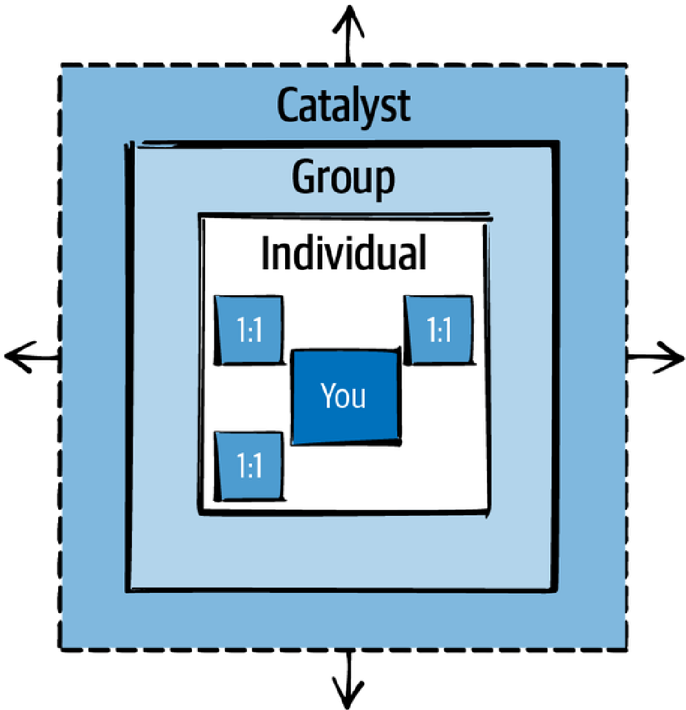

> 图 8-1：影响力的层级。群体影响力比个人影响力走得更远。
> 催化剂式影响力即使在你停止投入更多精力之后仍会持续。

影响可以采取哪些形式？我会描述四种把同事提升一个层次的机制，
并在每个层级上给出例子：

- **建议**：我们先从给建议讲起，包括应邀给出的和不请自来的。
  在个人层面，它可以是指导、同行反馈，或者只是回答问题。
  你可以通过写作和演讲把建议规模化到群体层面，
  再通过让同事之间容易互相提建议，达到催化剂层面。
- **教学**：我们会看如何通过培训、结对、观摩或教练式辅导，
  刻意地向个人传授技能。然后借助入职材料、codelab、课程和工作坊规模化到群体。
  催化剂层面则是教别人如何教学、制定课程体系，
  以及影响所有人都会接触到的主题。
- **护栏**：我们会探索如何给人们护栏，让他们能安全地工作。
  对个人，我会谈代码评审、设计评审，以及如何成为某个人的项目护栏。
  对群体，我们会看一些能让我们保持在正轨上的流程、政策和机器人。
  最后在催化剂层面，我们会探索终极护栏：文化变革。
- **机会**：最后，我们会看如何通过为人们匹配有助于学习的机会，帮助他们成长。
  对个人，我会谈委派、提携，以及为好工作宣传造势。
  对群体，你能给团队的最大机会也许是退后一步、留出空间、分享聚光灯。
  而当你提携过的入门级和 midlevel 伙伴成长为充满活力、技能娴熟、
  能解决问题的资深者，去迎接挑战、创造你从未想象过的新机会时，
  它就成了催化剂。

表 8-1 展示了这三个层级和四种机制，以及一些例子。

> 表 8-1：在组织内外规模化地施加建议、教学、护栏和机会的一些例子。

|  | 个人 | 群体 | 催化剂 |
| --- | --- | --- | --- |
| 建议 | 指导、分享知识、反馈 | 技术分享会、文档、文章 | 导师制项目、技术分享活动 |
| 教学 | 代码评审、设计评审、教练式辅导、结对、观摩 | 课程、codelab | 入职课程体系、教别人如何教学 |
| 护栏 | 代码评审、变更评审、设计评审 | 流程、linter、风格指南 | 框架、文化变革 |
| 机会 | 委派、提携、助威、持续支持 | 分享聚光灯、赋能团队 | 创造机会的文化、骄傲地看着你的明星 junior 同事改变世界 |

把这些层级和机制当作一份摆在你面前的选项清单，而不是一份要努力完成的核对表。
发挥你的长处，做那些你喜欢、觉得容易或想变得更擅长的。
虽然它们被呈现为一个层级结构，但不要跳过“较小”的那些。
通过代码评审或提携来提升同事，会在整个公司产生涟漪效应，
而即使是那些最能改变世界的技术专家，也仍在指导他们认为值得投资的人。

同样，不要过于执着地追求表 8-1 右栏中那些*催化式*的影响类型。
太多的项目和框架会让你的组织不堪重负，
而且参与一个现有的倡议，往往比另起炉灶影响更大。
比如，如果已经有了入职课程体系，在里面教一门课通常会比
另设一个独立的教育项目更有价值。带领一个团队穿过一个艰难的设计，
常常比修修补改 RFC 流程重要得多。先做个人和群体层面的工作，
只有在需求和价值非常明确时，才去扩大范围。

说了这么多，我们从建议开始。

## 建议

有句格言说：“免费的建议，价值恰好等于你为它付出的价钱。”
建议确实很嘈杂：好的信号里混着坏的，而且往往不会为接收它的人量身定制。
不过，每个人有时都需要建议，而给出建议是你传递经验的方式之一。
如果你有过成功也犯过错，也让别人从中学习吧。

> [!NOTE]
> **谁问你了？**
>
> 在你给出建议之前，先想想它是否受欢迎。
> 应邀给出的建议，是别人提出了要求：
> 一条推荐、对他们工作的反馈、帮忙决定该怎么做。
> 而不请自来的建议，则是他们没有开口要的。
>
> 在你发表看法之前，先想想对方是否想要听这些看法。
> 也想想你是否有足够的背景，能告诉他们一些既有用又不显而易见的东西。
> 如果不确定你的建议会不会受欢迎，就问他们。
>
> 有些时候，不请自来的建议是有价值的。
> “你的幻灯片很棒，但你演讲的时候总是对着自己的鞋子说话，
> 让人很难听懂你”，这是一句不好接受但多半出于善意的不请自来的建议。¹
> 但也要想想你的角色、你与这个人的关系。
> 有些话应该由朋友来说，而不是陌生人。
> 还有，别一上来就说。先问一句“我能给你提个建议吗？”，征得他们的同意。
>
> 以下是一些不请自来的建议可能确实有帮助的其他情形：
>
> - 当你认为对方陷入了他们自己看不出来的处境。
>   “嘿，我知道这不是你在问的问题，
>   但你描述的那份工作处境看起来不太健康。你值得更好的。”
> - 当你掌握了对方没有的关键信息。
>   “我听你说要开始用 Foo 平台了；
>   只是想让你知道，它明年就要被下线了。”
>
> 如果你特别想就一个没人问你的话题发表不请自来的建议，
> 可以考虑改成写一篇博客文章，或者发一条推文。²

### 面向个人的建议

有几种方式可以让你针对某人当下的处境，给出面向个人的建议。
包括成为他们的导师角色、回答他们的问题、评论他们做过的工作，
或者在绩效评审时给出同行反馈。

#### 指导

指导往往是工程师第一次体验到领导力。
在有正式导师制项目的公司，你可能会被指派去帮助一位新人熟悉环境。
指导也可能自然发生：坐在某个人旁边，介绍你自己，回答他们的问题，
你可能会发现自己有了一位非正式的被指导者。

通过分享你的视角和你学到的东西，
你可以加速他人的学习，让他们免于犯下不必要的错误。
你可以给他们讲你经历过的类似处境：你做了什么，结果如何。
Senior engineering director Neha Batra 把指导描述为
“分享你的经验，让工程师能自己加以利用”。
但请记住，指导聚焦于*你的*经验。

且不论是否应邀，对你有效的建议未必对别人有效。
作家兼管理教练 Lara Hogan（这一章里她的名字会出现很多次！）警告说：
“对一个人可能有效的建议（“开会时大声点！”或“找你老板要求加薪！”）
可能会削弱另一个人，因为代表性不足的群体成员
会在无意识中被区别评估和区别对待。”³
十年前的最佳实践，现在可能也不适用于更年轻的同事；
而你那段经历中的社交动态（或技术栈），
可能与你的同事正面对的情形并不匹配。
我曾有过同事反驳我给错了对象的建议。
“直接私信 director，请他们邀请你参加会议”这句话，
在 director 是你的同级时说起来容易，
而当他们是你的老板的老板的老板时，就难得多了！

在导师和被指导者的对话中，要小心不请自来的建议。
比如，当某人开始描述一个艰难的项目时，
轻松又直觉的反应是说出你——这位睿智的建议给出者——
在同样的处境下会怎么做。更体贴（虽然更难）的做法，是弄清楚他们真正需要什么。
也许到头来他们确实想要帮助。
但同样有可能的是，他们只是在寻求安慰，
想确认别人也会觉得这个问题或处境很难。
他们可能正在做小黄鸭调试：向你解释一件事，好让自己把它理清楚。
他们可能只是想讲一段亲历的苦战故事，
听一听别人对他们一路闯关的慰问与祝贺。
不请自来的建议会把这一切都搅乱。
可以问一句“你是需要发泄的空间，还是在找建议？”
然后按对方的要求给予安慰和认可，或者给出解决方案。

指导不只是针对新人：我的被指导者里有拥有几十年经验的人，
我自己也有导师，会向他们寻求建议。它也不必然是单向的。
你的被指导者可能给你带来新的视角，
或者教你一些他们比你更懂的话题。

如果你打算开始一段指导关系，就为成功做好安排。
设定预期，比如你们每周见一次面，持续六周。
就你们想达成的目标取得一致：被指导者是想要在新公司完成入职并感到自在、
学习一个新代码库，还是想要职业建议、朝一个新角色努力？
如果这些都在一开始就说清楚，
你们就不太会坐在房间里面面相觑，满脑子“我们本来要谈什么来着？”

#### 回答问题

如果你有一座庞大的知识宝库，而所有人都害怕向你提问，
你的知识就会一直待在你自己的脑袋里。要平易近人。
取决于你的工作风格，这可以意味着提供 office hour、
保持友善、方便私信，或者花一些时间就在与你共事的团队附近待着——
带沙发的办公空间最适合这种事。

要让找你这件事值得花功夫。有些工程师似乎把知识守得死死的，
只回答直接问出来的问题，一个字都不多说。

“`/user` 端点能给我用户的完整姓名吗？”junior 工程师问。

“不能，”senior 工程师回答，“它只能给你用户名。”

这位 junior 工程师围着这个问题硬折腾了一个小时，
才紧张兮兮地问：“有没有别的端点能给完整姓名？”

“当然，”senior 工程师说，“用 `/fulluser`。”

浪费了一个小时！这位资深的人手里有信息，却没想到要传授。
这并不意味着你应该*一股脑倒信息*，
把所有可能与手头话题沾边的信息都倾倒出去。
但要理解对方*隐含*在寻求什么建议，哪怕没有直接问出口。
如果不确定，就问问你的同事想做什么、需不需要帮助。

代码评审和设计评审也可以是回答隐含问题、给出建议的另一个时机。
如果你看到同事可以用更好的方式解决某个问题，告诉他们。
但要讲清楚你只是在分享有趣的信息，还是要他们改变方向：
收到一句干巴巴的“这里用 Foo 库也可以”，
却不知道这是不是意味着你讨厌现在的做法，会让人很沮丧。

领域相关的信息不只限于技术。
如果你摸清了在组织里行事和把事情办成的方法，
那就是可以传给被指导者和其他同事的宝贵知识。
分享你在第 2 章绘制的地形图吧！

#### 反馈

在我现在的工作中，我给自己安排的角色之一，
是给做会议演讲的同事当试听众。我喜欢看技术分享，
也投入了大量时间学习怎么把它们讲好，所以演讲者和我都受益。
看演讲的时候，我会记一大堆笔记，
标出我觉得有趣、有洞察或有教育意义的部分。
但我也会指出任何没起作用的地方、任何我认为不正确的地方、
任何我开始走神的地方。好的坏的，我都说实话。
否则那就是在浪费演讲者的时间。

当有人请你评审一份文档、一个 pull request 或一场会议演讲时，
确实要指出你认为很棒的部分，但也要尊重他们，
（善意地！）对他们的工作诚实。给出建设性的批评反馈并不容易。
要费一番功夫才能确切梳理出哪里不行，
并找到语言去解释为什么它没有达到本可以达到的水准。
这是一场更艰难的对话。但你若隐瞒真相，就帮不到你的同事。

#### 同行评审

如果你的公司有绩效管理周期，你可能会被要求提供一种特定形式的反馈：
同行评审。这类评审有两个受众，你需要把两者都记在心里。

第一个是向你征求反馈的人。假设他们之所以来问，
是真心想知道如何改进。我见过人们在同行反馈中纠结于
“这个人还能在哪里做得更好？”的问题，因为很容易把答案当成批评。
但要按字面理解这个问题：你的同事*能*在哪里做得更好？
他们怎样才能变得更出色？如果你想不出任何东西，
问问自己为什么他们没有再高一个（或两个！）职级，
并就他们应该重点关注的行为给出建议，帮他们达到那里。

但也要记住，反馈会被这个人的 manager 读到，
可能还会被正在校准其绩效或评估其晋升的人读到。
给这些人提供他们需要的信息，帮助你的同事成长，
并注意到需要解决的模式。但要想清楚你的话会被如何理解、
会不会被不了解你所描述工作的人断章取义。
如果你发现自己在回避描述某个成长空间，
因为不想意外搞砸一次当之无愧的晋升，
可以考虑改为通过邮件或当面给出私下反馈。

就像给出指导建议一样，记住对一个人有效的东西，
对另一个人可能是糟糕的建议。这在关于沟通风格的建议中尤其常见。
比如，“强势一点”这条建议会让一些人看起来更像领导者，
却会让另一些人惹上麻烦。科技圈女性中流传一个常见的玩笑：
当你收到第一份说你“盛气凌人”的同行评审时，
你就知道自己是在按 senior 的水准行事了。⁴
（那也可能是你的评审第一次不再写你“应该更果断一些”。
这条线很不好走。）所以要当心隐性偏见，
注意你在不同人身上如何描述同一种行为。
那是“凝聚共识”还是“优柔寡断”？他们是“接地气得让人耳目一新”，
还是“不专业”？这往往取决于你说的是谁。
Project Include 的人就如何给出反馈提供了更多建议。

### 把建议规模化到群体

你不可能和每个需要建议的人单独见面，
也不可能为整个组织写反馈：那样你的季度就一点时间都不剩了。
但你可以就任何你想讲的主题做一场技术分享或写一篇文章，
而它很可能会触达一些觉得它有帮助的人。这是规模化建议的好办法。

多年前，Google 的一群志愿者想提高测试质量，想出了一个新奇的解决方案：
他们把自己的建议写成简单的一页纸，打印出来，贴在厕所隔间里。
“Testing on the Toilet”是不请自来建议的极致，
但它受欢迎、有趣，而且大家真的会读！

如果你想把一件事讲给更多人听，就把它写下来。
有了文档，你就不用一遍又一遍地解释怎么做某件事。
一份 FAQ、一篇 how-to，甚至一个写得清清楚楚的频道主题，
都能让你把一件事只说一遍，却让很多人读到。
而如果你写的东西也适用于公司之外的人，
可以考虑进一步以博客文章或文章的形式分享。

此外，去寻找拿到麦克风和听众的机会。
你能在全员大会、行业会议或技术分享活动上争取到一个时段吗？
有时候，你可以借这些机会，在被邀请分享的信息*之外*，
捎带上你想传达的信息。有一次，我被邀请向一大群人讲一件由我挑选的事。
当时我正努力宣传依赖管理，以及谨慎选择所依赖系统的重要性。
于是我带着大家复盘了一次最近的服务中断，
它因为一个循环依赖而严重恶化，系统迟迟无法恢复上线。⁵
在这个大型会议上演讲的机会，让我可以把这次事故的故事组织成
能突出我想传达的信息的样子。那是在正确的时间出现的一群听众和一支麦克风。

### 成为催化剂

如果你想成为催化剂，就建立不需要你在场的建议流动。
让你的同事容易互相帮助。

如果你的团队或组织靠一对一对话才能弄清任何事情如何运作，
你能做的最有力量的事情之一，就是鼓励人们把东西写下来。
从小处开始：从口口相传的文化直接跳到*一切*都写下来，
不会为你赢得朋友。相反，去寻找一个小而有意义的改变。
你们缺一个好用的文档平台吗？
各团队会愿意为最常被打断回答的问题建一份 FAQ 吗？
你的 director 会支持设立一个每季度的文档日吗？

你可以通过设立每月技术分享会或午餐学习会，
来规模化“听众加麦克风”式的建议。这比只安排会议的承诺大得多：
你得征集演讲、发送提醒，可能还要看试讲。
想清楚你要投入什么，在你的时间图上为它做好规划，
而且最好至少找三个人一起分担。

类似地，你可以通过建立导师制项目，把指导进一步规模化。
要有心理准备：行政工作会比你想的更耗时间，
而且这类工作通常不被认为是工程师职责的一部分。
如果你能找到一位有兴趣做同样事情的 manager，
他们往往更容易把这项工作说成自己职责描述的一部分。
说服别人去建立导师制项目，同样算得上成为催化剂！

## 教学

接下来是好影响的第二种类型，它比建议更进一步：教学。
*告诉*别人事情和*教*别人事情，区别在哪里？
在于理解。当你在给建议时，你解释的是*你*与这个话题的关系，
接收者可以采纳也可以不理。当你在教学时，
你是在设法让对方不只是*接收*信息，而是把它为自己内化。

刻意的教学不只是资深的人帮助资历浅的人：
只要有人新加入团队，或者你比某人拥有更多领域知识，它就有用。
比如，我喜欢请同事给我概览一遍他们的系统，
好填补我对整体架构认识上的空白。在一个小时的白板推演之后，
我会对他们的系统如何与其他系统交互有清晰得多的认识，
而且我自己也画了一张图，可以日后参考，或补充进他们的文档。

### 面向个人的教学

只要你和与你共事的人之间存在知识差距，就有教学的机会。
有时这意味着正式的培训或教练式辅导。
但在常规的协作结构中，也有大量教学可做：
结对编程、观摩和评审。

#### 解锁一个主题

回想你上过的最好的课。它们成功在哪里？
我敢说，你离开时会觉得自己掌握了以前没有的东西：
一项可以在此之上继续构建的新技能或新理解。
出色的课程会为你“解锁”一个主题，激发好奇心和兴趣。

教师有一个明确的目标，常常落实在教案里。
如果你要教学，你也应该如此。举几个例子：

- 你是在概览某个系统吗？如果是，那么在这堂课结束时，
  你教的人应该能把系统画在白板上，并讲给别人听。
- 你是在带着人走读一个代码库吗？
  目标是给他们发出第一个 pull request 所需的一切。
- 你是在展示如何使用某个工具或 API 吗？
  描述三到五个常见场景，
  要求他们在课程结束时能独立处理。

成功的教学包含动手实践和激活知识：
学生应该边做边听。找机会让他们主导，
无论是让他们自己使用工具、亲手敲命令，
还是在他们自己的笔记本上而不是你的上面打开标签页。
如果他们最终还能留下一个可以回头查阅的“成果物”，
比如一张图或一段代码片段，那就更好了。

#### 结对、观摩与反向观摩

这是另一种教学的方式：直接与另一个人一起工作。
协作有一条方法的频谱（见图 8-2）：
从观摩——你在干活、同事在旁边看，到结对——你们一起干，
再到反向观摩——他们在干活，你在旁边看并给出反馈。

> 图 8-2：一起工作的频谱。这条线上的不同位置，在不同情况下各有用处。

观摩是一种示范式的教学：你的“影子”看你执行一项技能，
并记下你处理它的方式。这是做一个可见的榜样、
向同事展示如何以高标准工作的绝佳机会。

在结对中，你们仍然一起工作，但“影子”变成了主动的参与者。
结对可以是结对编程、合作撰写一份文档、在白板上推演一个架构，
或者一起解决一个问题。它既是树立榜样的又一个机会，
也是教学的机会：并肩工作意味着你可以分享知识，
并实时检验对方是否理解。

最后，你也可以“反向观摩”：学习者执行任务，
经验丰富的人旁观并给意见。无论学习者之前看得多仔细，
只有激活知识、亲手实践，他们才能学到最多。
反向观摩也可以充当一种护栏，我会在本章后面讨论。

#### 代码与设计评审

评审代码和设计可以是一种极好的教学形式。
你可以指出同事可能不知道的风险，并建议更安全的替代方案。
你还可以鼓励你希望更多看到的行为。

来自资深者的评审可以真正提振信心。
但要小心：*做错了的*评审会摧毁一个人的信心，而不是增强它。
费力穿过一连串居高临下、看似随意或让人摸不着头脑的评论，
会让人心力交瘁。

作为教师，你的职责是传授知识、指出问题，
同时保住学生的信心和成长型思维。代码评审还会在“护栏”一节再次出现，
到时我会谈为防止系统受损而做的评审。
但现在，这里有一些你为*教学*而评审时值得记住的想法：

##### 理解任务

注意背景。你的同事是刚接触这门语言或技术、想借此学习，
还是只需要第二双眼睛来保障安全？⁶
也要了解工作所处的阶段：
如果你读的是第一份高层次草稿，就从基础和方法入手，
别陷入吹毛求疵的细节。如果所有人都已认可，这是发布前的最后一次评审，
那就不是提重大方向问题的时候：直接扎进细节，
对可能出错的地方格外警觉。

##### 解释“为什么”，而不只是“是什么”

一条“别用 `shared_ptr`，用 `unique_ptr`”这样的评审意见，
只告诉了代码作者现在该做什么。他们下次还是不知道该怎么做。
教学意味着分享理解，而不只是事实。虽然代码作者可以去读
你刚提到的那个东西的文档，但他们可能意识不到为什么它适用。
一句简短的解释，或者一篇相关文章或某个具体 Stack Overflow 帖子
（而不是笼统的手册）的链接，会成为帮助他们学习的捷径。

##### 给出更好的示例

如果设计中的某一段让人困惑，不要只说“请把这里写得更清楚些”。
这让人不知道该怎么办！给出几条建议，
说说你认为作者想表达的是什么。

##### 说清楚什么重要

当你经验尚浅时，很难校准收到的建议的分量。
有些东西至关重要，有些是锦上添花，有些只是个人偏好。
为你的建议加上标注，让人一目了然。举几个例子：

- “这里改用参数化查询。你正把自己暴露在 SQL 注入攻击之下——
  恶意用户可能会把我们的数据库整个删掉！”
- “你这种做法完全可行，但我们倾向于避免单例模式。
  这是我们风格指南中解释原因的那一节的链接。”
- “我建议这里用一个更大的微服务，而不是两个小的——
  我认为这样更容易维护。但我不是特别坚持，你定。”
- “这只是吹毛求疵，但这个文件里其他所有拼写都是美式英语，
  所以这里我们用 organization 而不是 organisation 吧。”⁷

##### 挑选你的战场

John Turner 是一名软件工程师，曾为 Squarespace 工程博客撰写代码评审的文章，
他建议分几轮评审代码：先提高层次的意见，再逐步细化。
正如他指出的：“如果代码没有做它该做的事，
那么缩进对不对根本无关紧要。”这条建议同样适用于 RFC：
如果你的第一条意见是作者在解决一个错误的问题，
再留一百条技术建议就没有意义了。

##### 如果你的意思是“同意”，就说“同意”

讲清楚你的意见是不是阻塞性的，以及除此之外你对这个变更是否满意。
好坏都要说。特别是在设计文档上，要明确说一句“在我看来这没问题”。
代码评审通常以点一个按钮结束，表示你相信这个变更可以安全合并。
但当评审人很多时，每个人可能都会犹豫，要等其他人都表了态才敢批准。
如果你没有异议，就明说。

记住，职业生涯早期的工程师可能会觉得你令人生畏，
或者即使认为你错了，也不愿质疑你的建议。
想想怎么让你的意见友好、平易近人，而且，说到底，像个人。
如果一个 pull request 或 RFC 需要大量修改，
最有建设性的做法可能不是用评论把同事埋起来：
考虑约个时间跟他们聊聊，或者跟他们结对。

#### 教练式辅导

我要谈的最后一种个人教学形式是教练式辅导。
*指导*涉及分享你的亲身经验，
而*教练式辅导*是教人们自己解决问题。
这个过程可能更慢，但你的同事通过自己建立联系学到的东西，
远比从你这里直接得到答案要多。

教练式辅导是一组有点古怪的技能，听起来相当直白，
却需要投入时间和刻意努力才能学会。别指望马上就擅长它！
以下是你需要的三大技能：

##### 提开放式问题

开放式问题是那些无法用“是”或“否”回答的问题：
它们能换来多得多的信息。试着深挖问题，而不是一上来就给方案。
提出能帮助你的被辅导者识别和拆解问题的各个方面的提问，
那些方面可能是他们原本没有考虑过的。

##### 积极倾听

把你听到的复述回去，确保你真的理解了，
也让对方听到你如何组织他们说过的话。被理解的感觉可以很有力量，
能帮助人们减少孤独感。你的组织方式，可以给同事一种新的语言
来描述他们正在处理的事情，帮助他们想出新的解决方案。

##### 留出空间

为被辅导者留出足够的空间和沉默来思考。
如果你习惯在沉默出现时条件反射地插话，
就在再次开口前在心里默数到五，让对方有时间消化。

刚当教练的时候，你会觉得不直接*帮忙*非常奇怪。
如果你知道答案，难道不该直接*给*出来吗？不。
正如管理顾问 Julia Milner 在她的 TEDx 演讲中所警告的，
你不可能知道情况的每一个细节。当你给出解决方案时，
被辅导者很可能会条件反射地用 Milner 所说的“是的，但是……”来回应，
给出一条你的建议行不通的理由。她说，好的教练式辅导，
是把他们自己最好的想法引导出来，给他们反思的空间，
帮助他们走上属于自己的旅程，找到对他们有效的解决方案。

### 把教学规模化到群体

一次教一个人，对那个人很好，但这是传播信息的慢办法。
你可以通过为课程制作材料，来规模化你的教学。

组织一门课要花大量精力。第一次教它的前期成本很高，
但以后每再教一次，你都在摊薄这笔成本。和个人教学一样，
你的课程应该有一个明确目标：学生在结束时将知道什么、能做什么。
加入练习，或某种让课上的学生练习所学内容的方式。

如果你想把课程做成异步的，
可以考虑制作学生能按自己节奏使用的东西。
这类教学的一个绝佳例子是 codelab：
一种引导式教程，带着学生一步一步构建某个东西，或完成练习。⁸

我曾经在一个长期经费不足的项目上工作，
靠志愿者、实习生和短期驻留计划的人轮流支撑。
其中许多人对公司乃至行业都是新人。
直接把他们扔进我们的代码库（一个令人生畏的网络库）会让他们尖叫着逃跑，
所以我们创建并记录了一条学习路径。

第一天，我们让他们发两个 pull request：
一个往我们的笑话仓库里加一个笑话，另一个把他们的名字加进团队成员名单。
我们会找理由在这个过程里来回几轮，好让他们习惯代码评审流程。
第二天，我们让他们构建并运行一对专门为此创建的微型客户端和服务器。
他们会看着它在生产环境中运行，查看它的 UI，以及它导出的日志和指标。
然后他们对库做一个本地修改——比如加一条新日志，甚至调整一下逻辑——
并部署它，向自己证明代码仍然正常工作，而且能在监控数据里看到自己的修改。
效果非常好。到第二周开始做真正的修改时，他们已经不怕那些代码了。
它就只是代码而已。

当你的大多数贡献者只待三个月时，你需要让他们快速上手。
我们对每个新贡献者都使用这条记录完善的学习路径，
没过多久，它就收回了我们的投入。

### 成为催化剂

你可以通过教别人来教这些课，把课程进一步规模化。
不同的教师有不同的风格；拥抱这一点。让你新培养的教师
开始拥有他们自己的课：他们应该能编辑幻灯片和练习，
或者得到你的祝福，去创建自己的变体。观摩他们，并给出诚实的反馈：
他们想学。一旦*他们*开始教别人怎么教这门课，
这门课就脱离你而有了生命。（到这一步，我通常会悄悄溜走，
把自己从教学轮值里移出去。）

如果你的课适用于你们所有的工程师，
试着把它加入入职课程体系或内部学习发展路径——
所有新员工都会学到你想让他们知道的东西，
你不必再想办法去触达他们。如果你的公司还没有这种学习文化，
你可以通过倡导一套入职流程、布道学习路径、
或者搭建一个让创建 codelab 变得容易的框架，产生巨大的影响。

## 护栏

想想你在悬崖边步行道旁可能看到的护栏。它们不是用来*倚靠*的，
而是在你需要时帮你稳住身体。一次小小的踉跄不会让你完蛋：
护栏会拦住你，不让你跌下边缘。护栏鼓励自主、探索和创新。
路途安全时，我们所有人都走得更快。在本节中，
我们会看一些为同事添加护栏的方法，先面向个人，再面向规模化。

### 面向个人的护栏

你可以通过评审代码、设计和变更来提供护栏，
也可以在令人胆怯的项目中提供支持。

#### 代码、设计与变更评审

我已经描述过代码评审和设计评审可以多么出色地充当教学工具。
还有第三种同样有效的评审：*变更管理*。
它指的是在做一件事之前，把你要做的每一步确切写下来，
并让另一个人确认你描述的步骤是正确的。它就像代码评审，
只不过对象是命令行，或按正确顺序点击按钮。

你可以把代码、设计和变更评审当作帮助同事的有力护栏。
当一个人知道自己的工作会被评审时，就更容易自信地独立工作。
他们知道会有一道检查，确保他们不会造成一次停机事故，
也不会花几个月搭建一个行不通的架构。护栏帮他们避开危险的错误。

如果你想成为一个好的护栏，就永远不要对变更走过场式地放行。
仔细读：每一行代码、设计的每一小节、提议变更的每一个步骤。
以下是一些你应该留心的问题类别：

##### 这份工作应该存在吗？

你的同事想解决什么问题？他们是不是在用技术方案，
去解决一个本该通过和某人谈谈来解决的问题？

##### 这份工作真的解决了问题吗？

这个方案行得通吗？用户能不能做到他们需要做、也预期要做到的事？
有没有错误或拼写问题？有没有 bug 或性能问题？
设计是否提议以一种行不通的方式使用某个系统？

##### 它将如何处理失败？

这个方案将如何应对古怪的边界情况、畸形输入、
网络的突然消失、负载激增，以及其他任何可能出错的情况？
它会干净地失败，还是会损坏数据，或收了用户的钱
却不提供他们付费的服务？你将如何发现问题？

##### 它易于理解吗？

其他人能维护和调试新的代码或系统吗？
组件或变量的命名直观吗？复杂度是否被约束在一个精心挑选的位置？

##### 它契合全局图景吗？

这个变更是否开创了一个先例、建立了一种
你可能不希望别人效仿的模式？它是否迫使其他团队
在未来的变更中做额外的工作？它是不是一个风险很高的变更，
却被安排在一场高关注度发布的同时进行？

##### 对的人知道这件事吗？

该知情的人是否都被抄送在这个变更上？
需要执行的动作是否都附上了具体的名字，
还是满篇被动语态，搞不清哪个团队在做什么？
参与者是否知道大家对他们的期望是什么？

作为评审者，要接受你并非无所不知的事实。多提问，保持建设性。
好的护栏不是武断的守门人：你和你要保护的人站在同一边，
你希望他们成功。

#### 项目护栏

如果你曾经奋力接下一个困难的项目，你就会知道，
那是锻炼技能的好办法，但也让人神经紧绷！你更可能失败，
因为你在做一件对自己很难的事。所以，如果有一位更有经验、
做过这种规模或形态项目的同事，那就太好了：他们能帮你保持安全。
这不意味着他们会替你做工作，或保护你不犯任何可能的错误，
而是在你快要走近一场无法挽回的灾难时告诉你。
这就是充当项目护栏的含义。

我记得自己曾领导一个对我来说颇为吃力的项目。
它的组成部分比我做过的任何项目都多，干系人更多，政治因素也多得多。
每周我和 team lead 碰面时，他都会问一些关于项目的问题：
“顺便问一下，你打算怎么平衡这两个相互冲突的业务优先级？”
我当然没有计划：我根本没注意到这个问题正在逼近。
但这些问题足以把我拉回正轨，让我能提出前进的路径。
虽然我当时没有意识到，但那位 team lead 就是在充当护栏。
他在确认我是否注意到了自己正走在悬崖边缘，
而如果我没有好的应对想法，他随时准备给我辅导。

充当项目护栏不只是为经验较浅的人准备的：
你可以为任何正在领导项目或承担困难任务的同事扮演这个角色。
即便是非常老练的人，在用到新技能组合的项目中也需要支持。
如果有人请你当某个项目的导师或顾问，
他们多半至少期待一点点保驾护航。

护栏既能提供安全，也能提供支持。Lara Hogan 建议
具体说明你能为项目提供什么帮助，比如承诺评审设计、
或替想法向高层管理者争取支持；同时明确你的同事
应该在什么时候、以什么方式向你求助。她建议这样说：
“如果 B 连着三天不理你，就给我发邮件；到时候我可以给你撑腰。”

### 把护栏规模化到群体

你不可能亲自评审每一个变更、支持每一个项目，
如果你执意如此，只会拖慢所有人。我们来看看，
如何为你的团队或组织添加护栏，同时不挡任何人的路。

#### 流程

与其逐个教你的同事正确的做法，
不如把一套标准步骤写下来，并说服组织遵循它。
例如，在你们公司发布一个新功能的“正确方式”是什么？
你们的发布前流程可能包括回答这样的问题：

- 需要安全审批吗？
- 应该提前多久通知市场团队或客服？
- 应该藏在功能开关后面发布吗？
- 有没有应该补充的标准监控、事件上报和文档？
- 需不需要告诉其他团队，让它们预期会有额外负载？

还有很多！随着公司成长、组织变复杂，
发布造成停机事故或公关麻烦的途径也会越来越多。
于是，一个流程诞生了。

人们对流程的看法各不相同。有些人会为有清晰的步骤，
以及标准化带来的安全感而高兴。另一些人则坚持认为人们应该*思考*，
而不是无脑遵循规程，认为检查清单和审批只会拖慢他们。
没人说错；这是一个 trade-off。但公司越大，
你就越可能需要*某种*结构，帮助人们做正确的事，
而不必每次都重复问同样的问题。

以下是一些添加流程或检查清单可能有帮助的其他例子：

- 响应一次重大停机事故或安全事件
- 分享 RFC 或设计并达成一致
- 采用一门新技术或新语言
- 制定并记录跨多个组织的决策

总体而言，要力求让流程尽可能轻量。
如果你加入一套有大量样板、集中审批和漫长等待期的复杂程序，
它不会成为好的护栏：人们只会绕开它。
让正确的路，成为容易的路。

> [!NOTE]
> **流程开场白**
>
> 这是我为工作中的流程 FAQ 文档写的前言。
> 如果对你也有用，尽管拿去用。
>
> 关于 `<topic>` 应该怎么运作，有很多问题。像这样的流程，
> 很难在“规定得多细”上找到平衡。
>
> - 如果你什么都不写下来，大多数人会讨厌这样，
>   抱怨自己不知道该怎么做任何事。
> - 如果你写下指导原则，人们会把它们当成法律，
>   并因为它们没覆盖边界情况而争论它们是错的。
> - 而如果你把每个边界情况都写下来，你最终会得到
>   一大本政策和法务腔的三孔活页夹，
>   而且它很可能仍然覆盖不了所有情形。大家照样都讨厌它！
>
> 本文档试图对一些常见问题给出大体正确的答案。
> 这些答案不会在每个情形下都完美适用。
> 丢弃它们之前请三思；但如果它们不适合你正处的情形，
> 就去做那件讲得通的事。所有指导原则有时都是错的。
> （如果这些指导原则经常是错的，请提出修改。）
>
> 拿不准的时候，认真想想你正在做的事涉及的其他人，
> 假定他们都是尽力而为的讲道理的人，
> 同时自己也做一个尽力而为的讲道理的人。⁹

#### 书面化决策

这是另一种让做正确的事变得容易的方法：
把决策做一次并写下来，让人们不必一次又一次进行同样的争论。
书面化决策从人们的生活中消除了一点决策疲劳：
规则说我们通常做 X，那我们就做 X！

以下是四个例子：

##### 风格指南

正如 Google 的风格指南站点所解释的，项目的风格指南是
“关于如何为该项目编写代码的一组约定（有时是任意的）。
当其中所有代码的风格一致时，理解一个大型代码库会容易得多。”
这里的“风格”涵盖很广，从命名规范到错误处理，
再到哪些语言特性可以使用。把这些决策做一次并写下来，
你就把各个团队从每个新项目都要重复一遍的
“变量名用小驼峰还是 snake_case？”的争论中解放了出来。
你还会得到风格更一致的代码。

##### 铺装路

有些公司会记录一组标准的、支持良好的技术，
并建议（或要求）各团队不要踏出这条“铺装路”。
我喜欢由 Thoughtworks Tech Radar 推广开来的格式，
把技术标记为“Adopt”“Trial”“Assess”和“Hold”。

##### 政策

公司可以制定规则，例如：“每个团队都应该在停机事故后进行复盘。”
如果规则被严格执行，违反它可能被视为没有做好本职工作，
并影响绩效评审。要谨慎地使用政策。
很难把所有边界情况都考虑周全——而边界情况永远存在。
再说，政策太多，人们根本记不住所有该做的事。

##### 技术愿景与战略

技术愿景或技术战略（见第 3 章）给出了一个清晰的方向，
各个团队可以在方向之内，选择自己的路径去解决问题。

#### 机器人与提醒

软件顾问 Glen Mailer 说，他会寻找各种办法，
让人们尽可能容易地记得去做正确的事。
这意味着把正确的解决方案推到他们眼前——有时是字面意义上的！
他举过一个工作场所的例子：那里每个人都应该用工时表记录项目时间。
当然，人们经常忘记，直到有人想出一个办法：
他们在出口门的头部高度贴了一张工时表和一支笔。
任何人推门离开时，工时表正好出现在眼前——想忘都难。

如果你在尝试引入一个流程或一项书面化决策，
看看有没有办法（温和地）把它推到人们眼前。
更好的是，让自动化系统去做正确的事，省得人来动手。举几个例子：

##### 自动化提醒

与其总是提醒某人这周轮到他们执行发布流程，
不如设置自动化，把这件事放进他们的日历，或给他们发私信。
提醒里应该包含指向该流程的链接。

##### Linter

让代码 linter 尽可能多地执行你们的风格指南，
评审者就不必亲自执行了。

##### 搜索

确保任何关于“怎么做某件事”的搜索，都能带出*正确的*做法，
哪怕这意味着要更新所有“过时的”文档，加上指向正确位置的标题。

##### 模板

如果所有 RFC 都应该有安全一节，那就确保有一个好用的 RFC 模板，
并且模板里包含安全一节。

##### 配置检查器和 presubmit

你能不能加上自动化，在提交前自动运行单元测试，
或对配置运行安全检查？Google 的数据中心安全系统 SRSly
就是一个很好的例子：它允许设置诸如“一次最多只能重启 5% 的服务器”、
“如果该系统的 on-call 最近才被呼过，就不要下线它的服务器”这样的护栏。¹⁰

### 成为催化剂

创建能强化你的信息的机器人、政策和流程，
比为个别同事充当护栏，规模要大得多。
但它们仍然都依赖*你*去做点什么。
如果你真的想让一条信息延续下去，你需要每个人都相信它、在意它。
你要让你的组织达到这样一种状态：做别的事情反而显得奇怪。
最有效的护栏也最难建立：文化变革。除非你能让护栏
成为文化的一部分，否则你将永远追着合规跑。

如今大多数科技公司都做代码评审、写测试。但从前并非如此！
我们今天习以为常的所有护栏，
都是由那些足够在意、愿意论证这项改变值得花时间的人引入的。
如果你在推动一场文化变革，要有耐心。让所有人
以另一种方式行事，需要大量时间和专注的努力，
但这是你唯一能不再手动推着流程走的办法。

以下是一些能让你的文化变革之旅更轻松的方法：

#### 解决真实问题

文化变革应该与组织的需要紧密对齐。
预期任何提案都会遭遇大量“为什么”的质问。
准备好不只是停留在愿景上的答案：认真想想，这门生意从中得到什么？

#### 挑选你的战场

与其建立一套设计评审流程，不如努力培养对设计评审的尊重，
并相信各个团队会为自己选择什么形式最适合他们。
提供一些容易上手的默认选项，
但别纠结是否每个人都在遵循一模一样的流程。

#### 提供支持

你的流程和自动化应该支持你想要的改变：
它们应该让做正确的事变得容易。

#### 寻找盟友

不要试图独自改变文化。理想情况下，
你的盟友应包括你试图改变的组织中的高层支持者和影响力人物。
去查一查你在第 2 章绘制的影子组织架构图。

## 机会

我们要考察的最后一种好影响，是为人们找到他们成长所需的经验。
人们通过做事来学习，甚至比通过教学、教练式辅导或建议学到的更多。
每个项目或角色都是一次获得曝光、建立关系、
在简历上添一行经历的机会，而这一切都可能带来更多机会。
我们来看看如何把这些经验送给你的同事，既面向个人，也面向规模化。

### 面向个人的机会

作为资深的人，你会有很多场合，可以帮助其他人找到成长的机会。
你可以通过委派，直接提供项目和学习经历。
但你也可以推荐人选担任任务、宣传他们的工作，
或者把他们与能帮到他们的信息连接起来。

#### 委派

委派指的是把你的一部分工作交给别人。
当你委派时，通常不是把项目扔给一个人就扬长而去：
你在意结果。这可能意味着你会忍不住微观管理，
或者亲自动手处理项目中所有困难的部分。
但当你交出工作时，要*真正地*交出去。正如 Lara Hogan 所说，
如果你是先把工作变成“包装得漂漂亮亮、扎好缎带的礼物”再委派出去，
你的同事学不到那么多。如果你交给他们的是
“一个乱糟糟、没划定范围、但有点安全网的项目”，
他们就有机会打磨解决问题的能力、建立自己的支持体系、
拓展自己的技能组合。一个混乱的项目，
是难以通过其他途径获得的学习机会。

把难度对准你要委派的对象——别把组织级的混乱扔给一位新毕业生！
但在寻找委派对象时，要想得比最显而易见的人选更远。
任何能在项目上做出 A+ 完美水准的人，都不会从中学习。¹¹
相反，要找那种会觉得这份工作有点吃力、
但在支持下能够完成的人。向他们承诺这份支持。
你可能需要稍微推他们一把，帮他们看到这份工作触手可及：
他们可能还没把自己看成项目负责人、事故指挥官等等，
但你这样看待他们这个事实，可以极大地提振他们的信心。
描述你能为他们提供的护栏，并解释为什么你认为他们能胜任这个项目。

要留个心眼：当你委派时，你*不会得到一个克隆人*。
（抱歉，我们还没有那种技术。）不可避免地，
被你委派的人会采取与你会采取的不同的方法。
做一个护栏，辅导他们，多提问，但抑制住插手的冲动。
只要他们能达成目标，就让他们用自己的方式做。
我特别喜欢 Molly Graham——她最近一份工作是 Quip 的首席运营官——
把交接工作形容为“送出你的乐高”的方式：

> 新来的人不会用正确的方式搭你的乐高塔，
> 会拿走所有有趣或重要的乐高，
> 或者一旦他们接手你正在搭的那部分乐高塔，
> 你就没乐高可玩了——
> 对此有大量自然而然的焦虑和不安全感。
> 但在一家快速扩张的公司里，交出责任——
> 交出你开始搭建的那部分乐高塔——
> 是转向搭建更大更好事物的唯一途径。

一个要注意的关键“交出乐高”行为是：
关于项目的问题，你应该把提问的人*转给*另一个人，而不是*代为传话*。
也就是说：当有人问你这个项目的问题时，
你可能以为自己掌握着最新状态。但由你来回答这个问题，
会让你成为联系人，可能削弱你把项目交给的那位同事。
而且你的答案也可能是错的！
相反，要让接手项目的人获得曝光：说明他们才是这个主题的专家和负责人，
表明你信任他们做决定。你会给项目的新主人带来一段新的联系，
以及这段联系衍生出的任何额外机会。下次关心的人再有问题，
他们就知道该去找谁。而这个项目，也将从你的盘子里清走。

#### 提携

提携是利用你的影响力地位，为别人争取利益。
它比指导更主动：你是在刻意为别人解锁机会，而不只是给他们建议。
它也需要更多工作：如果你想成为一个出色的提携者，
你需要知道你的同事会从什么中受益、他们正在留意什么机会。
你正在把自己的时间和社会资本，投资于他们的成长。

Rosalind Chow 是卡内基梅隆大学组织行为与理论副教授，
她描述了自己所说的“提携的 ABCD”：

##### 放大声量

宣传你同事的好工作，确保其他人知道他们的成就

##### 助推

为他们推荐机会，并为他们的技能背书

##### 牵线

把他们带进一个人际网络，让他们能接触到
原本无缘见到的人

##### 捍卫

在他们受到不公批评时为他们挺身而出；
改变别人对他们的负面看法

通过提携提供的机会，可能看起来很小，但它们会通向更大的东西。
如果你推荐某人领导一个小项目，你就是在为他日后
被看见、被选中承担更大的项目铺路。你每次公开表扬某人、
评论他们的工作、甚至转发他们，都是在放大他们好工作的信号，
确保你人际网络中的其他人知道他们，并在机会出现时想起他们。
如果另一个团队里有人在当明星，要确保他们的老板知道。
如果你们公司写同行评审，一份评审是让好工作记录在案的好办法。

你应该提携谁？寻找那些想要成长机会、
并且你信任能把工作做好的人。推荐他们，就是在花费你的社会资本，
所以别把机会浪费在其实并不想要机会、或不愿投入努力的人身上。
去提携那些有未被发掘的潜力、值得投资的同事。
也要当心内群体偏好——这种认知偏见会让你更有利地评估与你相似的人。
用 Lotus 创始人、Electronic Frontier Foundation 联合创始人、
Kapor Center for Social Impact 联席主席 Mitch Kapor 的话说：
“我们谈论硅谷的精英体制，可它其实是一种镜像体制，
因为比起其他行业，这里的人更倾向于雇用和自己长得像的人。”
注意你在推荐谁、帮助谁，确保你不是不小心只提携了和你相似的人。
这件事做起来容易得出奇。

#### 牵线搭桥

即使某个角色或项目不由你来委派，也没人请你做推荐，
你仍然可以仅仅因为知道机会的存在，而提供机会。
作为 staff+ 工程师，你很可能比与你共事的其他工程师
有更宽的背景：正如我在第 2 章描述的，你会花更多时间单纯地*了解事情*。
竖起耳朵，留意能帮到同事的机会。你可以记住某个会议的征稿还在开放、
某个 team lead 的角色即将空缺，或者某个新的内部培训项目
正在提供某人想学的技能。通过把人与信息连接起来，你扩展了他们的选项。

### 把机会规模化到群体

我已经描述过的某些催化式影响类型，能给人们带来曝光，
以及学习领导力和教学技能的机会。但还有另一种规模化机会的方法：
共享舞台。

#### 分享聚光灯

作为团队或项目里最资深的人，会有很多你做得最好的事情。
这可能让你忍不住扑向每一个困难问题。虽然每天做那个足智多谋、
学识渊博、带领团队走向卓越的资深者，感觉妙极了，
但你实际在做的，是让团队里的其他人相形见绌，阻碍他们成长。

相反，把你的超凡表现，转化为帮助每个人把工作做得更好。
允许别人做不如你会做的工作，只要够好就行。他们就是这样学习的。
分享舞台包括委派，但它也可以意味着留出空间：
让别人注意到有工作需要做，从而通过把它接起来锻炼领导技能，
或者学会自己去委派。

以下是一些能确保你在分享聚光灯的方法：

- 如果有人在小组会议上提问，留出空档，
  或者明确把发言权交给团队里的另一个人。
- 带一位资历较浅的同事，去参加你去开的会，让他们讲自己的工作。
- 邀请一位资历较浅的同事，评审与他们的工作相关的设计或代码，
  并明确表示他们的意见很重要。

> [!WARNING]
> **警告**
>
> 成为每个项目的门面会限制你的团队，但相反的极端也会有问题。
> 如果你更喜欢把*一切*都委派出去，
> 请确保你与你的管理链，就你的工作方式达成了一致。
> 大多数 manager 都会期待 staff engineer 有一些直接的执行和看得见的成果。
> 别把自己放到如此纯粹的支持角色里，以至于没人说得清你到底在干什么。

### 成为催化剂

你可以采取一些步骤，让机会和提携在你不在场时也持续流动。
虽然大多数工作场所都有某种指导的概念，提携却可能尚未被充分理解。
去寻找方法，教你的同事把目光投向显而易见人选之外的人。
一些想法包括：倡导一套包容的面试流程、
邀请一位讲隐性偏见的演讲者，
或者确立开放团队角色要发布在内部职位板上的文化。

你在行业中成为催化剂的最好方式，是赋能你的同事，
让他们成为做出伟大事业的伟大工程师。当你提供机会，
把你的 midlevel 同事变成 senior、再变成 staff engineer 时，
要教他们向后来者提供建议、教学、护栏和机会。
你培养出的 staff engineer，会培养出跟随他们的 staff engineer。
你的领导力将持续下去。

> [!WARNING]
> **警告**
>
> 一个人要晋升到你的层级，不需要达到你*现在*的水平：
> 只需要达到你当初刚晋升到这个层级时的水平。
> 如果你不断看到加入你这个层级的人不如你有能力，
> 别讽刺标准降低了：想想这是不是意味着，你已经成长了。

在本章开头，我列出了提升同事技能的三个理由：
完成更多工作、让技术保持最新，以及改善这个行业。
这里是第四个：别人的成长，就是你的成长。如果你会委派，
你就能为更大、更难的问题承担责任，并把其中一部分交给团队里的其他人。
你的同事能做的越多，你能做的就越多。正如 Bryan Liles 所说：
“你想被往上推，靠的就是在你身后建起一整排替补阵容。”

某个时刻，你可能会看着正在做你过去那份工作的人，
意识到你已经上了一个层级。那时你该怎么办？
在第 9 章，我们会看看接下来做什么。

## 回顾

- 你可以通过提供建议、教学、护栏或机会来帮助你的同事。
  理解什么对具体情形最有帮助。
- 想清楚你是想一对一地帮助、提升你的团队，还是影响得更远。
- 提供你的经验和建议，但要确保它是受欢迎的。
  写作和公开演讲，能让你的信息传得更远。
- 通过结对、观摩、评审和教练式辅导来教学。
  开设课程或编写 codelab，可以规模化你的教学时间。
- 护栏能让人们自主地工作。提供评审，或为同事充当项目护栏。
  用流程、自动化和文化变革，把护栏固化下来。
- 机会可能比建议有价值得多。想想你在提携谁、委派给谁。
  在团队里分享聚光灯。
- 计划好，把你的工作送出去。

> ¹ “当心，你身后有只熊”也是一条可以接受的不请自来的建议。

> ² 不过，别点名羞辱你认为需要建议的那个人。

> ³ 《Resilient Management》（A Book Apart）

> ⁴ 2014 年。好年份。

> ⁵ X 没有 Y 起不来，Y 没有 X 也起不来，结果谁也起不来。

> ⁶ 我有时会试着在变更描述里注明背景，好让评审者有个锚点。比如：
> “我是这门语言的新手，所以如果哪里看起来怪怪的，
> 那多半不是刻意的风格选择！欢迎吹毛求疵，
> 也欢迎告诉我什么才是地道的写法。”

> ⁷ 窥见我生活的一角。`:laughing:`

> ⁸ 《Kotlin Koans》是个绝佳的例子，做起来也很有趣。
> Google 也有一大堆很棒的 codelab。

> ⁹ 这条建议大体上也是一条普适的人生好建议。

> ¹⁰ 推荐去看 Christina Schulman 和 Etienne Perot 关于 SRSly 的有趣演讲，
> 包括它的起源故事：自动化曾意外地把一个数据中心的所有磁盘一次性送去擦除。
> 正如他们指出的，如果你让高效的自动化去做一件蠢事，它会做得非常高效。

> ¹¹ 这种模式在招聘邮件里很常见：“来做你正在做的这件事吧，只是换一家公司。”
> 有时这招确实管用（我们会在第 9 章探讨换工作的动机），
> 但我见过的最成功的招聘，都是提供让人上一个台阶、有点让人发怵的角色。

# 第 9 章 接下来做什么？

本书一开始，我们踏上了一段理解“你的工作是什么”的旅程。
此后，你梳理了自己的范围与主要关注点，绘制了组织地图，
制定了战略与愿景，给工作排定了优先级，领导了大型项目，
绕过了障碍，示范了优秀的工程实践，也把同事们提升了一个层次。
这是一段旅程！现在我们来到了最后一个主题：我们又回到了你自己身上。
不过，我们不再多看你当下正在做什么，
而是要看从此处出发你将去向何方。我们要看的是如何提升你自己。

提升究竟意味着什么？这取决于具体处境，也取决于你自己。
所以我们会先回到贯穿全书的一个主题：什么才是重要的？
我们会看你的职业全局图景、你要去哪里，
以及你需要从下一步中得到什么。
然后我们会审视你当前的角色，评估它是否朝着你想去的方向迈进了一步。

staff engineer 这个角色定义得很松，
所以从此往后的路径定义得松也就不奇怪了。
我们会看看你手头的一些选项，
我也会分享一些从 staff+ 角色继续前行的人的故事。
这些故事只是你能做的事的一个样本，
但它们或许能为你的旅程带来启发。

最后，我们会想想你在整个职业生涯中将会施加的影响。
作为资深的人，你是我们这个行业的领导者之一。
你要为自己做出的选择负责，也会影响别人的选择。
而你是唯一能驱动自己职业的人。我们就从这里开始。

## 你的职业

我在一家巨型公司的朋友曾把他的职业旅程比作玩 *Diablo*——
一款经典的角色扮演电子游戏。
“我打掉所有怪物、清空地下城，”他说，
“最后攒够了经验值，升了一级。但接下来……
我又在新地下城里从头开始，而怪物*也*升了一级！这有什么意义？！”

对你来说，意义是什么？你要去哪里？

回到第 2 章，我们画了三张地图来描述你的工作。
现在我们来画第四张：小径地图。
把你的职业想象成一段穿越山地地形的旅程。
地图上标记了许多路径，有些常有人走，有些已经荒草丛生。
有些小径能见度很差，
但你可以在行进途中瞥见路标来保持方向感。
有些小径弯弯曲曲，
你可能需要走一条看起来远离目的地的路，
但那却是通往你想去之处的唯一途径。

并非所有目的地都在地图上，
而且许多有趣的地方只有离开小径才能到达。
如果你总是只根据标出的路径通向哪里来选择下一个目的地（见图 9-1），
你可能就会一直跟着别人的脚印走向下一座地下城，
错过自己真正想去的地方。

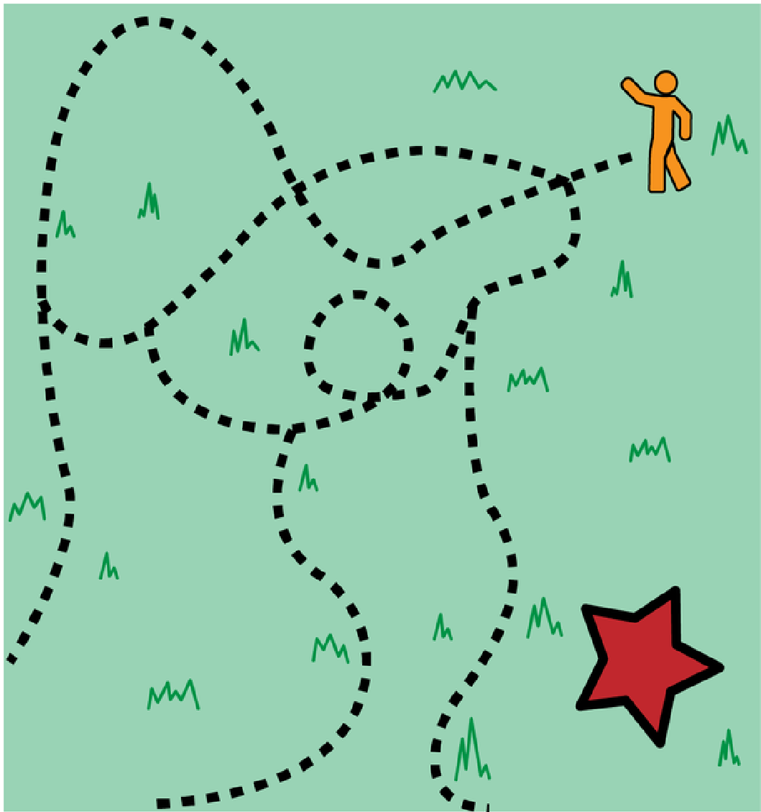

> 图 9-1：跟随本地小径。标出的路径没有一条通向目的地，
> 但如果你有地图，就会知道该在哪里离开小径。

但你要去哪里呢？也许你有一个明确的目的地，路上还有若干里程碑。
也许你并不*确切*知道自己要去哪里，但你知道自己想走的大致方向。
又或许你并没有特别要去的地方：你只是在享受旅程。

在本章余下的部分，我会假设你想从此处出发去*某个地方*。
职业发展常常被描述成攀爬职级阶梯，
不断增长资历、责任、权力和财富。
不过，这只是众多小径中的一个子集。我们来看看什么对你才是重要的。

### 什么对你才是重要的？

staff engineer Cian Synnott 写过，
列一份优先级清单可以让自己保持方向感，
并确保工作正在支撑他想从生活中得到的东西。
列这样一份清单，是反思什么对你重要的好办法。
你的职业与生活优先级是什么？下面是一些常见的：

#### 财务上有保障

对你来说最重要的可能是还清债务、准备大学学费，或者为退休存钱。

##### 支撑家庭

如果你有依赖你的家人，
你可能会为了能照顾好他们的薪水，接受一份自己不那么喜欢的工作。
你可能在优化的是稳定的收入、不错的福利，以及不必担心被裁员。

##### 拥有灵活的时间安排

你可能想要灵活性，
比如能配合育儿、照护老人，或者应对慢性病、残障的时间安排。
又或许你只是想要一份能给你大量自由时间去做自己喜欢的事的时间表。

##### 学到很多东西

也许你想要的是智力上的满足：
在某个领域成为世界级专家，
或者成为那种什么挑战都能顶上的通才——
也许你就是我们在第 3 章谈到的那个拯救 Starship Enterprise 的人！

##### 被人看见

对你来说，重要的可能是得到同行的尊重与赞赏，成为“行业名人”，
或者在一个有声望的角色上成为一种代表——
让别人能看到有人成功了，从而也能想象自己做到。

##### 做很酷的事

你可能想做又酷又激动人心的项目，做那些让你觉得有能量、好玩的事。

##### 挑战自己

回头看自己曾应对过比想象中更大的挑战，那感觉会很棒。

##### 积累财富

我们能不能花点时间欣赏一下：
身处一个（目前）薪酬很高的行业，我们是*多么幸运*？
你可能希望在整个职业生涯里尽可能多地把钱存进银行。

##### 为自己工作

也许你不喜欢让别人做影响你的决定，或者只是想体验一下自己当老板。
如果你最终想开公司或独立工作，
你可能正在努力积累技能、经验和人脉，好让自己有信心那么做。

##### 带来改变

也许你一生的目标是让世界变得更好，留下比你更长久的东西。
这可能意味着教书、发明点什么，
或者建设让技术圈更友好的社区。
也可能意味着把技术当作工具，去促成你真正想要的改变：
打造改善人们生活的产品，或者有能力支持那些需要你的事业。

##### 支撑你的志业

你可能在努力工作，以支撑自己*真正*在意的事：
比如在音乐事业上取得成功，或者让自己的爱好农场能经营下去。

你还可以为许多其他事情做优化：交朋友、环游世界、照顾健康，等等。
没有标准答案：这因人而异，而且很可能在你职业生涯中发生变化。
花点时间想想，在人生的这个阶段，你的优先级清单上有什么。

### 你要去哪里？

你的优先级清单会让你保持方向感，但它不会告诉你确切该去哪里。
为此，你需要画出自己的小径地图，并标上一些里程碑。
地图要画多细、覆盖多长时间，由你自己决定，
但如果你有一个遥远的目标，就规划一些能让你更接近它的步骤。
你觉得自己五年后在哪里？这意味着你现在需要做什么？

和其他几张地图一样，小径地图不独自来画会更好。
如果你只基于自己的经历，就找不到那些不明显的路径，
小径也会局限于你站在原处所能看到的东西。
你可以通过阅读、参加会议来拓宽视角，
尤其是通过向别人请教他们的旅程。
去找那些走过你感兴趣路径的人，和他们聊聊。

你的 manager 也许能帮上你职业发展的忙，
但这从来不是必然的，现在尤其如此。
在 staff+ 这个层级，你的 manager 甚至可能不知道怎么帮你：
你走的很可能是一条他们没走过的路。
不过，资深并不意味着你什么都懂，你仍然需要帮助和指导。
这意味着，你得自己去找别的建议来源、教导和护栏，
并寻找能帮你成长的机会。

如果你真的发现了一条让你兴奋的、有野心的路径，就认真考虑它。
人很容易根据哪条路的路标最清楚来选择路线，
但你要想到从这里看不到的东西。
没错，有些路会更难、感觉风险更大，或者能得到的支持更少，
但如果你心里有某个有野心的愿望，就不要限制自己。
如果你想要的角色、影响力或生活方式，从你当前的位置看似乎无法实现，
你仍然可以朝它迈出几步，
也许先移动到一个能让你看清此后该往哪走的有利位置。
职业生涯是很长的时间。

### 你需要投资什么？

想象你已经达成了目标、得到了对你重要的一切，那会是什么样子？
那个成功的未来的你，拥有哪些你现在还没有的技能？
他们的简历上写着哪些经历？他们如何度过时间，又认识了哪些人？
在决定接受什么角色和机会时，问问自己这些问题。

#### 积累技能

我有时听人说，他们真的*不擅长*某件事：
比如函数式编程，或者讲好一个故事。
我更喜欢另一种说法：那只是你（还）没有提升过的一项技能。
如果你能容忍最后一个被玩坏了的电子游戏比喻，
想想 *Final Fantasy* 这样的游戏：
每个任务都会给你能力点数，让你提升技能。
假设今年你又拿到了一些新的能力点数，
而你目前在“使用 Python”上有 14 点（图 9-2）。
你可以投一些点数升到 15 级，也可以不管这项技能，
把注意力放在别的事情上，比如把 JavaScript 练得更好。
又或者，你会在一个全新的东西上投入自己的第一批点数。

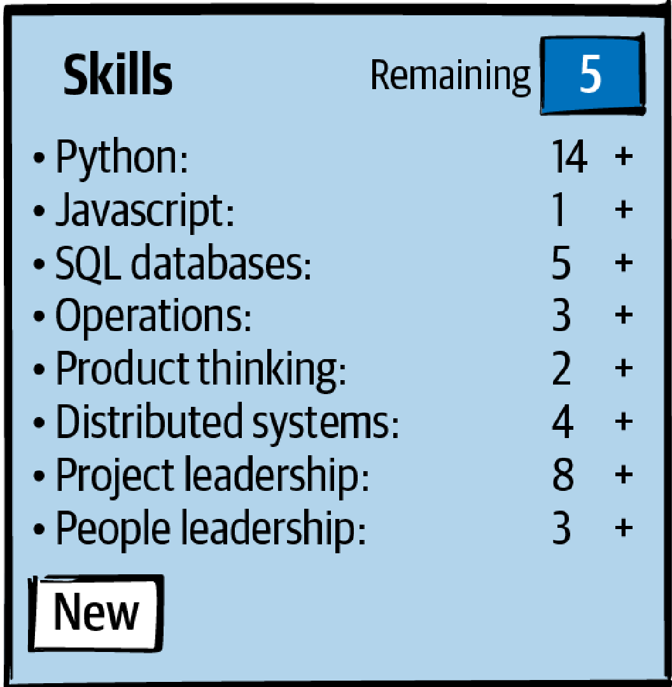

> 图 9-2：选择把今年的能力点数投在哪里。

我常听人说，你应该专注于自己擅长的事。
我不完全同意：你应该把点数投到你想擅长的事上，
这样你才能把这些技能建立起来。

技术世界里的一切都是可以学会的，前提是值得投入时间。也可能并不值得！
可学的技术领域和技能，比学习它们的时间要多，
所以你永远不可能在所有方面都是专家。
这没关系：强大的团队是由各自掌握一部分必要技能的人组成的。
但如果有些技能是你达成目标所必需的，
或者你的能力中有让你感到不安的缺口，
那就假定它们只是“未知”，而不是“不可知”。
你只是还没在那里投入能力点数而已。

话说回来，别把旅程搞得比它需要的更难。
如果你整天做的工作让你充满恐惧，
或者让你精疲力竭而不是兴奋，
那就去找一条通往目标的别的路。¹
Honeycomb 的 CTO Charity Majors 指出，
跟上我们这个快节奏的行业，意味着管理好自己的能量：
“如果你想在技术行业里拥有一段可持续的职业生涯，
你就得一辈子持续学习……
确保你 a) 了解自己、知道什么让你快乐，b) 把大部分时间花在与之一致的事情上。
做让你快乐的事会给你能量。
做消耗你的事则与你的成功背道而驰。”

练习那些你觉得困难的技能，也许会把它们变成优势，
并降低它们消耗的能量——也可能它们永远都是苦差事。
由你决定这项技能对你值多少。
我们每个人觉得容易的事情各不相同，
把点数投在哪里也由你自己决定。

> [!NOTE]
> **冒充者综合征**
>
> 刚进入这个行业的新毕业生会惊讶地发现，
> 他们仰慕的 staff engineer 中有多少人觉得自己是冒牌货。
> 取决于你走过的路，你可能会对某些方面感到不安，
> 比如技术战略、影响他人，或者系统设计。
> 有些做系统的人，对自己没写够那么多小时代码感到别扭。
> 有些做产品的工程师则怀疑，自己“本该”更擅长运维。
>
> 冒充者综合征是一种糟糕、让人不安的感觉：
> 它甚至会让你做出更差的工作，
> 因为你不敢承担经过计算的风险。
> 可以感到宽慰的是，这很常见，即便在这个层级也一样。
> 找机会把能力点数投到让你紧张的事情上，
> 向自己证明那不过是另一个可学、可知的话题。
> 但最重要的是：如果你正在“冒充”，
> 试着对自己宽容一点。没有人什么都懂。

#### 建立人脉

光有技能，很少足以把你带到想去的地方。你还需要人脉。
取决于你读到的是哪篇商业文章，
你会看到 70% 以上、甚至可能高达 85% 的工作岗位其实并没有公开招聘：
它们是通过人脉找到的。
当内部项目需要一位负责人时，
周围处于领导岗位的人之间会有一阵私下讨论，看看该推荐谁。
当会议需要演讲者，或者项目需要一位付费顾问时，
相关的人会去找他们认识的人。被人认识是有回报的。

认识人也有回报。
在各个角色上有人脉，能让你了解那些角色的人如何行事、
对他们来说“胜任”和“专业”是什么样子，以及他们如何沟通。²
拥有强大的人脉网络，意味着你总能找到专家去请教和学习。

CTO Yvette Pasqua 讲过如何以可持续的方式建立人脉，
而不用把所有内向者的能量都烧光。
她说，社交这件事对你来说不是天性、让你不自在，都没关系：
“如果你不知道该跟谁聊、不知道从何开始，
一个小秘密是：我们谁都不知道。”
Pasqua 会主动联系她想聊的人，
邀请他们聊一个她认为对方也会感兴趣的具体话题。
她建议加入各种团体和社区——但只加入那些能给你能量的——
并且在活动中和人一对一地交流。

最后这一条对内向者和社交上笨拙的人来说可能极为煎熬，
但你可以学会一大堆机械的技巧，让它变得可以接受。
我很喜欢作家、“从笨拙中康复的人” Vanessa Van Edwards 的
Science of People 网站，
在那上面可以学到一些别人似乎天生就会的“做人”魔法。
比如看看她那篇 “How to Network”，
里面有在活动中与人交谈的技巧：
该站在哪里、怎么记住别人的名字、该聊些什么。
这些东西全都是可以学会的。³

#### 建立可见度

如果你有技能，但没人知道，那就不会有人邀请你去用这些技能。
让人们看到你在解决问题、提出有洞察力的问题，
或者在混乱之中带着清晰的战略出现，
那么当机会出现时，他们就更可能想到你。
你还会遇到有趣的人：他们更可能主动联系你，
因为他们看到你在做的事与你们双方都相关。

你也可以选择在外部建立声誉，
通过开源贡献、行业工作组、文章、播客、视频、会议演讲等等让自己出名。
这类投入通常是可选的，
但如果你在找角色或人脉，它们会非常有帮助，
而且它们也是你在整个行业里施加正面影响的方式。
有些雇主鼓励员工对外贡献，
要么是为了招聘，要么是为了让更多人注意到公司的产品或服务。
如果你走这条路，要预期“公众人物”这个身份需要投入——
这正是你要花能力点数的地方之一。

有人给你机会，不代表你就必须接，
但如果你真的拿到了想要的机会，别浪费它：展示你能做什么。
比如，如果你的会议提案被接受了，
就不要拿一份在飞机上临时拼凑的演讲去讲。⁴
如果你加入了一个开源社区，不要一上来就找人吵架。
让人们看到你优雅而从容地做事——让你的胜任力被看见。

#### 有意识地选择角色和项目

建立技能、可见度和人脉最省时间的办法，就是把它作为工作的一部分。
你在什么事情上花时间，就会在什么事情上变强。
事实上，你很容易*意外地*获得一项专长，
只因为那正是你在工作中做的事：
一次经历引出下一次，然后不知不觉你就有了一个专业方向。
比如，花五年时间写存储系统，你就会擅长写存储系统：
你会有相关的技能，会和其他存储专家共事，
简历上也会有与存储相关的经历。
前同事要招一名存储专家时，他们会想到你。
同样这五年花在一款流行的移动应用上，
你建立起来的会是一套完全不同的资历。人很容易被定型。

所以，去选择那些能给你想要的经历的角色。
有些东西你只能在大公司学到，有些只能在小公司学到。
有些事情作为 manager 会更容易，另一些则只有真正动手才做得到。
如果你不确定自己需要什么，
就去找一个正在做你想要的角色、或者过着你想要的生活方式的人，
问他们是哪些关键经历把他们带到了今天这一步。
（你有时也可以在 LinkedIn 上偷偷看他们的简历，
但现实中的对话能告诉你更多。）

你在什么事情上花时间，就会在什么事情上变强，
所以要有意识地选择那些能给你想要技能的角色和项目。
Mason Jones 从 1995 年在 Travelocity 起步，
之后在 10 多家初创公司做过工程领导者，他对此表示同意：
“持续而有意识地选择那些能让我拓展知识、开阔经验的岗位，
是我整个职业生涯中做过的最有价值的一件事。”

## 你当前的角色

每一份工作都应该帮你朝长期目标成长，同时满足你的当下需求。
遗憾的是，人们常常会落到两者都做不到的岗位上。
本节的开始，我们先看你现在的这份工作对你好不好，
然后再评估它有没有可能符合你的愿望清单。

### 需要留意的五项指标

你当前的角色是在让你更接近目标吗？还是在做相反的事？
经验丰富的工程 director Cate Huston 提出了五项评估工作健康度的指标：

- 你是否在学习
- 你是在积累可迁移的技能，还是在应对组织功能障碍
- 你对招募别人加入自己的团队感觉如何
- 你有多自信
- 你的压力有多大

好的工作处境会让你持续朝目标成长，
你的自信和能力也会保持在较高的水平。
糟糕的工作处境——停滞、和霸凌者共事、缺乏支持、
不可能完成的截止日期，或者别的困难——
可能会恶化得足够慢，
以至于你早已越过本该转身离开的点，自己却没察觉。
我见过身处不健康工作环境的朋友，
变得坚信自己没有技能在别处找到工作。
结果他们留在那些让自己停滞的岗位上，
而技能不足就变成了自我实现的预言。
正如 Huston 说的：
“有时候五年的经验，不过是同一年的经验重复了五遍。”唉。

在另一篇文章里，Huston 解释说，
雇主买下的是你的时间，但他们只是租用了你的“品牌”。
好吧，对很多工程师来说，“个人品牌”这个概念会让人觉得别扭又做作，
但请想得比那些头发昂贵、字体昂贵的精致人士更远一些：
你的品牌就是别人对你的看法。
Huston 说，如果你的工作让你越来越难被雇用，
“我希望你的雇主付的租金足够多——
因为他们正在毁掉你的市场价值。
有时候这可能是值得的，但往往并不值得，
而人们意识到这一点时已经太晚了。”

我们都有好的一周和糟的一周，
所以我推荐给朋友的一个做法是：
把这几项指标跟踪几个月（见表 9-1），
看看随着时间推移趋势如何。

> 表 9-1：跟踪 Cate Huston 在 “5 signs it's time to quit your job”
> 一文中描述的工作健康信号。

| **信号** | 你在学习吗？你在成长吗？ | 你是在积累可迁移的技能，还是只是在学着应对组织的功能障碍？ | 你对招募朋友加入自己的公司感觉如何？ | 你的自信程度如何，你觉得自己有多能干？ | 你的工作对你的身体有好处吗？ |
| --- | --- | --- | --- | --- | --- |
| **刻度** | 0：停滞；5：火箭般增长 | 0：在学习如何应付这个组织；5：在学习可迁移的技能 | 0：道德上感到矛盾；5：极其热情 | 0：自信正在被侵蚀；5：自信在增长 | 0：压力 压力 压力；5：感觉健康 |
| <日期> | | | | | |
| <日期> | | | | | |
| ... | | | | | |

跟踪指标能让你不受近因偏差的影响，从更长的时间跨度上看更大的图景。
如果你回头看，发现大部分时候都还不错，
就不太会因为一个糟糕的月份而愤然辞职。
但如果你注意到自己*总是*有糟糕的月份，
或者指标随时间越来越差，
那就要意识到你可能处在一个对你不利的环境里。
想想 **Captain Awkward 的 Sheelzebub 原则**，
这是你在糟糕的关系里该问自己的一个问题：
“如果事情就一直保持现在的样子，你还会留下来吗：
再过一个月？再过 6 个月？再过一年？再过 5 年？还要多久？”

### 你能从角色中得到你想要的东西吗？

你的工作正在把你推向长期目标吗？它所在的环境健康吗？
花点时间过一遍你的优先级清单，
评估你的工作满足这些需求的程度（见图 9-3）。
既要看到缺了什么，也要记得欣赏已经很好的地方。
好的东西很容易被当作理所当然。

> 图 9-3：评估你的角色，看看哪些地方运转良好、哪些地方你希望有所不同。

无论你的工作有多好，你几乎肯定不会得出“它完美无缺”的结论！
你很少能找到一个在优先级清单上*每一项*都最好的角色。
赚最多的钱，往往和做对世界有益的事相冲突。
学到最多，可能意味着不接最有声望的角色。
重大的职业成就，可能意味着没有时间和精力留给生活的其他方面。
这就是为什么没有别人能替你做出职业决定：
我们每个人做出的 trade-off 都不同。
但要看看哪些地方不理想，
想想有没有可能在不牺牲别处太多的前提下改变它

### 你应该换工作吗？

如果你想修复某个不起作用的地方，你有两个选择：
改造现有的工作，或者换一份新工作。
我们来看看支持每一种选择的一些理由。

#### 留在同一个角色或公司的理由

如果你当前的角色给了你大部分你需要的东西，也在带你去想去的地方，
那么长期做同一件事可能会很有收获。
staff engineering 受益于你在同一个地方长期积累的资历、领域知识和关系。
以下是长期待在一个地方的其他一些好处：

##### 反馈回路

在一个地方待得更久，你就能获得看到自己行动后果的反馈回路。
当工程师频繁流动时，每个人看到的都是别人过去决策的结果，
而不是自己决策的结果。
你可能还会看到自己提升过的同事成长为 senior 或 staff engineer，
然后他们自己又成为榜样。

##### 深度

你对单一领域或单一技术栈了解得越多，理解就会越深入、越细致。
要把某样东西理解到能凭直觉在上面继续构建的程度，是需要时间的。
做以前做过的事也更快；你能更快取得进展。

##### 关系

你在整个组织里投入时间去认识人，也有你信任、并且喜欢共事的人。
你们积累起的相互善意已经足够多，
以至于哪怕最大的技术分歧也能保持同事式的友好，而不是剑拔弩张。
这是一项需要时间才能重新建立起来的资产。

##### 上下文

在投入时间和精力学会如何在你的组织里穿行之后，
你拥有的这套技能未必能迁移到另一个组织。
你搞懂了 OKR 流程，熟悉隐形的组织结构图，
也知道事情该怎么办成。

##### 熟悉度

你了解工作、了解时间安排，也了解周围的人。
如果你要过某些宗教节日，每天下午要去学校接孩子，
或者每周四午餐时间都要打 bocce，
你已经把日程安排成能容纳这些事的样子。
它就是这么顺畅，你也不愿改变什么。

#### 离开的理由

但也有一些很好的理由，让你可能想隔一段时间就动一动：

##### 就业能力

如果你在一个地方待得非常久，
你学到的可能是如何在那套文化里工作，而不是可迁移的技能。
外面的世界可能发生变化，而你可能会被落下。
让更多技能和领域保持鲜活，能为你留住更多扇门。

##### 经历

任何一个地方能提供的经历都是有限的，
可以向其学习的人也是有限的。
一旦你把能收集的都收集完了，你可能就该迎接新东西了。

##### 成长

有时候通过换工作，更容易在级别或职责范围上更进一步。
也许下一个级别感觉遥不可及、不现实，
或者涉及你根本不感兴趣的那种办公室政治或工作。
如果你所在的地方，你很难进入那些重要、有挑战性或受人关注的项目名单，
那么找一份新工作可能比拿到你期望的晋升更容易。

##### 钱

换工作可能是涨薪的快速通道。
虽然有些公司会让现有员工跟上市场水平，
但新员工往往能谈到更好的薪水、股票授予和入职奖金。

##### 不匹配

并不是所有成长路径在每家公司都存在。
如果你想成为某个话题的行业专家，
而你的组织并不真的需要这样一位专家；
如果你觉得充满干劲的项目不是领导层想投资的项目；
或者资深的人比领导机会还多——那可能就是该离开的时候了。
不是所有角色在所有地方都有。

正确的下一步取决于你需要什么。
在下一节里，我们会看从此处出发的一些路径，
有些是留在原地，另一些是换角色或换公司。

## 从此处出发的路径

从此处出发，你要去哪里？我们来看看你手上选项的样本：

### 继续做你正在做的事

如果你的工作给了你需要的，就什么都不用改。
我想强调这一点，因为我们的行业非常强调频繁换工作，
定期出现的“新工作”公告会让你觉得自己也该动一动。
如果你处在一个正在成长的细分领域，
你可能可以留在同一个团队，
仍然有几十年的学习和成长空间。
又或者你根本不想再成长：
你可能只想用现有的技能，一直做着大致相同的工作直到退休。

如果你是第二种人，就要稍微警惕行业变化让你的技能过时。
技术和你的业务都会变化，
就连领导技能，如果你不保持更新，也会慢慢变得过时。
社会规范、沟通风格、最佳实践……全都会变。
所以留在原地，大概也意味着要动一动、学一点，刚好够跟上时代。

### 朝着晋升努力

留在同一个角色，往往也能通向下一级。
随着你的影响力、知识和成果不断扩大，
你和你的 manager 可能都会开始觉得，是时候让你晋升了。

往更高级别发展可能收入更高，
也能给你带来伴随更资深的职位名称而来的可信度；
正如我在第 1 章说的，
这让你不必再花时间和精力去证明自己该出现在某些对话里。
而且老实说，被晋升或者被给到一个更大的职位，就是*感觉*很好。
但请拆解一下这种感觉：你真正在意的真的是级别吗，
还是你其实想要的是钱、声望、有趣的挑战、更大的范围、尊重、
进入“那个房间”、一种在进步的感觉，或者是完全不同的东西？
想要这些东西都没问题，
但要确保下一级别真的会给你想要的，
否则你可能很快就对新头衔感到大失所望。

要搞清楚在你公司晋升意味着什么：
是由你的 director 决定谁被晋升吗？有没有一个晋升委员会来评审你的工作？
可能有一份写下来的职级阶梯，里面写着下一级的期望，
但这些期望往往对“真正被期待什么”语焉不详。
也可能对能晋升多少人、或者某个角色能有多少人有名额限制：
除非恰好有一个合适规模的范围或项目需要领导，
否则你可能根本晋升不了。

如果你在争取晋升，就和你的 manager 谈谈，请他们指点。
去和下一级别的人建立联系，了解他们当时走的是什么路。
如果对方已经在这个角色上待了好几年，
寻找可供追随的脚印可能会让人望而生畏。
记住，你要看齐的是他们获得晋升时的成果，
而不是他们现在的位置。

### 少工作一些

成功也可能意味着在当前角色上少工作一些。
我聊过的一位工程师 Jens Rantil，
用 staff engineering 的角色换来了
一家小得多的公司的 80% 工时和 20% 的降薪。
如他所说，“每个周四都是周五！太棒了！”
Rantil 观察到，转向 80% 工时，
是很多人第一次给自己的空闲时间标上价格，
并决定多拥有一些空闲时间值多少钱。
（记住，降薪影响的不只是眼前的薪水：
它很可能也会影响退休储蓄。）
虽然 80% 是最常见的工时调整，
但我见过工程师安排成 60%、40% 甚至 20% 的工时；
有些雇主可能乐意每周只留你一天来用你的技能。

如果你要减少工时，要有意识地想清楚这些时间是从哪里省出来的。
最容易的做法可能是砍掉你的专注时间，只去开会，
但那可能不是让你开心的选择，
也可能意味着你达不成 manager 想要的结果。
或者你会发现，为了能做完工作中有趣的那部分，
你最后反而多做了无偿的加班：
如果你在每周五天的时候都没能避免加班，
那就得真的想清楚，你凭什么认为自己能坚持只工作四天。

一定要让你的期望和你的 manager、团队的期望对齐。
如果你仍然想朝晋升努力，
或者希望能被考虑去领导有趣的项目，一定要让 manager 知道。
对具体情况的处理方式事先达成一致，
比如 on-call、假期周，
或者你在某一天生病请假的那种周。
提醒一句：很多团队不会乐意你的时间变少；
从人力编制的角度看，团队的工程师人数就是这么多，
如果你工时减少，他们不会另外找人补上缺口。
但你也许能在更短的时间里完成很多事。
我聊过的一位说，自从开始每天工作五小时后，
他们完成的事情并没有少多少——
反正他们每天能高效工作的时间本来也只有四小时。

### 换团队

如果你准备好改变了，但对现在的雇主还挺满意，
那么内部转岗可能是个很好的选择。
你会保留相当一部分上下文、关系、可信度和社会资本，
同时又能在新事情上从头开始。
Hilti 的软件架构负责人 Burin Asavesna 告诉我，
他把这种重启看成一位老练的玩家在游戏里新开一个低级角色：
严格来说你是从零开始，
但实际上你已经知道游戏怎么玩，会飞速升级。

在团队或组织之间流动，是架桥的绝佳方式：
你在原来的团队里仍然有人脉，
又把知识和文化带到新团队。
你还会带来视角：
你本来就对这个团队以及组织其他部分如何看待它，有一个外部的看法。

### 建立一门新专长

技术世界的广度意味着总有新东西可学。
你可能会喜欢学习与已有知识非常邻近的东西，
为你的知识增加一个新的维度，
或者开始把大量能力点数投到一件全新的事情上。
你甚至可能意外地建立起一个新的专业方向。
很多最有趣的创新都来自那些在不止一个领域都很自如的人：
有趣的事情发生在边界上！

建立一门新专长可能不只是换团队，
还可能意味着转到另一条职业轨道，可能是暂时的，也可能是永久的。
前 principal engineer Lou Bichard 写过，
他从“有产品思维的工程师”正式转成了产品经理。
如他所说：“抽一点时间去做些不太一样的事，
也许能帮你把一些新的视角带进自己的工作。”

### 探索

有些公司会允许你接短期项目、嵌入某个团队、
参加轮岗项目，或者只是在一段时间里试一个新团队。
一位在巨型公司工作的 staff software engineer 告诉我，
她在同一个团队待了六年之后做了这种探索。
她的公司机会很多，包括轮岗项目，
所以她决定花些时间去探索外面有什么。
两年里，她试了三个团队：
一个规模较大的站点可靠性团队，做的是成熟的基础设施；
一个小型研究团队，做的是刚发布不久的产品；
还有一个中等规模的团队，和一个非营利组织合作开发一款新的开源产品。
在经历了这些差异巨大的体验之后，
她清楚地感到研究团队与她的兴趣最匹配，也有大量的成长机会，
于是她在那里待了最近一年半。

### 走上管理岗位

你感到管理岗位在向你招手吗？
有些 staff engineer 完全转到管理轨道，并在那里继续成长。
另一些则在管理岗上待一段时间，然后回到 IC 角色。

在一篇著名的文章里，Charity Majors 提出了她所称的工程师/manager 钟摆，
也就是有意识地每隔几年在 manager 和 IC 角色之间来回摆动。
Majors 反对那种“你必须选定一条道然后一直待在那里”的观点：

> 世界上最优秀的一线工程 manager，是那些离开动手实践从不超过 2-3 年、
> 依然全职泡在战壕里的人。
> 最优秀的个人贡献者，是那些在管理岗位上待过的人。
> 而世界上最优秀的技术领导者，常常是两者都做的人。来回摆动。像钟摆一样。

Majors 强调，管理绝不该被看作晋升——
它是换了一个职业，需要学一套不同的技能。
当你从人员领导转向技术领导（或反过来）时，地位不应该有任何变化：
两者各自建立一套技能，也会增强另一侧的技能。
但她不建议试图同时做这两件事：
“你一次只能真正在其中一件事上变得更好：工程，或者管理。”

Will Larson 认为，只要你已经作为团队 manager 和技术贡献者
积累起了扎实的经验，
工程师/manager 的混合角色并不*总是*糟糕的选择。
但他也同意，
如果你是想在工作中学习其中任何一套技能，那你会很吃力：
“如果你已经积累了作为团队 manager 和技术贡献者的经验，
那么只要它最符合你的职业规划，当然可以试一试，
但我一直建议不要让人在这样的角色上开始自己的管理生涯。”

如果你要进入这种混合角色，要有一个让它可持续的计划，
比如有一批其他资深的人，
在需要的时候可以把事情委托给他们，或者依靠他们。

### 第一次带直接下属

如果你以前没做过人员管理呢？
如果你从来没有当过 manager，也没有直接下属，
在职业生涯较晚的时候第一次担任管理角色，可能会让人心里发怵。
但以下三个理由说明，你可能已经准备好带第一批直接下属了：

- 如果未来的目标需要你有管理经验，那你终究要开始积累这套技能。
- 如果你所在的公司或团队里，
  只有走管理路线的人才能参与决策、获得上下文，
  你可能会认为走管理路线能让你更有杠杆去把项目做成。
- 或者，如果你已经到了自己职级阶梯的顶端，
  对上一级的业务问题感兴趣（又说服不了组织再加一级），
  那么带一个团队可能是你成长的下一个台阶。

有些公司有“带下属的 staff engineer”这种概念，有些公司没有。
承担下属职责可能需要你换一条轨道。

如果你习惯于以 senior manager、director 或 VP 的层级做 IC，
你可能会忍不住主张，你应该管理同样范围的一个组织。
Google 安全方向的工程 director、
曾经也是带下属的 staff engineer 的 Amanda Walker 建议不要这样做；
她建议你先做一段时间的 line manager，再去承担更高级别的组织角色：
“正如做过 software engineer 能让我更好地管理 software engineer，
做过 line manager 也能让我更好地管理其他 manager。
教练一项你打得很好的运动，总是更容易。”

不过，如果你已经习惯于在整个组织的范围上工作，
回去为单个功能团队管理 sprint 可能并不诱人。
一个可能的折中是：
寻找机会在一个跨团队项目里担任 tech lead 或 team lead，
只对那个团队里少数几个人承担管理责任。

你作为 manager 呈现出来的样子，会影响下属的生活，
所以如果你要当 manager，就要认真投入。

Majors 说，你最短的任期应该是两年：

> 如果你真的想试试做 manager，而机会又摆在面前，那就去做！
> 但前提是你准备好全身心投入一场为期两年的实验……
> 学会管理技能、并让大脑真正喜欢上它，需要不止一年。
> 如果你对两年的承诺还在犹豫，也许现在还不是时候。
> manager 换得太频繁会扰乱团队，
> 让他们向一个宁愿做别的事、或者不肯拼尽全力的人汇报，也不公平。

承诺走上管理，就意味着接受这需要时间。
要预期自己写代码、做架构或做技术工作的量远比原来少——
也要明白你可能一点都做不上。
在 *The Manager's Path* 中，Camille Fournier 写道：
“怀念更简单的时光、对正在放弃的东西有点害怕，都是正常的。
但你不可能一下子什么都做。
成为一位了不起的 manager，要求你专注于管理的技能，
而这又要求你放弃一部分技术上的专注。”

Majors 也同意：“如果你是 manager，你的工作就是变得更擅长管理。
不要试图抱住过去的荣光不放。”

### 找到或创造你自己的细分领域

资深领导岗位往往有具体的需求。
即便在同一家公司，一个 staff engineer 的空缺需要的是架构能力强的人；
另一个想要的是擅长跨组织协作的、老练的项目领导者；
第三个则在寻找额外的领导力带宽。
你越资深，越可能是在寻找一个需要*你这些特定技能*的角色，
而不是把自己塑造成适合某个通用角色的样子。

Molly Graham（就是我在上一章提到的“把你的乐高送出去”那篇文章的作者！）
说职业生涯分两个阶段：先弄清自己的优势是什么，
然后去找“形状像你”的空缺。
Graham 说：“幸福感会来自找到那些
落在你热爱做的事和你很擅长做的事的交集中的角色。”不过她补充道：

> 要小心那种听起来完全为你量身定做、
> 但一想到真的去做就让你觉得精疲力竭的角色。
> 如果这份工作还很“光鲜”——你的朋友和家人都觉得它很酷——就要加倍小心，
> 因为这时你的自尊心会掺和进来，让你接下它，
> 哪怕你的直觉说，你在那份工作上的大部分日子都会过得很痛苦。
> 那个维恩图——你极其擅长但讨厌做的事——
> 是会导致职业失误的一类。⁵

找到适合你的角色的一个办法，是你自己把它雕琢出来。
如果你得到这样的机会，
你就能同时填补组织的一个缺口、并创造一份你热爱的工作。
当 Keavy McMinn 在当时的公司准备做出改变时，
她觉得和 manager 开诚布公地谈自己的目标是种解放：
“这是我擅长、也真正想做的事。我怎样能对你和公司最有价值？”
他们一起打造出了一个互惠的新角色：
Stripe 的 CPO 技术顾问。

McMinn 说，她能创造自己的角色，
是因为她处在一个有特权的位置，
并且对提出做点不一样的事所冒的风险感到自在。
这条路不是每个人都能走。
不过她说，这其实出人意料地常见：
“知道*确实有人这么做*，也许对你有帮助！
允许自己去探索创造一个新角色的想法，
和那些能支持你一起做的人一起想。
这条路真的没有别人能替你走、也不会替你去谈。
甚至可以把它当成一次实验——这样能减轻一些压力！”

我还得到过一条很棒的建议，来自 Confidantist 的领导力教练
Fabianna Tassini：
如果你有机会设计自己的角色，
就应该把你热爱做的事大量包含进去。
让你有能量的工作应该占你工作的 70% 左右。
另外 30% 应该是你想练习、想做得更好的事。
（当然，公司得真的需要你所创造的这个角色；
你可能需要做出妥协，找到既适合你、也适合雇主的东西。）

### 换个雇主做同样的工作

在一个新的工作场所起步，能给你一个完全不同的视角，
也能填补你经历上的空白。
取决于你在寻找什么样的经历，
你可能选择不同规模、技术栈、领域或文化的组织。
如果可能的话，尽量不要“反弹式跳槽”。
Molly Graham 写道：
“有时候你在做一份工作时——尤其是在你不开心或精疲力竭的时候——
会倾向于挑一份'反弹式工作'。
就像反弹式恋爱一样，
反弹式工作只是帮你离开当前的处境，
但它往往不是最好、最健康的长期选择。”
她还说，“选择当前让你痛苦的东西的反面，
并不会带来幸福，它只是帮你摆脱糟糕的处境。”

如果有得选，就慢慢挑你的新角色，弄清楚你真正在找的是什么。
不要一见到第一封“勉强还行”的猎头邮件就扑上去。你值得更好的。

由于 staff+ 角色在不同地方的含义仍然千差万别，
要和未来的雇主明确地谈一谈：
在他们那里这意味着什么，你的工作会是什么。
正如 staff engineer Amy Unger 所写，
“很可能每一家公司、甚至每一位和你谈过的 manager，
都对他们要招的技能组合有自己的假设，却又说不清楚。”多问问题。

staff+ 的面试流程远没有标准化：
你可能会被问到编程谜题、系统设计、过去的项目、
在各类领导情境下你会怎么做，或者“请讲一次你……的经历”。
很多组织会提前告诉你面试流程安排。
如果不告诉，也可以问招聘人员该期待什么，好确保自己做好准备。
把你被问到的问题当作一个线索，看看新公司如何看待这个角色；
也记住，你同时也在面试你的面试官。

### 换雇主并升一级

换公司可以是重塑自己的机会。
它也能让你找到在你当前所在之处根本不存在的角色。
如果你在当前的职级阶梯上、在晋升流程中很难证明自己，
那么去别处面试下一个级别有时会更容易。
如果你的公司增长太慢，不需要更多资深领导者，
或者在有人离职之前容不下另一位 principal engineer 或 senior manager，
那么有时候离开反而能找到更多机会。

换公司同时升一级，通常在你已经是新公司所在领域的专家时会更容易。
如果你说你想在下一个级别上工作，
*同时*还要学习比如医疗健康或建筑行业，那就比较难说服别人。

如果你在看一个更高级别的角色，
要小心确认业界真的把它当作一次提升。
*levels.fyi* 网站可以帮你校准不同公司在不同头衔上的含义。

### 换雇主并降一级

有时候你会走一条在某些方面看起来是退后的路：
范围更小、钱更少、头衔没那么光鲜，或者是一个你还是新手的角色。
如果你只从每一样东西都在变好或变多的角度去想自己的路径，
你就会限制自己的选项。
尤其是，去一家更大的公司往往伴随着更高的期望和相应的降级。
降一级常常可以在不减少报酬的情况下做到，
而且它能让你夯实技术基础，或者多做一些你喜欢的那类工作。
现在在 Datadog 做 senior engineer 的 Josh Kaderlan 告诉我，
他为什么能坦然放弃在上一家公司拥有的 staff 头衔：
“如果你把头衔当成换工作的门槛条件，你的机会就会越来越少。
身处这个新环境让我很有收获，
尤其因为我不再总是每场对话里最资深的那个人，
而且我有机会向比我经验更多、更不同的人学习。”

另一位工程师 Stacey Gammon 告诉我，
她把自己的职业看成类似工程师/manager 钟摆，
只是在技术领导和动手写代码的角色之间摆动。
我们交谈时，她正要离开一家上市公司里一个偏领导的 principal engineer 角色，
并在权衡另外几家公司提供的、要“小”得多的角色，
那些角色能让她有更多时间写代码。

### 创办自己的初创公司

如果你真的想改变，而且想自己当老板，
你可能会考虑创办自己公司的挑战。
曾在 Spotify 做 staff machine learning engineer 的 James Kirk 告诉我，
他离开原来的角色，作为 CTO 联合创办了一家初创公司。他说：
“我有兴趣自己做点什么，因为它看起来既有挑战又有回报，
这种痒会一年年加重，直到你去挠它。
两年前我开始和当地一些 VC 及他们的社群建立联系，
并通过他们认识了现在我的联合创始人。
我们开始来回抛想法，
最终找到了一些让我们非常兴奋的东西，
于是我们拿了 VC 的钱，辞掉日常工作，认真地干了起来。”

如果你正准备创办自己的生意，
那这可能是个先在一段时间里关注报酬的好理由：
你是在攒一张现金安全网，好让自己有一段没什么收入的时间。
Kirk 补充说：“说实话，如果我在离职前没有攒下几年不错的科技行业收入，
我不觉得自己能安心承担这个风险。”

### 独立工作

为自己工作的另一种版本是独立工作：
通过咨询、承接外包、独立应用开发、培训，或者其他兼职工作。

软件顾问、多本编程书的作者 Emily Bache 说，
独立工作真正的好处是自由：
“我对如何度过每一天有很大的掌控权，
我有很多时间阅读、学习，并分享自己的想法。
我能去有趣的地方，遇见有趣的人，解决有趣的编程问题。”

Bache 强调，独立工作需要有一个此前就很强的人脉网络，
这样潜在的合作伙伴和客户会知道你能做什么，并主动找你。
让自己的公开形象保持更新也有帮助：
“营销是持续不断的——
我的目标是每年在大约 10 个会议和本地活动上演讲，同时发表文章。
我也投入时间在社交媒体上发帖——Twitter 和 LinkedIn——
好让人们能通过这些渠道找到我。”

咨询并不适合所有人。一位顾问 Vlad Ionescu 警告说：
“即便对想在职业中期到后期才开始做这行的人来说，
这也是一个很大的转变（需要不同的技能、要自己找客户等等），
而且它并不像很多人以为的那样光鲜
（通常比一份稳定的 FAANG 工作钱更少、压力更大等等）。
很多人喜欢它、也适合它，
但也有很多满怀憧憬的工程师被烧得很惨。”

所以要弄清楚你要进入的是什么。
确保你看清了这些 trade-off，并接受它们。
和创办初创公司一样，你可以靠先攒一张现金安全网来降低风险。

最后，记住独立工作意味着你会失去
很多你在其他角色里可能习以为常的支持结构。
离开 Box 的 staff engineering 角色、
成为全职独立应用开发者的 Chris Vasselli 建议：
“在公司里的时候，尽可能多地向不同团队和专家学习。
前端、后端、桌面、移动、设计、安全、QA、本地化、构建与发布，
甚至（尤其是！）市场、增长和商务拓展。
当你是独立开发者时，这些全都由你负责。”
要做好身兼多职的准备。

### 转换职业

在技术岗位待了很多年之后，有些人会感到被拉向别的事情。
那可能是转行去做教育、学术、政策或研究，
把你的技术经验和背景带去解决另一种问题。

我最喜欢的一个转向新方向的例子是 Peter Lyons：
他离开了在 Intuit 的 staff engineer 角色，
和伴侣、厨师 Christella Kay 一起，
在 Adirondack 山区为程序员办了一处静修场所。
现在他翻的是煎饼，而不是代码。
他说 COVID-19 期间的隔离帮他认清了对什么重要：
“它促使我们做出重大改变，彻底翻转我们的生活方式，
好让我们每天都能一起做我们深切在意的事。”

## 准备好重启

如果你真的换了工作，要做好重新当新手的准备。
你在第 2 章画的所有地图现在都过时了！
即便你是在同一个组织里换个新角色，
你也很可能从不同的位置、不同的上下文重新开始。
你需要重新建立全局视角，画一张新的定位地图。
你需要了解地形、文化和政治，画一张新的地形图。
你还需要一张新的藏宝图，帮你理解自己要往哪里去。

作家、分布式系统工程师 Cindy Sridharan 警告说，
不要试图用上一份工作的规则来做新工作。

> 并非所有新入职的资深领导者都完全愿意、
> 或能自在地把自己变成组织真正需要的那种领导者，
> 而不是他们过去这些年成长为的那种领导者。
> 许多领导者采取的是相反的做法：
> 试图按照自己的样子，或者过去工作场所的样子来塑造这个组织。
> 在我看来，被引入到陷入困境的组织中、
> 负责稳住混乱局面的工程领导者，往往受到很强的激励去这么做。
> 而这些人往往比那些努力摸清组织门道、
> 调整自己的领导风格以适应组织文化的人失败得更惨、也更频繁。

所以不要一头扎进你的新角色。
花时间去和尽可能多的人交谈。
搞清楚怎么建立联系、怎么获取信息、怎么出现在正确的房间里。
了解隐形的组织结构图。
解决一些问题，
但要谦虚，假定之前的技术决策都有其正当理由——一切都有 trade-off。
搞清楚如何提升你周围的工程师。

理解什么才是重要的。
在日历被会议填满之前，
先享受一段相对平缓的时间曲线。

## 你的选择很重要

我们现在到这本书的结尾了！
关于如何选择你的路径，我还有最后一件事要说。
它其实不关乎你的职业，而是关乎你作为行业里资深之人的职责：

你需要认真对待软件。

做软件可以很有趣。
这里通常有创造和一点玩心的空间，我们大多数人也不用穿西装上班。
但软件对每个人的生活都有巨大的影响。
当一个应用崩溃、丢掉了某人写到一半的文章，
或者糟糕的输入校验丢掉了某人的医保理赔，
我们就是在浪费别人的时间，给他们带来焦虑和压力。
AI 和算法偏见的风险已有充分记录。
社交网络上的霸凌、隐私信息泄露，
以及刻意让人上瘾的应用，毁掉的是人们的生活。
我们的选择可能意味着真实的人受到伤害。

软件被用于性命攸关的系统，而这会一年比一年更常见。
你今天提升起来的工程师，
将来可能要负责飞机、医疗方案，或者核电站。
我们需要教给新工程师勤勉与谨慎的价值观，
那是另一些性命攸关的工程学科的标志。
加拿大工程师以佩戴一枚多面体戒指而闻名，
那枚戒指提醒他们记住自己职业的义务与伦理。
作为一个行业，我们需要有同样的心态。

在一个 software engineer 四五年后就被视为资深的时代，
我们可能会忘记还有很多东西要学。
在一个许多工程师每两三年就换地方的时代，
我们可能被激励着为当下（以及当下的利润和当下的晋升）而构建，
而不是为长远而构建。
今天的大学生和青少年要应付的事情已经够多了：
不要再把粗制滥造的系统和技术债丢给他们。

你可以认真对待这份工作，同时也*真的*享受它！
这里有大量创造和好玩的空间。
但在评估风险时要拿出你良好的判断力。
要了解你的软件会被如何使用。
在什么可协商、什么不可协商上要立场坚定。
你的影响力比你想象的大，你做出的选择很重要。
资深的人怎么做，就为这个行业定下了文化。

做出好的软件。建设好的软件职业。建设好的软件行业。感谢阅读。<3

## 回顾

- 你要为自己的职业和选择负责。
  可以优化的方向有很多。要清楚什么对你重要，并且有意识地去选。
- 技能、可见度、关系和经历，会提升你获得机会的能力。
- 只要值得投入时间，一切都是可以学会的。
- 偶尔和自己对一下账，确认你的角色仍然在给你需要的东西。
  既要看哪里好，也要看哪里不管用。
- 长期待在一家雇主这里有充分的理由，不断流动也有充分的理由。
  无论哪种，从此处出发你都有好几条路径可选。
- 软件对地球上几乎每个人的生活和生计都有巨大影响。
  要严肃对待这份责任。

> ¹ 我很喜欢 Dina Levitan 的故事：她意识到自己并不是不擅长掷斧头，
> 她只是用了一种不适合她投掷风格的那种斧头。如她所说，
> “我们都能学会命中目标……但重要的是选对斧头。”

> ² 这也是为什么代表性如此重要。

> ³ 你在会议上聊过的那种“自信”的人里，有一半是在用软件跑这场互动，
> 同时祈祷自己“社交”得还算正确。我，呃，是听说的。

> ⁴ 如果你是那极少数能随手拼出几页幻灯片、踱上舞台、
> 来一场未经排练却赢得全场起立鼓掌的演讲的人之一，我说的不是你。
> 继续施展你的魔法吧。把你的秘诀告诉我。

> ⁵ Graham 补充说：“我发现，真正了解你的人，
> 总是会为你找到那些'形状像你'的第二阶段角色。
> 而不了解你的人，总是会拿你刚做过的那份工作来给你。”
> 我的经历也完全是这样。

# 索引

## A

能力点, 积累技能

积极倾听, 积极倾听

Adams, Douglas, 发生了什么？

建议, 建议-成为催化剂

面向群体的建议, 把建议规模化到群体

面向个人的建议, 面向个人的建议-同行评审

教学与建议的对比, 教学

未经请求的建议, 建议

Agile Alliance 关于“完成”的定义, 定义“完成”

Allspaw, John, 承担责任, 培养未来的领导者

American Society of Civil Engineers, 积累经验

回答问题, 回答问题

原型式职位定义, 这些原型里有适合你的吗？

The Art of Travel (de Botton), 澄清

Asavesna, Burin, 换团队

异步教学, 把教学规模化到群体

Atawodi, Ebi, 客户需求

工作的自主性, 你的目标是自主开展工作

组织文化, 自上而下还是自下而上？

“Avoid the Lake!” (Krishnan), 驾驭项目

Ayer, Elizabeth, 承担责任

## B

Bache, Emily, 独立工作

Barnes, Mark, 打磨你的故事

Batra, Neha, 指导

重新开始, 准备好重启

（另见 更换工作）

Benowitz, Jackie, 就范围达成一致

Berkun, Scott, 什么是技术愿景？

Bernstein, Michael R., 把它卖出去

偏见

被认为“技术足够强”, 积累经验

可信度, 可信度

种族与性别, staff engineer 究竟是什么？

同样的行为、不同的人, 同行评审

通过机会与提携取得的成功, 流动还是结晶？

Bichard, Lou, 建立一门新专长

全局思考

关于缺失全局图景, 第 3 章 创造全局图景

关于 staff engineer 角色, staff engineering 的三大支柱, 第一部分 全局图景

搭桥, 如果地形依然难走，就做一座桥, 理解并解释

创造全局图景

关于, 第 3 章 创造全局图景

关于缺失全局图景, 第 3 章 创造全局图景

做法, 筹备-让它正式立项

创造所需之物, 你真的需要愿景和战略文档吗？

最终稿, 创作最终稿

获得并保持对齐, 保持对齐-打磨你的故事

发布, 发布

做决策, 做决策-把你的工作展示出来

重新审视, 让它保持新鲜

SockMatcher 案例研究, 案例研究：SockMatcher-发布

关于 SockMatcher, 场景：SockMatcher 需要一套计划-场景：SockMatcher 需要一套计划

技术战略, 什么是技术战略？-一致的行动

技术愿景, 什么是技术愿景？-什么是技术愿景？

愿景与战略的对比, 什么是愿景？什么是战略？-你真的需要愿景和战略文档吗？

撰写, 撰写-思考时间, 创作最终稿

更长远的视角, 采取更长远的视角-分享地图

分享地图, 分享地图

失去, 定位地图：获得全局视角

需要的地图, 第 2 章 三张地图

（另见 地图）

看到更大的图景, 看到更大的图景-什么才是真正重要的？, 追逐亮闪闪的东西

短期目标的局限, 追逐亮闪闪的东西

为什么需要, 为什么我们需要能看见全局图景的工程师？-为什么我们需要能看见全局图景的工程师？

bikeshedding, 把最小的决策讨论得最多

Binde, Melissa, 找一位提携者

避免指责, 不要指责别人

温水煮青蛙, 定位地图：获得全局视角, 以局外人的视角

拥抱无聊的想法, 拥抱无聊的想法

Botros, Silvia, 第 1 章 你在这里做什么？

自下而上的文化

失败模式, “那间屋子”在哪里？

职位名称, staff engineer 究竟是什么？

管理风格, 自上而下还是自下而上？

做决策的房间, “那间屋子”在哪里？

Brooks, Fred, 什么需要你？

Brooks 定律, 什么需要你？

预算作为有限资源, 意识到预算的存在

bug 能致命, 为什么我们需要能有正面影响的工程师？

车贴标语式口号, 打磨你的故事

官僚型组织文化, 权力、规则还是使命？

目标的业务背景, 记住目标-审慎地花资源

自己的生意, 创办自己的初创公司

咨询或承包, 独立工作

## C

日历

自动提醒, 自动化提醒

非会议时间也是, 有限的时间

避免拖延, 让工作更容易做

平静的态度, 创造平静-保持一致

行为的一致性, 保持一致

加拿大工程师的多面体戒指, 你的选择很重要

被取消的项目, 项目被取消了

Captain Awkward 的 Sheelzebub 原则, 需要留意的五项指标

职级阶梯, staff engineer 究竟是什么？

为晋升而换工作, 离开的理由, 换雇主并升一级

超专业化职业路径, 你更倾向于“四种学科”中的哪一种？

职位名称, staff engineer 究竟是什么？, staff engineer 究竟是什么？

软件设计与架构, 为什么我们需要能看见全局图景的工程师？

职业发展

关于, 你的职业

职业转换, 转换职业

第一次带直接下属, 第一次带直接下属-第一次带直接下属

了解自己的优势、找到细分领域, 找到或创造你自己的细分领域

从此处出发的路径, 从此处出发的路径

需要投资什么, 你需要投资什么？-有意识地选择角色和项目

建立人脉, 建立人脉

积累技能, 积累技能-积累技能

建立可见度, 建立可见度

选择角色和项目, 有意识地选择角色和项目

对你来说什么重要, 什么对你才是重要的？

你要去哪里, 你要去哪里？

你当前的角色

关于, 你当前的角色

要留意的五项指标, 需要留意的五项指标

你应该换工作吗, 你应该换工作吗？-离开的理由

你目前得到了什么, 你能从角色中得到你想要的东西吗？

促进同事学习的催化剂

关于成为催化剂, 规模化你的正面影响-规模化你的正面影响

建议的流向, 成为催化剂

护栏, 成为催化剂

给同事的机会, 成为催化剂

教其他教学者, 成为催化剂

“The Challenges of Migrating 150+ Microservices to Kubernetes”（主题演讲；Wells）, 成功指标

用于护栏的变更评审, 代码、设计与变更评审

更换工作, 你应该换工作吗？-离开的理由

职业转换, 转换职业

engineer/manager 摆锤, 走上管理岗位

在同一家公司内探索职位, 探索

独立工作前先学习, 独立工作

降一级, 换雇主并降一级

为了晋升, 离开的理由, 换雇主并升一级

同样的工作、不同的雇主, 换个雇主做同样的工作

自己的初创公司, 创办自己的初创公司

组织中团队之间的深渊, 深渊

The Checklist Manifesto (Gawande), RFC 模板

决策中的清单, RFC 模板

Cheppudira, Mohit, 招募人员

首席技术官（CTO）, 为什么我们需要能看见全局图景的工程师？

Chow, Rosalind, 提携

《Civilization》策略游戏, 你为什么在做你现在做的事？

用教练式辅导来教学, 教练式辅导

用于教学的代码评审, 代码与设计评审-如果你的意思是“同意”，就说“同意”

面向个人的护栏, 代码、设计与变更评审

codelab, 把教学规模化到群体

在你项目上写代码, 写代码-做榜样，但别做瓶颈

风格指南, 风格指南

linter, Linter

你是否该在自己领导的项目上写代码, 你该不该在项目上写代码？

结对编程, 做榜样，但别做瓶颈

项目协作机制里的编码实践, 就协作机制达成一致

编码工作量与职位要求, 为什么我们需要能有正面影响的工程师？

技术性角色, 你身处一个“技术性”角色

你是否该在自己领导的项目上写代码, 你该不该在项目上写代码？

结对编程, 做榜样，但别做瓶颈

你的偏好, 你想（或需要）写多少代码？

领导角色中的协作, 你不是 manager，但你是领导者

Collins-Sussman, Ben, 影子组织架构图, 让工作更容易做

舒适程度（见 不适管理）

沟通

回答问题, 回答问题

在混乱中询问信息, 当所有人都困惑时，多问一些信息

向 manager 询问如何创造细分领域, 找到或创造你自己的细分领域

提出开放式问题, 提开放式问题

问“显而易见”的问题, 问“显而易见”的问题

假装惊讶, 当所有人都困惑时，多问一些信息

群体之间, 后门渠道还是正门？, 让地形图保持最新, 就协作机制达成一致, 沟通

团队之间的深渊, 深渊

闲聊, 后门渠道还是正门？, 让地形图保持最新, 为什么之前的尝试都没成？, 诊断, 守住你的时间, 就协作机制达成一致, 互相交流

新工作, 准备好重启

结对编程, 做榜样，但别做瓶颈

与未来的自己对话, 预想未来的你会希望自己做过什么

组织文化, 后门渠道还是正门？

信息共享, 保密还是开放？, 权力、规则还是使命？

反驳不尊重的言论, 看到问题就说出来

沿层级向上呈报, 争取组织支持, 争取组织支持, 争取组织支持

解释以让他人自行消化, 指导

明确人们该做什么, 召开启动会

诚实的反馈, 反馈

（另见 反馈）

“我不知道怎么和人说话”, 让地形图保持最新

访谈

staff+ 的求职面试, 换个雇主做同样的工作

战略与愿景文档, 访谈

领导角色, 你不是 manager，但你是领导者

nemawashi, Nemawashi

奥弗顿窗口, 要合乎情理, 打磨你的故事

被项目压垮

给未来自己的锚点文档, 为自己创建一个锚点

困难的倾诉对象, 决定把你的不确定性交给谁

与发起人交谈, 与项目发起人谈谈

同行评审, 同行评审

视角意识, 定位地图：获得全局视角

图画与图表, 图画与图表

项目协作机制, 就协作机制达成一致

项目管理, 就协作机制达成一致, 沟通

被取消的项目, 项目被取消了

推销你的项目, 做完了，但没人在用-让它容易被找到

项目历史背景, 历史

状态更新, 就协作机制达成一致, 同步状态

致谢, 理解并解释

汇总摘要, 理解并解释

说不, 干脆别做

对话中的沉默, 留出空间

staff engineer 的技能, 你不是 manager，但你是领导者, 你频繁且高效地沟通

状态更新, 就协作机制达成一致, 同步状态

迁移进度, 让工作更容易做

要点小结, 同步状态, 理解并解释

把问题讲透, 向别人学习

项目中的团队层级, 团队

技术战略, 什么是技术战略？-一致的行动

撰写资源, 什么是技术战略？

技术愿景, 什么是技术愿景？-什么是技术愿景？

撰写资源, 什么是技术愿景？

Three Bullets and a Call to Action, 让工作更容易做

牢固关系中的真话, 逃离回音室

通用语言, 命名

staff engineer 的胜任力, 要有能力

赞美, 让地形图保持最新

建立共识, 建立共识

nemawashi, Nemawashi

行为的一致性, 保持一致

约束（见 资源约束）

建设性批评, 主动寻求建设性批评

“Cover Your Ass Engineering”（CYAE）, 承担责任

Craine, Trish, 什么才是真正重要的？

创造你自己的职位, 找到或创造你自己的细分领域

作为资源的可信度, 可信度

关于项目选择的问题, 可信度：这个项目会用到你的技术技能吗？

危机情境, 火警响了

创造平静, 创造平静-保持一致

一致的行为, 保持一致

预期失败, 预期失败

快可能比最好更好, 随情况调整

事故指挥系统, 在紧急情况下站出来

危机中被忽略的职责范围, 你的范围有多大？, 那是你的工作吗？

因没注意到而滑入, 定位地图：获得全局视角

主动掌控, 在紧急情况下站出来

组织文化, 文化是什么样的？-流动还是结晶？

关于文化, 文化是什么样的？

推动口头文化转向书面文化, 成为催化剂

沟通, 后门渠道还是正门？

质量文化, 建立质量文化

做好工作的含义, 做好工作意味着什么？

价值观就是你做的事, 价值观就是你做的事

作为文化一部分的护栏, 成为催化剂

层级：流动还是结晶, 流动还是结晶？

信息共享, 保密还是开放？, 权力、规则还是使命？

管理风格, 自上而下还是自下而上？

权力、规则还是使命, 权力、规则还是使命？

尊重, 看到问题就说出来

（另见 尊重）

人员配置与工作量, 已分配还是有余力？

客户

构建项目背景, 客户需求, 发起人、干系人与客户

吃自己的狗粮, 做你自己的用户

客户不满意但项目已完成, 你到达……某个地方了？

因缺乏决策而受阻的项目, 被一个决策阻塞

记住客户, 记住有用户

状态更新, 同步状态

## D

de Botton, Alain, 澄清

Debugging Teams (Fitzpatrick and Collins-Sussman), 影子组织架构图, 让工作更容易做

The Decider 网站, 不做决定也是一种决定（只是通常不是好决定）

决策

与全局思考, 为什么我们需要能看见全局图景的工程师？-为什么我们需要能看见全局图景的工程师？

成为瓶颈, 范围过大

团队之间的深渊, 深渊

清单, RFC 模板

建立共识, 建立共识

nemawashi, Nemawashi

组织文化, 自上而下还是自下而上？

分散在各团队, 什么是愿景？什么是战略？

The Decider 网站, 不做决定也是一种决定（只是通常不是好决定）

决策疲劳, 范围过大

记录在文档里, 把你的工作展示出来, 制定备选方案, 书面化决策

Lightweight Architectural Decision Records 工具, 制定备选方案

局部最优, 为什么我们需要能看见全局图景的工程师？

向直属 manager 汇报, 向“低处”汇报

团队决策, 为什么我们需要能领导跨多团队项目的工程师？, 向“低处”汇报, 定位地图：获得全局视角

公地悲剧, 什么是愿景？什么是战略？

包含缓解措施, 不做决定也是一种决定（只是通常不是好决定）

不做决定也是一种决定, 不做决定也是一种决定（只是通常不是好决定）

自主负责, 做决定

项目因此受阻, 被一个决策阻塞-制定备选方案

与职责范围, 你的范围有多大？

战略与愿景文档, 做决策-把你的工作展示出来

你组织的地形, 决策是如何做出的？-请求加入

请求加入, 请求加入

决策是如何做出的, 决策是如何做出的？

影子组织架构图, 影子组织架构图

在哪里做决策, “那间屋子”在哪里？

trade-off, Trade-off

“even over” 陈述, Trade-off

内建下线, 为了下线而构建

委派作为机会, 委派

把所有事都委派出去, 分享聚光灯

领导者的工作就是委派, 让其他人来牵头

用于教学的设计评审, 代码与设计评审-如果你的意思是“同意”，就说“同意”

面向个人的护栏, 代码、设计与变更评审

设计项目, 设计-把最小的决策讨论得最多

关于, 设计

设计文档, 为什么要分享设计？

问“显而易见”的问题, 问“显而易见”的问题

bikeshedding, 把最小的决策讨论得最多

陷阱, 技术陷阱-把最小的决策讨论得最多

RFC 的安全部分, 模板

RFC 模板, RFC 模板-运维, 模板

RFC 模板示例, RFC 模板

错误好过含糊, 设计

项目协作机制里的开发实践, 就协作机制达成一致

DevOps Research and Assessment（DORA）小组, 权力、规则还是使命？

预期困难, 打磨你的故事

以善意看待难相处的人, 固定约束

第一次带直接下属, 第一次带直接下属-第一次带直接下属

灾难（见 危机情境）

不适管理

当榜样, 可我不想当榜样！

建立人脉, 建立人脉

被称为学习, 如果你感到不知所措……

反驳不尊重的言论, 看到问题就说出来

文档

面向群体的建议, 把建议规模化到群体

压垮你的项目的锚点, 为自己创建一个锚点

推动口头文化转向书面文化, 成为催化剂

客户需求, 记住有用户

决策, 把你的工作展示出来, 制定备选方案, 书面化决策

Lightweight Architectural Decision Records 工具, 制定备选方案

设计文档, 为什么要分享设计？

bikeshedding, 把最小的决策讨论得最多

陷阱, 技术陷阱-把最小的决策讨论得最多

RFC 的安全部分, 模板

RFC 模板, RFC 模板-运维, 模板

RFC 模板示例, RFC 模板

错误好过含糊, 设计

为维护而优化, 让它容易理解

记录在案的流程, 流程-流程

项目受阻, 理解并解释

项目协作机制, 就协作机制达成一致

被终止项目的回顾, 这段旅程不该走, 项目被取消了

成功项目的回顾, 这就是目的地！

汇总摘要, 理解并解释

写作技能与课程, 设计

吃自己的狗粮, 做你自己的用户

领域知识, 积累领域知识

为此换工作, 离开的理由

为新起点建立新专长, 建立一门新专长

留在当前工作, 留在同一个角色或公司的理由

教学, 教学

Domain-Driven Design (Evans), 命名

Donaldson, Ross, 做榜样，但别做瓶颈, 第 7 章 你现在是榜样了（抱歉）

定义“完成”, 定义“完成”

## E

吃自己的狗粮, 做你自己的用户

Ebertz, Joy, 你该不该在项目上写代码？

回音室, 逃离回音室

“The Effects of Employee Job Titles on Respect Granted by Customers”（Krukowski）, staff engineer 究竟是什么？

Eichler, Alex, 你主动要求加入

电梯演讲, 找一位提携者, 项目的重要方面是什么？

紧急情况（见 危机情境）

失去同理心, 定位地图：获得全局视角

精力作为受限资源, 精力

幸福感与精力, 积累技能, 找到或创造你自己的细分领域

关于项目选择的问题, 关于项目，要问自己的问题-精力：这场仗值得打吗？

沿层级向上呈报, 争取组织支持, 争取组织支持, 争取组织支持

尊重的文化, 看到问题就说出来

估算时间, 估算时间

Evans, Eric, 命名

“even over” 陈述, Trade-off

项目的执行

关于 staff engineer 角色, staff engineering 的三大支柱, 第二部分 执行

模糊性是工作的本质, 如果你感到不知所措……

涉及多个团队, 为什么我们需要能领导跨多团队项目的工程师？

项目管理, 第 5 章 领导大型项目

（另见 项目管理）

项目范围, 就范围达成一致

预期失败, 预期失败

用来建立技术技能的经验, 积累经验

在同一家公司内探索职位, 探索

## F

预期失败, 预期失败

反馈

延迟满足, 你的延迟满足能力如何？

为其频繁迭代改动, 风险

诚实, 反馈

行动的长期后果, 留在同一个角色或公司的理由

里程碑作为 beta 测试, 就范围达成一致

同行评审, 同行评审

作为战略的正反馈回路, 一致的行动

与晋升, 同行评审

对不尊重行为的公开回应, 看到问题就说出来

成功指标, 成功指标

假装惊讶, 当所有人都困惑时，多问一些信息

Fitzpatrick, Brian W., 影子组织架构图, 让工作更容易做

Ford, Neal, 什么是技术愿景？, 什么需要改变？

守门人的堡垒, 堡垒

Fournier, Camille, 前言, staff engineering 的三大支柱, 拥抱无聊的想法, 第一次带直接下属

Fowler, Martin, 让它保持简单

Fundamentals of Software Architecture (Richards and Ford), 什么是技术愿景？, 什么需要改变？

面向未来的规划, 向前看-培养未来的领导者

从此处出发的路径, 从此处出发的路径

你的职业

关于, 你的职业

需要投资什么, 你需要投资什么？-有意识地选择角色和项目

对你来说什么重要, 什么对你才是重要的？

你要去哪里, 你要去哪里？

你当前的角色

关于, 你当前的角色

要留意的五项指标, 需要留意的五项指标

你应该换工作吗, 你应该换工作吗？-离开的理由

你目前得到了什么, 你能从角色中得到你想要的东西吗？

## G

Gammon, Stacey, 换雇主并降一级

Garcia, Fran, 预期失败

Garza, Javier, 建立共识

守门人堡垒, 堡垒

Gawande, Atul, RFC 模板

Geisser, Carla, 可信度, 第 7 章 你现在是榜样了（抱歉）

gemba（走现场）, 让地形图保持最新

生成型组织文化, 权力、规则还是使命？

“Getting in the Room”（Larson）, 请求加入

“Getting to Commitment”（Toia）, 什么是技术战略？

Giralt, Polina, 如果你感到不知所措……, 做榜样，但别做瓶颈

glue work, 不要靠放任来委托

目标

构建项目背景, 目标

目标变化、聚焦点变化, 什么才是真正重要的？

与 manager 讨论, 找到或创造你自己的细分领域

了解每个人的目标, 驱散战争迷雾

失去视线, 定位地图：获得全局视角

让组织成功, 那是你的工作吗？, 什么才是真正重要的？

局外人视角, 为什么我们需要能看见全局图景的工程师？, 以局外人的视角, 什么才是真正重要的？

作为当前高层次的主要聚焦点, 第 1 章 你在这里做什么？

项目成果, 项目的重要方面是什么？

记住目标, 记住目标-审慎地花资源

RFC 内容, 目标

职责范围与对目标的影响力, 你的范围有多大？

短期目标的局限, 追逐亮闪闪的东西

staff engineer 职位描述, 在范围、形状和主要聚焦点上达成一致

用于想方案的思考时间, 思考时间

Good Strategy/Bad Strategy (Rumelt), 什么是技术战略？

Graham, Molly, 委派, 找到或创造你自己的细分领域, 换个雇主做同样的工作

用于沟通的图表, 图画与图表

草根倡议, 你被邀请加入一个草根行动

护栏

关于, 护栏

组织文化, 成为催化剂

面向群体的护栏, 把护栏规模化到群体

面向个人的护栏, 面向个人的护栏

项目护栏, 项目护栏

## H

幸福感与精力, 积累技能, 找到或创造你自己的细分领域

Harter, Ryan, 让它保持简单

Hewitt, Eben, 什么是技术战略？

层级, 你在组织中的位置在哪里？

向上呈报, 争取组织支持, 争取组织支持, 争取组织支持

尊重的文化, 看到问题就说出来

同侪中的第一人, 选择你的核心小组

流动还是结晶, 流动还是结晶？

受其影响的职责范围, 你的范围有多大？

影子组织架构图, 影子组织架构图

skip-level 会议, 向“低处”汇报

项目团队, 团队

The Hitchhiker's Guide to the Galaxy (Adams), 发生了什么？

Hogan, Lara, 向“低处”汇报, 指导, 项目护栏, 委派

Hood, James, 什么是技术愿景？

Hosseini, Mojtaba, 打磨你的故事

“How to Set the Technical Direction for Your Team”（Hood）, 什么是技术愿景？

所需的“humaning”技能, staff engineering 的三大支柱, 第三部分 提升

积累技能, 积累技能-积累技能

反驳不尊重的言论, 看到问题就说出来

领导角色, 你不是 manager，但你是领导者-你不是 manager，但你是领导者

人员管理, 你更倾向于“四种学科”中的哪一种？

第一次带直接下属, 第一次带直接下属-第一次带直接下属

与人交谈, 让地形图保持最新

Hunt, Andy, 估算时间

Huston, Cate, 需要留意的五项指标

超专业化职业路径, 你更倾向于“四种学科”中的哪一种？

## I

“Impact for the Impatient”（Geisser）, 可信度

隐性偏见, 同行评审

了解情况的重要性, 驱散战争迷雾

（另见 地图）

冒名顶替综合征, 如果你感到不知所措……, 积累技能

事故指挥系统, 在紧急情况下站出来

“An Incomplete List of Skills Engineers Need, Beyond Coding”（Fournier）, staff engineering 的三大支柱

独立咨询或承包, 独立工作

个人贡献者, staff engineer 究竟是什么？, 你更倾向于“四种学科”中的哪一种？

staff engineer 的影响力角色（见 提升）

InfoQ Software Architects' Newsletter, 你的问题以前是否被解决过？

信息共享

搭桥, 如果地形依然难走，就做一座桥

沟通机会, 互相交流

组织文化, 保密还是开放？

领导层的影响力, 权力、规则还是使命？

nemawashi, Nemawashi

项目协作机制, 就协作机制达成一致

汇总摘要, 理解并解释

分享藏宝图, 分享地图

教学, 教学

教一个群体, 把教学规模化到群体

教一个人, 面向个人的教学-留出空间

你组织的地形, 决策是如何做出的？

（另见 地形图）

把东西写下来, 为什么要分享设计？

（另见 文档）

审慎地使用 innovation token, 审慎地花资源

组织记忆, 建立组织记忆

可理解的代码, 让它容易理解

传递意图, 承担责任

紧急情况, 在紧急情况下站出来

访谈

staff+ 的求职面试, 换个雇主做同样的工作

战略与愿景文档, 访谈

欢迎内向者，不欢迎混蛋, 你不是 manager，但你是领导者

Kind Engineering 网站, 你不是 manager，但你是领导者

内向者的人脉建立, 建立人脉

全新的局外人视角, 以局外人的视角

Inverse Conway Maneuver, 为什么我们需要能领导跨多团队项目的工程师？

Ionescu, Vlad, 独立工作

## J

职位定义

与他人期望对齐, 在范围、形状和主要聚焦点上达成一致-在范围、形状和主要聚焦点上达成一致

模糊性, 两条路, 第 1 章 你在这里做什么？

不知道自己站在什么位置, 你不知道自己站在什么位置-补充能量

通过写清楚来消除, 在范围、形状和主要聚焦点上达成一致-在范围、形状和主要聚焦点上达成一致

任务模糊性, 如果你感到不知所措……

原型式职位定义, 这些原型里有适合你的吗？

自主性, 你的目标是自主开展工作

全局思考, staff engineering 的三大支柱

（另见 全局思考）

职级阶梯, staff engineer 究竟是什么？

与编码工作量, 为什么我们需要能有正面影响的工程师？, 你身处一个“技术性”角色

沟通技能, 你不是 manager，但你是领导者, 你频繁且高效地沟通

项目的执行, staff engineering 的三大支柱

（另见 项目的执行）

超专业化职业路径, 你更倾向于“四种学科”中的哪一种？

职位名称, staff engineer 究竟是什么？

领导者而非 manager, 你不是 manager，但你是领导者-你不是 manager，但你是领导者

提升, staff engineering 的三大支柱

（另见 提升）

让组织成功, 那是你的工作吗？, 什么才是真正重要的？

主要聚焦点, 第 1 章 你在这里做什么？, 你的主要聚焦点是什么？, 在范围、形状和主要聚焦点上达成一致

过度聚焦的风险, 定位地图：获得全局视角

汇报链, 你在组织中的位置在哪里？

职责范围, 你的范围有多大？-范围过窄

搭桥, 如果地形依然难走，就做一座桥, 理解并解释

被定义, 设定范围

搬运一桶桶柴油, 那是你的工作吗？

所需技能, staff engineering 的三大支柱-staff engineering 的三大支柱

（另见 staff engineer 所需的技能）

组织的技术方向, 你设定技术方向

技术技能, staff engineering 的三大支柱, 你身处一个“技术性”角色

（另见 技术技能）

工作年限, 积累经验

你的工作偏好, 你的角色是什么形状？-这些原型里有适合你的吗？

职位名称, staff engineer 究竟是什么？

管理岗位是换工作而非晋升, 走上管理岗位

（另见 晋升）

换新工作时降一级, 换雇主并降一级

Johnson, Rebecca, 设计

Jones, Mason, 有意识地选择角色和项目

## K

Kaderlan, Josh, 换雇主并降一级

Kapor, Mitch, 提携

Kay, Christella, 转换职业

Kind Engineering 网站, 你不是 manager，但你是领导者

Kirk, James, 创办自己的初创公司

Konigsberg, Robert, 加入一场已经在进行的远征

Krishnan, Kripa, 驾驭项目

Krukowski, Kipp, staff engineer 究竟是什么？

Kua, Pat, 你更倾向于“四种学科”中的哪一种？

## L

Lamport, Leslie, 重新审视你的假设

Larson, Will

对他的致意, 两条路, 致谢

原型式职位定义, 这些原型里有适合你的吗？

拥抱无聊的想法, 拥抱无聊的想法

engineer/manager 混合角色, 走上管理岗位

进入决策室, 请求加入

帮助他人的项目, 项目没有前进——它应该前进吗？

*Staff Engineer* 一书, staff engineer 究竟是什么？

staff+, staff engineer 究竟是什么？

支持他人, 加入一场已经在进行的远征

“A Survey of Engineering Strategies”, 什么是技术战略？

“Work on What Matters”, 守住你的时间

“Law of Triviality”（Parkinson）, 把最小的决策讨论得最多

LeadDev 大会, 你的问题以前是否被解决过？

与其的致意, 两条路, 致谢

内容更新, 你的问题以前是否被解决过？

“Sustaining and Growing Motivation Across Projects”, 招募人员

领导角色, 你不是 manager，但你是领导者-你不是 manager，但你是领导者

工作的自主性, 你的目标是自主开展工作

行为的一致性, 保持一致

可信度, 可信度

大胆委派, 让其他人来牵头

未来的领导者, 培养未来的领导者

进入决策室, 请求加入

帮助他人的项目, 项目没有前进——它应该前进吗？

作为领导力的指导, 指导

（另见 指导）

项目的最终责任, 定义角色

驾驭项目, 驾驭项目

可以学会的技能, 可我不想当榜样！

组织的技术方向, 你设定技术方向

技术领导/编码混合, 换雇主并降一级

也是技术性角色, 你身处一个“技术性”角色, 积累经验

领导项目（见 项目管理）

Leandro, Sabrina, 你的目标是自主开展工作

为获得技能而学习, 保持更新

（另见 staff engineer 所需的技能）

Learning HTTP/2 (Ludin and Garza), 建立共识

提升

关于 staff engineer 角色, staff engineering 的三大支柱, 第三部分 提升

（另见 榜样）

跨团队项目, 为什么我们需要能领导跨多团队项目的工程师？

领导角色, 你不是 manager，但你是领导者

提升他人的技能

关于, 正面影响

用到的建议, 建议-成为催化剂

规模化, 规模化你的正面影响-规模化你的正面影响

与职责范围, 你的范围有多大？, 范围过大, 范围过窄

技术性角色, 你身处一个“技术性”角色

为什么需要, 为什么我们需要能有正面影响的工程师？-为什么我们需要能有正面影响的工程师？

levels.fyi 网站上关于职级阶梯的内容, staff engineer 究竟是什么？, 换雇主并升一级

Levitan, Dina, 积累技能

Lightweight Architectural Decision Records 工具, 制定备选方案

Liles, Bryan, 规模化你的正面影响, 成为催化剂

linter, Linter

局部最优, 为什么我们需要能看见全局图景的工程师？

向直属 manager 汇报, 向“低处”汇报

团队决策, 为什么我们需要能领导跨多团队项目的工程师？, 向“低处”汇报, 定位地图：获得全局视角

公地悲剧, 什么是愿景？什么是战略？

定位地图, 定位地图：获得全局视角-什么才是真正重要的？

关于, 定位地图：你在这里

项目的背景, 构建背景

客户满意, 你的客户在意什么？

视角, 定位地图：获得全局视角-定位地图：获得全局视角, 逃离回音室-什么才是真正重要的？

跨越时间, 追逐亮闪闪的东西

问题以前被解决过, 你的问题以前是否被解决过？

看到更大的图景, 看到更大的图景-什么才是真正重要的？, 追逐亮闪闪的东西

更新, 什么才是真正重要的？

新工作, 准备好重启

什么才是真正重要的, 什么才是真正重要的？

项目的协作机制, 就协作机制达成一致

Lopp, Michael, 让其他人来牵头

Ludin, Stephen, 建立共识

潜水搜集信息, 让地形图保持最新

Lyons, Peter, 转换职业

## M

Mailer, Glen, 机器人与提醒

为……优化维护, 为维护而优化，而不是为创建-为了下线而构建

Majors, Charity

做让你开心的事, 积累技能

工程师/manager 钟摆, 走上管理岗位

manager 的职责就是管理, 第一次带直接下属

manager 的两年承诺, 第一次带直接下属

先稳稳做到 senior 再转管理, 积累经验

“Making the Case for Cloud Only” (Barnes), 打磨你的故事

Making Things Happen (Berkun), 什么是技术愿景？

manager 路线, 两条路, staff engineer 究竟是什么？

工程师/manager 混合角色, 走上管理岗位

工程师/manager 钟摆, 走上管理岗位

技术领导/写代码, 换雇主并降一级

第一批直接下属, 第一次带直接下属-第一次带直接下属

先积累经验, 积累经验

为重新开始而做 manager, 走上管理岗位

留着一只脚在路上, 你是否还留着一只脚在 manager 这条路线上？

staff engineer 的领导角色, 你不是 manager，但你是领导者

（另见 leadership 角色）

技术决策, 为什么我们需要能看见全局图景的工程师？

两年承诺, 第一次带直接下属

The Manager's Path (Fournier), 拥抱无聊的想法, 第一次带直接下属

地图

关于需要地图的原因, 第 2 章 三张地图

项目的背景, 构建背景

新工作, 准备好重启

建立, 驱散战争迷雾

画一张新地图, 如果藏宝图仍然不清楚，也许是时候画一张新的了, 准备好重启

你地图上的地标, 你的地图上有哪些地标？-影子组织架构图

创造全局图景

关于, 第 3 章 创造全局图景

关于错过全局图景, 第 3 章 创造全局图景

筹备, 筹备-让它正式立项

创造所需的东西, 你真的需要愿景和战略文档吗？

最终稿, 创作最终稿

达成并保持对齐, 保持对齐-打磨你的故事

发布, 发布

做决策, 做决策-把你的工作展示出来

重新审视, 让它保持新鲜

SockMatcher 案例研究, 案例研究：SockMatcher-发布

SockMatcher 案例，关于, 场景：SockMatcher 需要一套计划-场景：SockMatcher 需要一套计划

技术战略, 什么是技术战略？-一致的行动

技术愿景, 什么是技术愿景？-什么是技术愿景？

愿景与战略之别, 什么是愿景？什么是战略？-你真的需要愿景和战略文档吗？

把它写下来, 撰写-思考时间

了解情况的重要性, 驱散战争迷雾

更新定位地图, 什么才是真正重要的？, 准备好重启

更新地形图, 让地形图保持最新, 准备好重启

为新工作更新藏宝图, 准备好重启

定位地图, 定位地图：获得全局视角-什么才是真正重要的？

关于, 定位地图：你在这里

客户满意, 你的客户在意什么？

视角, 定位地图：获得全局视角-定位地图：获得全局视角, 逃离回音室-什么才是真正重要的？

跨时间的视角, 追逐亮闪闪的东西

以前被解决过的问题, 你的问题以前是否被解决过？

看到更大的图景, 看到更大的图景-什么才是真正重要的？, 追逐亮闪闪的东西

更新, 什么才是真正重要的？

什么才是真正重要的, 什么才是真正重要的？

地形图

关于, 地形图：了解地形

架桥, 如果地形依然难走，就做一座桥

组织的文化, 文化是什么样的？-流动还是结晶？

信息共享, 保密还是开放？, 权力、规则还是使命？

导航, 地形图：穿越地形

没有地图时的导航, 崎岖地形

组织中的地标, 留意地标-铺好的路、捷径，以及绕远路

你地图上的地标, 你的地图上有哪些地标？-影子组织架构图

理解你的组织, 理解你的组织-铺好的路、捷径，以及绕远路

更新, 让地形图保持最新

小径地图

关于, 你的职业

从此处出发的路径, 从此处出发的路径

要投资什么, 你需要投资什么？-有意识地选择角色和项目

什么对你才是重要的, 什么对你才是重要的？

你要去哪里, 你要去哪里？

你当前的角色, 你当前的角色

藏宝图

关于, 藏宝图：X 标出宝藏所在

追逐亮闪闪的东西, 追逐亮闪闪的东西

画一张新地图, 如果藏宝图仍然不清楚，也许是时候画一张新的了

更长远的视角, 采取更长远的视角-分享地图

分享地图, 分享地图

为新工作更新, 准备好重启

我们要去哪儿, 藏宝图：再提醒我一下我们要去哪儿？

你自己的旅程, 你自己的旅程

推销你的项目, 做完了，但没人在用-让它容易被找到

推销你自己, 独立工作

Mauer, George, 如果你感到不知所措……

McKinley, Dan, 审慎地花资源

McMinn, Keavy, Nemawashi, 找到或创造你自己的细分领域

会议

也把非会议时间排进日历, 有限的时间

决策室, 请求加入

午餐学习会, 成为催化剂

由资深工程师做记录, 主导会议

项目启动会, 召开启动会

项目协作机制, 就协作机制达成一致

skip-level 会议, 向“低处”汇报

解决问题, 你身处一个“技术性”角色

主动掌控, 主导会议

团队沟通, 互相交流

项目的心智模型, 心智模型

指导

关于 staff engineer 角色, staff engineering 的三大支柱

同事不知所措, 让工作更容易做

跨团队项目, 为什么我们需要能领导跨多团队项目的工程师？

未来的领导者, 培养未来的领导者

如何为成功做好准备, 指导

leadership 角色, 你不是 manager，但你是领导者

展示终身学习, 保持更新

指导计划, 成为催化剂

提升他人的技能, 指导

关于不请自来建议的警告, 指导

精英体制

职级名称, staff engineer 究竟是什么？

流动还是结晶的结构, 流动还是结晶？

镜像体制, 提携

成功指标, 成功指标

人们愿意与你共事, 培养未来的领导者

Micol, Daniel, 什么是技术愿景？

迁移遇到的阻力, 被一大群人阻塞-制定备选方案

宣布弃用意图, 预告接下来会有什么

进展状态更新, 让工作更容易做

把里程碑当作 beta 测试, 就范围达成一致

Millman, Zach, Nemawashi

Milner, Julia, 留出空间

Milstein, Sarah, 看到问题就说出来

镜像体制, 提携

链接拼写错误, 让它容易被找到

错误

避免指责, 不要指责别人

从中学习, 为什么我们需要能有正面影响的工程师？, 不要指责别人

为自己的错误负责, 为自己的错误负责, 不要指责别人

Moncho, Isaac Perez, 一致的行动

被单体项目压垮, 你不知道大家要去哪里-选择一位干系人

Muldoon, Paula, 积累经验

The Mythical Man-Month (Brooks), 什么需要你？

## N

Na, Dan, 以局外人的视角

命名有助于心智模型, 心智模型

nemawashi, Nemawashi

建立人脉, 建立人脉

独立工作所需, 独立工作

Nguyen, Amy, 干脆别做

创造细分领域, 找到或创造你自己的细分领域

99 Bottles of OOP (Owen), 做榜样，但别做瓶颈

不, 干脆别做

没人在用, 做完了，但没人在用-让它容易被找到

Nottingham, Mark, 建立共识

## O

永远成立的目标, 什么才是真正重要的？

“On Being a Senior Engineer” (Allspaw), 培养未来的领导者

开放式问题, 提开放式问题

给同事的机会

关于, 机会

催化剂, 成为催化剂

面向群体的机会, 把机会规模化到群体

面向个人的机会, 面向个人的机会-牵线搭桥

机会成本

你承诺的每一件事, 时间

工作范围过窄, 范围过窄

战略与愿景文档, 让它正式立项

工作必须重要, 什么重要？

为维护而优化, 为维护而优化，而不是为创建-为了下线而构建

Orosz, Gergely, 客户需求

用外部视角看全局图景, 以局外人的视角

奥弗顿窗口, 要合乎情理, 打磨你的故事

被一个项目压垮, 如果你感到不知所措……

同事不知所措, 让工作更容易做

管理不适感, 如果你感到不知所措……

五件要做的事, 如果你感到不知所措……

遗留单体的问题, 你不知道大家要去哪里-选择一位干系人

Owen, Katrina, 做榜样，但别做瓶颈

责任归属, 承担责任-不要靠放任来委托

跨团队项目, 为什么我们需要能领导跨多团队项目的工程师？

争议地带, 争议地带

glue work, 不要靠放任来委托

失去, 定位地图：获得全局视角

为自己的错误负责, 为自己的错误负责, 不要指责别人

散发意图, 承担责任

## P

在工作中结对, 做榜样，但别做瓶颈, 让工作更容易做

教学, 结对、观摩与反向观摩

Parish, Eva, 设计

Parkinson, C. Northcote, 把最小的决策讨论得最多

Pasqua, Yvette, 建立人脉

组织的病态文化, 权力、规则还是使命？

可选路径, 两条路, staff engineering 的三大支柱, 第三部分 提升, staff engineer 究竟是什么？-staff engineer 究竟是什么？

保持关注, 驱散战争迷雾

（另见 地图）

同行评审, 同行评审

向 manager 称赞明星员工, 提携

人员管理作为一门学科, 你更倾向于“四种学科”中的哪一种？

（另见“humaning”技能）

Perot, Etienne, 配置检查器和 presubmit

用图画来沟通, 图画与图表

规划与向前看, 向前看-培养未来的领导者

政策, 政策

The Pragmatic Programmer: Your Journey to Mastery (Thomas and Hunt), 估算时间

行为的可预测性, 保持一致

流程, 流程-流程

拖延者阻塞项目, 被一个人阻塞-争取组织支持

产品管理

关于, 客户需求

用客户需求提供背景, 客户需求

四种学科之一, 你更倾向于“四种学科”中的哪一种？

产品需求文档（PRD）, 成功指标, 发起人、干系人与客户

编程（见编码相关条目）

Progression.fyi 网站上的职级阶梯, staff engineer 究竟是什么？

项目管理

关于, 第 5 章 领导大型项目

开始一个项目, 项目的开始-召开启动会

项目背景, 构建背景-团队

“完成”的定义, 定义“完成”

很晚才收到的功能请求, 估算时间

启动会, 召开启动会

里程碑, 就范围达成一致

被项目压垮, 如果你感到不知所措……

项目的结构, 为项目建立结构-召开启动会

团队, 团队, 招募人员

清理或修复周, 争取由工程师主导的时间

驾驭项目, 驾驭项目-绕行

关于, 驾驭项目

澄清, 澄清-图画与图表

写代码, 写代码-做榜样，但别做瓶颈

沟通, 就协作机制达成一致, 沟通

设计, 设计-把最小的决策讨论得最多

探索项目定义, 探索-可以采取哪些方案？

绕开障碍, 绕行

招募人员, 招募人员

glue work, 不要靠放任来委托

帮助别人的项目, 项目没有前进——它应该前进吗？

四种学科之一, 你更倾向于“四种学科”中的哪一种？

项目护栏, 项目护栏

项目牵头人的最终责任, 定义角色, 驾驭项目

项目管理三角模型, 就范围达成一致

停下的项目（见 项目停下）

项目的结构

里程碑处的 beta 测试, 就范围达成一致

定义角色, 定义角色

协作机制, 就协作机制达成一致

招募人员, 招募人员

项目范围, 就范围达成一致

风格指南, 风格指南

致谢, 理解并解释

时间估算, 估算时间

项目选择

请求加入, 你主动要求加入

职业发展, 有意识地选择角色和项目

选择项目, 选择项目-你要签下的是什么？

要问自己的问题, 关于项目，要问自己的问题-技能：你身边的人会提升你的水平吗？

选错了项目, 如果这是个错误的项目呢？-干脆别做

守住你的时间, 守住你的时间

示例

精彩的项目, 示例：那个你希望能做的精彩项目

你不想做的优质项目, 示例：我想“想去做”

加入 on-call 轮值, 示例：加入 on-call 轮值

在全员大会上演讲, 示例：在全员大会上演讲

退出标准, 你要签下的是什么？

可用资源, E + 2S + ...？

说不, 干脆别做

项目停下

关于, 项目没有前进——它应该前进吗？

帮助别人的项目, 项目没有前进——它应该前进吗？

到达目的地, 这就是目的地！

到了但没到终点

关于, 你到达……某个地方了？

建在摇摇欲坠的地基上, 它建在摇摇欲坠的地基上-争取由工程师主导的时间

代码写完但没上线, 可是代码已经写完了！

没人在用, 做完了，但没人在用-让它容易被找到

项目就此停下, 项目就此停下-这就是目的地！

阻塞

关于, 你堵在路上了

另一个团队, 被另一个团队阻塞-制定备选方案

决策, 被一个决策阻塞-制定备选方案

一大群人, 被一大群人阻塞-制定备选方案

一个人, 被一个人阻塞-争取组织支持

一次愚蠢的按钮点击, 被一次 $%@$% 的按钮点击阻塞-制定备选方案

无人负责的工作, 被无人负责的工作阻塞-制定备选方案

致谢, 理解并解释

你迷路了

关于, 你迷路了

你怎么到达那里, 你不知道怎么到达那里

你要去哪里, 你不知道大家要去哪里-选择一位干系人

你站在什么位置, 你不知道自己站在什么位置-补充能量

晋升

为之换工作, 离开的理由, 换雇主并升一级

与反馈, 同行评审

管理岗是换工作而非晋升, 走上管理岗位

换工作时降一级, 换雇主并降一级

朝着……努力, 朝着晋升努力

刊物（见 资源）

## Q

生活质量作为一种资源, 生活质量

关于项目选择的问题, 生活质量：你喜欢这类工作吗？

减少可用时间, 守住你的时间

## R

RACI（职责分配矩阵）工具, 定义角色

散发意图, 承担责任

紧急情况, 在紧急情况下站出来

Rands Leadership Slack, 你的问题以前是否被解决过？

撰写技术战略, 什么是技术战略？

Rantil, Jens, 少工作一些

Raw Signal newsletter, 你的问题以前是否被解决过？

反弹式工作, 换个雇主做同样的工作

为项目招募人员, 招募人员

Rees, Sean, 找一位提携者

Reese, John, 建立组织记忆

关系

工作范围过大带来的限制, 范围过大

闲聊, 后门渠道还是正门？, 让地形图保持最新, 诊断, 互相交流, 准备好重启

群体之间的沟通, 后门渠道还是正门？, 让地形图保持最新

建立共识, 建立共识

逃离回音室, 逃离回音室

远程与全球化的员工队伍, 就协作机制达成一致

影子组织架构图, 影子组织架构图

提携, 找一位提携者

留在当前工作, 留在同一个角色或公司的理由

团队负责人, 团队

可靠, 可靠

提醒你做正确的事, 机器人与提醒

汇报链, 你在组织中的位置在哪里？

工作范围受其影响, 你的范围有多大？

声誉与可见度, 建立可见度

资源约束

关于, 资源约束

bin packing 问题, bin packing

预算, 意识到预算的存在

构建项目背景, 固定约束

可信度, 可信度

守住你的时间, 守住你的时间

帮助别人的项目, 项目没有前进——它应该前进吗？

精力, 精力

幸福与精力, 积累技能, 找到或创造你自己的细分领域

关于项目选择的问题, 关于项目，要问自己的问题-精力：这场仗值得打吗？

示例

精彩的项目, 示例：那个你希望能做的精彩项目

你不想做的优质项目, 示例：我想“想去做”

加入 on-call 轮值, 示例：加入 on-call 轮值

在全员大会上演讲, 示例：在全员大会上演讲

审慎地花 innovation token, 审慎地花资源

被一个项目压垮, 如果你感到不知所措……

项目选择, E + 2S + ...？, 选择项目-你要签下的是什么？

退出标准, 你要签下的是什么？

要问自己的问题, 关于项目，要问自己的问题-技能：你身边的人会提升你的水平吗？

选错了项目, 如果这是个错误的项目呢？-干脆别做

生活质量, 生活质量

说不, 干脆别做

技能, 技能

社会资本, 社会资本

审慎地花, 审慎地花资源

时间, 有限的时间-有限的时间

资源

书籍

The Art of Travel (de Botton), 澄清

The Checklist Manifesto (Gawande), RFC 模板

Debugging Teams (Fitzpatrick and Collins-Sussman), 影子组织架构图, 让工作更容易做

Domain-Driven Design (Evans), 命名

Fundamentals of Software Architecture (Richards and Ford), 什么是技术愿景？, 什么需要改变？

Good Strategy/Bad Strategy (Rumelt), 什么是技术战略？

The Hitchhiker's Guide to the Galaxy (Adams), 发生了什么？

Learning HTTP/2 (Ludin and Garza), 建立共识

Making Things Happen (Berkun), 什么是技术愿景？

The Manager's Path (Fournier), 拥抱无聊的想法

The Mythical Man-Month (Brooks), 什么需要你？

99 Bottles of OOP (Owen), 做榜样，但别做瓶颈

The Pragmatic Programmer: Your Journey to Mastery (Thomas and Hunt), 估算时间

Software Engineering at Google (Winters), 向前看

Staff Engineer (Larson), staff engineer 究竟是什么？

Technology Strategy Patterns (Hewitt), 什么是技术战略？

大会

LeadDev, 你的问题以前是否被解决过？

SREcon, 你的问题以前是否被解决过？

StaffPlus, 你的问题以前是否被解决过？

在线

American Society of Civil Engineers 的从业年限, 积累经验

“Avoid the Lake!” (Krishnan), 驾驭项目

“The Challenges of Migrating 150+ Microservices to Kubernetes” (keynote address; Wells), 成功指标

The Decider, 不做决定也是一种决定（只是通常不是好决定）

“The Effects of Employee Job Titles on Respect Granted by Customers” (Krukowski), staff engineer 究竟是什么？

“Getting in the Room” (Larson), 请求加入

“Getting to Commitment” (Toia), 什么是技术战略？

“How to Set the Technical Direction for Your Team” (Hood), 什么是技术愿景？

“Impact for the Impatient” (Geisser), 可信度

“An Incomplete List of Skills Engineers Need, Beyond Coding” (Fournier), staff engineering 的三大支柱

Kind Engineering, 你不是 manager，但你是领导者

“Law of Triviality” (Parkinson), 把最小的决策讨论得最多

levels.fyi 上的职级阶梯, staff engineer 究竟是什么？, 换雇主并升一级

“Making the Case for Cloud Only” (Barnes), 打磨你的故事

“On Being a Senior Engineer” (Allspaw), 培养未来的领导者

Progression.fyi 上的职级阶梯, staff engineer 究竟是什么？

Rands Leadership Slack, 你的问题以前是否被解决过？

Science of People, 建立人脉

“A Survey of Engineering Strategies” (Larson), 什么是技术战略？

“Technical Strategy Power Chords” (Shields), 什么是技术战略？

“Testing on the Toilet” (Google), 把建议规模化到群体

“We Are Not Special” (Wayne), 为什么我们需要能有正面影响的工程师？

“What I Think About When I Edit” (Parish), 设计

“Work on What Matters” (Larson), 守住你的时间

“Working with Product Managers” (Orosz), 客户需求

写作课程, 设计

“Writing Our 3-Year Technical Vision” (Micol), 什么是技术愿景？

刊物

InfoQ Software Architects' Newsletter, 你的问题以前是否被解决过？

Raw Signal newsletter, 你的问题以前是否被解决过？

SRE Weekly, 你的问题以前是否被解决过？

Thoughtworks Technology Radar, 你的问题以前是否被解决过？

the VOID report, 你的问题以前是否被解决过？

撰写技术战略, 什么是技术战略？

撰写技术愿景, 什么是技术愿景？

尊重

回击无礼言论, 看到问题就说出来

为战略和愿景做访谈, 访谈

与职级名称, staff engineer 究竟是什么？

尊重已有的东西, 以局外人的视角, 你的问题以前是否被解决过？

榜样设定规范, 为什么我们需要能有正面影响的工程师？

责任（见 责任归属）

反向观摩来学习, 结对、观摩与反向观摩

RFC 模板, RFC 模板-运维, 模板

设计文档的陷阱, 技术陷阱-把最小的决策讨论得最多

示例模板, RFC 模板

安全章节, 模板

Richards, Mark, 什么是技术愿景？, 什么需要改变？

项目涉及的风险, 风险

Rogers, Marco, staff engineer 究竟是什么？

staff engineer 的榜样角色

关于, staff engineering 的三大支柱, 第 7 章 你现在是榜样了（抱歉）

（另见 提升）

可我不想, 可我不想当榜样！

在你的项目上写代码, 做榜样，但别做瓶颈

Linter, Linter

风格指南, 风格指南

质量文化, 建立质量文化

做好工作的含义, 做好工作意味着什么？

价值观就是你做的事, 价值观就是你做的事

护栏

关于, 护栏

面向群体的护栏, 把护栏规模化到群体

面向个人的护栏, 面向个人的护栏

项目护栏, 项目护栏

欢迎内向者，不欢迎混蛋, 你不是 manager，但你是领导者

Kind Engineering website, 你不是 manager，但你是领导者

新的外部视角, 以局外人的视角

向前看, 向前看-培养未来的领导者

做好工作的含义

关于, 做好工作意味着什么？, 作为 senior engineer，做好工作意味着什么？

有能力, 要有能力

负责任, 要负责任

积累领域知识, 积累领域知识

创造平静, 创造平静-保持一致

有高标准, 有高标准-可靠

掌握情况, 掌握知识-保持更新

保持更新, 保持更新

主动掌控, 主动掌控

承担责任, 承担责任-不要靠放任来委托

规范与标准, 为什么我们需要能有正面影响的工程师？, 你不是 manager，但你是领导者

给同事的机会

关于, 机会

催化剂, 成为催化剂

面向群体的机会, 把机会规模化到群体

面向个人的机会, 面向个人的机会-牵线搭桥

记住客户, 记住有用户

记住目标, 记住目标-审慎地花资源

记住团队, 记住你有一个团队

教学

关于, 教学

异步教学, 把教学规模化到群体

学习路径, 把教学规模化到群体

面向群体的教学, 把教学规模化到群体

面向个人的教学, 面向个人的教学-留出空间

教其他教师, 成为催化剂

汇总 rollup, 理解并解释

小黄鸭调试, 指导

Rumelt, Richard, 什么是技术战略？

## S

薪资

在创办自己的初创公司之前优先关注薪酬, 创办自己的初创公司

通过换工作加薪, 离开的理由

改为少工作一些, 少工作一些

Schulman, Christina, 配置检查器和 presubmit

工作的范围, 你的范围有多大？-范围过窄

搭桥, 如果地形依然难走，就做一座桥, 理解并解释

危机状况会扩大范围, 你的范围有多大？, 那是你的工作吗？

定义范围, 设定范围

规模化正面影响, 规模化你的正面影响-规模化你的正面影响

支线任务的干扰, 范围过大, 选择你的核心小组

项目的范围, 就范围达成一致

自我认知, 有自我认知

senior engineer 之路, 引言, staff engineer 究竟是什么？-staff engineer 究竟是什么？

职级阶梯里的“senior”, staff engineer 究竟是什么？

senior engineer 对待问题的方式, 有限的时间

终身学习, 保持更新

做好工作的含义

概述, 作为 senior engineer，做好工作意味着什么？

有能力, 要有能力

负责任, 要负责任

有自我认知, 有自我认知

积累领域知识, 积累领域知识

创造平静, 创造平静-保持一致

有高标准, 有高标准-可靠

掌握知识, 掌握知识-保持更新

保持更新, 保持更新

主动掌控, 主动掌控

承担责任, 承担责任-不要靠放任来委托

service level objective（SLO）, 你的客户在意什么？

影子组织架构图, 影子组织架构图

以观摩来教学, 结对、观摩与反向观摩

分享信息（见 信息分享）

Shields, Patrick, 什么是技术战略？

忒修斯之船, 向前看

支线任务

用日历约束, 有限的时间

为糟糕项目做补偿, 为项目做补偿

偏离工作范围的干扰, 范围过大, 选择你的核心小组

帮助别人的项目, 项目没有前进——它应该前进吗？

项目选择, 你认领了一个问题

对话中的沉默, 留出空间

简单且可维护, 让它保持简单

单点故障风险, 招募人员, 做榜样，但别做瓶颈, 记住你有一个团队

staff engineer 所需的技能, staff engineering 的三大支柱-staff engineering 的三大支柱

积累技能, 保持更新, 积累技能-积累技能

管理不适感, 如果你感到不知所措……

成为榜样, 可我不想当榜样！

反驳不尊重的言论, 看到问题就说出来

四种学科, 你更倾向于“四种学科”中的哪一种？

掌握知识的重要性, 驱散战争迷雾

（另见 地图）

人员管理, 你更倾向于“四种学科”中的哪一种？

（另见 “humaning” 技能）

提升他人的技能, 正面影响

使用的建议, 建议-成为催化剂

规模化, 规模化你的正面影响-规模化你的正面影响

技术技能, staff engineering 的三大支柱

（另见 技术技能）

理解你的组织, 理解你的组织-铺好的路、捷径，以及绕远路

（另见 地图）

更新, 技能, 保持更新

为此换工作, 离开的理由

关于项目选择的问题, 技能：这个项目会教你一些你想学的东西吗？

写作, 设计

skip-level 会议, 向“低处”汇报

精炼的口号, 打磨你的故事

Smith, Evan, 你不是 manager，但你是领导者

社会资本, 社会资本

关于项目选择的问题, 社会资本：这是你的公司和manager期望你在这个职级做的工作吗？-社会资本：你是在挥霍已积累的资本吗？

SockMatcher 案例研究, 案例研究：SockMatcher-发布

关于 SockMatcher, 场景：SockMatcher 需要一套计划-场景：SockMatcher 需要一套计划

软件 bug 会致命, 为什么我们需要能有正面影响的工程师？

软件的重要性, 你的选择很重要

软件工程师

关于这个说法, 引言

可选路径, 两条路

软件设计与架构, 为什么我们需要能看见全局图景的工程师？

Software Engineering at Google (Winters), 向前看

困难时的倾诉对象, 决定把你的不确定性交给谁

被取消的项目, 项目被取消了

宣泄担忧, 平息，而不是放大

提携者

提携的 ABCD, 提携

为某人发声, 提携-提携

构建项目背景, 发起人、干系人与客户

与其确认项目使命, 与项目发起人谈谈

找到一位提携者, 找一位提携者

因缺乏决策而受阻的项目, 被一个决策阻塞

状态更新, 保持对齐, Nemawashi, 与项目发起人谈谈, 同步状态

项目协作机制, 就协作机制达成一致

把问题谈透, 向别人学习

分享聚光灯, 分享聚光灯

SRE Weekly, 你的问题以前是否被解决过？

SREcon 会议, 你的问题以前是否被解决过？

Sridharan, Cindy, 思考时间, 准备好重启

Staff Engineer (Larson), staff engineer 究竟是什么？

staff engineer

关于可选路径, 两条路, staff engineering 的三大支柱, 第三部分 提升, staff engineer 究竟是什么？-staff engineer 究竟是什么？

加拿大工程师的多面体戒指, 你的选择很重要

职级阶梯, staff engineer 究竟是什么？

把 Civilization 策略游戏当作研究, 你为什么在做你现在做的事？

工作的定义（见 岗位定义）

不要大声思考, 你现在是榜样了（抱歉）

engineer/manager 混合角色, 走上管理岗位

（另见 manager 路径）

超级专才的职业路径, 你更倾向于“四种学科”中的哪一种？

掌握知识的重要性, 驱散战争迷雾

（另见 地图）

软件的重要性, 你的选择很重要

bug 会致命, 为什么我们需要能有正面影响的工程师？

欢迎内向者，不欢迎混蛋, 你不是 manager，但你是领导者

被项目压得不知所措, 如果你感到不知所措……

管理不适感, 如果你感到不知所措……

要做的五件事, 如果你感到不知所措……

人们愿意与你共事, 培养未来的领导者

榜样, 做好工作意味着什么？

（另见 榜样角色）

所需的技能, staff engineering 的三大支柱-staff engineering 的三大支柱

（另见 staff engineer 所需的技能）

以及 technical program manager, 为什么我们需要能领导跨多团队项目的工程师？

staff+, staff engineer 究竟是什么？

领导角色, 你不是 manager，但你是领导者-你不是 manager，但你是领导者, 积累经验

（另见 领导角色）

由其提供的项目提携, 找一位提携者

汇报链条, 你在组织中的位置在哪里？

软件设计与架构, 为什么我们需要能看见全局图景的工程师？

StaffPlus 大会, 你的问题以前是否被解决过？

干系人, 命名

构建项目背景, 发起人、干系人与客户

战略和愿景文档中的人物角色, 创作最终稿

因缺乏决策而受阻的项目, 被一个决策阻塞

通过让人满意来解决问题, 选择一位干系人

状态更新, Nemawashi, 同步状态

把问题谈透, 向别人学习

自己创业, 创办自己的初创公司

咨询或承接外包, 独立工作

状态更新, 就协作机制达成一致, 同步状态

迁移进展, 让工作更容易做

要点, 同步状态, 理解并解释

用故事获得并保持对齐, 打磨你的故事

战略与愿景, 什么是愿景？什么是战略？-你真的需要愿景和战略文档吗？

筹备, 筹备-让它正式立项

概述, 筹备

可实现性, 确认它可实现, 要合乎情理

选择你的核心小组, 选择你的核心小组

拥抱无聊的想法, 拥抱无聊的想法

找到一位提携者, 找一位提携者

加入一场已经在进行的旅程, 加入一场已经在进行的远征

让它正式立项, 让它正式立项

设定范围, 设定范围

创造组织所需要的东西, 你真的需要愿景和战略文档吗？

获得并保持对齐, 保持对齐-打磨你的故事

群体护栏, 技术愿景与战略

发布, 发布

预算与人数, 让它正式生效

做决策, 做决策-把你的工作展示出来

重新审视, 让它保持新鲜

战略的定义, 什么是技术战略？

技术战略, 什么是技术战略？-一致的行动

撰写资源, 什么是技术战略？

技术愿景, 什么是技术愿景？-什么是技术愿景？

撰写资源, 什么是技术愿景？

撰写它, 撰写-思考时间

最终稿, 创作最终稿

初稿, 撰写

相关资源, 什么是技术愿景？, 什么是技术战略？

撰写循环, 撰写循环-未来的你会希望现在的你做过什么？

编程风格指南, 风格指南

linter, Linter

成功指标, 成功指标

人们愿意与你共事, 培养未来的领导者

Suley, Mohit, 你的客户在意什么？

沉没成本谬误, 这段旅程不该走

“A Survey of Engineering Strategies” (Larson), 什么是技术战略？

Synnott, Cian, 在范围、形状和主要聚焦点上达成一致, 为什么要分享设计？, 什么对你才是重要的？

## T

要点, 同步状态, 理解并解释

主动掌控, 主动掌控

Tassini, Fabianna, 有限的时间, 找到或创造你自己的细分领域

教学

概述, 教学

异步, 把教学规模化到群体

要引导的学习路径, 把教学规模化到群体

教一个群体, 把教学规模化到群体

教一个人, 面向个人的教学-留出空间

教其他老师, 成为催化剂

团队负责人维恩图, 定义角色

团队

为了重新开始而换团队, 换团队

群体之间的沟通, 后门渠道还是正门？, 让地形图保持最新, 沟通

跨团队项目, 为什么我们需要能领导跨多团队项目的工程师？

沟通, 沟通

决策

去中心化的影响, 什么是愿景？什么是战略？

局部最优, 为什么我们需要能领导跨多团队项目的工程师？, 向“低处”汇报, 定位地图：获得全局视角

争议地带, 争议地带

四种学科, 你更倾向于“四种学科”中的哪一种？

未来的领导者, 培养未来的领导者

把其他 staff engineer 当作你的团队, 逃离回音室

向 manager 称赞明星员工, 提携

项目

被另一个团队阻塞, 被另一个团队阻塞-制定备选方案

被取消的项目, 项目被取消了

沟通, 沟通

glue work, 不要靠放任来委托

层级, 团队

迁移受到的阻力, 被一大群人阻塞-制定备选方案

招募人员, 招募人员

团队负责人之间的关系, 团队

记住这是一个团队, 记住你有一个团队

宽泛工作范围下的关系, 范围过大

战略和愿景文档, 选择你的核心小组

撰写它, 撰写-思考时间

团队构造如同板块构造, 地形图：穿越地形, 深渊

tech lead manager, 你是否还留着一只脚在 manager 这条路线上？

致谢, 理解并解释

时间与精力资源, 审慎地花资源

tech lead manager（TLM）, 你是否还留着一只脚在 manager 这条路线上？

technical program manager（TPM）, 为什么我们需要能领导跨多团队项目的工程师？

（另见 项目管理）

技术技能

是否“技术足够”, 积累经验

本书未提供, 第三部分 提升

积累技能, 积累技能-积累技能

技术判断的可信度, 可信度

承认你不知道什么, 有自我认知

不要大声思考, 你现在是榜样了（抱歉）

知识与经验的基础, staff engineering 的三大支柱

staff engineer 的领导角色, 你身处一个“技术性”角色

（另见 领导角色）

做好工作的含义, 掌握知识-保持更新

四种学科之一, 你更倾向于“四种学科”中的哪一种？

单点故障风险, 招募人员, 做榜样，但别做瓶颈, 记住你有一个团队

组织的技术方向, 你设定技术方向

更新, 技能, 保持更新

为此换工作, 离开的理由

关于项目选择的问题, 技能：这个项目会教你一些你想学的东西吗？

比较职级阶梯的网站, staff engineer 究竟是什么？

技术战略, 什么是技术战略？-一致的行动

撰写资源, 什么是技术战略？

“Technical Strategy Power Chords” (Shields), 什么是技术战略？

技术愿景, 什么是技术愿景？-什么是技术愿景？

撰写资源, 什么是技术愿景？

技术雷达, 筹备

Technology Strategy Patterns (Hewitt), 什么是技术战略？

不存在临时方案, 发生了什么？

“Testing on the Toilet” (Google), 把建议规模化到群体

致谢, 理解并解释

思考时间, 思考时间

Thomas, Dave, 估算时间

Thoughtworks

Inverse Conway Maneuver, 为什么我们需要能领导跨多团队项目的工程师？

Technology Radar, 你的问题以前是否被解决过？, 铺装路

时间有限

概述, 有限的时间, 把所有事情都做了

时间分配, 你希望自己有多忙？

退出标准, 你要签下的是什么？

项目选择, projectqueue.pop()?, 你要签下的是什么？

选择项目, 选择项目-你要签下的是什么？

概述, 把所有事情都做了

对你很重要, 把所有事情都做了

要问自己的问题, 关于项目，要问自己的问题-技能：你身边的人会提升你的水平吗？

选错了项目, 如果这是个错误的项目呢？-干脆别做

守住你的时间, 守住你的时间

通过它保持一致的行为, 保持一致

帮助别人的项目, 项目没有前进——它应该前进吗？

估算时间, 估算时间

示例

精彩项目, 示例：那个你希望能做的精彩项目

你不想要的好项目, 示例：我想“想去做”

加入 on-call 轮值, 示例：加入 on-call 轮值

在全员大会上演讲, 示例：在全员大会上演讲

有限的时间, 有限的时间-有限的时间

manager 的两年承诺, 第一次带直接下属

生活质量压缩可用时间, 守住你的时间

资源约束

概述, 资源约束

bin packing 问题, bin packing

可信度, 可信度

精力, 精力

项目选择, E + 2S + ...？, 选择项目-你要签下的是什么？

生活质量, 生活质量

技能, 技能

社会资本, 社会资本

说不, 干脆别做

时间估算, 估算时间

时间图, 有限的时间

Toia, Mattie, 什么是技术战略？

自上而下的文化, 自上而下还是自下而上？

地形图

概述, 地形图：了解地形

搭桥, 如果地形依然难走，就做一座桥

项目的背景, 构建背景

导航, 地形图：穿越地形

没有地图, 崎岖地形

组织中的地标, 留意地标-铺好的路、捷径，以及绕远路

你组织中的决策, 决策是如何做出的？-请求加入

在你地图上, 你的地图上有哪些地标？-影子组织架构图

影子组织架构图, 影子组织架构图

理解你的组织, 理解你的组织-铺好的路、捷径，以及绕远路

概述, 理解你的组织

文化, 文化是什么样的？-流动还是结晶？

信息分享, 保密还是开放？, 权力、规则还是使命？

权力、规则还是使命, 权力、规则还是使命？

更新, 让地形图保持最新

新工作, 准备好重启

决策中的 trade-off, Trade-off

even over 表述, Trade-off

小径地图

概述, 你的职业

从此处出发的路径, 从此处出发的路径

要投资什么, 你需要投资什么？-有意识地选择角色和项目

建立人脉, 建立人脉

积累技能, 积累技能-积累技能

建立可见度, 建立可见度

选择角色和项目, 有意识地选择角色和项目

什么对你才是重要的, 什么对你才是重要的？

你要去哪里, 你要去哪里？

你当前的角色

概述, 你当前的角色

要留意的五项指标, 需要留意的五项指标

你应该换工作吗, 你应该换工作吗？-离开的理由

你目前得到什么, 你能从角色中得到你想要的东西吗？

愿景和战略文档中的透明度, 让它正式立项

藏宝图

概述, 藏宝图：X 标出宝藏所在

追逐亮闪闪的东西, 追逐亮闪闪的东西

项目的背景, 构建背景

绘制一张新地图, 如果藏宝图仍然不清楚，也许是时候画一张新的了

更长远的视角, 采取更长远的视角-分享地图

分享地图, 分享地图

为新工作更新, 准备好重启

我们要去哪儿, 藏宝图：再提醒我一下我们要去哪儿？

你自己的旅程, 你自己的旅程

Turner, John, 挑选你的战场

## U

通用语言, 命名

无人负责的工作阻塞项目, 被无人负责的工作阻塞-制定备选方案

Unger, Amy, 换个雇主做同样的工作

用户验收测试, 定义“完成”

（另见 客户）

## V

Van Dyk, Stephanie, 积累经验

Van Edwards, Vanessa, 建立人脉

Vasselli, Chris, 独立工作

宣泄担忧, 平息，而不是放大, 指导

Vigeant, Grace, 为项目做补偿

可见度与声誉, 建立可见度

愿景与战略, 什么是愿景？什么是战略？-你真的需要愿景和战略文档吗？

筹备, 筹备-让它正式立项

概述, 筹备

可实现性, 确认它可实现, 要合乎情理

选择你的核心小组, 选择你的核心小组

拥抱无聊的想法, 拥抱无聊的想法

找到一位提携者, 找一位提携者

加入一场已经在进行的旅程, 加入一场已经在进行的远征

让它正式立项, 让它正式立项

设定范围, 设定范围

创造组织所需要的东西, 你真的需要愿景和战略文档吗？

获得并保持对齐, 保持对齐-打磨你的故事

群体护栏, 技术愿景与战略

发布, 发布

预算与人数, 让它正式生效

做决策, 做决策-把你的工作展示出来

重新审视, 让它保持新鲜

战略的定义, 什么是技术战略？

技术战略, 什么是技术战略？-一致的行动

撰写资源, 什么是技术战略？

技术愿景, 什么是技术愿景？-什么是技术愿景？

撰写资源, 什么是技术愿景？

撰写它, 撰写-思考时间

最终稿, 创作最终稿

初稿, 撰写

相关资源, 什么是技术愿景？, 什么是技术战略？

撰写循环, 撰写循环-未来的你会希望现在的你做过什么？

通过图画和图表做可视化, 图画与图表

the VOID 报告, 你的问题以前是否被解决过？

## W

Wake, Bill, 定义“完成”

Walker, Amanda, 第一次带直接下属

走现场（gemba）, 让地形图保持最新

Waterhouse, Heidi, 发生了什么？

Wayne, Hillel, 为什么我们需要能有正面影响的工程师？

“We Are Not Special” (Wayne), 为什么我们需要能有正面影响的工程师？

网站（见 资源）

Wells, Sarah, 打磨你的故事, 成功指标

Westrum, Ron, 权力、规则还是使命？, 如果地形依然难走，就做一座桥

“What I Think About When I Edit” (Parish), 设计

Winters, Titus, 向前看

“Work on What Matters” (Larson), 守住你的时间

把少工作作为未来路径, 少工作一些

“Working with Product Managers” (Orosz), 客户需求

宣泄担忧, 平息，而不是放大, 指导

撰写技术战略, 什么是技术战略？

撰写技术愿景, 什么是技术愿景？

把东西写下来（见 文档）

“Writing Our 3-Year Technical Vision” (Micol), 什么是技术愿景？

## Y

工作年限, 积累经验

Yu, Denise, 理解并解释

## Z

Zunger, Yonatan, 你更倾向于“四种学科”中的哪一种？

# 关于作者

**Tanya Reilly** 在软件工程领域有二十多年经验，
最近在 Squarespace 担任 senior principal engineer，
从事架构和技术战略方面的工作。
此前她是 Google 的 staff engineer，
负责过地球上一些规模最大的分布式系统。
Tanya 在她的网站 No Idea Blog 上撰写关于技术领导力和软件可靠性的文章。
她是 LeadDev StaffPlus 大会的组织者和主持人，
也经常在大会上演讲和做主题演讲。
她原籍爱尔兰，现与配偶、孩子和一台意式咖啡机住在布鲁克林。

# 版权页

封面纸艺由 Susan Thompson 创作。
封面上的橡树枝用皱纹纸制作后拍摄而成。
封面字体为 Gilroy 和 Guardian Sans。
正文字体为 Minion Pro 和 Scala Pro；
标题和侧栏字体为 Benton Sans。
